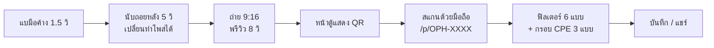
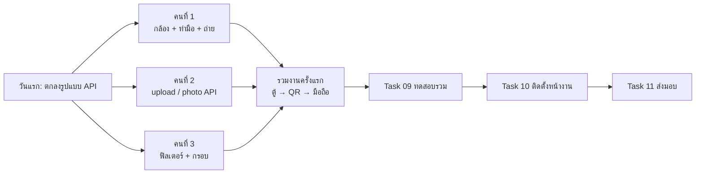

# SWU Open House — AI Photo Booth

ตู้ถ่ายรูปไร้สัมผัสสำหรับงานเปิดบ้าน ภาควิชาวิศวกรรมคอมพิวเตอร์ มศว (CPE SWU)
ผู้ร่วมงาน**แบมือหน้ากล้อง**เพื่อถ่ายรูป **สแกน QR** รับรูป แล้วแต่งฟิลเตอร์และกรอบต่อบนมือถือตัวเอง ตู้จึงว่างให้คนถัดไปได้เร็ว

| เป้าหมาย | ค่า |
|---|---|
| เวลาหน้าตู้ | ≤ 30 วินาทีต่อคน (60–80 คน/ชม.) |
| สเกลงาน | 2 วัน, 1,000–2,000 รูป |
| ค่าคลาวด์ | 0 บาท (Free Tier) |
| การส่งรูป | ดิจิทัล 100% ไม่มีเครื่องพิมพ์ |

## การทำงานของระบบ



ค่าทั้งหมดของระบบอยู่ที่ **[docs/decisions.md](docs/decisions.md)** · ไดอะแกรมละเอียดอยู่ที่ [docs/system-overview.md](docs/system-overview.md)

## สถานะโครงการ

| งาน | สถานะ |
|---|---|
| Task 00 — Discovery, PoC, งบประมาณ | ✅ เสร็จ |
| Task 01 — Requirements (BRD, PRD, SRS, NFR, RTM) | ✅ เสร็จ |
| Task 02 — Architecture & Technical Design | ✅ เสร็จ |
| Task 03–11 — Data/API, UX, PDPA, พัฒนา, ทดสอบ, ติดตั้ง | 🔲 ยังไม่เริ่ม |
| Web app (MVP) | 🚧 ขั้น 1/6 — ตั้งโปรเจกต์แล้ว |

แผนงานทั้งหมดอยู่ที่ [docs/backlog.md](docs/backlog.md)

## ทีมและการแบ่งงาน (3 คน)

แบ่งตามส่วนของระบบ ให้แต่ละคนแก้คนละโฟลเดอร์ จะได้ไม่ชนกันตอน merge

| | คนที่ 1 — หน้าตู้ (Kiosk) | คนที่ 2 — Backend & ข้อมูล | คนที่ 3 — หน้ามือถือ & UX |
|---|---|---|---|
| **ไฟล์ที่ดูแล** | `web/app/booth/`<br>`web/lib/gesture.ts`<br>`web/lib/handLandmarker.ts` | `web/app/api/`<br>`web/lib/storage.ts`<br>`web/lib/shortCode.ts` | `web/app/p/[code]/`<br>`web/lib/filters.ts`<br>`web/lib/frames.ts`<br>`web/public/frames/` |
| **งานเว็บ MVP** | ขั้น 2: กล้อง + จับท่าแบมือ<br>ขั้น 3: นับถอยหลัง, ถ่าย 9:16, พรีวิว, แสดง QR | ขั้น 3: `POST /api/upload`, `GET /api/photo/[code]`, รหัส `OPH-XXXX`<br>ขั้น 6: ลบรูปอัตโนมัติ 7 วัน, `/api/health` | ขั้น 4: ฟิลเตอร์ 6 แบบ + ความสว่าง<br>ขั้น 5: กรอบ CPE 3 แบบ + บันทึก/แชร์ |
| **Task ในเอกสาร** | Task 07 (Kiosk), Task 10 (ติดตั้งหน้างาน) | Task 03 (Data/API), Task 05 (PDPA), Task 06 (แผน+แผนทดสอบ) | Task 04 (UX/Wireframe), Task 08 (Mobile Portal), Task 11 (ส่งมอบ) |
| **หลัง MVP** | ปรับความแม่นท่ามือหน้างาน | Sync ขึ้น R2, `/find`, `/admin` | สลับภาษา TH/EN |

**งานร่วม:** Task 09 ทดสอบรวม — ทุกคนทดสอบงานของคนอื่น · ทุก PR ต้องมีอีกคนกด Approve ก่อน merge

### เริ่มได้เลย vs. ต้องรอ

**วันแรก (ทั้ง 3 คน):** ตกลงรูปแบบ API ร่วมกัน — ตู้ส่งรูปแบบไหน, API ตอบอะไรกลับ (`code`, URL รูป, สถานะ `410` เมื่อหมดอายุ) จดลง `web/README.md` เพื่อให้ทุกคนทำงานคู่ขนานได้

| งาน | ใคร | เริ่มได้เลย? | รออะไร |
|---|---|---|---|
| ขั้น 2 กล้อง + จับท่าแบมือ | 1 | ✅ เริ่มเลย | — (ใช้กล้องโน้ตบุ๊กหรือ iPad ผ่าน Camo/Iriun ได้) |
| นับถอยหลัง → ถ่าย 9:16 → พรีวิว | 1 | ✅ เริ่มต่อจากขั้น 2 | — |
| ส่งรูปขึ้น API + แสดง QR | 1 | ⏳ ทำกับ API ปลอมไปก่อน | `POST /api/upload` ของคนที่ 2 |
| รหัส `OPH-XXXX` + เก็บไฟล์ + `POST /api/upload` + `GET /api/photo` | 2 | ✅ เริ่มเลย | ข้อตกลง API วันแรก |
| ลบรูปอัตโนมัติ 7 วัน | 2 | ⏳ | ระบบเก็บไฟล์เสร็จก่อน |
| Sync ขึ้น Cloudflare R2 | 2 | ⏳ หลัง MVP | บัญชี Cloudflare + key |
| `/find`, `/admin` | 2 | ⏳ หลัง MVP | ขั้น 3 เสร็จ |
| Wireframe หน้าตู้ + หน้ามือถือ (Task 04) | 3 | ✅ เริ่มเลย | — |
| ฟิลเตอร์ 6 แบบ + ความสว่าง | 3 | ✅ เริ่มเลย (ทดสอบกับรูปตัวอย่าง) | — |
| ออกแบบไฟล์กรอบ CPE SWU 3 แบบ (PNG 9:16) | 3 | ✅ เริ่มเลย | — |
| หน้า `/p/[code]` แสดงรูปจริง | 3 | ⏳ ใช้รูปตัวอย่างไปก่อน | `GET /api/photo` ของคนที่ 2 |
| สลับภาษา TH/EN | 3 | ⏳ | หน้าจอทุกหน้านิ่งแล้ว |
| **รวมงานครั้งแรก:** ถ่ายจากตู้ → สแกน QR → เห็นรูปบนมือถือ | ทุกคน | ⏳ | ขั้น 3 ของคนที่ 1 + API ของคนที่ 2 |
| Task 09 ทดสอบรวม + ทดสอบกับคนจริง | ทุกคน | ⏳ | รวมงานครั้งแรกสำเร็จ |
| Task 10 ติดตั้งหน้างาน | 1 | ⏳ | ได้กล้อง/จอ/สถานที่จริง |
| Task 11 เอกสารส่งมอบ + อบรมสตาฟ | 3 | ⏳ ทำท้ายสุด | ระบบนิ่งแล้ว |



**กติกา Git:** ทำงานใน branch ของตัวเอง เช่น `feature/booth-camera`, `feature/api-upload`, `feature/mobile-filters` — ห้าม push ตรงเข้า `main` ให้เปิด PR แทน

## โครงสร้างโปรเจกต์

```
├── docs/                 เอกสารทั้งหมด (เริ่มที่ docs/README.md)
│   ├── decisions.md      มติล่าสุด + บันทึกการแก้ไข
│   ├── system-overview.md
│   ├── backlog.md
│   ├── task00-discovery/
│   ├── task01-requirements/
│   └── task02-architecture/
├── poc/
│   ├── test_poc.mjs          ทดสอบ logic หลัก 4 ข้อ (ท่ามือ, debounce, รหัส, PDPA)
│   └── validate_mermaid.mjs  ตรวจ syntax ไดอะแกรม Mermaid ในไฟล์ .md ทั้งหมด
└── web/                  เว็บแอป Next.js (ดู web/README.md)
```

## วิธีรัน

ต้องมี [Node.js LTS](https://nodejs.org)

**เว็บแอป**
```powershell
cd web
npm install
npm run dev
```
เปิด http://localhost:3000 — รายละเอียดใน [web/README.md](web/README.md)

**PoC และตัวตรวจไดอะแกรม** (รันจาก root)
```powershell
npm install
node poc/test_poc.mjs
node poc/validate_mermaid.mjs
```

## เทคโนโลยี

Next.js 15 + TypeScript · Google MediaPipe Hand Landmarker · HTML5 Canvas · Cloudflare R2 (แผน)
