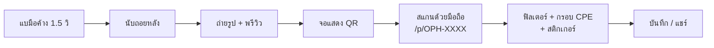

# SWU Open House — AI Photo Booth

ตู้ถ่ายรูปไร้สัมผัสสำหรับงานเปิดบ้าน ภาควิชาวิศวกรรมคอมพิวเตอร์ มศว (CPE SWU)
ผู้ร่วมงาน**แบมือหน้ากล้อง**เพื่อถ่ายรูป **สแกน QR** รับรูป แล้วแต่งฟิลเตอร์ กรอบ และสติกเกอร์ต่อบนมือถือตัวเอง



ค่าทั้งหมดของระบบอยู่ที่ [docs/decisions.md](docs/decisions.md) · ไดอะแกรมละเอียดอยู่ที่ [docs/system-overview.md](docs/system-overview.md)

---

## ⚡ วิธีใช้งานแบบรวดเร็วที่สุด (1-Click Zero-Friction Launcher)

สำหรับ Windows สามารถเริ่มใช้งานได้ทันทีโดยไม่ต้องจำคำสั่ง:

1. **ดับเบิลคลิกที่ไฟล์ `start.bat`** (อยู่ที่โฟลเดอร์หลักของโปรเจกต์)
   - สคริปต์จะตรวจสอบ Node.js
   - ปลดล็อก PowerShell Policy ให้อัตโนมัติ
   - เคลียร์ Port 3000 ที่อาจค้างอยู่จากการรันครั้งก่อน
   - ติดตั้ง dependencies และดึงโมเดล AI MediaPipe ให้อัตโนมัติหากยังไม่มี
   - เปิด Google Chrome ไปยังหน้าศูนย์รวมหน้าจอ `http://localhost:3000/launchpad` ให้ทันที!

*(หรือรันผ่าน PowerShell ด้วยคำสั่ง `.\run-booth.ps1`)*

---

## 🔄 เครื่องที่ clone ไปแล้ว: อัปเดตเป็นเวอร์ชันล่าสุด

การ clone คือการก๊อปโค้ด ณ ตอนนั้น เครื่องจะไม่อัปเดตเอง ต้องดึงของใหม่ทุกครั้งที่ทีม merge งานเข้า `main`

**วิธีง่าย (Windows):** ปิด dev server ตัวเก่า (ถ้าเปิดอยู่) แล้ว**ดับเบิลคลิก `update.bat`** สคริปต์จะทำให้ตามนี้

1. เช็กว่า clone มาจาก repo หลัก `icelandz9/swu-openhouse` ถ้าเป็น fork ของคนอื่นจะได้โค้ดเก่า
2. หยุดและบอกรายชื่อไฟล์ ถ้ามีไฟล์ที่แก้ค้างไว้ในเครื่อง จะได้ไม่ทับงานที่ยังไม่ได้ save
3. สลับไป branch `main` แล้วดึงโค้ดล่าสุด
4. รัน `npm install` ให้ เผื่อมี package ใหม่

เสร็จแล้วเปิด `start.bat` ใหม่ และกด **Ctrl+Shift+R** ในเบราว์เซอร์เพื่อล้างแคช

**วิธีพิมพ์คำสั่งเอง:**

```powershell
git remote -v              # ต้องเป็น icelandz9/swu-openhouse
git checkout main
git pull origin main
cd web
npm install
npm run dev
```

| ถ้าเจอ | แปลว่า | แก้ |
|---|---|---|
| `Your local changes would be overwritten` | มีไฟล์ที่แก้ค้างไว้ | ถ้าไม่ต้องการเก็บ ให้ `git stash` แล้ว pull ใหม่ |
| pull แล้วแต่หน้าเว็บยังเก่า | dev server ยังรันโค้ดเดิม หรือเบราว์เซอร์จำแคช | ปิด dev server (Ctrl+C) เปิดใหม่ แล้วกด Ctrl+Shift+R |
| สแกน QR แล้วยังเป็นของเก่า | QR พาไปเว็บจริงบน Vercel ไม่ใช่เครื่องตัวเอง | รอเว็บจริง deploy ใหม่ หรือตั้ง Public Domain ใน `/admin` เป็น IP ของเครื่อง |
| ค่าที่ตั้งไว้ใน `/admin` ไม่ตามมา | ค่าพวกนี้เก็บในเบราว์เซอร์แต่ละเครื่อง | ตั้งใหม่ในเครื่องนั้น |

---

## 🩺 เครื่องมือตรวจสุขภาพระบบ (Diagnostic Doctor)

ก่อนเริ่มงาน หากต้องการตรวจเช็คความพร้อมของทั้งระบบ สามารถรันคำสั่ง:

```powershell
npm run doctor
```
หรือหากต้องการสั่งซ่อมแซม เคลียร์พอร์ต และสร้างโมเดล/สติกเกอร์ใหม่อัตโนมัติ:
```powershell
npm run doctor:fix
```

---

## วิธีใช้งานผ่าน CLI (Clone / Pull & Run)

เปิด Terminal หรือ PowerShell แล้วรันคำสั่งผ่าน CLI ได้ทันที:

```powershell
# 1. ดึงโค้ดล่าสุด
git pull origin main

# 2. ติดตั้ง Dependencies (ทำเฉพาะครั้งแรก หรือเมื่อมีแพ็กเกจใหม่)
npm run setup

# 3. รันเซิร์ฟเวอร์
npm run dev
```

ระบบจะเชื่อมต่อไปยัง Cloudflare R2 ('cpe-swu-photobooth') และโดเมน Production (https://cpe-swu-openhouse.vercel.app) ให้อัตโนมัติในตัวโค้ด โดยไม่ต้องกังวลเรื่องไฟล์ .env.local ทำให้ผู้ร่วมงานที่สแกน QR Code บนมือถือเปิดดูและดาวน์โหลดรูปจาก Vercel ได้ทันที

---

## รายละเอียดคำสั่งและหน้าจอต่างๆ

ขั้นที่ 1–6 คือสิ่งที่ต้องทำเพื่อให้ตู้ใช้งานได้ ขั้นที่ 7 เป็นต้นไปทำเฉพาะเมื่อต้องการ

### ขั้นที่ 1 — ติดตั้งโปรแกรมที่ต้องใช้

| โปรแกรม | ใช้ทำอะไร | ดาวน์โหลด |
|---|---|---|
| **Node.js LTS** (20 ขึ้นไป) | รันเว็บแอป | https://nodejs.org |
| **Git** | ดาวน์โหลดโค้ด | https://git-scm.com |
| **Google Chrome** หรือ **Microsoft Edge** | เปิดหน้าตู้ (ต้องใช้กล้องและ GPU) | — |
| **เว็บแคม** | กล้องของตู้ (USB หรือกล้องในโน้ตบุ๊ก) | — |

ตรวจว่าติดตั้งสำเร็จ เปิด PowerShell แล้วรัน:

```powershell
node -v
npm -v
git --version
```

ทุกคำสั่งต้องขึ้นเลขเวอร์ชัน ถ้าขึ้นว่า "not recognized" ให้ปิดแล้วเปิด PowerShell ใหม่ หรือรีสตาร์ตเครื่อง

### ขั้นที่ 2 — ดาวน์โหลดโค้ด

```powershell
git clone https://github.com/icelandz9/swu-openhouse.git
cd swu-openhouse
```

### ขั้นที่ 3 — ติดตั้ง library ของเว็บ

ตัวเว็บอยู่ในโฟลเดอร์ `web/` **คำสั่ง npm ของเว็บต้องรันในโฟลเดอร์นี้เสมอ** ถ้ารันที่ root จะขึ้น `Missing script: "build"` หรือ `"dev"`

```powershell
cd web
npm install
```

ใช้เวลาไม่กี่นาที ต้องต่ออินเทอร์เน็ต

### ขั้นที่ 4 — ตั้งค่า (ข้ามได้ ถ้าทดสอบในเครื่องเดียว)

ถ้าไม่สร้างไฟล์ตั้งค่า ระบบจะเก็บรูปในเครื่อง (`web/data/`) และใช้ที่อยู่ที่เปิดหน้าเว็บเป็นลิงก์ใน QR ซึ่งเพียงพอสำหรับทดสอบ

ถ้าต้องการตั้งค่า ให้คัดลอกไฟล์ตัวอย่าง (ยังอยู่ในโฟลเดอร์ `web/`):

```powershell
Copy-Item .env.example .env.local
```

แล้วแก้ค่าใน `.env.local`:

| ค่า | ความหมาย |
|---|---|
| `NEXT_PUBLIC_APP_URL` | ที่อยู่เว็บที่ใส่ใน QR **ถ้าไม่มีโดเมนจริง ให้ลบค่านี้ทิ้งหรือเว้นว่าง** ค่าในไฟล์ตัวอย่างเป็นแค่ตัวอย่าง ถ้าปล่อยไว้ QR จะชี้ไปที่อยู่ที่ใช้ไม่ได้ |
| `STORAGE_DRIVER` | `local` = เก็บรูปในเครื่อง, `r2` = เก็บบน Cloudflare R2 (ดูขั้นที่ 8) |
| `R2_*` | ข้อมูลบัญชี Cloudflare R2 ใช้เมื่อ `STORAGE_DRIVER=r2` |
| `ADMIN_PIN` | ยังไม่ได้ใช้ ตอนนี้ PIN ของหน้า `/admin` คือ `1234` (เขียนไว้ในโค้ด) |

`.env.local` ไม่ขึ้น Git ใส่รหัสลับได้

### ขั้นที่ 5 — เปิดเว็บ

```powershell
npm run dev
```

- ครั้งแรกจะโหลดโมเดลจับมือของ MediaPipe (~8 MB) มาไว้ใน `public/mediapipe/` ต้องต่ออินเทอร์เน็ตแค่ครั้งแรก
- ถ้า Windows ถามสิทธิ์ Firewall ให้กด **Allow** (ทั้ง Private และ Public) ไม่อย่างนั้นมือถือจะเปิดรูปไม่ได้
- เห็นข้อความ `Ready` แล้วเปิดเบราว์เซอร์ได้เลย ปิดเซิร์ฟเวอร์ด้วย `Ctrl + C`

| หน้า | เปิดที่ | ใช้ทำอะไร |
|---|---|---|
| หน้าแรก | http://localhost:3000 | ลิงก์ไปทุกหน้า |
| จอที่ 1: ตู้ถ่ายรูป | http://localhost:3000/kiosk | หน้าจอที่ผู้ร่วมงานยืนแบมือ อนุญาตให้ใช้กล้องเมื่อเบราว์เซอร์ถาม |
| จอที่ 2: แสดงผล | http://localhost:3000/display | แสดง QR ของรูปล่าสุด และรูปทั้งหมด |
| แดชบอร์ดสตาฟ | http://localhost:3000/admin | PIN `1234` ควบคุมตู้ ลบรูป ออก QR ใหม่ |
| ค้นรูปด้วยรหัส | http://localhost:3000/find | กรอกรหัส `OPH-XXXX` เพื่อดึงรูปย้อนหลัง |

> **สำคัญ:** หน้า `/kiosk`, `/display` และ `/admin` สื่อสารกันผ่านเบราว์เซอร์ ต้องเปิด**ในเบราว์เซอร์เดียวกัน บนเครื่องเดียวกัน** (คนละแท็บหรือคนละหน้าต่างได้) ถ้าเปิดคนละเครื่องหรือคนละเบราว์เซอร์ จอจะไม่อัปเดตตามกัน

### ขั้นที่ 6 — ให้มือถือสแกน QR แล้วเปิดรูปได้

มือถือเปิด `localhost` ของคอมไม่ได้ จึงต้องให้ QR ชี้ไปที่ IP ของคอม

1. ต่อคอมตู้และมือถือเข้า **Wi-Fi วงเดียวกัน**
2. หา IP ของคอม ใน PowerShell รัน `ipconfig` แล้วดูบรรทัด `IPv4 Address` ของ Wi-Fi เช่น `192.168.1.10`
3. เปิดหน้าตู้และหน้าแสดงผล**ด้วย IP แทน localhost**:
   - `http://192.168.1.10:3000/kiosk`
   - `http://192.168.1.10:3000/display`
4. ถ่ายรูปหนึ่งรูป แล้วลองสแกน QR บนจอด้วยมือถือ ควรเปิดหน้าแต่งรูป `/p/OPH-XXXX` ได้

ถ้าสแกนแล้วเปิดไม่ได้ ดูหัวข้อ [แก้ปัญหา](#แก้ปัญหาที่พบบ่อย)

**ใช้งานผ่าน 4G/5G (ไม่ต้องต่อ Wi-Fi เดียวกัน)** ใช้ Cloudflare Tunnel สร้างลิงก์สาธารณะชั่วคราว:

1. ติดตั้ง `cloudflared`: `winget install --id Cloudflare.cloudflared`
2. เปิด PowerShell อีกหน้าต่าง (ปล่อย `npm run dev` ไว้) แล้วรัน `cloudflared tunnel --url http://localhost:3000`
3. คัดลอกลิงก์ `https://....trycloudflare.com` ที่ได้
4. เข้าหน้า `/admin` ใส่ลิงก์ในช่อง Public Domain แล้วกดบันทึก หรือใส่ใน `NEXT_PUBLIC_APP_URL` ของ `.env.local` แล้วรัน `npm run dev` ใหม่

ลิงก์ของ `trycloudflare.com` เปลี่ยนทุกครั้งที่รันใหม่ ต้องอัปเดตทุกครั้ง

### ขั้นที่ 7 — รันแบบใช้งานจริงในวันงาน

`npm run dev` ใช้ตอนพัฒนา ในวันงานให้ build แล้วรันแบบ production จะเร็วและนิ่งกว่า (ยังอยู่ในโฟลเดอร์ `web/`):

```powershell
npm run build
npm run start
```

ปิด `npm run dev` ก่อนรัน `npm run build` ถ้ารันพร้อมกัน dev server จะพัง เมื่อแก้โค้ดต้อง build ใหม่ทุกครั้ง

**เช็กลิสต์ก่อนเปิดตู้**
- [ ] คอมเสียบปลั๊ก ปิดโหมด Sleep และปิดการอัปเดตอัตโนมัติ
- [ ] เปิด `/kiosk` เต็มจอ (`F11`) บนจอที่ 1 และ `/display` เต็มจอบนจอที่ 2 ด้วย IP หรือลิงก์ tunnel
- [ ] ลองแบมือถ่าย 1 รูป แล้วสแกน QR ด้วยมือถือของตัวเอง
- [ ] เปิด `/admin` ไว้บนโน้ตบุ๊กสตาฟ (เบราว์เซอร์เดียวกับเครื่องตู้ ดูหมายเหตุในขั้นที่ 5)

### ขั้นที่ 8 — (ไม่บังคับ) เก็บรูปบน Cloudflare R2

1. สร้าง bucket และ API Token ที่ Cloudflare Dashboard → R2
2. ใส่ `R2_ACCOUNT_ID`, `R2_ACCESS_KEY_ID`, `R2_SECRET_ACCESS_KEY`, `R2_BUCKET_NAME`, `R2_PUBLIC_DOMAIN` ใน `web/.env.local` และตั้ง `STORAGE_DRIVER=r2`
3. ทดสอบการเชื่อมต่อ (รันจาก root ของ repo):
   ```powershell
   node web/scripts/test-r2-connection.mjs
   ```
4. รัน `npm run dev` ใหม่

### ขั้นที่ 9 — (ไม่บังคับ) เดโมตรวจท่ามือด้วย Python

ใช้ทดสอบกติกาท่ามือกับกล้องจริง เก็บข้อมูล และเทรนโมเดล **ตัวตู้จริงไม่ได้ใช้ส่วนนี้** ต้องมี [Python 3.13](https://www.python.org/downloads/) รันจาก root ของ repo:

```powershell
python -m venv .venv
.\.venv\Scripts\Activate.ps1
pip install -r scripts/model-training/requirements.txt
python scripts/model-training/fivepalm_shutter.py
```

รูปที่ถ่ายจะอยู่ใน `scripts/model-training/captures/` และไม่ขึ้น Git รายละเอียดอยู่ใน [scripts/model-training/README.md](scripts/model-training/README.md)

### ขั้นที่ 10 — (ไม่บังคับ) PoC และตัวตรวจไดอะแกรม

รันจาก root ของ repo (คนละ `npm install` กับของเว็บ):

```powershell
npm install
node poc/test_poc.mjs
node poc/validate_mermaid.mjs
```

---

## แก้ปัญหาที่พบบ่อย

| อาการ | สาเหตุและวิธีแก้ |
|---|---|
| `npm : File ... cannot be loaded because running scripts is disabled` | Windows ปิดกั้นการรันสคริปต์ PowerShell: ให้เปิด PowerShell แล้วรัน `Set-ExecutionPolicy -Scope CurrentUser -ExecutionPolicy RemoteSigned -Force` หรือดับเบิลคลิก `start.bat` |
| `Port 3000 is in use` / `EADDRINUSE: 3000` | มีโปรเซสค้าง: รันคำสั่ง `npm run kill-port` หรือดับเบิลคลิก `start.bat` ระบบจะเคลียร์พอร์ตให้อัตโนมัติ |
| `Failed to execute postMessage on BroadcastChannel: Channel is closed` | แก้ไขแล้วในเวอร์ชันล่าสุด (Commit `8e6a1c0`+): รัน `git pull` เพื่ออัปเดตโค้ด |
| หน้าตู้ขึ้นว่าไม่พบกล้อง | ตรวจว่าเสียบกล้องแล้ว ปิดโปรแกรมอื่นที่ใช้กล้องอยู่ (Zoom, Teams, Camera) และกดอนุญาตกล้องที่ไอคอนแม่กุญแจหน้า URL |
| กล้องเปิดได้เมื่อใช้ `localhost` แต่ใช้ IP ไม่ได้ | เบราว์เซอร์ให้ใช้กล้องเฉพาะ `localhost` หรือ `https` ให้เปิด `/kiosk` ด้วย `localhost` บนเครื่องตู้ แล้วตั้ง Public Domain ใน `/admin` เป็น IP หรือลิงก์ tunnel แทน |
| สแกน QR แล้วมือถือเปิดไม่ได้ | ตรวจว่ามือถือต่อ Wi-Fi วงเดียวกับคอม, กด Allow ใน Firewall แล้ว, และ QR ไม่ได้ชี้ไปที่ `localhost` |
| QR ชี้ไปที่โดเมนแปลก ๆ | ลบหรือแก้ `NEXT_PUBLIC_APP_URL` ใน `web/.env.local` และค่า Public Domain ใน `/admin` |
| จอแสดงผลไม่อัปเดตเมื่อถ่ายรูป | `/kiosk` กับ `/display` ต้องเปิดในเบราว์เซอร์เดียวกันบนเครื่องเดียวกัน |
| โหลดโมเดลจับมือไม่สำเร็จตอน `npm run dev` | ต่ออินเทอร์เน็ตแล้วรันใหม่ ต้องใช้เน็ตแค่ครั้งแรก |

---

## โครงสร้างโปรเจกต์

```
├── web/                  เว็บแอป Next.js (ตัวตู้จริง) — ดู web/README.md
│   ├── app/              หน้าเว็บและ API
│   ├── lib/              ตรรกะท่ามือ, สถานะตู้, ฟิลเตอร์, ที่เก็บรูป
│   ├── public/           กรอบรูป, สติกเกอร์, โลโก้
│   └── data/             รูปที่ถ่าย (สร้างอัตโนมัติ ไม่ขึ้น Git)
├── scripts/
│   ├── model-training/   เดโมตรวจท่ามือ + เก็บข้อมูลและเทรนโมเดล (Python)
│   └── frames/           สคริปต์ทำกรอบรูปจากไฟล์ของผู้ออกแบบ
├── docs/                 เอกสารทั้งหมด (เริ่มที่ docs/README.md)
├── poc/                  ชุดทดสอบช่วง PoC และตัวตรวจไดอะแกรม
└── tasks/                แผนงาน
```

## ข้อมูลส่วนบุคคล (PDPA)

รูปที่ถ่ายเป็นรูปหน้าคนจริง **ห้าม commit รูป** (`.jpg`, `.jpeg`, `.png`) ขึ้น Git `.gitignore` กันไว้แล้ว ยกเว้นกรอบรูปและสติกเกอร์ที่เป็นไฟล์ออกแบบ กติกาทั้งหมดอยู่ใน [AGENTS.md](AGENTS.md)

## เทคโนโลยี

Next.js 15 + TypeScript · Tailwind CSS · Google MediaPipe Hand Landmarker · HTML5 Canvas · Cloudflare R2 (ไม่บังคับ)
