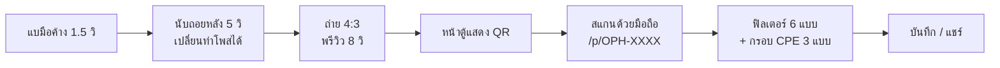
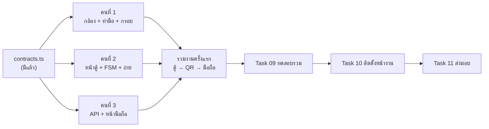

# SWU Open House — AI Photo Booth

ตู้ถ่ายรูปไร้สัมผัสสำหรับงานเปิดบ้าน ภาควิชาวิศวกรรมคอมพิวเตอร์ มศว (CPE SWU)
ผู้ร่วมงาน**แบมือหน้ากล้อง**เพื่อถ่ายรูป **สแกน QR** รับรูป แล้วแต่งฟิลเตอร์และกรอบต่อบนมือถือตัวเอง ตู้จึงว่างให้คนถัดไปได้เร็ว

| เป้าหมาย | ค่า |
|---|---|
| เวลาหน้าตู้ | ≤ 30 วินาทีต่อคน (60–80 คน/ชม.) |
| สเกลงาน | 2 วัน, 1,000–2,000 รูป |
| ค่าคลาวด์ | 0 บาท (Free Tier) |
| การส่งรูป | ดิจิทัล 100% ไม่มีเครื่องพิมพ์ |

## การทำงานของระบบ



ค่าทั้งหมดของระบบอยู่ที่ **[docs/decisions.md](docs/decisions.md)** · ไดอะแกรมละเอียดอยู่ที่ [docs/system-overview.md](docs/system-overview.md)

## สถานะโครงการ

| งาน | สถานะ |
|---|---|
| Task 00 — Discovery, PoC, งบประมาณ | ✅ เสร็จ |
| Task 01 — Requirements (BRD, PRD, SRS, NFR, RTM) | ✅ เสร็จ |
| Task 02 — Architecture & Technical Design | ✅ เสร็จ |
| Task 03–11 — Data/API, UX, PDPA, พัฒนา, ทดสอบ, ติดตั้ง | 🔲 ยังไม่เริ่ม |
| Web app (MVP) | 🚧 ขั้น 1/6 — ตั้งโปรเจกต์แล้ว |

แผนงานทั้งหมดอยู่ที่ [docs/backlog.md](docs/backlog.md)

## ทีมและการแบ่งงาน (3 คน)

แบ่งตามโฟลเดอร์ในโค้ด (ตามโครงใน PR #5) ให้แต่ละคนแก้คนละโฟลเดอร์ จะได้ไม่ชนกันตอน merge — รายละเอียดทีละ Task อยู่ที่ [docs/task02-architecture/team-execution-and-github-plan.md](docs/task02-architecture/team-execution-and-github-plan.md)

| | คนที่ 1 — AI & Vision | คนที่ 2 — หน้าตู้ (Kiosk) | คนที่ 3 — มือถือ & Backend |
|---|---|---|---|
| **โฟลเดอร์ที่ดูแล** | `web/lib/ai-vision/`<br>`web/public/templates/` (ไฟล์กรอบ) | `web/app/kiosk/`<br>`web/lib/kiosk/` | `web/app/p/` `web/app/find/` `web/app/admin/`<br>`web/app/api/`<br>`web/lib/mobile/` `web/lib/storage/` |
| **งานหลัก** | เปิดกล้อง + MediaPipe, ตรวจท่าแบมือด้วยกฎ 21 จุด (`gestureRules.ts` ไม่ต้องเทรนโมเดล), เลือกมือใกล้กล้องสุด, จับเวลาค้าง 1.5 วิ, ออกแบบกรอบ CPE SWU 3 แบบ (PNG 4:3) | State Machine ของตู้, กรอบไกด์ 4:3, นับถอยหลัง 5 วิ, แฟลช 100ms, พรีวิว 8 วิ + ถ่ายใหม่ 1 ครั้ง, ส่งรูปแล้วแสดง QR, ปุ่มแตะถ่ายสำรอง | `POST /api/photos`, `GET /api/photos/[code]`, รหัส `OPH-XXXX`, ลบรูป 7 วัน, Sync ขึ้น R2 เบื้องหลัง, หน้ามือถือ: ฟิลเตอร์ 6 แบบ + กรอบ + บันทึก/แชร์ |
| **Task ในเอกสาร** | Task 10 (ติดตั้งกล้อง/แสงหน้างาน), Task 11 (ส่งมอบ) | Task 04 (UX/Wireframe), Task 06 (แผน+แผนทดสอบ), Task 07 (Kiosk) | Task 03 (Data/API), Task 05 (PDPA), Task 08 (Mobile Portal) |
| **หลัง MVP** | ปรับค่ากฎท่ามือจากการทดสอบกับคนจริง | หน้าสตาฟบนตู้ (แตะโลโก้ 5 ครั้ง + PIN) | `/find`, `/admin`, สลับภาษา TH/EN |

**ไฟล์กลาง** `web/lib/contracts.ts` — Type และค่าคงที่ที่ทั้ง 3 คนใช้ร่วมกัน (เวลา, สถานะตู้, รูปแบบ API) ใครจะแก้ต้องบอกทีมก่อน และค่าต้องตรงกับ [docs/decisions.md](docs/decisions.md)

**งานร่วม:** Task 09 ทดสอบรวม — ทุกคนทดสอบงานของคนอื่น · ทุก PR ต้องมีอีกคนกด Approve ก่อน merge

### เริ่มได้เลย vs. ต้องรอ

| งาน | ใคร | เริ่มได้เลย? | รออะไร |
|---|---|---|---|
| เปิดกล้อง + ตรวจท่าแบมือ + วงความคืบหน้า 1.5 วิ | 1 | ✅ เริ่มเลย | — (ใช้กล้องโน้ตบุ๊กหรือ iPad ผ่าน Camo/Iriun ได้) |
| ออกแบบไฟล์กรอบ CPE SWU 3 แบบ (PNG 4:3) | 1 | ✅ เริ่มเลย | — |
| State Machine + นับถอยหลัง + แฟลช + พรีวิว + ตัดภาพ 4:3 | 2 | ✅ เริ่มเลย (กดปุ่มแทนท่ามือไปก่อน) | — |
| ต่อท่ามือเข้ากับหน้าตู้ | 2 | ⏳ | Hook `useGestureTrigger` ของคนที่ 1 |
| ส่งรูปแล้วแสดง QR | 2 | ⏳ ใช้ API ปลอมไปก่อน | `POST /api/photos` ของคนที่ 3 |
| `POST /api/photos` + `GET /api/photos/[code]` + รหัส `OPH-XXXX` | 3 | ✅ เริ่มเลย (มีโครงแล้ว) | — |
| ฟิลเตอร์ 6 แบบ + ความสว่าง บนหน้า `/p/[code]` | 3 | ✅ เริ่มเลย (ทดสอบกับรูปตัวอย่าง) | — |
| ซ้อนกรอบ + บันทึก/แชร์ | 3 | ⏳ วาดกรอบด้วยโค้ดไปก่อน | ไฟล์กรอบ PNG ของคนที่ 1 |
| ลบรูปอัตโนมัติ 7 วัน | 3 | ⏳ | ระบบเก็บไฟล์เสร็จก่อน |
| Sync ขึ้น Cloudflare R2 | 3 | ⏳ หลัง MVP | บัญชี Cloudflare + key |
| **รวมงานครั้งแรก:** แบมือ → ถ่าย → สแกน QR → เห็นรูปบนมือถือ | ทุกคน | ⏳ | งานของทั้ง 3 คนข้างบน |
| Task 09 ทดสอบรวม + ทดสอบกับคนจริง | ทุกคน | ⏳ | รวมงานครั้งแรกสำเร็จ |
| Task 10 ติดตั้งหน้างาน | 1 | ⏳ | ได้กล้อง/จอ/สถานที่จริง |
| Task 11 เอกสารส่งมอบ + อบรมสตาฟ | 1 | ⏳ ทำท้ายสุด | ระบบนิ่งแล้ว |



**กติกา Git:** ทำงานใน branch ของตัวเอง เช่น `feat/dev1-vision-engine`, `feat/dev2-kiosk-page`, `feat/dev3-api-and-mobile` — ห้าม push ตรงเข้า `main` ให้เปิด PR แทน และใช้ `git commit -m "ข้อความ"` ทุกครั้ง

## โครงสร้างโปรเจกต์

```
├── docs/                 เอกสารทั้งหมด (เริ่มที่ docs/README.md)
│   ├── decisions.md      มติล่าสุด + บันทึกการแก้ไข
│   ├── system-overview.md
│   ├── backlog.md
│   ├── task00-discovery/
│   ├── task01-requirements/
│   └── task02-architecture/
├── poc/
│   ├── test_poc.mjs          ทดสอบ logic หลัก 4 ข้อ (ท่ามือ, debounce, รหัส, PDPA)
│   └── validate_mermaid.mjs  ตรวจ syntax ไดอะแกรม Mermaid ในไฟล์ .md ทั้งหมด
└── web/                  เว็บแอป Next.js (ดู web/README.md)
```

## วิธีรัน

ต้องมี [Node.js LTS](https://nodejs.org)

**เว็บแอป**
```powershell
cd web
npm install
npm run dev
```
เปิด http://localhost:3000 — รายละเอียดใน [web/README.md](web/README.md)

**PoC และตัวตรวจไดอะแกรม** (รันจาก root)
```powershell
npm install
node poc/test_poc.mjs
node poc/validate_mermaid.mjs
```

## เทคโนโลยี

Next.js 15 + TypeScript · Google MediaPipe Hand Landmarker · HTML5 Canvas · Cloudflare R2 (แผน)
