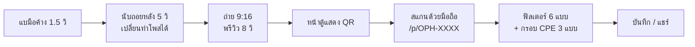

# SWU Open House — AI Photo Booth

ตู้ถ่ายรูปไร้สัมผัสสำหรับงานเปิดบ้าน ภาควิชาวิศวกรรมคอมพิวเตอร์ มศว (CPE SWU)
ผู้ร่วมงาน**แบมือหน้ากล้อง**เพื่อถ่ายรูป **สแกน QR** รับรูป แล้วแต่งฟิลเตอร์และกรอบต่อบนมือถือตัวเอง ตู้จึงว่างให้คนถัดไปได้เร็ว

| เป้าหมาย | ค่า |
|---|---|
| เวลาหน้าตู้ | ≤ 30 วินาทีต่อคน (60–80 คน/ชม.) |
| สเกลงาน | 2 วัน, 1,000–2,000 รูป |
| ค่าคลาวด์ | 0 บาท (Free Tier) |
| การส่งรูป | ดิจิทัล 100% ไม่มีเครื่องพิมพ์ |

## การทำงานของระบบ



ค่าทั้งหมดของระบบอยู่ที่ **[docs/decisions.md](docs/decisions.md)** · ไดอะแกรมละเอียดอยู่ที่ [docs/system-overview.md](docs/system-overview.md)

## สถานะโครงการ

| งาน | สถานะ |
|---|---|
| Task 00 — Discovery, PoC, งบประมาณ | ✅ เสร็จ |
| Task 01 — Requirements (BRD, PRD, SRS, NFR, RTM) | ✅ เสร็จ |
| Task 02 — Architecture & Technical Design | ✅ เสร็จ |
| Task 03–11 — Data/API, UX, PDPA, พัฒนา, ทดสอบ, ติดตั้ง | 🔲 ยังไม่เริ่ม |
| Web app (MVP) | 🚧 ขั้น 1/6 — ตั้งโปรเจกต์แล้ว |

แผนงานทั้งหมดอยู่ที่ [docs/backlog.md](docs/backlog.md)

## โครงสร้างโปรเจกต์

```
├── docs/                 เอกสารทั้งหมด (เริ่มที่ docs/README.md)
│   ├── decisions.md      มติล่าสุด + บันทึกการแก้ไข
│   ├── system-overview.md
│   ├── backlog.md
│   ├── task00-discovery/
│   ├── task01-requirements/
│   └── task02-architecture/
├── poc/
│   ├── test_poc.mjs          ทดสอบ logic หลัก 4 ข้อ (ท่ามือ, debounce, รหัส, PDPA)
│   └── validate_mermaid.mjs  ตรวจ syntax ไดอะแกรม Mermaid ในไฟล์ .md ทั้งหมด
└── web/                  เว็บแอป Next.js (ดู web/README.md)
```

## วิธีรัน

ต้องมี [Node.js LTS](https://nodejs.org)

**เว็บแอป**
```powershell
cd web
npm install
npm run dev
```
เปิด http://localhost:3000 — รายละเอียดใน [web/README.md](web/README.md)

**PoC และตัวตรวจไดอะแกรม** (รันจาก root)
```powershell
npm install
node poc/test_poc.mjs
node poc/validate_mermaid.mjs
```

## เทคโนโลยี

Next.js 15 + TypeScript · Google MediaPipe Hand Landmarker · HTML5 Canvas · Cloudflare R2 (แผน)
