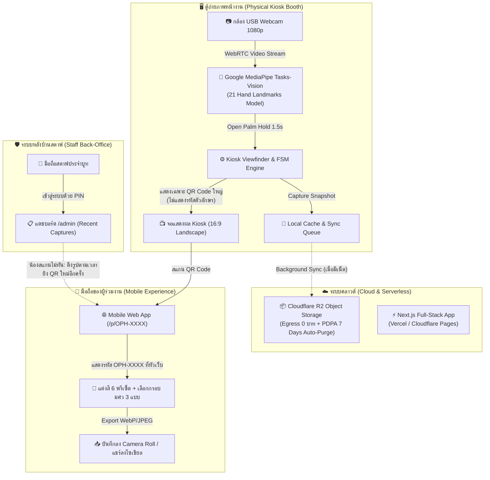
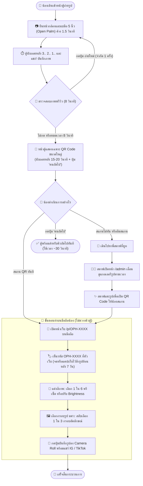

# SWU Open House - AI Photo Booth 📸✨
> ระบบตู้ถ่ายภาพอัจฉริยะแบบไร้สัมผัส (Touchless AI Photo Booth) สำหรับงานเปิดบ้าน มศว (SWU Open House)

---

## 🎯 1. Concept & วัตถุประสงค์โครงการ (Why We Build This)

* 🖐️ **Touchless AI Interaction**: ถ่ายภาพด้วยท่าทางมือ (MediaPipe Hand Keypoints 21 จุด บน WebGL 60 FPS) ทันสมัยและถูกสุขอนามัย
* ⚡ **Queue Optimization (<= 30 วิ/คน)**: หน้าตู้ทำหน้าที่ถ่ายภาพเท่านั้น แล้วแสดงเฉพาะ QR Code ขนาดใหญ่ทันที ผู้ใช้นำมือถือมาสแกนไปแต่งสีและเลือกกรอบรูปบนมือถือตัวเอง คิวหน้าตู้จึงไหลลื่นไม่ติดขัด
* 🏷️ **OPH Short Code & Staff QR Recovery**: รหัส `OPH-XXXX` จะแสดงบนหัวเว็บมือถือให้น้องบันทึกไว้ และมีระบบหลังบ้านสตาฟ (`/admin`) ดู Timeline รูปถ่ายล่าสุดเพื่อยิง QR ให้น้องย้อนหลังได้ทันทีหากสแกนไม่ทัน
* 💸 **0 THB Cloud Infrastructure**: ประมวลผลบน Client-side ทั้งหมด + จัดเก็บภาพบน Cloudflare R2 (ฟรีค่า Egress) พร้อมระบบลบภาพอัตโนมัติ 7 วันตามมาตรฐาน PDPA

---

## 🏗️ 2. ภาพรวมสถาปัตยกรรมระบบ (System Architecture)

---

## 🔄 3. แผนผังการทำงานตั้งแต่เริ่มถ่ายจนได้รูป (End-to-End Workflow)

---

## 💻 4. ข้อมูลทางเทคนิคหลัก (Key Tech Stack)

| ส่วนประกอบ (Component) | เทคโนโลยีที่เลือกใช้ (Technology Stack) | เหตุผลและจุดเด่น (Key Rationale) |
| :--- | :--- | :--- |
| **Frontend Framework** | **Next.js 14+ (App Router, TypeScript)** | พัฒนาแบบ Monorepo รองรับทั้งหน้าตู้ Kiosk, มือถือ และระบบสตาฟ |
| **Computer Vision Engine** | **Google MediaPipe Tasks-Vision** | ตรวจจับพิกัดมือ 21 จุด บน WebGL แบบเรียลไทม์ 60 FPS บน Client 100% |
| **Object Storage** | **Cloudflare R2 (S3-Compatible)** | Egress Bandwidth 0 บาท พร้อม Lifecycle Rule ลบภาพทิ้งอัตโนมัติ 7 วัน (PDPA) |
| **Client Compositor** | **HTML5 Canvas 2D API** | ซ้อนเลเยอร์ภาพถ่าย ฟิลเตอร์สี และกรอบ PNG ความละเอียดสูงบนเครื่องผู้ใช้ |
| **Staff Back-Office** | **Next.js Server Actions + PIN Protection** | สตาฟเข้าจัดการตู้และออก QR ย้อนหลังได้สะดวกรวดเร็วจากมือถือ |

---

## 📂 5. สารบัญเอกสารโครงการ (Documentation Index)

เอกสารฉบับเต็มและมาตรฐานทางวิศวกรรมทั้งหมดถูกจัดเก็บอยู่ในโฟลเดอร์ `ducument-sathit/`:

* 📁 **[ducument-sathit/TASK_BACKLOG.md](ducument-sathit/TASK_BACKLOG.md)**: แผนผังความคืบหน้าภาพรวม 12 Tasks ของโครงการ
* 📁 **[ducument-sathit/task00/](ducument-sathit/task00/)**: เอกสารการค้นพบความต้องการ, ผลทดสอบ PoC 4/4 และสถาปัตยกรรมต้นทุน 0 บาท
* 📁 **[ducument-sathit/task01/](ducument-sathit/task01/)**: เอกสารข้อกำหนดความต้องการ (BRD, PRD, SRS/IEEE 830, NFR, RTM) และสถาปัตยกรรมระบบ C4 Model + 6 Sequence Diagrams
