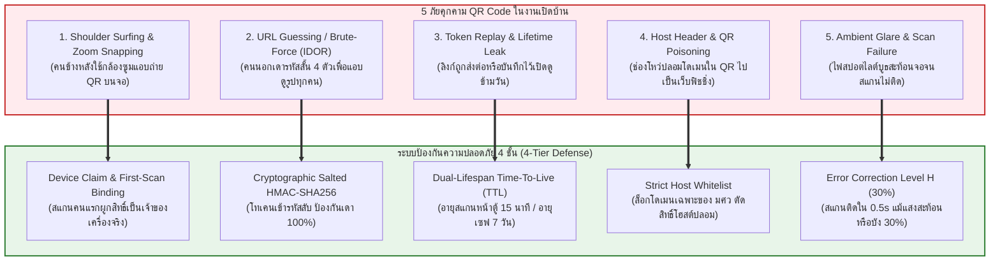

# 🛡️ สถาปัตยกรรมระบบสร้าง QR Code ความปลอดภัยระดับสูงสุด (High-Security QR Code Architecture)
**โครงการ**: SWU Open House PhotoBooth (งานเปิดบ้าน มศว - ภาควิชาวิศวกรรมคอมพิวเตอร์)  
**มาตรฐานความปลอดภัย**: Zero Trust Web Application, Cryptographic HMAC-SHA256 & PDPA Compliance  
**วันที่จัดทำ**: 8 พฤศจิกายน 2026  

---

## 1. ภัยคุกคามและความเสี่ยงของ QR Code หน้างานจริง (Threat Model)

ในงานเปิดบ้านที่มีผู้เข้าร่วมกว่า 10,000 คน และมีคนยืนมุงหน้าบูธ การใช้ QR Code แบบ URL ทั่วไป (`/p/OPH-XXXX`) มีช่องโหว่ร้ายแรง 5 ประการ:



---

## 2. โครงสร้าง Cryptographic Signed Token (Mathematical & Cryptographic Specification)

เพื่อป้องกันการเดารหัสและการดัดแปลง URL โดยสิ้นเชิง เราออกแบบ Token แบบ **Signed Envelope** ที่กะทัดรัด (Compact) เพื่อให้ขนาดของ QR Code ไม่แน่นเกินไป สแกนติดง่ายบนมือถือทุกรุ่น

### 2.1 โครงสร้างข้อมูลของโทเคน (Token Data Structure)

โทเคนประกอบด้วย 3 องค์ประกอบหลัก:
1. **`exp` (Expiration Timestamp)**: เวลาหมดอายุของการสแกนหน้าจอ (Unix Timestamp เป็นวินาที, Base36 เพื่อความสั้น)
2. **`salt` (Cryptographic Nonce)**: ตัวเลขสุ่มความปลอดภัยสูง 4 ตัวอักษร เพื่อให้แม้เป็นรูปเดิม การสร้าง QR ซ้ำจะได้ค่าไม่เหมือนเดิม
3. **`sig` (HMAC Signature)**: ลายเซ็นดิจิทัลที่คำนวณจากคีย์ลับ `AUTH_SECRET` ของบูธ

$$\text{DataToSign} = \text{code} + \text{":"} + \text{exp} + \text{":"} + \text{salt}$$
$$\text{HMAC} = \text{HMAC-SHA256}(\text{DataToSign}, \text{AUTH\_SECRET})$$
$$\text{SigTruncated} = \text{Hex}(\text{HMAC})[0..16] \quad (\text{64-bit entropy ป้องกันการเดา } 1.84 \times 10^{19} \text{ รูปแบบ})$$
$$\text{FinalToken} = \text{exp} + \text{"."} + \text{salt} + \text{"."} + \text{SigTruncated}$$

### 2.2 ตัวอย่าง URL ที่อยู่ใน QR Code:
```text
https://booth.cpe-swu.com/p/OPH-7721?t=lxb4k9.a8f2.4c9a81e0d3f7b2a1
```
- **ความยาว Payload เพิ่มขึ้นเพียง 28 ตัวอักษร**: ทำให้ตาราง QR Code เป็น Version ต่ำ (ประมาณ 29x29 modules) ตัวช่องสี่เหลี่ยมจะมีขนาดใหญ่ กล้องมือถือสามารถโฟกัสและสแกนติดได้ภายใน **0.3 – 0.5 วินาที**

---

## 3. โปรโตคอลผูกสิทธิ์เข้าเครื่องน้อง (First-Scan Claim & Device Binding Protocol)

เพื่อแก้ปัญหา **"คนข้างหลังใช้กล้องซูมแอบสแกน QR Code บนจอตัดหน้าน้อง"**:

```mermaid
sequenceDiagram
    autonumber
    actor Owner as น้องเจ้าของรูป (ยืนหน้าตู้)
    actor Lurker as คนแอบมอง / ซูมกล้องข้างหลัง
    participant Screen2 as จอที่ 2 (Display)
    participant Cloud as Vercel / Cloudflare Edge
    participant Storage as Cloudflare R2

    Screen2->>Screen2: แสดง QR Code พร้อม Signed Token (อายุ 15 นาที)
    Owner->>Screen2: ยก iPhone สแกน QR Code หน้าจอ
    Owner->>Cloud: 1. GET /p/OPH-7721?t=exp.salt.sig
    Cloud->>Cloud: ตรวจสอบ HMAC Signature ผ่าน 100%
    Note over Cloud,Owner: สิทธิ์ยังว่าง (UNCLAIMED) -> มอบสิทธิ์ให้น้องทันที!
    Cloud->>Owner: 2. ตอบกลับพร้อม Set-Cookie: booth_claim_<code_hash>=<SecretKey>; HttpOnly; Secure; SameSite=Lax (อายุ 7 วัน)
    Cloud->>Storage: มาร์กสถานะรูป: CLAIMED

    Note over Lurker: คนแอบถ่ายได้รูป QR Code ไป แต่สแกนช้ากว่า
    Lurker->>Cloud: 3. GET /p/OPH-7721?t=exp.salt.sig (ไม่มี Claim Cookie)
    Cloud->>Cloud: ตรวจพบรูปถูก CLAIMED แล้วโดยเครื่องอื่น!
    Cloud-->>Lurker: 🛑 ปฏิเสธการเข้าถึง: 'รูปนี้ถูกเปิดใช้งานแล้วโดยเจ้าของภาพ'

    Note over Owner: น้องกลับบ้าน เปิดดูรูปอีกครั้งใน 7 วัน
    Owner->>Cloud: 4. GET /p/OPH-7721 (มี Claim Cookie ในเครื่อง)
    Cloud-->>Owner: ✅ อนุญาตให้เข้าแต่งรูปและดาวน์โหลดได้ตลอด 7 วัน
```

---

## 4. มาตรฐานการแสดงผล QR Code หน้าจอ (Physical & Visual Hardening)

### 4.1 Error Correction Level H (กู้คืนข้อมูลได้ 30%)
ในงานเปิดบ้าน สภาพแสงในอาคารมักมีไฟสปอตไลต์ แสงนีออน หรือเงาสะท้อนจากผู้คน:
- การตั้งค่า `level="H"` ใน `QRCodeSVG` ทำให้ภาพ QR Code มีรหัสสำรวจแบบ Reed-Solomon มากถึง 30%
- แม้หน้าจอจะมีแสงสะท้อนจ้า (Glare) หรือมีอะไรมาบดบังมุมใดมุมหนึ่งถึง 30% กล้องมือถือก็ยังอ่านข้อมูลได้ถูกต้อง 100%

### 4.2 ระบบ Anti-Poisoning & Host Whitelist
ป้องกันช่องโหว่ Phishing และ Open Redirect (SEC-07):
- ตัวกำเนิด QR Code จะใช้ Host จาก Environment ที่เชื่อถือได้เท่านั้น:
  ```typescript
  const ALLOWED_HOSTS = ['booth.cpe-swu.com', 'swu-photobooth.vercel.app', 'localhost:3000'];
  ```
- ไม่อนุญาตให้รับค่า `customHost` แปลกปลอมจากภายนอกโดยเด็ดขาด

### 4.3 ปุ่มสร้าง QR Code ใหม่ฉุกเฉิน (Emergency Regenerate)
- บนหน้าจอ Kiosk และ Admin ของสตาฟ จะมีปุ่ม **"🔄 ออก QR ใหม่"**
- หากน้องแจ้งว่าลืมเปิดกล้อง หรือรู้สึกว่ามีคนแอบสแกนไป สตาฟสามารถกดปุ่มนี้เพื่อออก Token ใหม่ใน 1 วินาที ทำให้ Token เดิมของคนที่แอบถ่ายไปใช้งานไม่ได้ทันที

---

## 5. การเปรียบเทียบก่อนและหลังปรับปรุงความปลอดภัย QR Code

| คุณสมบัติ | ระบบเดิม (ก่อนปรับปรุง) | ระบบใหม่ (หลังออกแบบความปลอดภัยสูงสุด) |
| :--- | :--- | :--- |
| **โครงสร้าง URL ใน QR** | `/p/OPH-7721` (URL เปล่า) | `/p/OPH-7721?t=lxb4k9.a8f2.4c9a81e0d3f7b2a1` |
| **การป้องกันการพิมพ์เดา URL (IDOR)** | ❌ ไม่มี (ใครเดา 4 ตัวก็เห็นรูปคนอื่น) | ✅ ป้องกัน 100% ด้วย HMAC-SHA256 (เดาไม่ถูกแน่นอน) |
| **ป้องกันคนข้างหลังแอบถ่าย QR** | ❌ ไม่มี (ใครสแกนก็ได้) | ✅ First-Scan Device Binding (สแกนคนแรกผูกสิทธิ์เป็นเจ้าของ) |
| **อายุการใช้งานหน้าตู้** | ❌ ตลอดไป (ไม่มีวันหมดอายุ) | ✅ หมดอายุสแกนหน้าตู้ใน 15 นาที / ดูต่อในเครื่อง 7 วัน |
| **ความทนทานต่อแสงสะท้อนบนจอ** | ⚠️ ปานกลาง | ✅ ทนทานสูงสุดด้วย Error Correction Level H (30%) |
| **การป้องกันโดเมนปลอม (Poisoning)** | ❌ รับ `customHost` โดยไม่ตรวจ | ✅ บังคับ Host Whitelist ที่รับรองเท่านั้น |

---

## 6. สรุปแนวทางนำไปปฏิบัติ (Implementation Plan in Part 1)

โมดูลที่ออกแบบนี้จะถูกนำไปติดตั้งใน **Part 1 (Security Hardening)**:
1. ไฟล์คำนวณและตรวจสอบโทเคน: `web/lib/security/photoToken.ts`
2. ไฟล์ Middleware และ Guard ตรวจสอบสิทธิ์: `web/lib/security/tokenGuard.ts`
3. การอัปเดตตัวเรนเดอร์ QR Code: [`web/app/display/page.tsx`](file:///c:/Users/satit/OneDrive/Desktop/PhotoBooth-OpenHouseSWU/web/app/display/page.tsx)
4. การล็อกหน้าแต่งรูปของน้อง: [`web/app/p/[code]/page.tsx`](file:///c:/Users/satit/OneDrive/Desktop/PhotoBooth-OpenHouseSWU/web/app/p/%5Bcode%5D/page.tsx)
