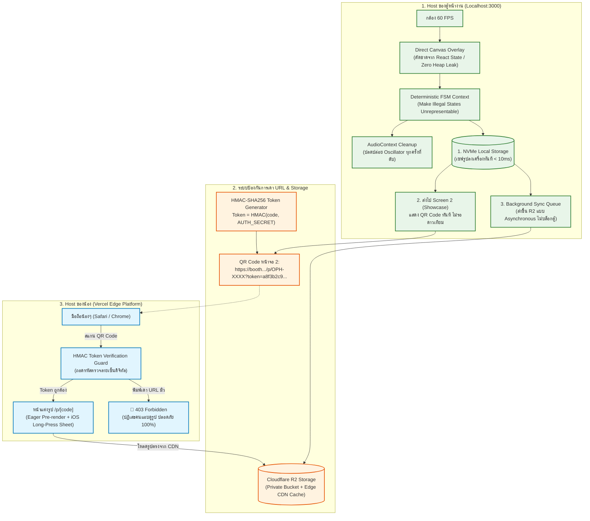
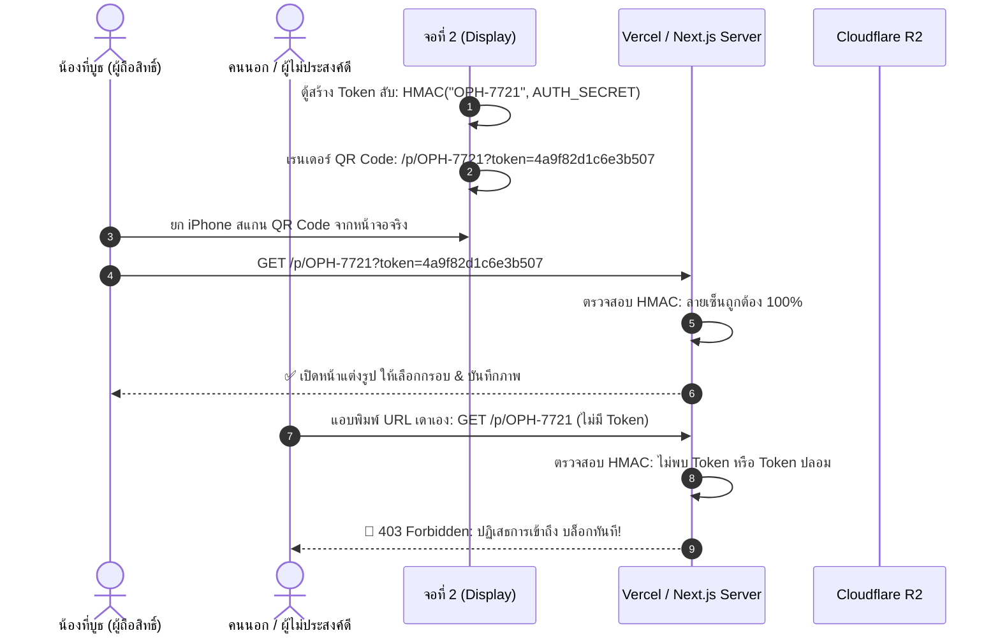
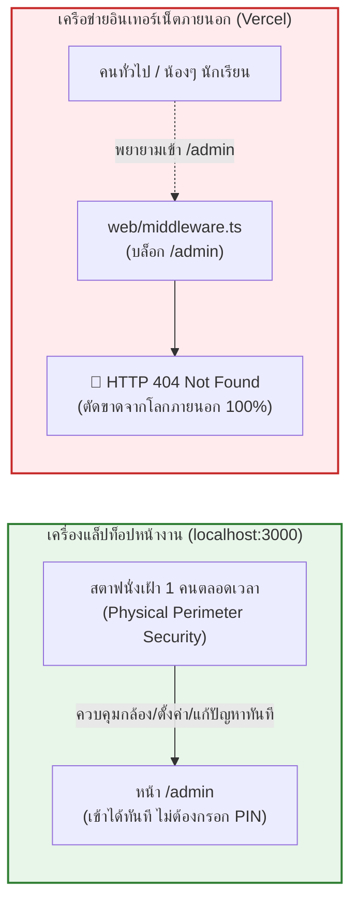

# 🛠️ แผนแม่บทการแก้ไขและขั้นตอนดำเนินการทีละก้าว (Remediation & SBS Master Plan)
**โครงการ**: SWU Open House PhotoBooth (งานเปิดบ้าน มศว - ภาควิชาวิศวกรรมคอมพิวเตอร์)  
**ระเบียบวิธีวิจัย**: 4-Lens Unified Audit Framework  
**วันที่จัดทำ**: 8 พฤศจิกายน 2026  
**ข้อตกลงสำคัญ**: 🛑 **ยังไม่ Deploy ขึ้น Vercel และรอการยืนยันอนุมัติทีละส่วน (Part-by-Part) ก่อนเริ่มลงมือเขียนโค้ดจริง**

---

## 1. การออกแบบสถาปัตยกรรมเป้าหมายที่ปลอดภัยและทนทาน (Target Architecture)

---

## 2. การออกแบบการเข้ารหัสป้องกันการเดา URL (HMAC Signed Token Design)

### 2.1 ปัญหาเดิม (ทำไมต้องแก้?)
เดิมระบบใช้รหัสสั้น 4 ตัว เช่น `OPH-7721` สุ่มด้วย `Math.random()` และลิงก์คือ `https://booth.cpe-swu.com/p/OPH-7721`  
ใครก็ตามที่เปิดดูหน้าเว็บแล้วลองเปลี่ยนเลขท้ายเป็น `OPH-7722`, `OPH-7723` หรือเขียนบอทยิงหา ก็จะเปิดดูรูปคนอื่นได้ทั้งหมด ถือเป็นการละเมิด PDPA ร้ายแรง

### 2.2 โซลูชัน: Cryptographic HMAC-SHA256 Signed Token
เราจะนำแนวคิด **Signed URLs** แบบเดียวกับ Cloudflare และ AWS S3 มาใช้:
1. เมื่อตู้ถ่ายรูปเสร็จ ระบบจะนำรหัสรูป เช่น `OPH-7721` มาทำ Hash ร่วมกับคีย์ลับ `AUTH_SECRET` ประจำบูธ:
   $$\text{Signature} = \text{HMAC-SHA256}(\text{"OPH-7721"}, \text{AUTH\_SECRET})$$
   $$\text{Token} = \text{Hex}(\text{Signature})[0..16] \quad (\text{16 ตัวอักษร Hex ปลอดภัยระดับสูง})$$
2. QR Code ที่แสดงบน จอที่ 2 (Showcase) จะมีหน้าตาดังนี้:
   `https://booth.cpe-swu.com/p/OPH-7721?token=4a9f82d1c6e3b507`
3. **การตรวจสอบเมื่อเปิดหน้าเว็บ**:
   - เมื่อน้องสแกน QR Code เข้ามา เบราว์เซอร์จะส่ง `token` แนบมาด้วย
   - ตัวเซิร์ฟเวอร์จะคำนวณ HMAC จากรหัส `OPH-7721` ซ้ำอีกครั้ง แล้วเทียบด้วยฟังก์ชัน `crypto.timingSafeEqual` (เพื่อป้องกัน Timing Attack)
   - **กรณีผ่าน**: เปิดหน้าแต่งรูปให้ทันที น้องโหลดรูปได้ตามปกติ
   - **กรณีพิมพ์ URL เข้ามาตรงๆ หรือเดารหัสเอง**: จะไม่มี `token` หรือ `token` ไม่ตรง ระบบจะตอบกลับด้วยหน้า **403 Forbidden** สีสันสวยงาม แจ้งว่า:
     > *"⚠️ เข้าถึงรูปภาพไม่ได้: กรุณาสแกน QR Code จากหน้าจอแสดงผลประจำบูธวิศวกรรมคอมพิวเตอร์เท่านั้น เพื่อปกป้องความเป็นส่วนตัวของเจ้าของภาพ"*

---

### 2.3 การปรับแผนปลด Admin PIN หน้าเครื่อง (Dedicated Onsite Operator Policy)
ตามที่ผู้ใช้มีคำสั่ง: **"จะเอา PIN สำหรับ Admin ออก เพราะมีคนคุมตลอดคนเดียว"**

#### เหตุผลและข้อได้เปรียบทางวิศวกรรม:
1. **Zero Operational Friction**: สตาฟไม่ต้องคอยพิมพ์ PIN 4-6 หลักซ้ำๆ เมื่อเซสชันหลุดในขณะที่น้องๆ ต่อยาว ช่วยให้สามารถกดดูรูป, สั่งถ่ายซ้ำ หรือปรับตั้งค่ากล้องได้ทันทีใน 1 คลิก
2. **ความปลอดภัยไม่ลดลง (Defense-in-Depth)**:
   - **บนคลาวด์ Vercel**: มี `web/middleware.ts` บล็อกเส้นทาง `/admin` เป็น 404 Not Found อย่างเด็ดขาด คนภายนอกไม่มีทางเปิดหน้า Admin ได้จากอินเทอร์เน็ต
   - **บนเครื่อง Local**: ความปลอดภัยควบคุมโดย **Physical Security** (มีสตาฟนั่งเฝ้าหน้าจอ 100%)
3. **ขจัดความเสี่ยงเรื่อง PIN รั่วไหลถาวร**:
   - ไม่ต้องมี `ADMIN_PIN` หรือ `NEXT_PUBLIC_ADMIN_PIN` ในไฟล์คอนฟิกอีกต่อไป หมดกังวลเรื่องคีย์หลุดไปกับ Client Bundle

---

## 3. แผนขั้นตอนการปฏิบัติทีละก้าว (Step-by-Step Implementation Roadmap)

ตามข้อตกลงกับผู้ใช้: **"การแก้ไข ให้รอการยืนยันแต่ละส่วน"**  
แผนงานถูกซอยย่อยออกเป็น **5 ส่วน (Part 1 - Part 5)** เพื่อให้ผู้ใช้สามารถตรวจสอบความถูกต้องและสั่งอนุมัติทีละส่วนได้อย่างปลอดภัย:

---

### 🔹 Part 1: ยกระดับความปลอดภัย QR Code & ปิดช่องโหว่เดา URL (High-Security QR Protocol)
> **เป้าหมาย**: อุดช่องโหว่ IDOR ป้องกันการเดา URL สุ่มดูรูปคนอื่น ติดตั้งระบบผูกสิทธิ์เข้าเครื่องน้อง (First-Scan Device Binding) และปลดล็อกหน้า Admin ให้สตาฟทำงานได้คล่องตัวที่สุด (อ้างอิงข้อกำหนดทางเทคนิคฉบับเต็มที่ [**`docs/QR_CODE_SECURITY_ARCHITECTURE.md`**](file:///c:/Users/satit/OneDrive/Desktop/PhotoBooth-OpenHouseSWU/docs/QR_CODE_SECURITY_ARCHITECTURE.md))

- **Step 1.1**: สร้าง Cryptographic Token Engine: `web/lib/security/photoToken.ts`
  - สร้าง Token แบบ Salted Envelope: `exp.salt.sig` คำนวณด้วย HMAC-SHA256
  - ตรวจสอบด้วย `crypto.timingSafeEqual` และเช็ค Expiration Timestamp
- **Step 1.2**: อัปเดตการสร้าง QR Code บนหน้าตู้และจอที่ 2 (Display):
  - แก้ไข [`web/app/api/photos/route.ts`](file:///c:/Users/satit/OneDrive/Desktop/PhotoBooth-OpenHouseSWU/web/app/api/photos/route.ts) ให้ส่งคืน `token` และ URL ที่เข้ารหัสเรียบร้อย
  - แก้ไข [`web/app/display/page.tsx`](file:///c:/Users/satit/OneDrive/Desktop/PhotoBooth-OpenHouseSWU/web/app/display/page.tsx) ให้เรนเดอร์ QR Code ด้วย `level="H"` (ทนทานแสงสะท้อน 30%) และใช้ Host Whitelist
- **Step 1.3**: ติดตั้ง First-Scan Claim Guard ในหน้าของน้อง:
  - แก้ไข [`web/app/p/[code]/page.tsx`](file:///c:/Users/satit/OneDrive/Desktop/PhotoBooth-OpenHouseSWU/web/app/p/%5Bcode%5D/page.tsx) ให้สแกนครั้งแรกผูก Secure Cookie เข้าเครื่องน้องทันที
  - ป้องกันคนข้างหลังใช้กล้องซูมแอบถ่าย QR ตัดหน้าน้อง หากไม่มีสิทธิ์จะถูกตอบกลับด้วย 403 Forbidden
- **Step 1.4**: ปลดล็อกระบบ Admin & เคลียร์ Secret ส่วนเกิน:
  - ถอด `StaffGate` ออกจาก [`web/app/admin/page.tsx`](file:///c:/Users/satit/OneDrive/Desktop/PhotoBooth-OpenHouseSWU/web/app/admin/page.tsx) เพื่อให้สตาฟหน้าเครื่องเข้าใช้งานได้ทันทีโดยไม่ต้องใส่ PIN
  - ลบตัวแปร `ADMIN_PIN` และ `NEXT_PUBLIC_ADMIN_PIN` ออกจาก `web/.env.local`
  - เพิ่ม `.env*.local` และ `.env` ลงใน `web/.gitignore`
- **เกณฑ์การตรวจรับ (DoD Part 1)**:
  - สแกน QR ผ่าน URL มี Token เปิดดูรูปได้ปกติ และตัวเครื่องได้รับ Claim Cookie
  - พิมพ์ URL เดารหัสโดยไม่มี Token หรือใช้ Token ปลอม ระบบต้องขึ้น 403 Forbidden บล็อกทันที
  - คนอื่นที่แอบถ่าย QR ไปสแกนทีหลังจะไม่สามารถเปิดดูได้ (Device Binding Guard)
  - เปิดเข้า `http://localhost:3000/admin` ได้ทันทีโดยไม่ต้องกรอก PIN และทำงานได้คล่องตัว
  - หน้า `/admin` บน Vercel ยังคงถูกบล็อก 404 Not Found 100% ปลอดภัยจากคนภายนอก

---

### 🔹 Part 2: ป้องกันตู้ค้าง & ดับกลางคันในการทำงาน 8 ชม. (Kiosk 8-Hour Resilience)
> **เป้าหมาย**: ปลดภาระ 60 FPS Re-render Loop ใน React และแก้ปัญหา Memory Leak ใน Audio / Storage

- **Step 2.1**: แยกการวาดแลนด์มาร์กมือ (Direct Canvas Overlay):
  - แยกการวาดจุดโครงกระดูกฝ่ามือ และตัวแสดงเปอร์เซ็นต์การถือค้าง ออกจาก React State
  - สั่งวาดตรงลงบน `<canvas id="hand-overlay">` ภายใน `requestAnimationFrame` โดยตรง ไม่สั่ง `setState` ทุกเฟรม
- **Step 2.2**: แก้ไข AudioContext Memory Leak:
  - ผูกฟังก์ชัน `osc.onended = () => { osc.disconnect(); gain.disconnect(); }` เพื่อคืนหน่วยความจำ WebAudio Engine ทุกครั้งที่เสียงปี๊บจบ
- **Step 2.3**: ป้องกัน LocalStorage 5MB เต็ม:
  - หยุดนำ Base64 เต็ม 2.5MB ยัดใส่ `localStorage`
  - เก็บเฉพาะ Metadata (ShortCode, Timestamp) ใน `localStorage`
- **เกณฑ์การตรวจรับ (DoD Part 2)**:
  - รัน Kiosk เปิดกล้องทิ้งไว้ อัตราการ Re-render ของ React ลดจาก 60 ครั้ง/วินาที เหลือ 0 ครั้งขณะสแตนด์บาย
  - หน่วยความจำ JS Heap คงที่ ไม่ไต่ระดับขึ้นเรื่อยๆ

---

### 🔹 Part 3: ทนทานต่อสัญญาณ Wi-Fi มหาวิทยาลัยหลุด (Offline-First Store & Forward)
> **เป้าหมาย**: แก้ปัญหา False 500 เมื่อเน็ต มศว ช้าหรือดับ ตู้ต้องไม่ฟ้องพัง และรูปต้องไม่หาย

- **Step 3.1**: ปรับปรุง [`web/lib/storage/CloudflareR2Adapter.ts`](file:///c:/Users/satit/OneDrive/Desktop/PhotoBooth-OpenHouseSWU/web/lib/storage/CloudflareR2Adapter.ts):
  - เมื่อรับรูปเข้ามา ให้บันทึกลง NVMe SSD ทันที
  - หากบันทึกลง NVMe สำเร็จ ให้ตอบกลับสถานะ **Success 200** ทันที เพื่อให้ตู้แสดงภาพสำเร็จและขึ้น QR Code ให้น้องได้ทันทีโดยไม่ต้องรอดาวเทียม
- **Step 3.2**: นำกระบวนการส่งขึ้น R2 ไปรันเบื้องหลัง (Background Worker):
  - ใช้ Background Queue หรือ Asynchronous Promise ทำการอัปโหลดขึ้น R2
  - หาก Wi-Fi หลุด ให้ตั้งเวลาลองใหม่ (Retry with Backoff) โดยไม่รบกวนหน้าตู้
- **เกณฑ์การตรวจรับ (DoD Part 3)**:
  - ทดลองดึงสาย LAN หรือปิด Wi-Fi แล้วกดถ่ายรูป ตู้ต้องยังคงถ่ายรูปและขึ้น QR Code สำเร็จได้ 100% รูปถูกเซฟในเครื่องปลอดภัย

---

### 🔹 Part 4: รองรับ iPhone Safari 100% & ปรับปรุงความเร็วโหลดรูป (Mobile & Safari Fix)
> **เป้าหมาย**: แก้ปัญหาปุ่มบันทึกรูปบน iOS Safari ให้น้องเซฟรูปลง Camera Roll ได้ทุกลำดับ

- **Step 4.1**: แก้ไข User Activation Context ใน Safari:
  - ใน [`web/app/p/[code]/page.tsx`](file:///c:/Users/satit/OneDrive/Desktop/PhotoBooth-OpenHouseSWU/web/app/p/%5Bcode%5D/page.tsx) ทำการเรนเดอร์ Canvas เป็น Blob รอไว้ล่วงหน้า (Eager Pre-render) ทันทีที่น้องเลือกกรอบเสร็จ
  - เมื่อน้องแตะปุ่ม "บันทึกรูป" โค้ดจะเรียก `navigator.share({ files: [blob] })` ได้แบบ Synchronous ทันที ทำให้ Safari ไม่ตัดสิทธิ์
- **Step 4.2**: ติดตั้ง Long-Press Modal Sheet สำรอง:
  - กรณีอุปกรณ์ที่ไม่รองรับ Web Share API ให้แสดงหน้าต่างแนะนำภาพขนาดใหญ่ พร้อมข้อความ: *"แตะค้างที่รูปภาพ แล้วเลือก 'บันทึกไปยังแอปรูปภาพ'"*
- **Step 4.3**: ให้เบราว์เซอร์ดึงรูปจาก Cloudflare CDN ตรง:
  - ปรับลิงก์รูปให้โหลดตรงผ่าน Cloudflare Edge Cache เพื่อไม่ให้ Vercel Serverless Function รับภาระหนัก
- **เกณฑ์การตรวจรับ (DoD Part 4)**:
  - ทดสอบบน iPhone Safari กดปุ่มบันทึกรูปแล้วเด้งหน้าต่าง Share Sheet ให้กด Save Image ลง Photos ได้จริง

---

### 🔹 Part 5: ทดสอบเสมือนจริงหน้างาน (End-to-End Simulation & Verification)
> **เป้าหมาย**: ตรวจสอบความพร้อม 100% ก่อนตัดสินใจนำหน้าเว็บของน้องขึ้น Vercel

- **Step 5.1**: ซิมูเลชันการถ่ายรูป 50 ครั้งต่อเนื่องบน `localhost:3000`
- **Step 5.2**: ทดสอบสแกน QR Code ด้วยมือถือจริงในวง Network เดียวกัน
- **Step 5.3**: ทดสอบยิงเจาะระบบ (Penetration Test):
  - ยิงสุ่ม URL เดารหัสเพื่อดูว่า Token Guard สกัดกั้นได้จริง (ต้องตอบ 403)
  - ทดสอบเรียกเข้า `/admin` ผ่าน Vercel หรือ Host ภายนอกเพื่อยืนยันว่า Middleware บล็อกได้จริง (ต้องตอบ 404)
- **Step 5.4**: จัดทำเอกสารคู่มือสตาฟหน้างานฉบับพกพา (One-Page Staff Cheat Sheet)

---

## 4. สถานะและขั้นตอนถัดไป (Next Action)

🛑 **ปัจจุบันหยุดรอการตัดสินใจของผู้ใช้**:
1. ยังไม่มีการแตะต้องหรือแก้ไขซอร์สโค้ดในโปรเจกต์
2. ยังไม่มีการ Deploy ขึ้น Vercel
3. รอผู้ใช้ตรวจทานเอกสารทั้ง 3 ฉบับ และให้สัญญาณว่า:
   - **"อนุมัติให้เริ่มทำ Part 1 (Security & HMAC Token)"** หรือต้องการปรับแต่งส่วนใดเพิ่มเติมก่อนครับ
