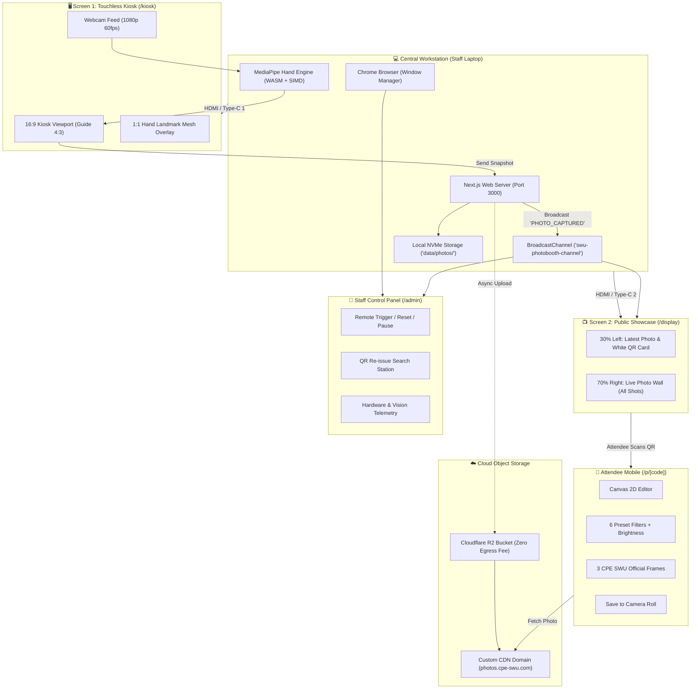
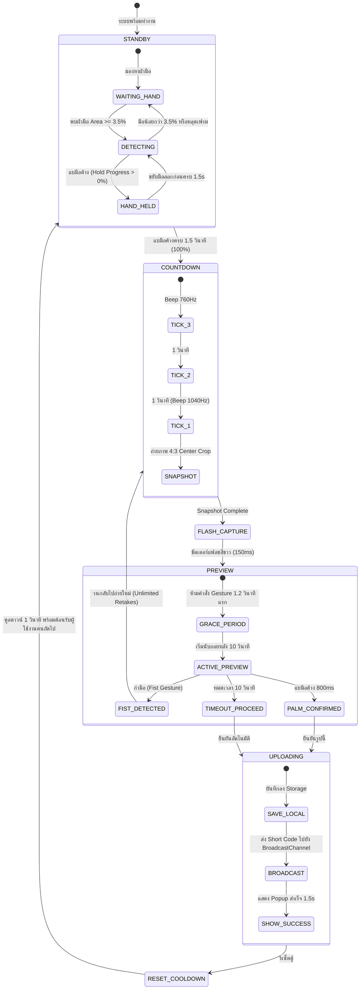
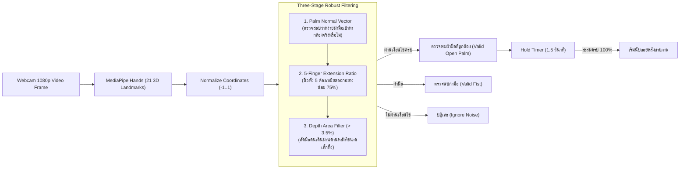
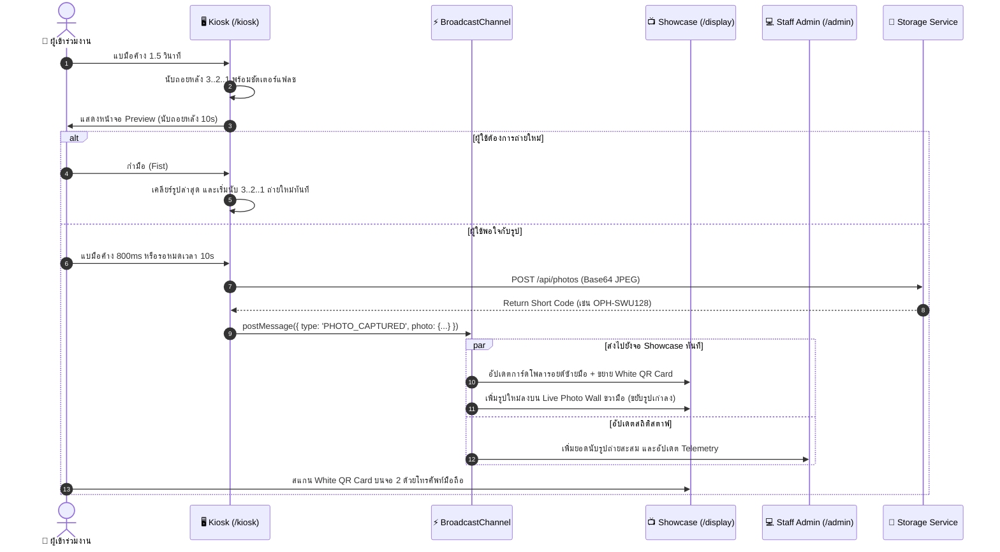
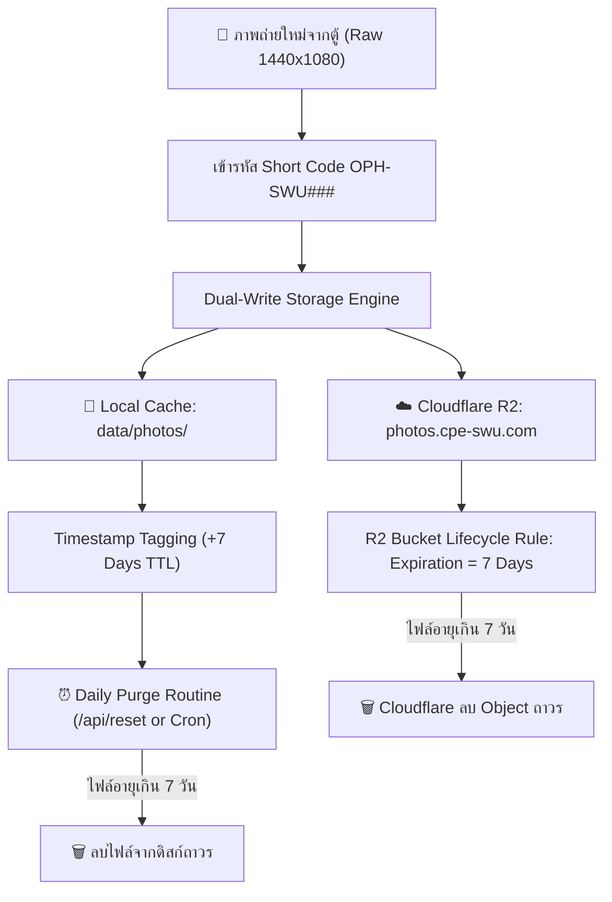
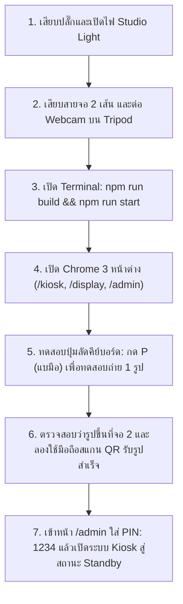

# 📘 CPE PhotoBooth — Master System Documentation & Architecture Guide
**โครงการระบบตู้ถ่ายภาพอัจฉริยะไร้สัมผัส (Touchless AI Vision Photo Booth)**  
*ภาควิชาวิศวกรรมคอมพิวเตอร์ คณะวิศวกรรมศาสตร์ มหาวิทยาลัยศรีนครินทรวิโรฒ (SWU CPE Open House 2026)*

---

## 📑 สารบัญ (Table of Contents)
1. [สรุปการปรับปรุงและอัปเกรดระบบในวันนี้ (What Was Done Today)](#1-สรุปการปรับปรุงและอัปเกรดระบบในวันนี้)
2. [สถาปัตยกรรมระบบและไดอะแกรมภาพรวม (System Architecture & Diagrams)](#2-สถาปัตยกรรมระบบและไดอะแกรมภาพรวม)
   - 2.1 [Hardware & Display Topology](#21-hardware--display-topology)
   - 2.2 [Finite State Machine (FSM) Lifecycle](#22-finite-state-machine-fsm-lifecycle)
   - 2.3 [AI Hand Vision & Depth Filter Pipeline](#23-ai-hand-vision--depth-filter-pipeline)
   - 2.4 [Dual-Screen Real-Time Sync Sequence](#24-dual-screen-real-time-sync-sequence)
   - 2.5 [Storage & PDPA 7-Day Lifecycle](#25-storage--pdpa-7-day-lifecycle)
3. [แผนการจัดเก็บ QR Code และรูปถ่ายบน Cloud Storage (Storage & Code Implementation)](#3-แผนการจัดเก็บ-qr-code-และรูปถ่ายบน-cloud-storage)
   - 3.1 [Zero-Dependency Cloudflare R2 / AWS S3 SigV4 Adapter](#31-zero-dependency-cloudflare-r2--aws-s3-sigv4-adapter)
   - 3.2 [ระบบ Short Code และโครงสร้างข้อมูล](#32-ระบบ-short-code-และโครงสร้างข้อมูล)
   - 3.3 [การสร้าง QR Code และ Dynamic Public Host](#33-การสร้าง-qr-code-และ-dynamic-public-host)
   - 3.4 [การรักษาความเป็นส่วนตัวและการลบไฟล์ตามมาตรฐาน PDPA](#34-การรักษาความเป็นส่วนตัวและการลบไฟล์ตามมาตรฐาน-pdpa)
4. [คู่มือการ Deploy และปฏิบัติการวันจัดงานจริง (On-site Deployment Plan)](#4-คู่มือการ-deploy-และปฏิบัติการวันจัดงานจริง)
   - 4.1 [รายการอุปกรณ์ฮาร์ดแวร์ (Hardware Checklist)](#41-รายการอุปกรณ์ฮาร์ดแวร์-hardware-checklist)
   - 4.2 [การตั้งค่าหน้าจอ Windows Multi-Display (Extend Mode)](#42-การตั้งค่าหน้าจอ-windows-multi-display-extend-mode)
   - 4.3 [การเชื่อมต่อเครือข่ายสำหรับ QR Code บนมือถือ (Cloudflare Tunnel / LAN)](#43-การเชื่อมต่อเครือข่ายสำหรับ-qr-code-บนมือถือ)
   - 4.4 [ขั้นตอนการเปิดระบบในเช้าวันงาน (Morning Runbook)](#44-ขั้นตอนการเปิดระบบในเช้าวันงาน-morning-runbook)
   - 4.5 [แดชบอร์ดสตาฟและการรับมือเหตุฉุกเฉิน (Contingency & Troubleshooting)](#45-แดชบอร์ดสตาฟและการรับมือเหตุฉุกเฉิน)

---

## 1. สรุปการปรับปรุงและอัปเกรดระบบในวันนี้

ในรอบการพัฒนาวันนี้ ระบบได้รับการปรับปรุงครั้งสำคัญทั้งในแง่ของ **อัตลักษณ์สถาบัน (Brand Identity)**, **ความเสถียรของกล้องและอัลกอริทึมไร้สัมผัส (Vision & Interaction)**, **ความสะอาดของ UI (Professional Impeccable Design)**, และ **ระบบ Storage รองรับวันงานจริง**:

| หมวดหมู่ | รายการที่ปรับปรุง | ผลลัพธ์ที่ได้ |
| :--- | :--- | :--- |
| **🎨 ธีมและอัตลักษณ์ มศว** | เปลี่ยนพื้นหลังจากดำสนิท (`#000000`) เป็น **สีเทา มศว** (`#16181E` / `#1C1F26` / `#20242D`) | เข้ากับอัตลักษณ์อย่างเป็นทางการ **"สีเทา - แดง"** (SWU Charcoal Gray & Crimson Red `#CE1126`) ดูสุขุม เป็นทางการระดับวิชาการ |
| **🧼 ความสะอาดของ UI** | ถอดอิโมจิ (✊, ✋, 📷, 💻) และสติกเกอร์ทั้งหมดออกแทนที่ด้วย Lucide Icons | UI ดูเป็นทางการ (Production-grade), ไม่มี AI Slop, ไอคอนเวกเตอร์คมชัดทุกความละเอียด |
| **📐 เสาฝั่งขวา (Right Pillar)** | คืนค่า UI เป็น Step Guide เรียบหรู 3 ขั้นตอน (`01 แบมือ 1.5s`, `02 โพสอิสระ`, `03 รับรูปที่จอ 2`) | สบายตา ไม่เกะกะสายตา ลดภาระการรับรู้ของผู้ใช้งาน |
| **📊 Telemetry Badge** | ย้ายสถานะการตรวจจับมือไปไว้มุมล่างซ้าย และลบแถบเปอร์เซ็นต์กลางจอที่บดบังใบหน้า | ผู้ใช้งานมองเห็นหน้าตัวเองในกล้องได้ชัดเจน ไม่ถูกป้ายบัง |
| **📸 กล้องและ Viewport** | 4:3 Mathematical Center-Crop (1440×1080) จากสตรีม 16:9 พร้อมปุ่ม "เชื่อมต่อกล้องทันที" | สัดส่วนภาพถ่ายตู้สติกเกอร์มาตรฐาน และมี Fallback ชัดเจนเมื่อบราวเซอร์ยังไม่ได้สิทธิ์กล้อง |
| **🔄 ลูปถ่ายใหม่ไม่จำกัด** | ปลดล็อกข้อจำกัดรอบถ่ายใหม่ (Unlimited Retakes) โดยไม่มีข้อความ `(1 LEFT)` | ผู้เข้าร่วมงานสามารถกำมือเพื่อลองถ่ายใหม่ได้ตามต้องการจนกว่าจะได้รูปที่พอใจ |
| **⏱️ Grace Period & Deliberate Hold** | เพิ่ม Grace Period 1.2 วินาทีแรกตอนเข้าหน้า Preview และต้องแบมือค้าง 800ms ถึงจะยืนยัน | ป้องกันมือที่ค้างจากท่าโพสถ่ายรูปเผลอไปกดส่งรูปโดยไม่ได้ตั้งใจ |
| **☁️ Zero-Dependency Cloud Storage** | สร้าง Cloudflare R2 / S3 SigV4 Storage Adapter ด้วย Native Node.js `crypto` และ `fetch` | อัปโหลดรูปขึ้น Cloud ได้โดยไม่ต้องพึ่ง `@aws-sdk/client-s3` น้ำหนักเบาและเสถียรสูง |
| **⚙️ Next.js Root Warning** | ระบุ `outputFileTracingRoot` ใน `next.config.ts` และลบ lockfile แปลกปลอม | ระบบ Build ไร้ Warning กวนใจ สะอาดและพร้อม Production |

---

## 2. สถาปัตยกรรมระบบและไดอะแกรมภาพรวม

### 2.1 Hardware & Display Topology
สถาปัตยกรรมฮาร์ดแวร์หน้างาน ใช้ **แล็ปท็อปประสิทธิภาพสูง 1 เครื่อง** ทำหน้าที่เป็นทั้งประมวลผล AI Vision, รัน Local Web Server, และจ่ายสัญญาณภาพออกไปยัง **2 จอแสดงผลภายนอก** แยกอิสระ:



---

### 2.2 Finite State Machine (FSM) Lifecycle
สถานะการทำงานของตู้ถ่ายรูปควบคุมด้วย State Machine ที่รัดกุม ป้องกันการเกิด Race Condition:



---

### 2.3 AI Hand Vision & Depth Filter Pipeline
การประมวลผลภาพมือทำงานบนเครื่องแล็ปท็อป 100% ผ่าน WebAssembly โดยไม่ส่งภาพวิดีโอออกนอกเครื่อง:



---

### 2.4 Dual-Screen Real-Time Sync Sequence
การสื่อสารระหว่างหน้าต่างตู้ถ่ายภาพ จอ Showcase และแดชบอร์ดสตาฟ ทำงานผ่าน `BroadcastChannel` บน Memory บราวเซอร์โดยตรง Latency ต่ำกว่า 5ms:



---

### 2.5 Storage & PDPA 7-Day Lifecycle
ระบบปฏิบัติตาม พ.ร.บ. คุ้มครองข้อมูลส่วนบุคคล (PDPA) อย่างเคร่งครัด โดยมีการกำหนดเวลาทำลายข้อมูลอัตโนมัติ:



---

## 3. แผนการจัดเก็บ QR Code และรูปถ่ายบน Cloud Storage

### 3.1 Zero-Dependency Cloudflare R2 / AWS S3 SigV4 Adapter
เพื่อความเร็วสูงสุดและไม่ต้องติดตั้ง SDK ขนาดใหญ่ของ AWS (`@aws-sdk/client-s3`) ระบบใช้ **Native AWS Signature Version 4 (SigV4)** ที่เขียนด้วย Node.js `crypto` ในตัว ([`CloudflareR2Adapter.ts`](file:///c:/Users/satit/OneDrive/Desktop/PhotoBooth-OpenHouseSWU/web/lib/storage/CloudflareR2Adapter.ts)):

```typescript
// web/lib/storage/CloudflareR2Adapter.ts (ตัดตอนฟังก์ชันอัปโหลด)
async savePhoto(shortCode: string, imageBuffer: Buffer): Promise<StoredPhotoResult> {
  const key = `${shortCode}.jpg`;
  const expiresAt = new Date(Date.now() + 7 * 24 * 60 * 60 * 1000).toISOString();

  if (this.accountId && this.accessKeyId && this.secretAccessKey) {
    const host = `${this.accountId}.r2.cloudflarestorage.com`;
    const path = `/${this.bucketName}/${key}`;
    const endpoint = `https://${host}${path}`;

    const amzDate = new Date().toISOString().replace(/[:-]|\.\d{3}/g, '');
    const dateStamp = amzDate.substring(0, 8);
    const payloadHash = crypto.createHash('sha256').update(imageBuffer).digest('hex');

    const canonicalHeaders = `content-type:image/jpeg\nhost:${host}\nx-amz-content-sha256:${payloadHash}\nx-amz-date:${amzDate}\n`;
    const signedHeaders = 'content-type;host;x-amz-content-sha256;x-amz-date';
    const canonicalRequest = `PUT\n${path}\n\n${canonicalHeaders}\n${signedHeaders}\n${payloadHash}`;

    const credentialScope = `${dateStamp}/auto/s3/aws4_request`;
    const stringToSign = `AWS4-HMAC-SHA256\n${amzDate}\n${credentialScope}\n${crypto
      .createHash('sha256')
      .update(canonicalRequest)
      .digest('hex')}`;

    const signingKey = getSignatureKey(this.secretAccessKey, dateStamp, 'auto', 's3');
    const signature = crypto.createHmac('sha256', signingKey).update(stringToSign).digest('hex');
    const authHeader = `AWS4-HMAC-SHA256 Credential=${this.accessKeyId}/${credentialScope}, SignedHeaders=${signedHeaders}, Signature=${signature}`;

    const res = await fetch(endpoint, {
      method: 'PUT',
      headers: {
        'Content-Type': 'image/jpeg',
        Host: host,
        'x-amz-content-sha256': payloadHash,
        'x-amz-date': amzDate,
        Authorization: authHeader,
      },
      body: new Uint8Array(imageBuffer),
    });

    if (res.ok) {
      return {
        photoId: shortCode,
        shortCode,
        url: `${this.publicDomain}/${key}`,
        storageDriver: 'r2',
        expiresAt,
      };
    }
  }

  // Fallback อัตโนมัติไปยัง Local Storage หากไม่มีคลาวด์หรือออฟไลน์
  return this.fallbackAdapter.savePhoto(shortCode, imageBuffer);
}
```

### 3.2 การตั้งค่า Environment Variables สำหรับ Cloud Storage
บันทึกค่าไว้ใน `web/.env.local` บนเครื่องแล็ปท็อปหน้างาน:

```env
# Storage Mode: 'r2' หรือ 'local'
STORAGE_DRIVER=r2

# Cloudflare R2 Credentials (Zero Egress Fees)
R2_ACCOUNT_ID=xxxxxxxxxxxxxxxxxxxxxxxxxxxxxxxx
R2_ACCESS_KEY_ID=xxxxxxxxxxxxxxxxxxxxxxxxxxxxxxxx
R2_SECRET_ACCESS_KEY=xxxxxxxxxxxxxxxxxxxxxxxxxxxxxxxxxxxxxxxx
R2_BUCKET_NAME=swu-photobooth
R2_PUBLIC_DOMAIN=https://photos.cpe-swu.com

# Public Web URL สำหรับสร้าง QR Code (ให้มือถือสแกนเจอ)
NEXT_PUBLIC_APP_URL=https://booth.cpe-swu.com
```

### 3.3 การสร้าง QR Code และ Dynamic Public Host Override
บนหน้าจอ Showcase (`/display`) และ Staff Admin (`/admin`):
- QR Code ชี้ตรงไปยัง URL: `https://[Domain]/p/[ShortCode]` เช่น `https://booth.cpe-swu.com/p/OPH-SWU101`
- ในกรณีฉุกเฉินที่สัญญาณเน็ตเปลี่ยน หรือใช้ Cloudflare Tunnel / Ngrok ชั่วคราว สตาฟสามารถกรอก Domain ใหม่ในช่อง **Public Domain for QR Code** บนหน้า `/admin` ได้ทันที โดยระบบจะบันทึกลง `localStorage` และยิงคำสั่ง `SET_PUBLIC_DOMAIN` ผ่าน BroadcastChannel ไปเปลี่ยนเป้าหมาย QR Code ทุกหน้าจอแบบเรียลไทม์

---

## 4. คู่มือการ Deploy และปฏิบัติการวันจัดงานจริง

### 4.1 รายการอุปกรณ์ฮาร์ดแวร์ (Hardware Checklist)
- [ ] **Laptop ควบคุมหลัก**: Intel Core i5/i7 หรือ Apple Silicon (RAM 16GB ขึ้นไป) รัน Windows 11
- [ ] **จอแสดงผล 1 (Screen 1)**: จอตั้งสำหรับตู้ถ่ายรูป (16:9 ขนาด 24" - 32")
- [ ] **จอแสดงผล 2 (Screen 2)**: จอใหญ่สำหรับ Showcase / รับรูป (16:9 ขนาด 32" - 55")
- [ ] **กล้องเว็บแคม (Webcam)**: Full HD (1080p 60fps) มุมกว้าง 78° - 90° พร้อมขาตั้ง Tripod มั่นคง
- [ ] **สายสัญญาณ**: สาย HDMI to HDMI หรือ Type-C to HDMI/DisplayPort 2 เส้น
- [ ] **ไฟส่องสว่าง (Studio Ring Light / Softbox)**: เพื่อให้ภาพคมชัดและ MediaPipe ตรวจจับมือได้แม่นยำ 100%
- [ ] **ปลั๊กพ่วงกันไฟกระชาก (Power Strip)**: 1 ชุด (จ่ายไฟ Laptop, จอ 1, จอ 2, ไฟสตูดิโอ)

---

### 4.2 การตั้งค่าหน้าจอ Windows Multi-Display (Extend Mode)
1. เสียบสายจอทั้ง 2 เข้ากับ Laptop
2. กดปุ่มลัด **`Windows + P`** บนคีย์บอร์ด -> เลือก **`Extend` (ขยาย)**
3. คลิกขวาบน Desktop -> เลือก **Display settings**:
   - จัดเรียงลำดับหน้าจอ: `[จอ 1 Kiosk]` ⬅️ `[จอ Laptop สตาฟ]` ➡️ `[จอ 2 Showcase]`
   - ตั้งค่า Scale ของทั้ง 3 จอเป็น **100%**
4. เปิด Google Chrome 3 หน้าต่างแยกกัน:
   - **หน้าต่างที่ 1**: เปิด `http://localhost:3000/kiosk` -> ลากไป **จอที่ 1** -> กด **`F11`** เพื่อ Fullscreen
   - **หน้าต่างที่ 2**: เปิด `http://localhost:3000/display` -> ลากไป **จอที่ 2** -> กด **`F11`** เพื่อ Fullscreen
   - **หน้าต่างที่ 3**: เปิด `http://localhost:3000/admin` -> วางไว้บน **หน้าจอ Laptop** สำหรับสตาฟมอนิเตอร์

---

### 4.3 การเชื่อมต่อเครือข่ายสำหรับ QR Code บนมือถือ
เนื่องจากผู้เข้าร่วมงานจะสแกน QR Code ด้วย 4G/5G จากโทรศัพท์มือถือ ต้องมี Public URL ที่ชี้กลับมายังเครื่อง Laptop:

#### วิธีที่ 1: ใช้ Cloudflare Tunnel (แนะนำสูงสุด - ฟรีและเสถียรมาก)
```powershell
# รัน Cloudflare Tunnel ชี้ตรงเข้า Port 3000
cloudflared tunnel --url http://localhost:3000
```
- นำ URL ที่ได้ (เช่น `https://random-subdomain.trycloudflare.com`) ไปใส่ในช่อง **Public Domain for QR Code** บนหน้าแดชบอร์ด `/admin`

#### วิธีที่ 2: Deploy Frontend บน Vercel + Backend R2 (สแตนด์อะโลน)
- Deploy โค้ดขึ้น Vercel โดเมน `booth.cpe-swu.com`
- โทรศัพท์มือถือของผู้ใช้จะเข้าเว็บผ่าน Vercel และดาวน์โหลดภาพตรงจาก Cloudflare R2 CDN โดยตรง

---

### 4.4 ขั้นตอนการเปิดระบบในเช้าวันงาน (Morning Runbook)



---

### 4.5 แดชบอร์ดสตาฟและการรับมือเหตุฉุกเฉิน (Contingency & Troubleshooting)
เข้าหน้าต่าง `/admin` บนจอ Laptop ของสตาฟ (PIN เริ่มต้น: **`1234`**):

| สถานการณ์หน้างาน | วิธีแก้ไขผ่าน Staff Admin หรือคีย์บอร์ด |
| :--- | :--- |
| **น้องทำรหัสรูปหาย หรือสแกนไม่ทัน** | ค้นหารูปในช่อง **"ค้นหารูปภาพ / Re-issue QR"** -> คลิก **"ออก QR Code ใหม่"** เพื่อให้ผู้ปกครองหรือน้องสแกนจากหน้าจอ Laptop ได้ทันที |
| **คนต่อแถวยาว ต้องการเร่งคิว** | กดปุ่ม **"ข้าม Preview"** หรือกดคีย์บอร์ดปุ่ม **`P`** เพื่อส่งรูปเข้าจอ 2 ทันทีโดยไม่ต้องรอ 10 วินาที |
| **กล้องค้างหรือสายหลุด** | กดปุ่ม **"เชื่อมต่อกล้องใหม่"** บน Admin หรือกดปุ่มแดง **"เชื่อมต่อกล้องทันที"** บนหน้าตู้ |
| **สตาฟต้องการจัดคิวหรือปรับมุมกล้อง** | กดปุ่ม **"พักบูธชั่วคราว" (Pause Booth)** เพื่อขึ้นหน้าจอพักบูธ ผู้เข้าร่วมงานจะไม่สามารถกดถ่ายได้ |
| **ตรวจจับมือยากเกินไป (ห้องมืดหรือมือเล็ก)** | ปรับแถบเลื่อน **"Hand Area Threshold"** ลงเหลือ `2.0% - 2.5%` เพื่อให้ระบบตอบสนองง่ายขึ้น |
| **คนเดินผ่านข้างหลังทำให้ตู้เผลอกดถ่าย** | ปรับแถบเลื่อน **"Hand Area Threshold"** ขึ้นเป็น `4.5% - 5.0%` ระบบจะรับเฉพาะมือที่อยู่ใกล้กล้องหน้าตู้เท่านั้น |

---

*จัดทำโดย: ทีมพัฒนาระบบ CPE PhotoBooth ประจำงาน SWU Open House 2026*  
*บันทึกสถานะล่าสุด: Git Commit `4474b5e` บน Branch `feature/standalone-prototype-suite`*
