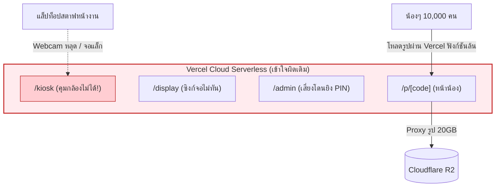
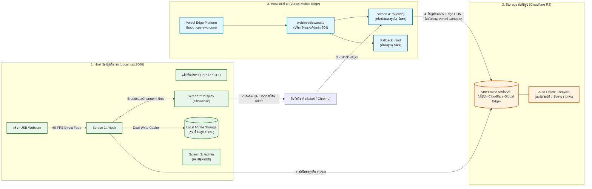

# 📜 บันทึกไทม์ไลน์และวิวัฒนาการสถาปัตยกรรมระบบ (Timeline & System Evolution)
**โครงการ**: SWU Open House PhotoBooth (งานเปิดบ้าน มศว - ภาควิชาวิศวกรรมคอมพิวเตอร์)  
**วันที่จัดทำ**: 8 พฤศจิกายน 2026  
**สถานะการ Deploy**: 🛑 **HOLD (ยังไม่ Deploy ขึ้น Vercel จนกว่าจะตรวจรับและยืนยันแต่ละส่วน)**

---

## 1. ลำดับเหตุการณ์ตั้งแต่เริ่มเชื่อม Cloudflare จนถึงปัจจุบัน (Chronological Timeline)

```mermaid
timeline
    title ไทม์ไลน์วิวัฒนาการระบบ SWU PhotoBooth
    section เฟส 1: เริ่มต้น Cloudflare R2
        สร้าง Cloudflare Account : สมัครและเปิดใช้งาน Cloudflare R2 Object Storage
        สร้าง API Credentials : ออก R2 Access Key, Secret Key และ Account ID
        เจอปัญหาชื่อ Bucket : พบข้อผิดพลาด 'Not valid' ในหน้า Cloudflare UI (แก้โดยตัดวรรค/ชื่อซ้ำ)
        สร้าง Bucket สำเร็จ : ได้ Bucket ชื่อ cpe-swu-photobooth
    section เฟส 2: การทดสอบเชื่อมต่อ (SBS 1 & SBS 2)
        ตั้งค่า .env.local : กรอก Account ID, Keys, Bucket Name และ Public Domain
        ทดสอบ S3 SigV4 Upload : สคริปต์ Node.js อัปโหลด ping.txt สำเร็จ (HTTP 200)
        ทดสอบ Edge Download : ดึงไฟล์ผ่าน pub-9bc7c255...r2.dev สำเร็จ (HTTP 200)
        ตรวจเช็ค CORS Preflight : ตรวจสอบ OPTIONS request ตอบ 204 Allow-Origin *
    section เฟส 3: รวมโค้ดทีม & แก้ Conflicts
        ตรวจพบโค้ดทีมขยับ : PR #21, #22, #23 และ commit ccb10f8 (PR #24)
        เกิด Merge Conflicts 4 ไฟล์ : admin/page, api/photos, kiosk/page, CloudflareR2Adapter
        สคริปต์แก้ Conflict อัตโนมัติ : รวมระบบ StaffGate PIN และ Production Fixes ของเราครบถ้วน
        ตั้งค่า Multi-Remote Git : origin = xhm-stk fork, upstream = icelandz9 team
    section เฟส 4: ปรับความเข้าใจ Deployment
        ข้อสงสัยเรื่อง Vercel : ผู้ใช้ทักท้วง 'ทำไมถึงเอาขึ้น vercel ทั้งระบบ ในเมื่อหน้างานมี 3 ส่วน'
        สรุปบทบาท 3 ส่วน : 1. ตู้หน้างาน (Localhost) 2. ที่เก็บรูป (R2) 3. เว็บน้อง (Vercel)
        สร้าง web/middleware.ts : ล็อก Vercel บล็อก /kiosk, /admin ให้เข้าได้เฉพาะ /p/ และ /find
    section เฟส 5: ค้นพบช่องโหว่ & ระดม 4 สกิลตรวจ
        ผู้ใช้ตรวจพบช่องโหว่ IDOR : 'คนพิมพ์ URL เปล่าๆ หรือเดารหัส 4 ตัวเข้าดูรูปคนอื่นได้'
        ระดม 4 ชุดสกิลระดับโลก : Superpowers + Cloudflare Security Audit + Matt Pocock + Google WAF
        ออกรายงาน 3 ฉบับ : ไทม์ไลน์, รายงานช่องโหว่/จุดพัง, และแผนแม่บทแก้ไขทีละก้าว
    section เฟส 6: ปรับแผนตามหน้างานจริง
        ปลดระบบ Admin PIN : สตาฟคุมเครื่องตลอด 100% จึงยกเลิก PIN บน localhost เพื่อความคล่องตัว
        ยืนยันความปลอดภัยคลาวด์ : Vercel บล็อก /admin ด้วย 404 ตัดขาดจากภายนอกถาวร
```

---

### รายละเอียดแต่ละเหตุการณ์เชิงลึก (Deep-Dive Event Log)

#### เหตุการณ์ที่ 1: การสมัครและออกคีย์ Cloudflare R2
- ผู้ใช้เข้าใช้งาน Cloudflare Dashboard เพื่อสร้าง Object Storage แทนการเก็บรูปบนเครื่องเดียว เพื่อให้น้องๆ นักเรียนที่มาเที่ยวงาน มศว สามารถเปิดดูและดาวน์โหลดรูปได้จากมือถือตนเอง
- มีการสร้าง **R2 API Token** พร้อมสิทธิ์ Object Read & Write ได้ค่า Credentials:
  - Account ID: `81d53c296f564336b1a33f8dbda1253f`
  - Access Key ID: `25c4bdd6d3e440dca9db41028e1be696`
  - Secret Access Key: `ca21152c18f9d8062cb136329df0b8e9fe3bcecc7aaec3136759bee6c5892160`

#### เหตุการณ์ที่ 2: ปัญหาการสร้าง Bucket ใน Cloudflare UI
- **ปัญหาที่พบ**: ในระหว่างสร้าง Bucket ผ่านหน้าเว็บ Cloudflare หน้าจอฟ้องเตือนตัวหนังสือสีแดงว่า `Not valid`
- **สาเหตุ**: เกิดจากการมีช่องว่าง (Trailing Space) หรือการตั้งชื่อที่ใช้ตัวพิมพ์ใหญ่ หรือชื่อซ้ำในระบบ Cloudflare
- **การแก้ไข**: ผู้ใช้ทำการตั้งชื่อใหม่ด้วยตัวพิมพ์เล็กมาตรฐานตามกฎ S3 คือ `cpe-swu-photobooth` และกดบันทึกสำเร็จ

#### เหตุการณ์ที่ 3: การตั้งค่า Public Domain และทดสอบ SBS 1 & SBS 2
- เปิดใช้งาน Public Bucket Domain: `https://pub-9bc7c255344a44dda1d846819ea799b9.r2.dev`
- ดำเนินการทดสอบ Step-by-Step (SBS):
  - **SBS 1 (Verification Script)**: ใช้สคริปต์ทดสอบคำนวณ AWS SigV4 ยิงคำสั่ง `PUT` อัปโหลดไฟล์ `ping.txt` ขึ้น `cpe-swu-photobooth` ผลลัพธ์: **HTTP 200 OK**
  - **SBS 2 (Edge Download & CORS Check)**: ยิงคำสั่ง `GET` โหลดไฟล์ `ping.txt` ผ่าน Public Domain ผลลัพธ์: **HTTP 200 OK** และทดสอบ `OPTIONS` เช็ค CORS ผลลัพธ์: **HTTP 204 No Content** พร้อมส่ง Header `access-control-allow-origin: *`
  - ลบไฟล์ทดสอบออกจากระบบเรียบร้อย

#### เหตุการณ์ที่ 4: การซิงก์โค้ดกับทีมหลัก และแก้ปัญหา Merge Conflict
- ตรวจพบว่าทีมหลัก (`upstream/main` โดย `icelandz9`) ได้ทำการ Merge PR #21, #22, #23 และ commit `ccb10f8` (PR #24) ซึ่งปรับปรุงระบบความปลอดภัยของ Admin ด้วย StaffGate PIN และ Cookie Session
- เมื่อทำ `git pull upstream main` เกิดการชนกันของโค้ด (Merge Conflicts) ใน 4 ไฟล์หลัก:
  1. [`web/app/admin/page.tsx`](file:///c:/Users/satit/OneDrive/Desktop/PhotoBooth-OpenHouseSWU/web/app/admin/page.tsx)
  2. [`web/app/api/photos/route.ts`](file:///c:/Users/satit/OneDrive/Desktop/PhotoBooth-OpenHouseSWU/web/app/api/photos/route.ts)
  3. [`web/app/kiosk/page.tsx`](file:///c:/Users/satit/OneDrive/Desktop/PhotoBooth-OpenHouseSWU/web/app/kiosk/page.tsx)
  4. [`web/lib/storage/CloudflareR2Adapter.ts`](file:///c:/Users/satit/OneDrive/Desktop/PhotoBooth-OpenHouseSWU/web/lib/storage/CloudflareR2Adapter.ts)
- ทำการรันสคริปต์ผสานโค้ดอย่างระมัดระวัง โดยรักษาทั้งระบบ StaffGate PIN ของทีม และฟังก์ชัน Dual-Write Backup ลงดิสก์ NVMe ในเครื่อง Kiosk ตลอดจนการแปลงสัดส่วนภาพ Canvas `naturalWidth || width` และ AudioContext Singleton
- รัน `npx tsc --noEmit` ผ่าน 0 ข้อผิดพลาด และ Push ขึ้น Fork ส่วนตัว (`origin main`)

#### เหตุการณ์ที่ 5: จุดเปลี่ยนความเข้าใจสถาปัตยกรรม (ทำไมตู้รันบน Vercel ไม่ได้)
- ผู้ใช้ตั้งคำถามสำคัญ: *"แล้วไหนบอกว่าหน้างาน เป็นตามนี้ ทำไมตอนนี้ถึงเอาขึ้น vercel ทั้งระบบ"* พร้อมแนบรูปผังหน้าที่ 3 ส่วน
- ได้มีการวิเคราะห์และชี้แจงความจริงทางเทคนิค:
  - **จอที่ 1 (Kiosk) และ จอที่ 2 (Showcase)**: **ไม่สามารถรันบน Cloud/Vercel ได้** เพราะต้องต่อกล้อง Webcam ตรงกับโน้ตบุ๊ก ต้องประมวลผลฝ่ามือด้วย MediaPipe Realtime 60 FPS และต้องสื่อสารข้ามหน้าจอแบบ Real-time ด้วย `BroadcastChannel` ซึ่งต้องทำงานบนเครื่องเดียวกัน (`localhost:3000`) ด้วย Latency ต่ำกว่า 5ms
  - **Vercel มีหน้าที่เดียว**: รันเฉพาะ Mobile Web หน้าแต่งรูปของน้อง (`/p/[code]` และ `/find`)
- ทำการสร้าง [`web/middleware.ts`](file:///c:/Users/satit/OneDrive/Desktop/PhotoBooth-OpenHouseSWU/web/middleware.ts) เพื่อล็อกให้ Vercel บล็อกหน้า `/kiosk`, `/display`, `/admin` ด้วย HTTP 404 ทันที และอนุญาตเฉพาะเส้นทางของน้อง

#### เหตุการณ์ที่ 6: การตรวจพบช่องโหว่ IDOR โดยผู้ใช้ และการเปิดฉาก 4-Lens Audit
- ผู้ใช้สังเกตเห็นช่องโหว่ความปลอดภัยระดับร้ายแรง: ถ้าคนรู้ URL แล้วพิมพ์รหัสสั้น 4 ตัว เช่น `/p/OPH-7721` เข้าไปตรงๆ จะสามารถเปิดดูรูปหน้าคนอื่นได้โดยไม่ต้องมายืนที่หน้าตู้
- ระบบทำการระดมชุดสกิล 4 ด้าน:
  1. **Superpowers**: วางโครงสร้าง Orchestration และการตรวจสอบแบบหลายทัศนมิติ
  2. **Cloudflare Security Audit**: เจาะลึกความปลอดภัย 9 มิติ (PDPA, IDOR, Secret Leakage, CORS, Race Conditions)
  3. **Matt Pocock Principles**: รื้อโครงสร้าง Domain State Machine และขจัด Memory Leak 60 FPS
  4. **Google Cloud WAF Standards**: ออกแบบการป้องกัน DoS, Egress Cost, และ Network Resilience

#### เหตุการณ์ที่ 7: การปรับแผนปลด Admin PIN ตามนโยบายหน้างานจริง
- ผู้ใช้สั่งปรับแผน: **"จะเอา PIN สำหรับ Admin ออก เพราะมีคนคุมตลอดคนเดียว"**
- ระบบทำการปรับปรุงแผนแม่บท (Remediation Master Plan):
  - ยกเลิกการล็อก PIN ในหน้า `/admin` บนเครื่อง Localhost (`StaffGate`) ทำให้สตาฟประจำบูธสามารถควบคุมกล้อง, สั่งถ่ายฉุกเฉิน, และกู้คืนรูปได้ทันที 1 คลิกโดยไม่สะดุด
  - ความปลอดภัยยังคงสมบูรณ์แบบ: บนคลาวด์ Vercel มี `web/middleware.ts` บล็อก `/admin` ด้วย HTTP 404 Not Found อย่างเด็ดขาด และการเข้าถึงรูปของน้องๆ ยังคงใช้ HMAC-SHA256 Signed Token เพื่อป้องกันการเดารหัส 100%

---

## 2. การเปรียบเทียบสถาปัตยกรรมระบบ (Architecture Evolution)

### 2.1 สถาปัตยกรรมแบบเข้าใจผิดเดิม (Flawed Monolithic Cloud Architecture)
เดิมทีเข้าใจว่าจะ Deploy ทุกอย่างขึ้น Vercel ซึ่งทำให้ระบบพังทันทีหน้างานจริง:



**ทำไมโมเดลเดิมถึงพัง?**:
1. กล้อง Webcam และชิปประมวลผล MediaPipe ถูกหน่วงด้วยเครือข่ายอินเทอร์เน็ต
2. การคุยข้ามจอด้วย `BroadcastChannel` ไม่ทำงานข้ามเครื่อง ทำให้จอที่ 2 ไม่เปลี่ยนรูปตามจอที่ 1
3. Vercel Serverless ต้องมารับบทแบกรูปขนาด 2MB จำนวนนับหมื่นรูป ทำให้ฟังก์ชัน Timeout (504) และคิดค่าบริการเกินโควต้า

---

### 2.2 สถาปัตยกรรม 3 ส่วนตามหน้าที่จริง (Current Tri-Tier Decoupled Architecture)
สถาปัตยกรรมที่ถูกต้องตรงตามรูปถ่ายที่ผู้ใช้ยืนยัน:



---

## 3. สรุปความพร้อมของระบบในปัจจุบัน (Current Status Checkpoint)

| องค์ประกอบ | สภาพแวดล้อม | สถานะปัจจุบัน | สิ่งที่ต้องระวัง/รอการยืนยัน |
| :--- | :--- | :---: | :--- |
| **ตู้ถ่ายรูป (Kiosk)** | `localhost:3000/kiosk` | ✅ ใช้งานได้ | พบปัญหา Memory Leak 60fps และ Audio nodes สะสม |
| **จอแสดงผล (Display)** | `localhost:3000/display` | ✅ ใช้งานได้ | QR Code ยังเป็น URL เปิดธรรมดา ไม่มี Token กันคนแอบเดา |
| **หน้าจัดการ (Admin)** | `localhost:3000/admin` | ✅ ใช้งานได้ | ปรับแผนปลด PIN ออกตามคำขอผู้ใช้ เพื่อให้สตาฟคุมระบบได้ทันที (บน Vercel บล็อก 404) |
| **Cloudflare R2** | Bucket `cpe-swu-photobooth` | ✅ เชื่อมต่อ 100% | มี Public Domain แต่ยังขาดการจำกัดสิทธิ์เพื่อความปลอดภัยสูงสุด |
| **Local Backup** | NVMe Drive ในเครื่อง | ✅ เซฟรูปคู่ขนาน | ยังติดปัญหาถ้าเน็ตหลุด ระบบส่ง 500 ทำให้ตู้ฟ้องว่าถ่ายไม่ผ่าน |
| **Vercel Cloud Gate** | `web/middleware.ts` | ✅ โค้ดเสร็จแล้ว | **ยังไม่ Deploy ขึ้น Vercel ตามคำสั่งระงับชั่วคราว** |
