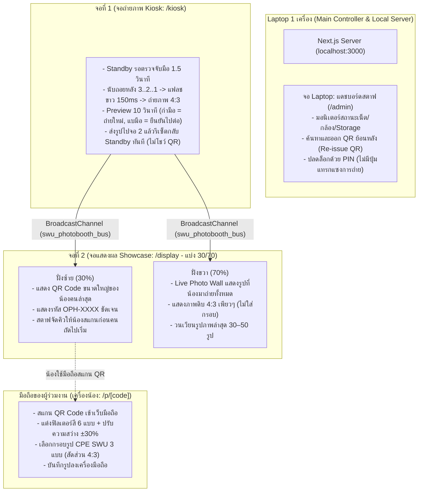

# มติล่าสุดของระบบ (Current Decisions)

ค่าในหน้านี้คือ**ค่าที่ใช้จริงล่าสุด** ได้รับการสรุปและเห็นพ้องผ่านกระบวนการสัมภาษณ์เจาะลึกสถาปัตยกรรม (`/grill-me`) หากเอกสารอื่นเขียนไม่ตรงกับหน้านี้ ให้ยึดหน้านี้เป็นหลัก

**อัปเดตล่าสุด**: 7 พฤศจิกายน 2026

---

## 1. การจัดวางฮาร์ดแวร์และหน้าจอหน้างาน (Physical Hardware Topology)

ระบบทำงานบน **Laptop 1 เครื่อง** และเชื่อมต่อหน้าจอแสดงผลภายนอก **2 จอ** ผ่านสายสัญญาณตรง (HDMI / USB-C DisplayPort) เป็น Windows Extended Desktop:

---

## 2. ตารางสรุปค่าหลักของระบบ (System Configuration Matrix)

| หมวดหมู่ | รายละเอียดค่าที่ใช้จริง | หมายเหตุทางวิศวกรรม |
| :--- | :--- | :--- |
| **สถาปัตยกรรมจอภาพ** | **3 หน้าจอ**: จอ Laptop (`/admin`) + จอที่ 1 (`/kiosk`) + จอที่ 2 (`/display`) | รันบนเครื่องเดียวกันผ่าน Extended Desktop |
| **การเชื่อมต่อข้ามจอ** | **Browser `BroadcastChannel` API** (`swu_photobooth_bus`) | ซิงค์ 0ms ออฟไลน์ 100% ไม่ต้องผ่านเน็ต |
| **ท่าเริ่มสั่งถ่าย (จอ 1)** | แบมือ 5 นิ้ว (`OPEN_PALM`) ค้าง **1.5 วินาที** | กรองขนาดมือหน้าตู้ (Depth & Area Filter) |
| **การนับถอยหลัง (จอ 1)** | **3 วินาที** (3..2..1) พร้อมเสียง Beep และวงแหวน Progress | เปลี่ยนท่าโพสได้อิสระ ไม่ยกเลิกกลางคัน |
| **แฟลชกล้อง (จอ 1)** | จอขาวสว่างวาบ **150ms** | Visual Shutter Feedback |
| **สัดส่วนภาพถ่าย** | **Single Shot สัดส่วน 4:3 (1440x1080 px)** | Center Crop จากกล้อง WebRTC 1080p |
| **การพรีวิว (จอ 1)** | **10 วินาที** (แสดงภาพดิบ 4:3 ที่เพิ่งถ่าย) | มีแถบเวลานับถอยหลัง |
| **คำสั่งในหน้าพรีวิว (จอ 1)** | **กำมือ (`FIST`)** = ถ่ายใหม่ (Retake ได้ 1 ครั้ง) **แบมือ (`OPEN_PALM`)** = ยืนยันบันทึกและไปต่อทันที | ควบคุมแบบ Touchless 100% ไม่ต้องแตะจอ (หากไม่กด เมื่อครบ 10 วินาทีจะไปต่ออัตโนมัติ) |
| **จอที่ 2 ฝั่งซ้าย (30%)** | แสดง **QR Code** ขนาดใหญ่ + รหัส `OPH-XXXX` ของคนล่าสุด | สตาฟช่วยจัดระเบียบให้น้องสแกนก่อน |
| **จอที่ 2 ฝั่งขวา (70%)** | **Live Photo Wall** รวมรูปถ่ายทั้งหมดในงาน | แสดงภาพดิบ 4:3 เพียวๆ (ไม่ใส่กรอบ) วนเวียน 30–50 รูป |
| **รหัสรูปภาพ** | `OPH-XXXX` (สุ่ม 4 หลัก ตัดตัวอักษรสับสน `0, O, 1, I, L`) | ตัวอย่างเช่น `OPH-AB29` |
| **การแต่งรูปบนมือถือ** | ฟิลเตอร์ 6 พรีเซ็ต + ปรับ Brightness ±30% + กรอบ CPE SWU 3 แบบ | เรนเดอร์บน Canvas 2D บนมือถือน้อง 100% |
| **ธีมกรอบรูป** | **CPE SWU 3 แบบ**: Official Classic / Youthful Tech / Photostrip | ไฟล์ PNG โปร่งใส สัดส่วน 4:3 |
| **การเก็บรักษาข้อมูล** | ลบไฟล์ภาพอัตโนมัติเมื่อครบ **7 วัน** ตามกฎหมาย PDPA | ทำงานผ่าน TTL Auto-Purge Service |
| **หน้าจอแอดมิน (Laptop)** | มอนิเตอร์สถานะกล้อง/เน็ต/Storage + Re-issue QR Code | เข้าใช้งานด้วย Staff PIN (ไม่มีปุ่มแทรกแซงการถ่าย) |

---

## 3. ผังหน้าเว็บและ API ทั้งหมด

| ประเภท | Path | หน้าจอที่แสดง | บทบาทหน้าที่ |
| :--- | :--- | :--- | :--- |
| **Web Page** | `/kiosk` | **จอที่ 1 (Capture Screen)** | ตู้ถ่ายรูป 16:9 ไกด์ 4:3, ตรวจจับมือ, นับถอยหลัง, พรีวิว 10 วิ (กำมือถ่ายใหม่ / แบมือไปต่อ) |
| **Web Page** | `/display` | **จอที่ 2 (Showcase Screen)** | แบ่ง 30/70: ซ้ายแสดง QR คนล่าสุด / ขวาแสดง Live Photo Wall รวมรูปเพียว 4:3 |
| **Web Page** | `/admin` | **จอ Laptop (Staff Admin)** | มอนิเตอร์สถานะระบบ ตรวจสอบกล้อง/เน็ต ออก QR ย้อนหลัง และตรวจสอบ PIN |
| **Web Page** | `/p/[code]` | **มือถือน้อง (Mobile Editor)** | หน้าเว็บแต่งรูป 6 สี 3 กรอบ CPE SWU 4:3 และดาวน์โหลดลงเครื่อง |
| **Web Page** | `/find` | **มือถือน้อง (Photo Lookup)** | หน้าค้นหารูปย้อนหลังด้วยรหัส OPH-XXXX กรณีทำ QR หาย |
| **API** | `POST /api/photos` | Server Route | รับภาพ Base64, สุ่มรหัส OPH-XXXX, บันทึกลง Storage |
| **API** | `GET /api/photos/[code]` | Server Route | ดึงข้อมูลภาพและลิงก์ดาวน์โหลด พร้อมเช็กหมดอายุ 7 วัน |
| **API** | `GET /api/health` | Server Route | ตรวจสอบสถานะการทำงานของระบบ (Healthcheck) |

---

## 4. บันทึกประวัติการแก้ไขมติ (Revision Log)

| วันที่ | ประเด็น | เดิม | มติใหม่ล่าสุด | เหตุผลทางวิศวกรรม |
| :--- | :--- | :--- | :--- | :--- |
| 2026-11-07 | สถาปัตยกรรมจอภาพ | จอเดียว รวมถ่ายและโชว์ QR | **แยก 2 จอ + 1 Laptop**: จอ 1 ถ่ายรูป, จอ 2 โชว์ QR (30%) + Photo Wall (70%), Laptop เป็น Admin | เพิ่ม Throughput ได้ 2 เท่า คนถ่ายไม่ต้องยืนขวางกล้องตอนสแกน QR |
| 2026-11-07 | การสั่งงานหน้าพรีวิว 10s | กดปุ่มแตะหน้าจอ Touchscreen | **ใช้ท่ามือ**: กำมือ ✊ = ถ่ายใหม่ / แบมือ 🖐️ = ไปต่อ | Touchless 100% ไม่ต้องซื้อจอสัมผัสราคาแพง |
| 2026-11-07 | Photo Wall (จอ 2 ขวา 70%) | โชว์ภาพแต่งกรอบ | **โชว์ภาพดิบ 4:3 เพียวๆ** ทันทีหลังถ่ายเสร็จ (30-50 รูป) | ขึ้นโชว์ได้ทันที Real-time ไม่ต้องรอน้องแต่งรูปเสร็จ |
| 2026-11-07 | แอดมินและสตาฟ | แตะหน้าจอตู้ 5 ครั้ง | **รันบนจอของ Laptop โดยตรง** | สะดวกต่อการมอนิเตอร์ของสตาฟ และไม่รบกวนหน้าตู้ของน้อง |
| 2026-11-07 | การสื่อสารระหว่างจอ | ไม่มี (เดิมเป็นจอเดียว) | **`BroadcastChannel` API** บนเบราว์เซอร์ | เชื่อมโยง 3 จอบน Laptop เครื่องเดียวได้ทันทีแบบ 0ms ออฟไลน์ 100% |
