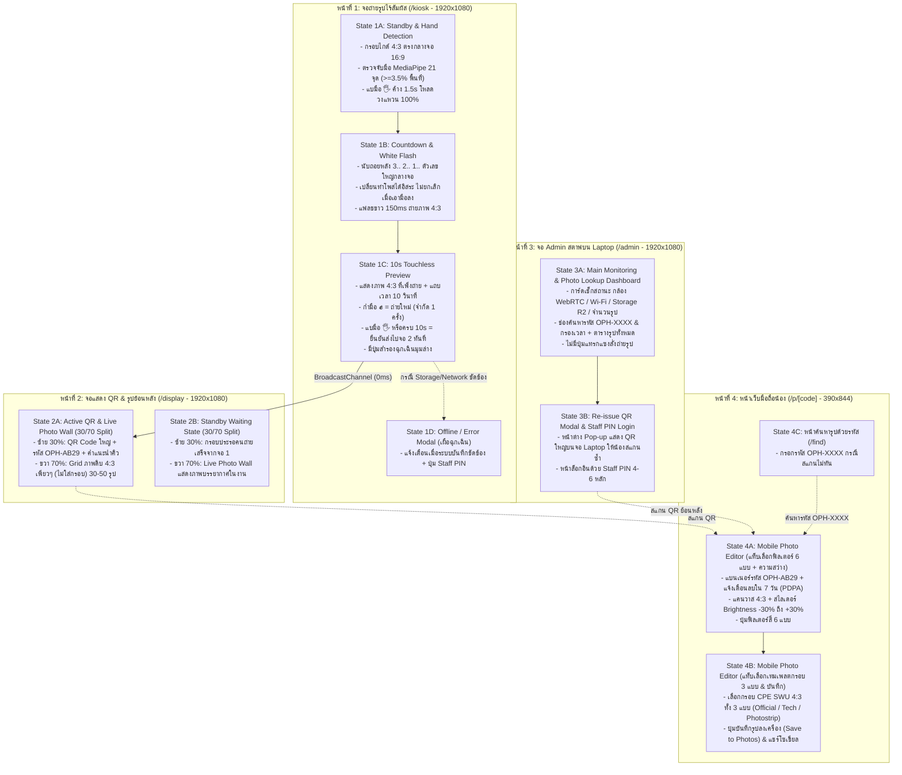

# คู่มือการออกแบบ UI/UX, ระบบชุดคำสั่ง (Prompts) และขั้นตอนการใช้งานแบบ Step-by-Step (SBS) สำหรับสร้าง Mockup ทั้ง 4 หน้าจอใน Google Stitch

**โครงการ**: SWU Open House — AI Photo Booth (สาขาวิชาวิศวกรรมคอมพิวเตอร์ คณะวิศวกรรมศาสตร์ มหาวิทยาลัยศรีนครินทรวิโรฒ / CPE SWU)  
**อ้างอิงมติสถาปัตยกรรมล่าสุด**: [decisions.md](decisions.md), [system-overview.md](system-overview.md), [system-architecture-and-technical-design.md](task02-architecture/system-architecture-and-technical-design.md)  
**สกิลที่ใช้สังเคราะห์และตรวจสอบมาตรฐาน**: `design`, `design-system`, `frontend-ui-engineering`, `frontend-design`, `ui-styling`  
**อัปเดตล่าสุด**: 7 พฤศจิกายน 2026  

---

## สารบัญ (Table of Contents)
1. [การวิเคราะห์ระบบการออกแบบและอัตลักษณ์ (Design System & Brand Tokens Analysis)](#1-การวิเคราะห์ระบบการออกแบบและอัตลักษณ์-design-system--brand-tokens-analysis)
2. [แผนผังการเชื่อมต่อทั้ง 4 หน้าจอและสถานะย่อยทั้งหมด (Screen Topology & UI States)](#2-แผนผังการเชื่อมต่อทั้ง-4-หน้าจอและสถานะย่อยทั้งหมด-screen-topology--ui-states)
3. [คู่มือ Step-by-Step (SBS) การใช้งาน Google Stitch ตั้งแต่เริ่มต้นจนจบ](#3-คู่มือ-step-by-step-sbs-การใช้งาน-google-stitch-ตั้งแต่เริ่มต้นจนจบ)
4. [ชุด Prompt สำหรับ Google Stitch: หน้าที่ 1 — หน้าถ่ายรูปไร้สัมผัส (จอที่ 1: `/kiosk`)](#4-ชุด-prompt-สำหรับ-google-stitch-หน้าที่-1--หน้าถ่ายรูปไร้สัมผัส-จอที่-1-kiosk)
5. [ชุด Prompt สำหรับ Google Stitch: หน้าที่ 2 — หน้าแสดง QR และรูปย้อนหลัง (จอที่ 2: `/display`)](#5-ชุด-prompt-สำหรับ-google-stitch-หน้าที่-2--หน้าแสดง-qr-และรูปย้อนหลัง-จอที่-2-display)
6. [ชุด Prompt สำหรับ Google Stitch: หน้าที่ 3 — หน้า Admin สตาฟบนจอ Laptop (`/admin`)](#6-ชุด-prompt-สำหรับ-google-stitch-หน้าที่-3--หน้า-admin-สตาฟบนจอ-laptop-admin)
7. [ชุด Prompt สำหรับ Google Stitch: หน้าที่ 4 — หน้าเว็บมือถือสำหรับน้องที่สแกน QR (`/p/[code]` & `/find`)](#7-ชุด-prompt-สำหรับ-google-stitch-หน้าที่-4--หน้าเว็บมือถือสำหรับน้องที่สแกน-qr-pcode--find)
8. [ตารางตรวจสอบความครบถ้วนของรายละเอียด (Zero-Omission Verification Checklist)](#8-ตารางตรวจสอบความครบถ้วนของรายละเอียด-zero-omission-verification-checklist)

---

## 1. การวิเคราะห์ระบบการออกแบบและอัตลักษณ์ (Design System & Brand Tokens Analysis)

จากการใช้สกิล `design-system` และ `frontend-ui-engineering` วิเคราะห์ข้อกำหนดของโครงการ **CPE SWU Open House AI Photo Booth** พบว่าการออกแบบ UI ทั้ง 4 หน้าจอต้องหลีกเลี่ยงรูปแบบ AI สำเร็จรูปทั่วไป (เช่น สีม่วง-ครามแบบ AI Default) และยึด **อัตลักษณ์ของมหาวิทยาลัยศรีนครินทรวิโรฒ (สีเทา-แดง)** ผสานกับ **กลิ่นอายวิศวกรรมคอมพิวเตอร์ (Cyber/Tech HUD & Dark Studio Mode)** เพื่อให้ภาพจากกล้องและรูปถ่ายของน้องๆ โดดเด่นที่สุดในสภาพแสงหน้าบูทจริง

### 1.1 ระบบสี 3 เลเยอร์ (Three-Layer Color Tokens)

| ระดับ Token | ชื่อสี / บทบาท | รหัสสี Hex | การนำไปใช้ในทั้ง 4 หน้าจอ |
| :--- | :--- | :--- | :--- |
| **Brand Primary** | **SWU Crimson Red (แดง มศว)** | `#CE1126` | สีเน้นหลัก (Primary CTA), เส้นกรอบ Active 4:3, ป้ายรหัส `OPH-XXXX`, แถบ Progress Ring ตอนแบมือ |
| **Brand Hover/Accent** | **Bright Coral Red** | `#EF4444` | สถานะ Hover, แสง Glow รอบปุ่มสำคัญ, แถบแจ้งเตือน |
| **Brand Secondary** | **SWU Slate Grey (เทา มศว)** | `#1E293B` | พื้นหลังการ์ดรอง, แถบ Header, กรอบตารางในหน้า Admin |
| **Background Base** | **Studio Obsidian Black** | `#090D16` | พื้นหลังหลักของจอที่ 1, จอที่ 2, จอ Admin และหน้ามือถือ (ลดแสงสะท้อนรบกวนกล้อง) |
| **Surface Elevated** | **Dark Cyber Slate** | `#111827` | พื้นหลังแผงควบคุม, กล่อง QR Station (ฝั่งซ้าย 30% ของจอ 2), การ์ดสถิติในหน้า Admin |
| **Tech Accent (AI/Vision)** | **CPE Cyber Cyan** | `#06B6D4` | เส้นโครงกระดูกมือ 21 จุด (MediaPipe Landmarks), กรอบตรวจจับมือ `OPEN_PALM` |
| **Semantic Success** | **Emerald Online** | `#10B981` | สถานะกล้อง WebRTC พร้อมใช้งาน, สถานะ Wi-Fi/R2 Sync ปกติ, ท่าแบมือยืนยันไปต่อ |
| **Semantic Warning** | **Amber Retake / Timer** | `#F59E0B` | แถบนับเวลาถอยหลัง 10 วินาทีในหน้า Preview, ปุ่มกำมือถ่ายใหม่ (`FIST` ✊), สถานะรอซิงค์คลาวด์ |
| **Text Primary** | **Pure Crisp White** | `#F8FAFC` | หัวข้อหลัก, ตัวเลขนับถอยหลัง 3..2..1, รหัสรับรูป |
| **Text Muted** | **Cool Silver Grey** | `#94A3B8` | คำอธิบายรอง, หมายเหตุ PDPA 7 วัน, เวลา Timestamp |

### 1.2 ระบบตัวอักษร (Typography Scale)
* **ฟอนต์ภาษาไทยและอังกฤษหลัก (Heading & UI)**: `Prompt` หรือ `Plus Jakarta Sans` / `Inter` (หัวข้อใช้ `Bold 700` ถึง `ExtraBold 800` เพื่อให้มองเห็นชัดในระยะยืนหน้าตู้ 1.5–2 เมตร)
* **ฟอนต์รหัสรูปภาพและตัวเลขจับเวลา (Monospace / Tech Data)**: `JetBrains Mono` หรือ `Space Mono` สำหรับรหัส `OPH-XXXX` (ตัดตัวอักษรสับสน `0, O, 1, I, L`), ตัวเลขนับถอยหลัง `3.. 2.. 1..`, ค่า FPS และพิกัด MediaPipe

### 1.3 มาตรฐานสัดส่วนหน้าจอและเลย์เอาต์ (Viewport & Aspect Ratio Rules)
1. **หน้าที่ 1 (`/kiosk` - จอที่ 1 สำหรับถ่ายรูป)**:
   * จอภาพขนาด **16:9 แนวนอน (1920x1080 px)**
   * พื้นที่ถ่ายภาพจริงตรงกลางเป็น **สัดส่วน 4:3 (1440x1080 px)** คิดเป็นความกว้าง **75% ตรงกลางจอ**
   * ขอบซ้ายและขวาข้างละ **12.5% (240 px ต่อข้าง)** เป็นแถบมืดกึ่งโปร่งแสง (Pillarbox Mask `bg-black/75` + `backdrop-blur-sm`) เพื่อวาง HUD สถานะ AI และคำแนะนำท่าทางมือโดยไม่บังตัวคนถ่าย
2. **หน้าที่ 2 (`/display` - จอที่ 2 สำหรับโชว์ QR และรูปย้อนหลัง)**:
   * จอภาพขนาด **16:9 แนวนอน (1920x1080 px)**
   * แบ่งหน้าจอแนวตั้งเป็น **ฝั่งซ้าย 30% (576 px)** สำหรับ **QR Code Station** ของคนล่าสุด และ **ฝั่งขวา 70% (1344 px)** สำหรับ **Live Photo Wall** แสดงภาพดิบสัดส่วน **4:3 เพียวๆ (ไม่มีกรอบ)** จำนวน 30–50 รูปล่าสุด
3. **หน้าที่ 3 (`/admin` - จอ Laptop ของสตาฟ)**:
   * จอภาพขนาด **16:9 Desktop/Laptop (1440x900 px หรือ 1920x1080 px)**
   * เน้น **System Health Monitoring** และ **Re-issue QR Code** (ค้นหารูปตามเวลา/รหัส) **ห้ามมีปุ่มกดสั่งถ่ายรูปแทน** เพื่อรักษาความเป็น Touchless 100%
4. **หน้าที่ 4 (`/p/[code]` - หน้าเว็บมือถือสำหรับน้อง)**:
   * จอภาพขนาด **Mobile Portrait แนวตั้ง (390x844 px)**
   * แสดงภาพพรีวิวบน Canvas สัดส่วน **4:3** พร้อมตัวเลือก **6 ฟิลเตอร์สี + แถบปรับความสว่าง (-30% ถึง +30%) + 3 เทมเพลตกรอบรูป CPE SWU (สัดส่วน 4:3)**

### 1.4 ตารางเชื่อมโยงชื่อบนหน้าจอ UI กับ TypeScript Contracts ในโค้ด (`web/lib/contracts.ts` & `web/lib/mobile/colorFilters.ts`)

เพื่อให้ภาพ Mockup จาก Google Stitch เชื่อมต่อกับโค้ดใน `web/` ได้แบบไร้รอยต่อ 100% ตารางนี้สรุปการจับคู่ชื่อที่แสดงบน UI กับรหัสในโค้ดจริง:

| หมวดหมู่ | ลำดับที่ | ชื่อแสดงผลบนหน้าจอ UI (User-Facing Label) | รหัสในโค้ด (`id` ใน TypeScript) | ค่าพารามิเตอร์ / CSS Filter ในโค้ดจริง |
| :--- | :---: | :--- | :--- | :--- |
| **6 ฟิลเตอร์สี (`FilterPresetId`)** | 1 | **Original (สีต้นฉบับ)** | `'original'` | `none` |
| **6 ฟิลเตอร์สี (`FilterPresetId`)** | 2 | **Bright / Clear (สว่างใส / Warm Glow)** | `'warm'` | `sepia(0.2) saturate(1.2) contrast(1.05)` (`RGB: +15, +5, -10`) |
| **6 ฟิลเตอร์สี (`FilterPresetId`)** | 3 | **Warm Vintage (โทนอุ่นวินเทจ / Vintage Film)** | `'vintage'` | `sepia(0.4) contrast(0.9) brightness(0.95)` (`RGB: +20, +10, -15`) |
| **6 ฟิลเตอร์สี (`FilterPresetId`)** | 4 | **Cool Cyber (โทนเย็นไซเบอร์ / Cool Breeze)** | `'cool'` | `hue-rotate(180deg) saturate(0.9) contrast(1.05)` (`RGB: -10, +5, +20`) |
| **6 ฟิลเตอร์สี (`FilterPresetId`)** | 5 | **Film Grain / Rosy (โทนฟิล์มอมชมพู มศว / SWU Rosy)** | `'rosy'` | `hue-rotate(330deg) saturate(1.1) brightness(1.05)` (`RGB: +25, -5, +5`) |
| **6 ฟิลเตอร์สี (`FilterPresetId`)** | 6 | **B&W High Contrast (ขาวดำคมชัด / Monochrome)** | `'bw'` | `grayscale(1) contrast(1.2)` |
| **3 กรอบรูป (`CPEFrameTemplateId`)** | 1 | **Official SWU Classic (สีเทา-แดง มศว ทางการ)** | `'cpe-official'` | `/public/templates/cpe-official.png` (1440x1080, 4:3 Alpha PNG) |
| **3 กรอบรูป (`CPEFrameTemplateId`)** | 2 | **CPE Tech Graphic (ลายวงจร/โค้ดดิ้ง AI)** | `'cpe-tech-circuit'` | `/public/templates/cpe-tech-circuit.png` (1440x1080, 4:3 Alpha PNG) |
| **3 กรอบรูป (`CPEFrameTemplateId`)** | 3 | **Minimalist Photostrip (สไตล์ฟิล์มมินิมอล)** | `'cpe-photostrip'` | `/public/templates/cpe-photostrip.png` (1440x1080, 4:3 Alpha PNG) |
| **สถานะตู้ถ่ายรูป (`KioskFSMState`)** | — | **Standby (`1A`) / Countdown (`1B`) / Preview (`1C`) / Error (`1D`)** | `'IDLE'`, `'DETECTING_HAND'`, `'COUNTDOWN_ACTIVE'`, `'FLASH_CAPTURE'`, `'PREVIEW_RETAKE'`, `'UPLOADING'`, `'WAITING_NETWORK'`, `'RESET_COOLDOWN'` | ควบคุมผ่าน `useKioskFSM()` และซิงค์ข้ามจอผ่าน `BroadcastChannel('swu_photobooth_bus')` |

---

## 2. แผนผังการเชื่อมต่อทั้ง 4 หน้าจอและสถานะย่อยทั้งหมด (Screen Topology & UI States)

เพื่อให้การสร้าง Mockup ใน Google Stitch ครบถ้วนทุกจังหวะการทำงาน ไม่ตกหล่นแม้แต่สถานะเดียว เราแบ่งหน้าจอที่ต้องเจนเนอเรตออกเป็น **4 หน้าหลัก (รวม 11 หน้าจอย่อยตาม State จริง)** ดังนี้:



---

## 3. คู่มือ Step-by-Step (SBS) การใช้งาน Google Stitch ตั้งแต่เริ่มต้นจนจบ

**Google Stitch** (`stitch.withgoogle.com`) คือเครื่องมือ AI UI Design Generation ของ Google ที่แปลง Text Prompt หรือภาพสเก็ตช์ให้กลายเป็นหน้าจอ UI ความละเอียดสูงที่แก้ไขต่อได้ และสามารถส่งออก (Export) ไปยัง **Figma** หรือคัดลอกเป็นโค้ด **HTML/Tailwind CSS** ได้ทันที

เพื่อให้ได้ผลลัพธ์ตรงตามสถาปัตยกรรมทั้ง 4 หน้าโดยไม่เพี้ยน ให้ทำตามขั้นตอน **Step-by-Step (SBS)** ดังต่อไปนี้:

### ขั้นตอนที่ 1: การเตรียมความพร้อมและตั้งค่าโปรเจกต์ใน Google Stitch
1. เปิดเบราว์เซอร์ Chrome แล้วเข้าไปที่เว็บไซต์ **[https://stitch.withgoogle.com](https://stitch.withgoogle.com)** และลงชื่อเข้าใช้ด้วยบัญชี Google
2. คลิกปุ่ม **"New Project"** (หรือ **"Create New Design"**) ตั้งชื่อโปรเจกต์ว่า:  
   `SWU Open House - CPE AI Photo Booth (4 Screens)`
3. **ข้อสำคัญที่สุดในการเลือกโหมดหน้าจอ (Device Viewport Selection)**:
   * ใน Google Stitch ก่อนจะวาง Prompt ทุกครั้ง ให้สังเกตแถบเครื่องมือเลือกขนาดหน้าจอ (Device Type):
     * **สำหรับหน้าที่ 1 (จอถ่ายรูป `/kiosk`)**: ต้องเลือกเป็น **`Desktop / Web (16:9 Landscape)`** เสมอ
     * **สำหรับหน้าที่ 2 (จอแสดง QR และรูปย้อนหลัง `/display`)**: ต้องเลือกเป็น **`Desktop / Web (16:9 Landscape)`** เสมอ
     * **สำหรับหน้าที่ 3 (หน้า Admin `/admin`)**: ต้องเลือกเป็น **`Desktop / Web (16:9 Landscape)`** เสมอ
     * **สำหรับหน้าที่ 4 (หน้าเว็บมือถือน้อง `/p/[code]`)**: ต้องสลับโหมดเป็น **`Mobile (Portrait)`** เสมอ
4. **การเลือกโมเดลใน Google Stitch**:
   * หากในหน้าจอมีตัวเลือกโมเดล ให้เลือก **High Quality / Pro Mode (Gemini Pro Vision)** เพื่อให้ AI จัดวางโครงสร้าง Grid 30/70, สัดส่วนกรอบ 4:3 ในจอ 16:9, และตัวอักษรภาษาไทย/อังกฤษได้อย่างแม่นยำ

---

### ขั้นตอนที่ 2: ลำดับการป้อน Prompt ทั้ง 4 หน้า (Workflow การรันทีละหน้า)

> **เคล็ดลับสำคัญ (Pro Tip สำหรับ Google Stitch)**:  
> อย่าป้อนทั้ง 4 หน้าพร้อมกันใน Prompt เดียว! เพราะ Google Stitch ออกแบบมาให้สร้าง UI ทีละประเภทอุปกรณ์ (Desktop หรือ Mobile) ให้ทำการ **สร้างทีละหน้า (Screen-by-Screen)** โดยก๊อปปี้ **Prompt ภาษาอังกฤษ (Recommended for Best Layout Precision)** หรือ **Prompt ภาษาไทย** ที่เตรียมไว้ในหัวข้อที่ 4–7 ด้านล่างไปวางตามลำดับนี้:

#### ลำดับที่ 2.1: สร้างหน้าที่ 1 — หน้าถ่ายรูปไร้สัมผัส (จอที่ 1 `/kiosk`)
1. เลือกโหมดหน้าจอเป็น **`Desktop`**
2. ไปที่ **[หัวข้อที่ 4](#4-ชุด-prompt-สำหรับ-google-stitch-หน้าที่-1--หน้าถ่ายรูปไร้สัมผัส-จอที่-1-kiosk)** ด้านล่าง ก๊อปปี้ **Prompt 1A (หน้า Standby & ตรวจจับมือแบ 5 นิ้ว 1.5 วินาที)** ไปวางในช่อง Prompt ของ Google Stitch แล้วกด **Generate**
3. เมื่อได้หน้าจอที่ 1A แล้ว ให้คลิกปุ่ม **"Create Variant" / "Duplicate & Edit"** (หรือสร้าง Frame ใหม่ข้างๆ) แล้ววาง **Prompt 1B (หน้านับถอยหลัง 3..2..1 & แฟลชขาว 150ms)** เพื่อให้ดีไซน์คงธีมสีและโครงสร้างเดิมเป๊ะ
4. ทำซ้ำอีกครั้งโดยกด **"Create Variant"** แล้ววาง **Prompt 1C (หน้าพรีวิว 10 วินาที: กำมือถ่ายใหม่ / แบมือไปต่อ)**
5. (ทางเลือกสำหรับครบทุก State ใน FSM) กด **"Create Variant"** แล้ววาง **Prompt 1D (สถานะ `WAITING_NETWORK` / แจ้งเตือนเมื่อระบบบันทึกขัดข้อง + ปุ่มปลดล็อกด้วย Staff PIN)**

#### ลำดับที่ 2.2: สร้างหน้าที่ 2 — หน้าแสดง QR และรูปย้อนหลัง (จอที่ 2 `/display`)
1. สร้างหน้าจอใหม่ในโหมด **`Desktop`**
2. ไปที่ **[หัวข้อที่ 5](#5-ชุด-prompt-สำหรับ-google-stitch-หน้าที่-2--หน้าแสดง-qr-และรูปย้อนหลัง-จอที่-2-display)** ด้านล่าง ก๊อปปี้ **Prompt 2A (หน้าแสดง QR ฝั่งซ้าย 30% + Live Photo Wall รูปเพียว 4:3 ฝั่งขวา 70%)** ไปวางแล้วกด **Generate**
3. ตรวจสอบจุดสำคัญบนภาพที่ได้:
   * ฝั่งซ้ายต้องกว้างประมาณ **30%** แสดงกล่อง QR Code สีขาวขนาดใหญ่ และรหัส `OPH-AB29`
   * ฝั่งขวาต้องกว้างประมาณ **70%** แสดงตารางรูปถ่ายสัดส่วน **4:3 เพียวๆ ไม่มีกรอบรูปแปะทับ**
4. (ทางเลือกเพิ่มเติม) กดสร้าง Variant แล้ววาง **Prompt 2B (สถานะรอคนถ่ายรูปคนแรก)** เพื่อใช้ประกอบเอกสารระบบ

#### ลำดับที่ 2.3: สร้างหน้าที่ 3 — หน้า Admin สตาฟบนจอ Laptop (`/admin`)
1. สร้างหน้าจอใหม่ในโหมด **`Desktop`**
2. ไปที่ **[หัวข้อที่ 6](#6-ชุด-prompt-สำหรับ-google-stitch-หน้าที่-3--หน้า-admin-สตาฟบนจอ-laptop-admin)** ด้านล่าง ก๊อปปี้ **Prompt 3A (หน้าแดชบอร์ดมอนิเตอร์สถานะระบบ + ค้นหารูปและปุ่ม Re-issue QR)** ไปวางแล้วกด **Generate**
3. ตรวจสอบว่า **ไม่มีปุ่มกดสั่งถ่ายรูป (No Capture Button)** ตามมติที่เราตกลงกันไว้
4. กดสร้าง Variant แล้ววาง **Prompt 3B (เมื่อสตาฟกดเปิดหน้าต่าง Re-issue QR Modal ให้น้องสแกนบนจอ Laptop)**

#### ลำดับที่ 2.4: สร้างหน้าที่ 4 — หน้าเว็บมือถือสำหรับน้องที่สแกน QR (`/p/[code]`)
1. **เปลี่ยนโหมดอุปกรณ์ใน Google Stitch เป็น `Mobile` (แนวตั้ง)**
2. ไปที่ **[หัวข้อที่ 7](#7-ชุด-prompt-สำหรับ-google-stitch-หน้าที่-4--หน้าเว็บมือถือสำหรับน้องที่สแกน-qr-pcode--find)** ด้านล่าง ก๊อปปี้ **Prompt 4A (หน้าเว็บมือถือแต่งรูปครบวงจร: แคนวาส 4:3 + ฟิลเตอร์ 6 แบบ + สไลเดอร์ความสว่าง + เทมเพลตกรอบ 3 แบบ + ปุ่มดาวน์โหลด)** ไปวางแล้วกด **Generate**
3. หากต้องการแยกดูรายละเอียดตอนกดสลับแท็บหรือดูหน้าค้นหารหัสย้อนหลัง (`/find`) ให้ใช้ **Prompt 4B** และ **Prompt 4C** สร้างเป็นหน้าจอคู่กัน

---

### ขั้นตอนที่ 3: การปรับแต่งจุดย่อยใน Google Stitch (Refinement & Follow-up Prompts)
หากจุดใดในภาพที่ Google Stitch เจนออกมายังไม่เป๊ะ 100% สามารถคลิกที่องค์ประกอบนั้น (Select Element) แล้วพิมพ์คำสั่งแก้ไขเฉพาะจุด (Edit Prompt) ดังนี้:
* **กรณีกรอบ 4:3 ในจอที่ 1 กว้างเต็มจอเกินไป**:  
  > `"Add dark semi-transparent vertical pillarbox bars (12.5% width on both left and right sides) so the center active camera viewfinder is strictly 4:3 aspect ratio inside this 16:9 screen."`
* **กรณีรูปใน Photo Wall จอที่ 2 มีกรอบหรือป้ายข้อความรกเกินไป**:  
  > `"Remove all decorative frames, captions, and borders from the photo grid on the right 70% panel. Show pure raw 4:3 rectangular photographs only with a clean 12px gap."`
* **กรณีหน้า Admin เผลอมีปุ่มกดถ่ายรูป**:  
  > `"Remove any camera capture or shutter trigger button. This staff dashboard is strictly for monitoring system health and re-issuing QR codes."`

---

### ขั้นตอนที่ 4: การนำไฟล์ออกจาก Google Stitch (Export to Figma & Next.js Code)
1. **ส่งออกเข้า Figma**: คลิกปุ่ม **"Copy to Figma"** (หรือ **"Export to Figma"**) ที่มุมขวาบนของ Google Stitch แล้วนำมาวาง (`Ctrl + V`) ในไฟล์ Figma ของทีม เพื่อใช้เป็น Reference ในการตรวจรับงานและทำสไลด์นำเสนอ
2. **ส่งออกเป็นโค้ด Tailwind CSS**: คลิกปุ่ม **"View Code"** เลือก **HTML / Tailwind CSS** เพื่อก๊อปปี้คลาสสีและโครงสร้าง Grid ไปใส่ในไฟล์ `web/app/kiosk/page.tsx`, `web/app/display/page.tsx`, `web/app/admin/page.tsx`, และ `web/app/p/[code]/page.tsx` ได้ทันที

---

## 4. ชุด Prompt สำหรับ Google Stitch: หน้าที่ 1 — หน้าถ่ายรูปไร้สัมผัส (จอที่ 1: `/kiosk`)

> **การตั้งค่าใน Google Stitch ก่อนวาง Prompt**:  
> - **Device Mode**: `Desktop / Web (16:9 Widescreen 1920x1080)`  
> - **Theme**: `Dark Mode`

### รายละเอียดครบทุกจุดที่อยู่ใน Prompt หน้าที่ 1 (ห้ามตกหล่น):
1. หน้าจอขนาด 16:9 แนวนอน แต่มี **กรอบไกด์ถ่ายภาพสัดส่วน 4:3 อยู่ตรงกลางจอ (กว้าง 75% ของจอ = 1440x1080 px)** ขอบซ้ายและขวาข้างละ 12.5% เป็นแถบมืดกึ่งโปร่งแสง (Pillarbox Mask)
2. ระบบตรวจจับมือ **MediaPipe 21 จุด** พร้อมแสดงกรอบกรองเฉพาะมือที่อยู่ใกล้และมีขนาดใหญ่ **>= 3.5% ของพื้นที่ภาพ** (ป้องกันคนเดินผ่านด้านหลังเผลอสั่งถ่าย)
3. ท่าเริ่มถ่าย: ยกมือ **แบ 5 นิ้ว (`OPEN_PALM` 🖐️) ค้างไว้ 1.5 วินาที** มีวงแหวน **Circular Progress Ring** โหลดรอบไอคอนมือจนครบ 100%
4. โหมดนับถอยหลัง **3.. 2.. 1..** ตัวเลขขนาดใหญ่กลางจอ พร้อมข้อความบอกว่า **"เปลี่ยนท่าโพสได้อิสระ! (เอามือลงได้ ไม่ยกเลิก)"** ตามด้วยแฟลชขาวสว่าง 150ms
5. หน้า **Preview นาน 10 วินาที** แสดงภาพสัดส่วน 4:3 ที่เพิ่งถ่าย พร้อมคำสั่งไร้สัมผัส (Touchless): **กำมือ (`FIST` ✊) = ถ่ายใหม่ (จำกัด 1 ครั้ง)** และ **แบมือ (`OPEN_PALM` 🖐️) = ยืนยันไปต่อทันที** (หรือรอครบ 10 วินาทีระบบจะส่งรูปไปจอที่ 2 อัตโนมัติ) พร้อมปุ่มสำรองขนาดเล็กมุมล่างเผื่อฉุกเฉิน
6. **ไม่แสดง QR Code บนจอที่ 1** เมื่อยืนยันเสร็จจะส่งข้อมูลผ่าน `BroadcastChannel (swu_photobooth_bus)` ไปจอที่ 2 ทันที แล้วจอที่ 1 รีเซ็ตกลับหน้า Standby รับคิวถัดไปทันที

---

### Prompt 1A: สถานะ Standby & กำลังตรวจจับมือแบ 5 นิ้วค้าง 1.5 วินาที (Recommended — English Version)
*(ก๊อปปี้กล่องด้านล่างนี้ไปวางใน Google Stitch โหมด Desktop)*

```text
Design a modern dark-themed 16:9 widescreen interactive AI Photo Booth Kiosk screen (1920x1080px) for "SWU Open House - Computer Engineering (CPE)".
Brand Color Palette: Deep Obsidian Black background (#090D16), SWU Crimson Red primary accent (#CE1126), Slate Grey surface (#1E293B), and Cyber Cyan AI vision indicators (#06B6D4).

LAYOUT & 4:3 CENTER CROP ARCHITECTURE:
- Full 16:9 landscape viewport divided into 3 vertical columns:
  1. Left Pillarbox Mask (12.5% width, 240px): Semi-transparent dark glass overlay (rgba(9,13,22,0.82)) with vertical tech HUD telemetry: "AI VISION: MEDIAPIPE 21-LANDMARK", "FPS: 60 WebGL", "DEPTH FILTER: ACTIVE (Hand Area >= 3.5%)", and "BUS: swu_photobooth_bus READY".
  2. Center Active Viewfinder (75% width, 1440x1080px, strict 4:3 aspect ratio): Live camera feed of cheerful university open house visitors standing in front of the booth. Framed by a glowing 2px SWU Crimson Red (#CE1126) and Cyber Cyan corner reticle border with a top badge "4:3 CAPTURE ZONE (1440x1080 px)".
  3. Right Pillarbox Mask (12.5% width, 240px): Semi-transparent dark glass overlay showing a 3-step visual guide: Step 1 "🖐️ Hold Open Palm 1.5s to Start", Step 2 "✌️ Pose Freely During 3..2..1", Step 3 "📲 Scan QR at Screen 2".

AI HAND DETECTION & 1.5s HOLD PROGRESS RING OVERLAY (Inside the 4:3 Center Zone):
- On the visitor's raised open hand, render a glowing Cyber Cyan (#06B6D4) 21-point hand skeleton mesh with a bounding box labeled "PRIMARY SUBJECT HAND (Area: 6.2% >= 3.5% OK)".
- At the bottom-center of the 4:3 viewfinder, display a floating glassmorphic HUD banner featuring a large circular progress ring (currently at 75% / 1.1s of 1.5s) in glowing SWU Red (#CE1126) around an Open Palm icon (🖐️).
- Main Thai/English headline inside the HUD banner: "🖐️ แบมือ 5 นิ้วค้างไว้ 1.5 วินาที เพื่อเริ่มถ่ายภาพ (Hold Open Palm 1.5s to Capture)".
- Subtext: "เมื่อถ่ายเสร็จ รับ QR Code ได้ทันทีที่หน้าจอที่ 2 ด้านข้าง (QR Code will appear on Screen 2)".
- Top bar header: SWU CPE logo badge on the left, title "SWU OPEN HOUSE 2026 | CPE AI PHOTO BOOTH — SCREEN 1 (CAPTURE KIOSK)", and green status pill "CAMERA 1080p READY".
```

### Prompt 1A (ทางเลือกภาษาไทย — สำหรับใช้ใน Google Stitch):
```text
ออกแบบหน้าจอตู้ถ่ายรูป AI Photo Booth แนวนอน 16:9 (1920x1080px) สำหรับงาน SWU Open House สาขาวิศวกรรมคอมพิวเตอร์ (CPE มศว) โทนสีมืด Dark Cyber Studio ใช้สีอัตลักษณ์ มศว คือ แดงเข้ม (#CE1126), เทาเข้ม (#1E293B), พื้นหลังดำ (#090D16) และสีฟ้าไซเบอร์ (#06B6D4)

โครงสร้างหน้าจอ (16:9 พร้อมกรอบถ่ายภาพ 4:3 ตรงกลาง):
- แบ่งพื้นที่แนวตั้งเป็น 3 ส่วน:
  1. แถบมืดขอบซ้าย (กว้าง 12.5% / 240px): พื้นหลังโปร่งแสงสีดำ แสดงสถานะ AI Vision: "MediaPipe 21 จุด (60 FPS)", "ตัวกรองขนาดมือ >= 3.5% (ป้องกันคนเดินผ่านด้านหลัง)", และสถานะเชื่อมต่อ "BroadcastChannel: swu_photobooth_bus"
  2. พื้นที่กล้องตรงกลางสัดส่วน 4:3 (กว้าง 75% / 1440x1080px): แสดงภาพสดจากกล้องเว็บแคม มีเส้นกรอบไกด์สีแดง มศว (#CE1126) ที่มุมทั้งสี่ พร้อมป้ายกำกับด้านบน "กรอบถ่ายภาพมาตรฐาน 4:3 (1440x1080 px)"
  3. แถบมืดขอบขวา (กว้าง 12.5% / 240px): แสดงขั้นตอนใช้งานสั้นๆ 3 ขั้นตอน: 1. แบมือ 1.5 วิ 2. โพสท่าตอนนับ 3..2..1 3. เดินไปสแกน QR ที่จอที่ 2
- บนมือของผู้ใช้ในภาพ มีจุดโครงกระดูกมือ 21 จุดสีฟ้าไซเบอร์ (#06B6D4) พร้อมกรอบข้อความ "ตรวจพบมือหลัก (ขนาด 6.2% >= 3.5%)"
- ด้านล่างตรงกลางกรอบ 4:3 มีแถบกระจกใส (Glassmorphism) แสดงวงแหวน Progress Ring สีแดง (#CE1126) กำลังโหลดรอบไอคอนรูปมือแบ 5 นิ้ว (🖐️) ที่ 75% (1.1 / 1.5 วินาที) พร้อมข้อความขนาดใหญ่ชัดเจน: "🖐️ แบมือ 5 นิ้วค้างไว้ 1.5 วินาที เพื่อเริ่มถ่ายภาพ"
```

---

### Prompt 1B: สถานะนับถอยหลัง 3.. 2.. 1.. & แฟลชขาว 150ms (Countdown & Free Pose State — English Version)
*(ใช้สร้างหน้าจอต่อเนื่องจาก Prompt 1A เพื่อแสดงจังหวะนับถอยหลัง)*

```text
Design the "COUNTDOWN_ACTIVE" state for the 16:9 widescreen SWU CPE AI Photo Booth Kiosk (Screen 1, 1920x1080px), keeping the exact same 4:3 center viewfinder (75% width) and left/right 12.5% dark pillarbox layout.

KEY VISUAL ELEMENTS:
- Inside the center 4:3 active camera zone: Show visitors striking a fun pose freely (peace signs, mini hearts) with their hands down or in any position.
- In the exact center of the 4:3 frame: Display a massive, glowing translucent countdown number "2" (from the 3.. 2.. 1.. sequence) inside a sleek circular countdown ring with SWU Crimson Red (#CE1126) and white neon glow.
- Floating banner at the bottom of the 4:3 frame in Emerald Green (#10B981) and Dark Slate (#1E293B):
  - Main text: "กำลังนับถอยหลัง 3.. 2.. 1.. โพสท่าได้อิสระเลย! (เอามือลงได้ ไม่ยกเลิก)"
  - Subtext: "เตรียมพบกับเอฟเฟกต์แฟลชขาวสว่าง 150ms เพื่อบันทึกภาพ 4:3"
- Left pillarbox HUD shows state: "STATE: COUNTDOWN_ACTIVE (LOCKED TRIGGER)" and "SHUTTER FLASH: 150ms WHITE OVERLAY ARMED".
```

### Prompt 1B (ทางเลือกภาษาไทย — สำหรับใช้ใน Google Stitch):
```text
ออกแบบสถานะ "COUNTDOWN_ACTIVE (กำลังนับถอยหลัง 3.. 2.. 1..)" ของหน้าจอที่ 1 (/kiosk ขนาด 16:9 แนวนอน 1920x1080px) โดยคงโครงสร้างกรอบถ่ายภาพสัดส่วน 4:3 ตรงกลาง (กว้าง 75% = 1440x1080px) และแถบมืดขอบซ้าย-ขวาข้างละ 12.5% เหมือนหน้า 1A

รายละเอียดสำคัญบนหน้าจอ:
- ภายในกรอบกล้อง 4:3 ตรงกลาง: แสดงภาพผู้ชมงานกำลังเปลี่ยนท่าโพสอย่างอิสระ (เช่น ชูสองนิ้ว หรือทำมินิฮาร์ท โดยสามารถเอามือที่แบค้างไว้ลงได้เลย ระบบล็อกการสั่งถ่ายแล้วไม่ยกเลิกกลางคัน)
- กึ่งกลางกรอบ 4:3: แสดงตัวเลขนับถอยหลังขนาดใหญ่พิเศษ "2" (จากลำดับ 3.. 2.. 1..) ล้อมรอบด้วยวงแหวนเรืองแสงสีแดง มศว (#CE1126) และสีขาวคมชัด
- แถบข้อความด้านล่างกรอบ 4:3 (ขอบสีเขียว #10B981):
  - ข้อความหลัก: "กำลังนับถอยหลัง 3.. 2.. 1.. เปลี่ยนท่าโพสได้อิสระ! (เอามือลงได้ ไม่ยกเลิก)"
  - ข้อความรอง: "เมื่อนับถึง 0 หน้าจอจะสว่างวาบสีขาว (White Flash 150ms) และตัดภาพสัดส่วน 4:3 ทันที"
```

---

### Prompt 1C: สถานะหน้าพรีวิว 10 วินาที — กำมือถ่ายใหม่ / แบมือยืนยันไปต่อ (10s Touchless Preview State — English Version)
*(สำคัญมาก: แสดงการควบคุมไร้สัมผัส กำมือ ✊ = ถ่ายใหม่, แบมือ 🖐️ = ไปต่อ, ปุ่มสำรองฉุกเฉิน และไม่มี QR Code บนจอนี้)*

```text
Design the "10-Second Touchless Photo Preview & Retake" state for Screen 1 (/kiosk, 16:9 widescreen 1920x1080px) of the SWU Open House CPE AI Photo Booth.

LAYOUT & VISUAL HIERARCHY:
- Maintain the 16:9 screen with the centered 4:3 captured photo (1440x1080px, 75% width) and 12.5% left/right dark pillarbox panels.
- Top-center over the 4:3 captured photo: A prominent countdown timer bar and pill badge in Amber Gold (#F59E0B): "พรีวิวรูปภาพของคุณ — ส่งไปจอที่ 2 อัตโนมัติใน 07 วินาที (Auto-confirm in 7s)" with a smooth horizontal progress bar draining from 10s to 0s.
- Bottom of the 4:3 photo frame: Two large, high-contrast Touchless Gesture Action Cards side-by-side:
  1. Left Gesture Card (Amber/Dark Slate border #F59E0B): Large Fist Icon (✊) + Circular Hold Ring + Title: "กำมือค้าง (Hold Fist ✊) = ถ่ายใหม่ (Retake)" + Badge: "เหลือสิทธิ์ถ่ายใหม่ 1 ครั้ง (1 Retake Left)".
  2. Right Gesture Card (SWU Red/Emerald border #10B981 & #CE1126, highlighted): Large Open Palm Icon (🖐️) + Circular Hold Ring + Title: "แบมือค้าง (Hold Palm 🖐️) = ยืนยันไปต่อทันที (Confirm & Send to Screen 2)".
- Bottom-right corner of the screen (inside the right pillarbox): Two small, subtle emergency fallback buttons for staff/mouse click labeled "ปุ่มสำรองฉุกเฉิน: [ถ่ายใหม่] [ยืนยันส่งไปจอ 2]".
- Notice banner at the bottom: "เมื่อยืนยันแล้ว จอนี้จะรีเซ็ตพร้อมรับคิวถัดไปทันที — เชิญสแกน QR Code รับรูปที่หน้าจอที่ 2 ด้านข้าง (No QR on this screen; QR is sent instantly to Screen 2 via BroadcastChannel)".
```

### Prompt 1C (ทางเลือกภาษาไทย — สำหรับใช้ใน Google Stitch):
```text
ออกแบบสถานะ "PREVIEW_RETAKE (พรีวิวภาพ 10 วินาทีแบบไร้สัมผัส)" บนหน้าจอที่ 1 (/kiosk ขนาด 16:9 แนวนอน 1920x1080px)

รายละเอียดสำคัญบนหน้าจอ:
- ตรงกลางแสดงภาพถ่ายสัดส่วน 4:3 (1440x1080px กว้าง 75% ของจอ) ที่เพิ่งถ่ายเสร็จ ขนาบด้วยแถบมืดซ้าย-ขวาข้างละ 12.5%
- ด้านบนของกรอบ 4:3 มีแถบเวลานับถอยหลังสีเหลืองอำพัน (#F59E0B): "พรีวิวรูปภาพของคุณ — ระบบจะยืนยันและส่งไปจอที่ 2 อัตโนมัติใน 07 วินาที (จาก 10 วินาที)"
- ด้านล่างของกรอบ 4:3 มีการ์ดคำสั่งท่าทางมือไร้สัมผัส (Touchless Gesture Cards) 2 ใบวางคู่กันขนาดใหญ่ชัดเจน:
  1. การ์ดซ้าย (ขอบสีเหลืองอำพัน #F59E0B): ไอคอนรูปกำมือ (✊) พร้อมวงแหวนโหลด + ข้อความ "กำมือ (FIST ✊) = ถ่ายใหม่ทันที (จำกัดสิทธิ์ 1 ครั้ง)"
  2. การ์ดขวา (ขอบสีเขียวและแดง มศว #10B981 / #CE1126): ไอคอนรูปแบมือ 5 นิ้ว (🖐️) พร้อมวงแหวนโหลด + ข้อความ "แบมือ (OPEN PALM 🖐️) = ยืนยันและส่งรูปไปจอที่ 2 ทันที"
- มุมขวาล่างในแถบมืดด้านข้าง มีปุ่มสำรองขนาดเล็กสำหรับกรณีฉุกเฉิน: "ปุ่มสำรองฉุกเฉิน: [ถ่ายใหม่] [ยืนยันไปต่อ]"
- ข้อความแจ้งเตือนด้านล่างสุด: "หน้าจอที่ 1 จะไม่แสดง QR Code — เมื่อยืนยันแล้ว เชิญเดินไปสแกน QR Code รับรูปได้ที่หน้าจอที่ 2 ด้านข้างทันที"
```

---

### Prompt 1D: สถานะ `WAITING_NETWORK` / แจ้งเตือนเมื่อระบบบันทึกขัดข้อง & ปุ่มปลดล็อกด้วย Staff PIN (Error Recovery State — English Version)
*(ใช้สร้าง Variant ของจอที่ 1 สำหรับเอกสารวิศวกรรม แสดงหน้าต่างแจ้งเตือนกรณี Storage/Network ขัดข้อง และปุ่มให้สตาฟกรอก PIN ปลดล็อก)*

```text
Design the "WAITING_NETWORK / STORAGE RECOVERY" modal state on Screen 1 (/kiosk, 16:9 widescreen 1920x1080px) of the SWU Open House CPE AI Photo Booth.

KEY VISUAL ELEMENTS:
- Keep the 16:9 screen with the 4:3 center photo dimmed in the background.
- In the center of the screen: A sleek dark glassmorphic recovery dialog card (540px wide, border #F59E0B Amber and #CE1126 SWU Red):
  - Top status spinner + Amber badge: "STATE: WAITING_NETWORK / RETRYING STORAGE SYNC"
  - Headline: "กำลังบันทึกภาพและซิงค์ข้อมูลเข้าสู่ระบบ..."
  - Subtext: "ระบบกำลังพยายามเชื่อมต่อซ้ำอัตโนมัติ ภาพของคุณถูกแคชไว้ในหน่วยความจำอย่างปลอดภัย"
  - Divider line with Staff Override section:
    - Label: "สำหรับเจ้าหน้าที่สตาฟประจำบูท (Staff Override):"
    - 4-digit Staff PIN input boxes `[ • ] [ • ] [ • ] [ • ]` + Secondary button "🔓 ปลดล็อกด้วย Staff PIN เพื่อส่งข้ามไปจอที่ 2 / รีเซ็ตคิว"
```

### Prompt 1D (ทางเลือกภาษาไทย — สำหรับใช้ใน Google Stitch):
```text
ออกแบบสถานะสำรองฉุกเฉิน "WAITING_NETWORK (รอการเชื่อมต่อระบบบันทึกภาพ & ปลดล็อกด้วย Staff PIN)" บนหน้าจอที่ 1 (/kiosk ขนาด 16:9 แนวนอน 1920x1080px)

รายละเอียดสำคัญบนหน้าจอ:
- พื้นหลังเป็นกรอบภาพ 4:3 ที่ถูกดิมแสงให้มืดลงเล็กน้อย
- ตรงกลางหน้าจอแสดงกล่องหน้าต่างแจ้งเตือน (Glassmorphic Modal กว้าง 540px ขอบสีเหลืองอำพัน #F59E0B):
  - ไอคอนกำลังหมุนเชื่อมต่อ (Auto-Retry Spinner) พร้อมป้ายสถานะ "WAITING_NETWORK"
  - หัวข้อ: "กำลังบันทึกภาพและเชื่อมต่อระบบ..."
  - คำอธิบาย: "กรุณารอสักครู่ ระบบกำลังบันทึกภาพของคุณซ้ำโดยอัตโนมัติ"
  - ส่วนควบคุมสำหรับสตาฟด้านล่างกล่อง: ช่องกรอกรหัส "Staff PIN 4 หลัก" พร้อมปุ่ม "🔓 แจ้งพี่สตาฟกดปลดล็อก / ข้ามขั้นตอน" เพื่อไม่ให้คิวหน้าตู้ค้างถาวร
```

---

## 5. ชุด Prompt สำหรับ Google Stitch: หน้าที่ 2 — หน้าแสดง QR และรูปย้อนหลัง (จอที่ 2: `/display`)

> **การตั้งค่าใน Google Stitch ก่อนวาง Prompt**:  
> - **Device Mode**: `Desktop / Web (16:9 Widescreen 1920x1080)`  
> - **Theme**: `Dark Mode`

### รายละเอียดครบทุกจุดที่อยู่ใน Prompt หน้าที่ 2 (โครงสร้างใหม่ล่าสุดตามดีไซน์จริง):
1. **แบ่งพื้นที่หน้าจอ 16:9 แนวนอน (1920x1080px)**: ฝั่งซ้าย (~35%) สำหรับ "รูปล่าสุด & QR สแกนรับรูป" และฝั่งขวา (~65%) สำหรับ "แกลเลอรีภาพก่อนหน้า & แบรนด์ CPE OPEN HOUSE"
2. **ฝั่งซ้าย (~35% — คอลัมน์รูปล่าสุดและการรับรูป)**:
   - **แถบบนสุด (Mini Status Bar)**: ด้านซ้ายมีป้าย `LATEST SHOT` (ตัวอักษรสีเขียวมิ้นต์/Cyan Monospace) และด้านขวามีเวลานาฬิกา เช่น `17:40`
   - **หัวข้อหลัก**: `รูปล่าสุด` (ตัวอักษรภาษาไทยสีขาว Bold ตัวใหญ่ ชัดเจน)
   - **การ์ดรูปภาพสไตล์โพลารอยด์ (Polaroid Card)**:
     - กรอบการ์ดสีขาวสว่างสไตล์รูปถ่ายโพลารอยด์ มีขอบขาวรอบภาพ และขอบขาวด้านล่างกว้างกว่า
     - ด้านในคือภาพถ่าย 4:3 ล่าสุดของผู้ใช้งาน มีแถบสีเข้มคาดล่างเขียนว่า `CPE OPEN HOUSE` และข้อความย่อย `วิศวกรรมคอมพิวเตอร์ • 7 พ.ย. 2026`
     - บนกระดาษโพลารอยด์ใต้รูปถ่าย มีตัวหนังสือพิมพ์กลาง: `CPE OPEN HOUSE` และบรรทัดถัดมา `07.11.2026`
   - **การ์ด QR Code สีขาวทรงรีมน (High-Contrast White Pill/Card)**:
     - การ์ดสีขาวล้วนขอบมนขนาดใหญ่ (`rounded-3xl` หรือ `rounded-2xl`) วางอยู่ใต้รูปโพลารอยด์
     - แบ่งเป็น 2 คอลัมน์ในแนวนอน:
       - **ฝั่งซ้ายของการ์ด**: แสดง QR Code สีขาว-ดำ ขนาดใหญ่ คมชัด สแกนติดง่าย
       - **ฝั่งขวาของการ์ด**:
         - หัวข้อเด่นพร้อมลูกศร: `← สแกนรับรูป` (ตัวอักษรสีดำเข้ม Bold ขนาดใหญ่)
         - คำแนะนำการสแกน: `เปิดกล้องมือถือแล้วสแกน` (สีเทาเข้ม)
         - คำแนะนำ Wi-Fi บูธ: `ต้องต่อ WiFi เดียวกับบูธ` (สีเทากลาง)
         - รหัสรูปภาพ: `#8884` หรือ `OPH-XXXX` (ฟอนต์ Monospace สีเทาอ่อน)
3. **ฝั่งขวา (~65% — คอลัมน์ CPE OPEN HOUSE & ภาพก่อนหน้า)**:
   - **แถบหัวข้อด้านบน (Top Brand Header)**:
     - ด้านซ้าย: ข้อความแบรนด์ขนาดใหญ่ `CPE OPEN HOUSE` โดยคำว่า `CPE` เป็นสีเขียวมิ้นต์สะท้อนแสง (`#2DD4BF` หรือ `#10B981`) และ `OPEN HOUSE` เป็นสีขาวล้วน Bold
     - ด้านขวา: สถิติจำนวนรูปที่ถ่าย เช่น `ถ่ายไปแล้ว 4 รูป` (ตัวหนังสือสีเทาสะอาดตา)
   - **หัวข้อย่อย**: `ภาพก่อนหน้า` (ตัวอักษรสีเขียวมิ้นต์/Cyan ขนาดเล็ก)
   - **แถวแกลเลอรีภาพก่อนหน้า (Horizontal Previous Photos Strip)**:
     - แถวภาพถ่ายแนวนอน 3+ รูป แสดงภาพของน้องๆ คิวก่อนหน้า ขอบมนโค้ง กรอบมืดกลมกลืน
     - มีลายน้ำขนาดเล็กมุมล่างซ้ายของแต่ละรูป: `CPE OPEN HOUSE`
   - **พื้นที่ว่างโทน Dark Minimalist**: พื้นที่ด้านล่างคงความโปร่ง สะอาด โทนสี Obsidian Black (`#06080D`) เรียบหรู ไร้สิ่งรบกวนสายตา

---

### Prompt 2A: หน้าจอ Showcase จอที่ 2 — โครงสร้าง Polaroid ล่าสุด + การ์ด QR สีขาว + ภาพก่อนหน้า (Recommended — English Version)
*(ก๊อปปี้กล่องด้านล่างนี้ไปวางใน Google Stitch โหมด Desktop)*

```text
Design a 16:9 widescreen showcase display (1920x1080px) for "Screen 2: Showcase & QR Pick-up Station (/display)" at the SWU Open House Computer Engineering (CPE) Photo Booth.
Aesthetic: Luxury Dark Studio Mode (#06080D / #0A0D14) with Tech Mint/Cyan (#2DD4BF / #10B981), Pure White (#FFFFFF), and Deep Charcoal Slate (#1E2536).

Strict 2-Column Layout: Left Column (~35% width) and Right Column (~65% width).

LEFT COLUMN (~35% WIDTH) — "LATEST SHOT" & SCANNABLE QR STATION:
1. Top Status Row:
   - Left: Monospace tag "LATEST SHOT" in vibrant neon mint/cyan (#2DD4BF).
   - Right: Current clock time "17:40" in muted monospace slate (#64748B).
2. Section Heading:
   - Big, bold Thai title: "รูปล่าสุด" in crisp white (#FFFFFF, text-3xl font-extrabold).
3. Polaroid Photo Card (The Newest Visitor's Photo):
   - A clean white rectangular Polaroid-style card with a subtle drop shadow.
   - Generous white border margins with a wider chin at the bottom.
   - Inside photo: A crisp 4:3 photograph of the visitor. Bottom of photo has a subtle dark translucent bar with "CPE OPEN HOUSE" and "วิศวกรรมคอมพิวเตอร์ • 7 พ.ย. 2026".
   - Below the photo on the white card: Centered bold text "CPE OPEN HOUSE" and small date "07.11.2026".
4. QR Code Scanner Card (Directly Below Polaroid):
   - A prominent, pure white card with heavily rounded corners (rounded-3xl) and soft elevation.
   - Horizontal 2-column internal layout:
     - Left side: A large, sharp, high-contrast black-and-white QR code (140x140px) ready for smartphone scanning.
     - Right side (Content & Guide):
       - Big headline with left-pointing arrow: "← สแกนรับรูป" in bold deep slate (#0F172A, text-xl).
       - Primary instruction: "เปิดกล้องมือถือแล้วสแกน" in neutral dark slate (#334155, text-sm).
       - Crucial Wi-Fi reminder: "ต้องต่อ WiFi เดียวกับบูธ" in muted gray (#64748B, text-xs).
       - Photo Code: "#8884" (or "#OPH-AB29") in light monospace (#94A3B8, text-xs).

RIGHT COLUMN (~65% WIDTH) — BRAND HEADER & PREVIOUS GALLERY:
1. Top Brand Header Bar:
   - Left: Grand title "CPE OPEN HOUSE" — "CPE" is highlighted in bright tech mint/cyan (#2DD4BF), and "OPEN HOUSE" in bold white (#FFFFFF).
   - Right: Real-time counter badge: "ถ่ายไปแล้ว 4 รูป" in sleek muted silver/gray (#94A3B8, text-sm).
2. Sub-heading:
   - Section label "ภาพก่อนหน้า" in bright tech mint/cyan (#2DD4BF, text-xs uppercase tracking-widest).
3. Horizontal Previous Photos Strip:
   - A horizontal row of 3 visible previous photos with landscape 4:3 aspect ratio and rounded corners (rounded-xl).
   - Each photo has a tiny subtle watermark badge at the bottom-left: "CPE OPEN HOUSE".
4. Spacious Clean Dark Space:
   - Clean, breathable, ultra-minimal obsidian dark background (#06080D) underneath the photo strip, maintaining a premium gallery feel with zero visual clutter.
```

### Prompt 2A (ทางเลือกภาษาไทย — สำหรับใช้ใน Google Stitch):
```text
ออกแบบหน้าจอแสดงผลที่ 2 (Screen 2: Showcase & QR รับรูป /display) ขนาด 16:9 แนวนอน (1920x1080px) สำหรับงาน SWU Open House สาขาวิศวกรรมคอมพิวเตอร์ (CPE มศว) โทนสีดำสนิท Obsidian (#06080D) ตัดด้วยสีเขียวมิ้นต์/ไซแอน (#2DD4BF) และสีขาว (#FFFFFF)

โครงสร้างแบ่ง 2 ฝั่งชัดเจน (ฝั่งซ้ายประมาณ 35% / ฝั่งขวาประมาณ 65%):

1. ฝั่งซ้าย (~35% — รูปล่าสุด และ การ์ด QR สแกนรับรูป):
- แถบสถานะด้านบน: ซ้ายแสดงป้าย "LATEST SHOT" (ฟอนต์ Monospace สีเขียวมิ้นต์) ขวาแสดงเวลา "17:40"
- หัวข้อหลักตัวใหญ่สีขาว Bold: "รูปล่าสุด"
- การ์ดรูปภาพสไตล์โพลารอยด์ (Polaroid Card):
  * กรอบการ์ดสีขาวล้วนขอบมน ด้านในแสดงรูปถ่าย 4:3 ล่าสุดของผู้ใช้งาน มีแถบสีเข้มคาดล่างของรูปเขียนว่า "CPE OPEN HOUSE" และ "วิศวกรรมคอมพิวเตอร์ • 7 พ.ย. 2026"
  * บนกระดาษการ์ดสีขาวใต้รูป มีข้อความตรงกลาง: "CPE OPEN HOUSE" และบรรทัดถัดไป "07.11.2026"
- การ์ดสีขาวทรงรีมนสำหรับสแกน QR Code (อยู่ใต้รูปโพลารอยด์):
  * การ์ดสีขาวล้วนขอบมนขนาดใหญ่ (rounded-3xl) แนวนอน แบ่งเป็น 2 ฝั่ง:
    - ฝั่งซ้าย: QR Code สีดำคมชัดขนาดใหญ่ สแกนติดง่าย
    - ฝั่งขวา: มีลูกศรและข้อความใหญ่ "← สแกนรับรูป" สีดำเข้ม, บรรทัดถัดมา "เปิดกล้องมือถือแล้วสแกน", บรรทัดถัดมา "ต้องต่อ WiFi เดียวกับบูธ", และรหัสรูป "#8884" (ฟอนต์ Monospace สีเทา)

2. ฝั่งขวา (~65% — แบรนด์ CPE OPEN HOUSE และ ภาพก่อนหน้า):
- แถบหัวข้อด้านบน:
  * ด้านซ้าย: ข้อความแบรนด์ "CPE OPEN HOUSE" โดยคำว่า "CPE" เป็นสีเขียวมิ้นต์สดใส (#2DD4BF) และ "OPEN HOUSE" เป็นสีขาว Bold
  * ด้านขวา: แสดงจำนวนภาพ "ถ่ายไปแล้ว 4 รูป"
- หัวข้อย่อย: "ภาพก่อนหน้า" ตัวอักษรสีเขียวมิ้นต์ขนาดเล็ก
- แถวแสดงภาพถ่ายก่อนหน้า (Horizontal Strip):
  * แสดงภาพถ่ายแนวนอน 3 รูปของคิวก่อนหน้า ขอบมนโค้งมนสวยงาม พร้อมลายน้ำขนาดเล็กมุมล่างซ้าย "CPE OPEN HOUSE"
- พื้นที่ด้านล่างเป็นพื้นหลังสีดำเข้มสะอาดตา โปร่ง โล่ง สไตล์มินิมอลสตูดิโอ ไร้ขยะสายตา
```

---

### Prompt 2B: สถานะ Standby รอคนถ่ายรูปคนแรกบนจอที่ 2 (Empty / Waiting QR State — English Version)
*(ใช้สร้าง Variant ของจอที่ 2 กรณีเพิ่งเปิดระบบหรือยังไม่มีคิวถ่าย)*

```text
Create a variant of the 16:9 Screen 2 (/display) 30%/70% split layout where the Left 30% QR Station is in its "Waiting for Next Capture" standby state.
- In the Left 30% column: Replace the active QR code with a sleek dashed-border square placeholder (240x240px) in Slate Grey (#1E293B) containing a QR icon and text "รอรับภาพจากจอที่ 1... (เมื่อถ่ายภาพเสร็จ QR Code จะปรากฏที่นี่ทันทีใน 0 วินาที)".
- In the Right 70% column: Keep the "LIVE PHOTO SHOWCASE" grid showing pure 4:3 raw photos from earlier visitors.
```

### Prompt 2B (ทางเลือกภาษาไทย — สำหรับใช้ใน Google Stitch):
```text
สร้างหน้าจอ Variant ของจอที่ 2 (/display ขนาด 16:9 แบ่งซ้าย 30% / ขวา 70%) ในสถานะ "รอรับภาพใหม่จากจอที่ 1 (Standby Waiting State)":
- ฝั่งซ้าย 30%: แสดงกรอบสี่เหลี่ยมเส้นประสีเทาเข้ม (#1E293B ขนาด 240x240px) ตรงกลางมีไอคอน QR Code และข้อความ "รอคนเข้าถ่ายรูปที่จอที่ 1... เมื่อถ่ายภาพเสร็จ QR Code จะปรากฏที่นี่ทันทีแบบ Real-time (0ms)"
- ฝั่งขวา 70%: แสดงตาราง LIVE PHOTO SHOWCASE รวมภาพถ่ายดิบสัดส่วน 4:3 เพียวๆ (ไม่มีกรอบ) จำนวน 30–50 รูปล่าสุดตามปกติ
```

---

## 6. ชุด Prompt สำหรับ Google Stitch: หน้าที่ 3 — หน้า Admin สตาฟบนจอ Laptop (`/admin`)

> **การตั้งค่าใน Google Stitch ก่อนวาง Prompt**:  
> - **Device Mode**: `Desktop / Web (16:9 Laptop Screen 1440x900 or 1920x1080)`  
> - **Theme**: `Dark Mode`

### รายละเอียดครบทุกจุดที่อยู่ใน Prompt หน้าที่ 3 (ห้ามตกหล่น):
1. รันอยู่บน **หน้าจอ Laptop เครื่องหลักของสตาฟ (`/admin`)** แยกอิสระจากจอที่ 1 และจอที่ 2
2. **แถบมอนิเตอร์สุขภาพระบบ (System Health Cards 4 การ์ดด้านบน)**:
   * **การ์ด 1 — สถานะกล้อง WebRTC & AI**: แสดงสถานะกล้อง USB Webcam 1080p (Connected 60 FPS) และโมเดล MediaPipe WebGL
   * **การ์ด 2 — สถานะเครือข่าย (Network & Bus)**: แสดงสถานะ Wi-Fi / Internet Online และสถานะ `BroadcastChannel (swu_photobooth_bus)` ที่เชื่อม 3 จอเข้าด้วยกัน
   * **การ์ด 3 — พื้นที่จัดเก็บข้อมูล (Local SSD & Cloudflare R2 Sync)**: แสดงพื้นที่ดิสก์ในเครื่อง (`web/data/photos/`) และสถานะการซิงค์ขึ้น Cloudflare R2 (เช่น `Synced 100% | Pending: 0 รูป`)
   * **การ์ด 4 — สถิติจำนวนรูปถ่ายทั้งหมดและ PDPA TTL**: แสดงจำนวนรูปที่ถ่ายทั้งหมดในงานวันนี้ (เช่น `248 รูป`) และสถานะตัวนับเวลาลบอัตโนมัติ 7 วัน (PDPA Auto-Purge Active)
3. **ระบบค้นหาและออก QR Code ย้อนหลัง (Photo Lookup & Re-issue QR Tool)**:
   * ช่องค้นหาด้วยรหัส `OPH-XXXX` (เช่น `OPH-AB29`) + ตัวกรองช่วงเวลาที่ถ่าย (Timestamp Filter เช่น 15 นาทีล่าสุด, 1 ชั่วโมงล่าสุด, ดูรูปทั้งหมด View All Photos)
   * ตาราง/การ์ดแสดงรายการรูปถ่ายทั้งหมด เรียงจากล่าสุด พร้อมรูปตัวอย่างสัดส่วน 4:3, รหัส `OPH-XXXX`, เวลาที่ถ่าย, สถานะการเก็บไฟล์ (`Local + R2`), และปุ่มเด่นชัดเจน **"เปิด QR Code ให้น้องสแกน (Re-issue QR)"**
4. **กฎเหล็ก (Strict Architectural Constraint)**: **ไม่มีปุ่มกดสั่งถ่ายรูปแทน (No Remote Capture Override Button)** เพื่อคงความเป็น Touchless อัตโนมัติ 100%

---

### Prompt 3A: หน้าแดชบอร์ดหลักของสตาฟบนจอ Laptop — System Health & Re-issue QR (Recommended — English Version)
*(ก๊อปปี้กล่องด้านล่างนี้ไปวางใน Google Stitch โหมด Desktop)*

```text
Design a professional dark-mode Staff Admin & System Monitoring Dashboard (/admin) running on the operator's 16:9 Laptop screen (1920x1080px) for the "SWU Open House CPE AI Photo Booth".
Color Palette: Deep Slate/Obsidian (#090D16, #111827), SWU Crimson Red (#CE1126), Slate borders (#1E293B), Emerald Green (#10B981) for healthy metrics.

TOP NAVIGATION BAR:
- Left: SWU CPE Badge + Title "STAFF ADMIN PORTAL (/admin) — Master Controller Laptop" + Subtitle "Monitoring & QR Code Recovery Console (PDPA 7-Day Auto-Purge Enabled)".
- Right: "🔒 Authenticated via Staff PIN" badge, Notice pill "Touchless Mode Only (No Remote Shutter Override)", and a subtle "ออกจากระบบ (Logout)" button.

SECTION 1: SYSTEM HEALTH MONITOR (4 Metric Cards in a 4-Column Row):
1. Card 1 (Webcam & AI Engine): Status dot Emerald Green "ONLINE" | Title "กล้อง WebRTC & MediaPipe" | Value "1080p @ 60 FPS" | Subtext " center-crop 4:3 (1440x1080) normal".
2. Card 2 (Network & Inter-Screen Bus): Status dot Emerald Green "CONNECTED" | Title "สถานะเครือข่าย & จอแสดงผล" | Value "Wi-Fi Online + 2 Displays" | Subtext "BroadcastChannel (swu_photobooth_bus): 0ms".
3. Card 3 (Storage & Cloud Sync): Status dot Emerald Green "SYNCED" | Title "พื้นที่จัดเก็บ Local & Cloudflare R2" | Value "Local SSD: 14.2 GB Free" | Subtext "R2 Sync Queue: 0 Pending (100% Uploaded)".
4. Card 4 (Total Captures & PDPA): Status dot Crimson Red | Title "จำนวนรูปถ่ายทั้งหมดในงาน" | Value "248 รูป (Photos)" | Subtext "ลบอัตโนมัติใน 7 วัน (TTL Auto-Purge Active)".

SECTION 2: PHOTO LOOKUP & RE-ISSUE QR DIRECTORY (Main Workspace):
- Filter & Search Bar:
  - Search Input with magnifying glass: "ค้นหารหัสรูปภาพ เช่น OPH-AB29..."
  - Time Filter Pills: "[ทั้งหมด (248)]" (Active Red), "[15 นาทีล่าสุด]", "[1 ชั่วโมงล่าสุด]", "[รอซิงค์ R2 (0)]"
  - Right side button: "🔄 รีเฟรชข้อมูล (Refresh)"
- Photo Grid (4 columns x 2 rows of recent photo cards, with pagination "หน้า 1 จาก 31 — ดูรูปทั้งหมด"):
  - Each card shows:
    - A 4:3 raw photo preview thumbnail.
    - Bold monospace code badge: "OPH-AB29", "OPH-K7M4", "OPH-X9P2", etc.
    - Timestamp: "ถ่ายเมื่อ 14:32:10 น. (2 นาทีที่แล้ว)" and Storage badge "Local + R2" in green.
    - A prominent full-width primary button in SWU Crimson Red (#CE1126) with a QR icon: "📲 เปิด QR ให้น้องสแกน (Re-issue QR)".
- IMPORTANT RULE: Do NOT include any "Take Photo" or "Trigger Camera" button anywhere on this admin dashboard.
```

### Prompt 3A (ทางเลือกภาษาไทย — สำหรับใช้ใน Google Stitch):
```text
ออกแบบหน้าจอแดชบอร์ดสำหรับสตาฟ (Staff Admin Portal /admin) บนหน้าจอ Laptop ขนาด 16:9 (1920x1080px) โทนสีมืด Dark Mode (#090D16 และ #111827) ใช้สีแดง มศว (#CE1126) และสีเขียวสถานะปกติ (#10B981)

โครงสร้างหน้าจอแบ่งเป็น 3 ส่วนหลัก (ห้ามมีปุ่มกดสั่งถ่ายรูปเด็ดขาด เพราะระบบเป็น Touchless 100%):
1. แถบหัวข้อด้านบน (Header):
   - ชื่อระบบ "SWU OPEN HOUSE CPE — STAFF ADMIN CONSOLE (/admin)" พร้อมคำอธิบาย "ระบบมอนิเตอร์สุขภาพตู้และค้นหา QR Code ย้อนหลัง (ลบภาพอัตโนมัติใน 7 วันตาม PDPA)"
   - มุมขวาบนมีป้ายสถานะ "เข้าสู่ระบบด้วย Staff PIN แล้ว" และปุ่ม "ออกจากระบบ"

2. แถบมอนิเตอร์สถานะสุขภาพระบบ (System Health 4 การ์ดเรียงกัน):
   - การ์ดที่ 1 (สถานะกล้อง WebRTC): ไฟสีเขียว "พร้อมใช้งาน" | "USB Webcam 1080p (60 FPS)" | "MediaPipe 21 จุด & Crop 4:3 ปกติ"
   - การ์ดที่ 2 (สถานะเครือข่าย & การเชื่อมจอ): ไฟสีเขียว "ออนไลน์" | "Wi-Fi & BroadcastChannel" | "ซิงค์จอที่ 1 และจอที่ 2 ปกติ (0ms)"
   - การ์ดที่ 3 (พื้นที่จัดเก็บข้อมูล): ไฟสีเขียว "ซิงค์ครบ 100%" | "Local SSD + Cloudflare R2" | "คิวรออัปโหลดค้าง: 0 รูป"
   - การ์ดที่ 4 (สถิติภาพถ่ายทั้งหมด): ตัวเลขขนาดใหญ่ "248 รูป" | "ถ่ายวันนี้ (7 พ.ย. 2026)" | "ตั้งเวลาลบอัตโนมัติ 7 วัน (PDPA)"

3. ส่วนค้นหาและออก QR Code ย้อนหลัง (Photo Lookup & Re-issue QR):
   - แถบค้นหาด้านบน: ช่องพิมพ์ค้นหารหัส "ค้นหารหัส OPH-XXXX (เช่น OPH-AB29)" คู่กับปุ่มกรองตามเวลา "[ดูรูปทั้งหมด (248)] [15 นาทีล่าสุด] [1 ชั่วโมงล่าสุด]"
   - ตารางแสดงการ์ดรูปถ่าย 4 คอลัมน์ (แสดงภาพตัวอย่างสัดส่วน 4:3, รหัส OPH-AB29 ตัวใหญ่ชัดเจน, เวลาที่ถ่าย "14:32 น.", สถานะ "Local + R2" และปุ่มสีแดง มศว ขนาดใหญ่ใต้การ์ดทุกใบเขียนว่า "📲 เปิด QR Code ให้น้องสแกน (Re-issue QR)")
```

---

### Prompt 3B: สถานะเปิดหน้าต่าง Re-issue QR Modal บนจอ Laptop & หน้าล็อกอิน Staff PIN (English Version)
*(ใช้สร้าง Variant ของหน้า Admin เพื่อแสดงตอนสตาฟกดเปิด QR ให้น้องที่ลืมสแกนมาสแกนจากจอ Laptop และหน้ากรอก PIN)*

```text
Create a variant of the Staff Admin Dashboard (/admin, 1920x1080px) showing the "Re-issue QR Code Modal" open in the center of the screen over the dimmed dashboard background.

MODAL CONTENT (Centered Glassmorphic Dialog Card, 560px wide):
- Top header: Title "ออก QR Code ย้อนหลัง (Re-issue QR Code)" + Close button (X).
- Left side of modal: 4:3 photo preview of the visitor's capture + metadata "รหัสรูปภาพ: OPH-AB29", "เวลาถ่าย: 14:32:10 น.", "วันหมดอายุ PDPA: 14 พ.ย. 2026".
- Right side of modal: A large, crisp white QR Code box (260x260px) so the visitor can scan directly from the staff's laptop screen.
- URL box below with copy button: "http://192.168.1.10:3000/p/OPH-AB29 [คัดลอกลิงก์]".
- Bottom corner inset preview: Also show a small floating preview card of the "Staff PIN Login Screen" (4-digit PIN input box + red "เข้าสู่ระบบ" button) to document the PIN authentication state.
```

### Prompt 3B (ทางเลือกภาษาไทย — สำหรับใช้ใน Google Stitch):
```text
สร้างหน้าจอ Variant ของหน้าแดชบอร์ดสตาฟ (/admin ขนาด 16:9 บนจอ Laptop) ขณะเปิดหน้าต่าง Pop-up "ออก QR Code ย้อนหลัง (Re-issue QR Code Modal)" อยู่ตรงกลางจอ:
- พื้นหลังเป็นหน้าแดชบอร์ด Admin ที่ถูกดิมแสงมืดลง
- ตรงกลางแสดงกล่องหน้าต่าง Modal (กว้าง 560px ขอบสีแดง มศว #CE1126):
  - ฝั่งซ้ายของกล่อง: แสดงรูปถ่ายตัวอย่างสัดส่วน 4:3 ของน้อง พร้อมข้อมูล "รหัสรูปภาพ: OPH-AB29", "เวลาถ่าย: 14:32:10 น.", และ "ลบอัตโนมัติ: 14 พ.ย. 2026 (7 วันตาม PDPA)"
  - ฝั่งขวาของกล่อง: แสดง QR Code สีขาวขนาดใหญ่คมชัด (260x260px) เพื่อให้น้องใช้มือถือสแกนจากหน้าจอ Laptop ของสตาฟได้ทันที พร้อมปุ่ม "[ส่งขึ้นแสดงที่จอที่ 2 อีกครั้ง]" และ "[คัดลอกลิงก์ /p/OPH-AB29]"
- มุมขวาล่างแสดงการ์ดตัวอย่างขนาดเล็กของหน้า "Staff Admin Login (กรอกรหัส Staff PIN 4-6 หลัก)" เพื่อใช้ประกอบเอกสารระบบรักษาความปลอดภัย
```

---

## 7. ชุด Prompt สำหรับ Google Stitch: หน้าที่ 4 — หน้าเว็บมือถือสำหรับน้องที่สแกน QR (`/p/[code]` & `/find`)

> **การตั้งค่าใน Google Stitch ก่อนวาง Prompt**:  
> - **Device Mode**: `Mobile (Portrait 390x844px)` *(สำคัญมาก: ต้องเปลี่ยนโหมดใน Google Stitch จาก Desktop เป็น Mobile)*  
> - **Theme**: `Dark Mode`

### รายละเอียดครบทุกจุดที่อยู่ใน Prompt หน้าที่ 4 (ห้ามตกหล่น):
1. น้องสแกน QR Code จากจอที่ 2 (หรือจากจอ Laptop สตาฟ) แล้วเข้ามาที่ `/p/OPH-XXXX` (เช่น `/p/OPH-AB29`) บนมือถือของตัวเอง
2. **แบนเนอร์ส่วนหัว (Top Header)**: แสดงรหัสรูปภาพ `OPH-AB29` ชัดเจน พร้อมข้อความแจ้งเตือนกฎหมาย **PDPA: "ภาพจะถูกลบอัตโนมัติภายใน 7 วัน"**
3. **พื้นที่พรีวิวภาพ (HTML5 Canvas 2D Preview)**: แสดงภาพถ่ายสัดส่วน **4:3** คมชัด อยู่ด้านบนหน้าจอ เห็นผลลัพธ์การเปลี่ยนสีและกรอบรูปทันทีแบบ Real-time
4. **ส่วนเลือกฟิลเตอร์สี 6 แบบ + แถบปรับความสว่าง (6 Color Filters + Brightness Slider)**:
   * แถบสไลเดอร์ปรับความสว่าง (**Brightness Slider ตั้งแต่ `-30%` ถึง `+30%`** ค่าเริ่มต้น `0%`)
   * ปุ่มเลือกฟิลเตอร์สี **ครบทั้ง 6 แบบ** (เชื่อมโยงกับ `web/lib/mobile/colorFilters.ts`):
     1. **Original** (`id: 'original'` — สีต้นฉบับ)
     2. **Bright / Clear** (`id: 'warm'` — *Warm Glow*)
     3. **Warm Vintage** (`id: 'vintage'` — *Vintage Film*)
     4. **Cool Cyber** (`id: 'cool'` — *Cool Breeze*)
     5. **Film Grain / Rosy** (`id: 'rosy'` — *SWU Rosy*)
     6. **B&W High Contrast** (`id: 'bw'` — *Monochrome*)
5. **ส่วนเลือกเทมเพลตกรอบรูป CPE SWU (สัดส่วน 4:3) ครบทั้ง 3 แบบ** (เชื่อมโยงกับ `CPEFrameTemplateId` ใน `web/lib/contracts.ts`):
   1. **Official SWU Classic (`cpe-official`)**: กรอบสีเทา-แดงอัตลักษณ์ มศว พร้อมตราสัญลักษณ์คณะวิศวกรรมศาสตร์ / CPE SWU
   2. **CPE Tech Graphic (`cpe-tech-circuit`)**: กรอบกราฟิกลายวงจรดิจิทัล โค้ดดิ้ง และ AI โทนวัยรุ่นทันสมัย
   3. **Minimalist Photostrip (`cpe-photostrip`)**: กรอบสไตล์ฟิล์มมินิมอลเกาหลี พร้อมข้อความ `CPE SWU OPEN HOUSE 2026`
6. **ปุ่มดาวน์โหลดและแชร์ (Action Buttons)**: ปุ่มหลักขนาดใหญ่ **"บันทึกรูปลงเครื่อง (Save to Photos / Download JPEG)"** และปุ่มรอง **"แชร์ลงโซเชียล (Share to IG / TikTok / Line)"**

---

### Prompt 4A: หน้าเว็บมือถือแต่งรูปครบวงจร — แคนวาส 4:3, ฟิลเตอร์ 6 แบบ, ความสว่าง ±30%, และกรอบ CPE 3 แบบ (Recommended — English Version)
*(ก๊อปปี้กล่องด้านล่างนี้ไปวางใน Google Stitch โหมด Mobile Portrait)*

```text
Design a sleek dark-mode Mobile Web Photo Editor screen (Mobile Portrait 390x844px) for "/p/OPH-AB29" of the "SWU Open House - Computer Engineering (CPE) AI Photo Booth".
Brand Colors: Obsidian dark background (#090D16), Elevated dark cards (#111827), SWU Crimson Red primary accent (#CE1126), Slate Grey (#1E293B), and Cyber Cyan highlights (#06B6D4).

1. TOP HEADER & PDPA BANNER:
- Compact header bar showing SWU CPE logo on the left, photo code pill "รหัสรูป: OPH-AB29" in bold monospace crimson badge on the right.
- Below header: A subtle red/slate alert strip: "🔒 ภาพจะถูกลบอัตโนมัติภายใน 7 วันตามกฎหมาย PDPA (บันทึกลงเครื่องได้ทันที)".

2. INTERACTIVE 4:3 HTML5 CANVAS PREVIEW (Main Stage):
- A crisp 4:3 aspect ratio photo preview card (full mobile width with 16px margin) showing smiling visitors at the booth.
- The photo is currently framed with the "CPE Tech Graphic (ลายวงจร/โค้ดดิ้ง)" 4:3 template overlay featuring subtle circuit lines and a bottom bar "CPE SWU OPEN HOUSE 2026".
- Top-right corner of canvas has a small badge "4:3 HD CANVAS".

3. BRIGHTNESS SLIDER (-30% to +30%):
- Below the canvas: A compact control card with a sun icon, label "ความสว่าง (Brightness)", current value badge "+10%", and a smooth range slider ranging from "-30%" on the left, "0%" in the middle, to "+30%" on the right with a red thumb (#CE1126).

4. 6 COLOR FILTER PRESETS (Horizontal Scrollable Thumbnail Strip):
- Section label: "เลือกฟิลเตอร์สี (6 Color Filters)"
- Show 6 circular/rounded-square filter preview buttons in a clean row:
  1. "1. Original" (Normal)
  2. "2. Bright/Clear" (Active selected with glowing #CE1126 border)
  3. "3. Warm Vintage"
  4. "4. Cool Cyber"
  5. "5. Film Grain / Rosy"
  6. "6. B&W Contrast"

5. 3 CPE SWU 4:3 FRAME TEMPLATES (3-Column Selector Cards):
- Section label: "เลือกกรอบรูปอัตลักษณ์ CPE SWU (3 Templates - 4:3)"
- 3 distinct selectable cards side-by-side:
  1. Card 1: "Official SWU" (สีเทา-แดง มศว Classic)
  2. Card 2 (Selected with red checkmark): "CPE Tech Graphic" (ลายวงจร/โค้ดดิ้ง AI)
  3. Card 3: "Minimalist Strip" (ฟิล์มมินิมอล Photostrip)

6. STICKY BOTTOM ACTION BAR:
- Primary full-width button in glowing SWU Crimson Red (#CE1126): "⬇️ บันทึกรูปลงเครื่อง (Save to Photos)"
- Secondary icon button next to it in Slate Grey (#1E293B): "📤 แชร์ (Web Share / IG)"
```

### Prompt 4A (ทางเลือกภาษาไทย — สำหรับใช้ใน Google Stitch):
```text
ออกแบบหน้าเว็บมือถือแนวตั้ง (Mobile Portrait 390x844px) สำหรับหน้ารับและแต่งรูป "/p/OPH-AB29" ของงาน SWU Open House สาขาวิศวกรรมคอมพิวเตอร์ (CPE มศว) โทนสีมืด (#090D16) ตัดกับสีแดง มศว (#CE1126) และสีเทาเข้ม (#1E293B)

องค์ประกอบในหน้าจอเรียงจากบนลงล่างอย่างเป็นระเบียบ:
1. แถบหัวเว็บ (Top Header): แสดงโลโก้ CPE SWU และป้ายรหัสเด่นชัด "รหัสรูปของคุณ: OPH-AB29" พร้อมแถบข้อความแจ้งเตือนด้านล่าง "🔒 ภาพจะถูกลบอัตโนมัติภายใน 7 วันตามกฎหมาย PDPA"
2. พื้นที่แสดงภาพพรีวิว (HTML5 Canvas สัดส่วน 4:3): แสดงภาพถ่ายของน้องในสัดส่วน 4:3 แนวนอนที่สวมกรอบรูป CPE SWU เรียบร้อยแล้ว
3. แถบสไลเดอร์ปรับความสว่าง (Brightness Slider): มีไอคอนพระอาทิตย์ ข้อความ "ปรับความสว่าง (Brightness)" และสไลเดอร์เลื่อนได้ตั้งแต่ "-30%" ถึง "+30%" (ตรงกลางคือ 0%)
4. แถบเลือกฟิลเตอร์สี 6 แบบ (เรียง 6 ปุ่มพร้อมภาพตัวอย่างเล็กๆ):
   - 1. Original (ต้นฉบับ)
   - 2. Bright/Clear (สว่างใส - กำลังเลือกอยู่ มีขอบสีแดง)
   - 3. Warm Vintage (โทนอุ่นวินเทจ)
   - 4. Cool Cyber (โทนเย็นไซเบอร์)
   - 5. Film Grain / Rosy (โทนฟิล์มละมุน)
   - 6. B&W High Contrast (ขาวดำคมชัด)
5. แถบเลือกเทมเพลตกรอบรูป CPE SWU สัดส่วน 4:3 จำนวน 3 แบบ (การ์ด 3 ใบเรียงกัน):
   - แบบที่ 1: Official SWU Classic (สีเทา-แดง มศว ทางการ)
   - แบบที่ 2: CPE Tech Graphic (ลายวงจรดิจิทัลและโค้ดดิ้ง - กำลังเลือกอยู่)
   - แบบที่ 3: Minimalist Photostrip (สไตล์ฟิล์มมินิมอล)
6. แถบปุ่มกดด้านล่างสุด (Sticky Bottom CTA):
   - ปุ่มใหญ่สีแดง มศว (#CE1126): "⬇️ บันทึกรูปลงเครื่อง (Save to Photos)" คู่กับปุ่มรอง "📤 แชร์รูป"
```

---

### Prompt 4B: หน้าเว็บมือถือเน้นรายละเอียดเทมเพลตกรอบรูป CPE SWU ทั้ง 3 แบบ & สถานะบันทึกรูปสำเร็จ (Frame Template Showcase & Save Completed Variant — English Version)
*(ใช้สร้าง Variant คู่กับ Prompt 4A เพื่อซูมดูรายละเอียดดีไซน์กรอบรูป CPE 4:3 ทั้ง 3 แบบ และแบนเนอร์ยืนยันเมื่อกดบันทึกรูปลงเครื่องสำเร็จ)*

```text
Create a variant of the Mobile Portrait Photo Editor screen (/p/OPH-AB29, 390x844px) focused on the "3 CPE SWU 4:3 Frame Templates Comparison & Download Success State".

KEY VISUAL ELEMENTS:
1. Top Header: Code badge "OPH-AB29" + Emerald toast notification banner at the top: "✅ บันทึกรูปภาพความละเอียดสูง (1440x1080 JPEG) ลงเครื่องเรียบร้อยแล้ว!".
2. Main 4:3 Canvas Preview: Show the captured photo wearing Template 1 "Official SWU Classic (สีเทา-แดง มศว)" with a clean crimson & slate academic border and the "Computer Engineering SWU Open House" crest.
3. Expanded 3-Template Visual Selector Cards (Showing clear visual previews of all 3 4:3 frames):
   - Card 1 (`cpe-official` - Selected): "1. Official SWU Classic" — SWU Grey & Crimson Red border with official university emblem.
   - Card 2 (`cpe-tech-circuit`): "2. CPE Tech Graphic" — Cyber cyan & red circuit board trace corners with `<CPE/AI>` coding badge.
   - Card 3 (`cpe-photostrip`): "3. Minimalist Photostrip" — Clean white/slate Korean film border with monospace date stamp `07.11.2026 • SWU CPE`.
4. Bottom Sheet / Action Bar:
   - Primary Button: "⬇️ บันทึกซ้ำ (Download High-Res JPEG)"
   - Native Share Sheet Row: Quick share icons for "Instagram Story", "TikTok", "LINE", and "AirDrop / More (Web Share API)"
   - PDPA Footer note: "🔒 ลบไฟล์อัตโนมัติใน 7 วัน (PDPA TTL)"
```

### Prompt 4B (ทางเลือกภาษาไทย — สำหรับใช้ใน Google Stitch):
```text
สร้างหน้าจอ Variant ของเว็บมือถือแนวตั้ง (/p/OPH-AB29 ขนาด 390x844px) แสดงรายละเอียดการเปรียบเทียบกรอบรูป CPE SWU สัดส่วน 4:3 ทั้ง 3 แบบ และสถานะเมื่อกดบันทึกรูปสำเร็จ:
1. ด้านบนสุดมีแถบแจ้งเตือนสีเขียว (#10B981): "✅ บันทึกรูปภาพ (1440x1080 px) ลงอัลบั้มรูปในมือถือเรียบร้อยแล้ว!"
2. พื้นที่พรีวิว Canvas 4:3 แสดงภาพที่สวมกรอบแบบที่ 1 "Official SWU Classic (สีเทา-แดง มศว)"
3. การ์ดเลือกกรอบรูป CPE SWU ทั้ง 3 แบบ ขยายให้เห็นลวดลายกรอบ 4:3 ชัดเจน:
   - การ์ดที่ 1 (`cpe-official`): "Official SWU Classic" — กรอบสีเทา-แดงอัตลักษณ์ มศว พร้อมตราสัญลักษณ์วิศวกรรมคอมพิวเตอร์
   - การ์ดที่ 2 (`cpe-tech-circuit`): "CPE Tech Graphic" — กรอบลายวงจรดิจิทัล โค้ดดิ้ง `<CPE/>` และ AI สีฟ้าไซเบอร์ตัดแดง
   - การ์ดที่ 3 (`cpe-photostrip`): "Minimalist Photostrip" — กรอบฟิล์มมินิมอลพร้อมวันที่ `07.11.2026 • CPE SWU OPEN HOUSE`
4. ด้านล่างแสดงแถบแชร์ด่วน (Web Share API): ปุ่มแชร์ไปยัง Instagram Story, TikTok, LINE และข้อความแจ้งเตือน PDPA ลบอัตโนมัติใน 7 วัน
```

---

### Prompt 4C: หน้าค้นหารูปย้อนหลังด้วยรหัส `OPH-XXXX` บนมือถือ (`/find` — Fallback Lookup Page — English Version)
*(ใช้สร้างหน้าจอที่ 3 ในโหมด Mobile Portrait สำหรับกรณีที่น้องไม่ได้สแกน QR แต่จดรหัส `OPH-XXXX` มาเปิดหาเอง)*

```text
Design a Mobile Portrait screen (390x844px) for the Photo Code Lookup page (/find) of the SWU Open House CPE AI Photo Booth.
Dark theme (#090D16) with SWU Crimson Red (#CE1126) and Slate Grey (#1E293B).

CONTENT & LAYOUT:
- Top Header: SWU CPE Logo + "ค้นหารูปถ่ายของคุณ (Photo Lookup /find)"
- Center Card (#111827):
  - Icon: Magnifying glass over a 4:3 photo frame.
  - Headline: "กรอกรหัสรูปภาพ 4 หลัก"
  - Instruction: "ป้อนรหัส OPH-XXXX ที่แสดงบนหน้าจอที่ 2 หรือสอบถามรหัสจากพี่สตาฟประจำบูท"
  - Large Monospace Input Field: Pre-filled prefix "OPH - " followed by 4 large character boxes showing "A B 2 9" in uppercase monospace font (note: excludes confusing characters 0, O, 1, I, L).
  - Full-width SWU Red button (#CE1126): "🔍 ค้นหาและเปิดหน้าแต่งรูป"
- Footer notice: "หมายเหตุ: รูปภาพจะถูกเก็บรักษาไว้ในระบบเป็นเวลา 7 วันตามนโยบาย PDPA"
```

### Prompt 4C (ทางเลือกภาษาไทย — สำหรับใช้ใน Google Stitch):
```text
ออกแบบหน้าเว็บมือถือแนวตั้ง (Mobile Portrait 390x844px) สำหรับหน้าค้นหารูปถ่ายย้อนหลังด้วยรหัส (/find) ของงาน SWU Open House สาขาวิศวกรรมคอมพิวเตอร์ (CPE มศว) โทนสีมืด (#090D16) ตัดด้วยสีแดง มศว (#CE1126) และสีเทาเข้ม (#1E293B)

องค์ประกอบบนหน้าจอ:
- ส่วนหัว (Header): โลโก้ CPE SWU และชื่อหน้า "ค้นหารูปถ่ายของคุณ (/find)"
- การ์ดตรงกลางหน้าจอ (#111827):
  - ไอคอนแว่นขยายคู่กับกรอบรูป 4:3
  - หัวข้อใหญ่: "กรอกรหัสรูปภาพ OPH-XXXX"
  - คำอธิบาย: "สำหรับน้องที่สแกน QR ไม่ทัน สามารถกรอกรหัส 4 หลักท้าย (ตัดตัวอักษรสับสน 0, O, 1, I, L) หรือติดต่อพี่สตาฟที่จอ Laptop"
  - ช่องกรอกรหัสตัวอักษร Monospace ขนาดใหญ่: มีคำนำหน้า "OPH -" และช่องกรอก 4 หลักแสดงตัวอย่าง "A B 2 9"
  - ปุ่มกดสีแดง มศว (#CE1126) เต็มความกว้าง: "🔍 ค้นหารูปและเปิดหน้าแต่งภาพ"
- ข้อความด้านล่างสุด: "🔒 รูปภาพจะถูกเก็บรักษาไว้ 7 วันและลบอัตโนมัติตามกฎหมาย PDPA"
```

---

## 8. ตารางตรวจสอบความครบถ้วนของรายละเอียด (Zero-Omission Verification Checklist)

ตารางนี้ยืนยันว่าชุด Prompt ทั้ง 11 สถานะย่อย (`1A–1D`, `2A–2B`, `3A–3B`, `4A–4C` ทั้งภาษาอังกฤษและภาษาไทย) และคู่มือ SBS ด้านบนได้บรรจุรายละเอียดทุกข้อจากการออกแบบสถาปัตยกรรมและโค้ดจริงในโปรเจกต์ครบ 100% โดยไม่มีตกหล่น:

| หมวดหมู่ / หน้าจอ | รายละเอียดที่ตกลงกันไว้ | สถานะในชุด Prompt | ตำแหน่งอ้างอิงในเอกสารนี้ |
| :--- | :--- | :---: | :--- |
| **ภาพรวมฮาร์ดแวร์** | Laptop 1 เครื่อง ต่อจอภายนอก 2 จอ (Extended Desktop) + มือถือผู้ชมงาน ซิงค์ผ่าน `BroadcastChannel (swu_photobooth_bus)` | ครบถ้วน 100% | หัวข้อที่ 1, 2, 4, 5, 6 |
| **การเชื่อมโยงโค้ด** | ตารางจับคู่ชื่อ UI กับ `FilterPresetId` (6 แบบ), `CPEFrameTemplateId` (3 แบบ), และ `KioskFSMState` (8 สถานะ) ใน `web/lib/` | ครบถ้วน 100% | หัวข้อที่ 1.4 |
| **หน้าที่ 1 (`/kiosk`)** | จอ 16:9 แนวนอน มีกรอบไกด์สัดส่วน **4:3 (1440x1080 px)** อยู่ตรงกลางจอ (75% width + ขอบมืดซ้ายขวาข้างละ 12.5%) | ครบถ้วน 100% | Prompt 1A, 1B, 1C, 1D (EN/TH) |
| **หน้าที่ 1 (`/kiosk`)** | ตรวจจับมือ **MediaPipe 21 จุด** คัดเฉพาะมือที่ใกล้/ใหญ่ที่สุด **>= 3.5% ของพื้นที่ภาพ** | ครบถ้วน 100% | Prompt 1A (EN/TH) |
| **หน้าที่ 1 (`/kiosk`)** | ยกมือแบ 5 นิ้ว (`OPEN_PALM` 🖐️) ค้าง **1.5 วินาที** มีวงแหวน **Progress Ring** โหลดจนครบ 100% | ครบถ้วน 100% | Prompt 1A (EN/TH) |
| **หน้าที่ 1 (`/kiosk`)** | นับถอยหลัง **3.. 2.. 1..** เปลี่ยนท่าโพสได้อิสระ ไม่ยกเลิกเมื่อเอามือลง + **แฟลชขาวสว่าง 150ms** | ครบถ้วน 100% | Prompt 1B (EN/TH) |
| **หน้าที่ 1 (`/kiosk`)** | หน้า **Preview 10 วินาที** ควบคุมไร้สัมผัส: **กำมือ (`FIST` ✊) = ถ่ายใหม่ (1 ครั้ง)**, **แบมือ (`OPEN_PALM` 🖐️) = ยืนยันไปต่อ** (หรือรอหมด 10 วิ) + ปุ่มสำรองฉุกเฉิน | ครบถ้วน 100% | Prompt 1C (EN/TH) |
| **หน้าที่ 1 (`/kiosk`)** | **ไม่แสดง QR บนจอที่ 1** ส่งภาพและ QR ไปจอที่ 2 ทันทีแล้วรีเซ็ตกลับ Standby รับคนถัดไป + มีหน้า `WAITING_NETWORK` & Staff PIN เผื่อฉุกเฉิน | ครบถ้วน 100% | Prompt 1A, 1C, 1D (EN/TH) |
| **หน้าที่ 2 (`/display`)** | จอ 16:9 แบ่งพื้นที่อัตราส่วน **ฝั่งซ้าย 30% / ฝั่งขวา 70%** | ครบถ้วน 100% | Prompt 2A, 2B (EN/TH) |
| **หน้าที่ 2 (`/display`)** | **ฝั่งซ้าย 30% (QR Station)**: แสดง QR ใหญ่ของคนล่าสุด + รหัส `OPH-XXXX` + คำแนะนำสตาฟจัดคิวสแกนก่อนคนถัดไปถ่าย | ครบถ้วน 100% | Prompt 2A, 2B (EN/TH) |
| **หน้าที่ 2 (`/display`)** | **ฝั่งขวา 70% (Live Photo Wall)**: แสดงภาพรวมทั้งหมดในงานเป็น **ภาพดิบสัดส่วน 4:3 เพียวๆ (ไม่มีกรอบ)** อัปเดต Realtime หมุนเวียน 30–50 รูป | ครบถ้วน 100% | Prompt 2A, 2B (EN/TH) |
| **หน้าที่ 3 (`/admin`)** | รันบนจอ Laptop สตาฟ มอนิเตอร์ **System Health** (กล้อง WebRTC, Wi-Fi/Offline, Local Storage/R2 Sync, จำนวนรูปทั้งหมด) | ครบถ้วน 100% | Prompt 3A (EN/TH) |
| **หน้าที่ 3 (`/admin`)** | ค้นหาและออก QR ย้อนหลัง (**Re-issue QR Modal** + รหัส `OPH-XXXX`) ดูรูปทั้งหมดตามเวลา + ล็อกอินด้วย PIN + **ไม่มีปุ่มกดสั่งถ่ายรูปแทน** | ครบถ้วน 100% | Prompt 3A, 3B (EN/TH) |
| **หน้าที่ 4 (`/p/[code]`)** | มือถือแนวตั้ง (390x844) สแกนเข้า `/p/OPH-XXXX` แสดงภาพ **4:3 บน HTML5 Canvas 2D** | ครบถ้วน 100% | Prompt 4A, 4B (EN/TH) |
| **หน้าที่ 4 (`/p/[code]`)** | เลือกฟิลเตอร์สี **6 แบบ** (Original, Bright/Clear, Warm Vintage, Cool Cyber, Film Grain/Rosy, B&W High Contrast) + **Brightness Slider (-30% ถึง +30%)** | ครบถ้วน 100% | Prompt 4A (EN/TH) |
| **หน้าที่ 4 (`/p/[code]`)** | เลือกเทมเพลตกรอบรูป **CPE SWU (4:3) 3 แบบ** (Official SWU Classic, CPE Tech Graphic, Minimalist Photostrip) | ครบถ้วน 100% | Prompt 4A, 4B (EN/TH) |
| **หน้าที่ 4 (`/p/[code]`)** | ปุ่มดาวน์โหลด/บันทึกรูปลงเครื่อง (Save to Photos / Web Share API) + แจ้งเตือน **PDPA ลบอัตโนมัติใน 7 วัน** + หน้าค้นหารหัส `/find` | ครบถ้วน 100% | Prompt 4A, 4B, 4C (EN/TH) |

