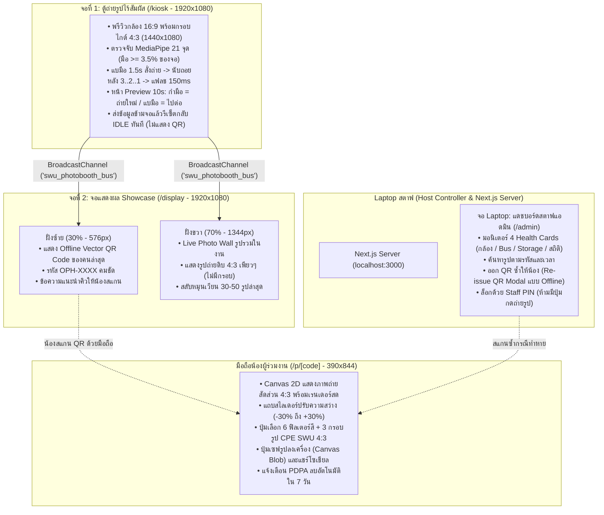
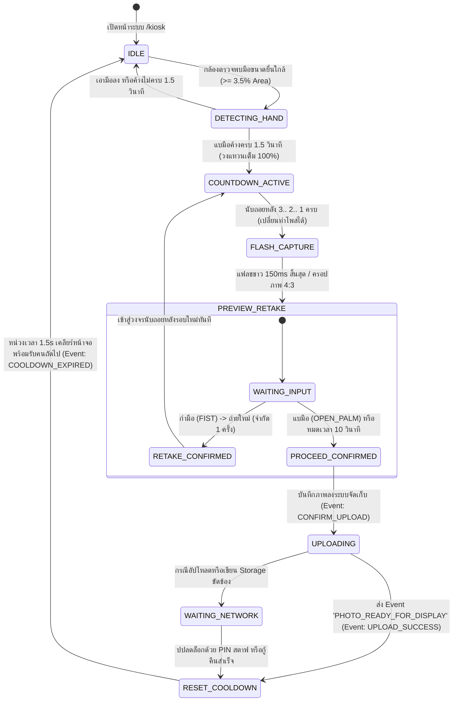

# Master System Prompt & Code-Ready Specification (Impeccable Luxury Tech Craft)

**โครงการ**: SWU Open House — AI Photo Booth (สาขาวิชาวิศวกรรมคอมพิวเตอร์ CPE มหาวิทยาลัยศรีนครินทรวิโรฒ)  
**มาตรฐานการออกแบบ**: `/impeccable` (Editorial Precision, Dark Studio Luxury & Production-Grade Code)  
**สถาปัตยกรรมฮาร์ดแวร์**: 1 Laptop สตาฟ + 2 จอแสดงผลภายนอก (Windows Extended Desktop 1080p) + มือถือผู้ร่วมงาน (Mobile Web)  
**เวอร์ชันระบบเป้าหมาย**: Next.js 15 (App Router), React 19, TypeScript 5.9, Tailwind CSS v4, MediaPipe Vision Tasks  
**เอกสารอ้างอิงหลัก**: [decisions.md](decisions.md) | [system-overview.md](system-overview.md) | [web/lib/contracts.ts](../web/lib/contracts.ts)

---

## สารบัญ (Table of Contents)

1. [ปรัชญาและระบบการออกแบบระดับ Impeccable (Luxury Tech Craft System)](#1-ปรัชญาและระบบการออกแบบระดับ-impeccable-luxury-tech-craft-system)
   - 1.1 [แก่นแนวคิดการออกแบบ (Design POV & Aesthetic Direction)](#11-แก่นแนวคิดการออกแบบ-design-pov--aesthetic-direction)
   - 1.2 [ชุดสีและโทเค็นความสว่าง (Color Tokens & OKLCH Specifications)](#12-ชุดสีและโทเค็นความสว่าง-color-tokens--oklch-specifications)
   - 1.3 [ระบบตัวพิมพ์และการจัดวางข้อมูล (Typography & Tabular Data Scale)](#13-ระบบตัวพิมพ์และการจัดวางข้อมูล-typography--tabular-data-scale)
   - 1.4 [จังหวะมิติ สัดส่วน และพื้นผิวเบราว์เซอร์ (Surfaces, Spatial Rhythm & Depth)](#14-จังหวะมิติ-สัดส่วน-และพื้นผิวเบราว์เซอร์-surfaces-spatial-rhythm--depth)
   - 1.5 [ระบบการเคลื่อนไหวและฟิสิกส์ปฏิสัมพันธ์ (Micro-Interactions & Motion Physics)](#15-ระบบการเคลื่อนไหวและฟิสิกส์ปฏิสัมพันธ์-micro-interactions--motion-physics)
   - 1.6 [กฎข้อห้ามเชิงศิลป์และมาตรฐาน Craft Floor (Craft Floor Bans & Standards)](#16-กฎข้อห้ามเชิงศิลป์และมาตรฐาน-craft-floor-craft-floor-bans--standards)
2. [ผังการเชื่อมต่อและสถานะการทำงาน (Screen Topology & State Architecture)](#2-ผังการเชื่อมต่อและสถานะการทำงาน-screen-topology--state-architecture)
   - 2.1 [สถาปัตยกรรมฮาร์ดแวร์ 3 จอ + 1 มือถือ](#21-สถาปัตยกรรมฮาร์ดแวร์-3-จอ--1-มือถือ)
   - 2.2 [State Machine ไร้สัมผัสของตู้ถ่ายรูป (Kiosk Touchless FSM)](#22-state-machine-ไร้สัมผัสของตู้ถ่ายรูป-kiosk-touchless-fsm)
   - 2.3 [TypeScript Data Contracts & BroadcastChannel Event Bus](#23-typescript-data-contracts--broadcastchannel-event-bus)
3. [Master System Prompt สำหรับ AI UI Generation (Stitch / v0 / Claude / Cursor)](#3-master-system-prompt-สำหรับ-ai-ui-generation-stitch--v0--claude--cursor)
   - 3.1 [Global Master System Prompt & Operational Context](#31-global-master-system-prompt--operational-context)
   - 3.2 [Prompt หน้าที่ 1: จอถ่ายรูปไร้สัมผัส (`/kiosk`)](#32-prompt-หน้าที่-1-จอถ่ายรูปไร้สัมผัส-kiosk)
   - 3.3 [Prompt หน้าที่ 2: จอแสดงผล Showcase 30/70 (`/display`)](#33-prompt-หน้าที่-2-จอแสดงผล-showcase-3070-display)
   - 3.4 [Prompt หน้าที่ 3: จอ Laptop สตาฟแอดมิน (`/admin`)](#34-prompt-หน้าที่-3-จอ-laptop-สตาฟแอดมิน-admin)
   - 3.5 [Prompt หน้าที่ 4: หน้าเว็บบนมือถือสำหรับน้อง (`/p/[code]` & `/find`)](#35-prompt-หน้าที่-4-หน้าเว็บบนมือถือสำหรับน้อง-pcode--find)
4. [โครงสร้างโค้ดจริงและ Component Anatomy (Code-Ready Implementation)](#4-โครงสร้างโค้ดจริงและ-component-anatomy-code-ready-implementation)
   - 4.1 [CSS Variables & Tailwind CSS v4 `@theme` Configuration](#41-css-variables--tailwind-css-v4-theme-configuration)
   - 4.2 [Component Anatomy: หน้าถ่ายรูป `/kiosk`](#42-component-anatomy-หน้าที่-1-kiosk)
   - 4.3 [Component Anatomy: หน้า Showcase `/display`](#43-component-anatomy-หน้าที่-2-display)
   - 4.4 [Component Anatomy: หน้า Admin Laptop `/admin`](#44-component-anatomy-หน้าที่-3-admin)
   - 4.5 [Component Anatomy: หน้า Mobile Editor `/p/[code]`](#45-component-anatomy-หน้าที่-4-pcode)
5. [เกณฑ์การตรวจสอบคุณภาพและการปฏิเสธข้อผิดพลาด (Craft Floor & Quality Audit)](#5-เกณฑ์การตรวจสอบคุณภาพและการปฏิเสธข้อผิดพลาด-craft-floor--quality-audit)

---

## 1. ปรัชญาและระบบการออกแบบระดับ Impeccable (Luxury Tech Craft System)

### 1.1 แก่นแนวคิดการออกแบบ (Design POV & Aesthetic Direction)

ตามปรัชญาของ `/impeccable` งานออกแบบระดับแนวหน้าไม่ได้เกิดจากการตกแต่งที่ฟุ่มเฟือย หากแต่เกิดจาก **ความแม่นยำทางวิศวกรรม (Engineering Precision), ลำดับสายตาที่เด็ดขาด (Visual Hierarchy), และความเคารพต่อบริบทการใช้งานจริง (Contextual Truth)**

* **ธีมหลัก (World Concept)**: **"Dark Studio Editorial & Precision Computer Engineering"**
  บรรยากาศห้องสตูดิโอถ่ายภาพระดับไฮเอนด์ผสมผสานกับหน้าจอวิศวกรรมคอมพิวเตอร์ขั้นสูง (CPE) ใช้พื้นผิวสีดำออบซิเดียนลึก (Deep Obsidian Black `#090D16`) เพื่อลดแสงสะท้อนรบกวนเลนส์กล้อง WebRTC และขับเน้นภาพถ่ายของผู้ร่วมงานให้โดดเด่นสมจริงที่สุด
* **บุคลิกทางสายตา (Visual Persona)**:
  - **Authoritative & Calm**: สุขุม หนักแน่น เป็นทางการ ไม่ฉูดฉาดแบบของเล่น
  - **Zero-Touch Ergonomics**: รองรับการใช้งานไร้สัมผัส 100% ด้วยระยะยืนหน้าตู้ 1.5–2.0 เมตร ทุกตัวอักษรและสัญลักษณ์หลักมองเห็นชัดเจนในพริบตา
  - **Local Resilient**: ทำงานออฟไลน์สมบูรณ์แบบบนเครือข่ายภายใน (Localhost / Subnet 192.168.x.x) ไม่พึ่งพา CDN ภายนอกในการเรนเดอร์ UI หรือ QR Code

---

### 1.2 ชุดสีและโทเค็นความสว่าง (Color Tokens & OKLCH Specifications)

ระบบสีถูกกำหนดบนพื้นที่สี **OKLCH (Oklab Chromaticity & Lightness)** เพื่อความสม่ำเสมอของการรับรู้สายตามนุษย์ (Perceptual Uniformity) พร้อมค่า Hex สำหรับการเรนเดอร์ในเบราว์เซอร์:

```
[Brand Identity — SWU CPE Heritage]
├── SWU Crimson Red (Primary): #CE1126 | oklch(0.48 0.22 25.0)  -> จุดดึงสายตาหลัก, วงแหวนนับเวลา, เส้น Active
├── SWU Scarlet Glow (Hover):  #EF4444 | oklch(0.62 0.22 25.0)  -> สภาวะ Interactive, Pulse Feedback
└── SWU Slate Navy (Secondary):#1E293B | oklch(0.28 0.04 255.0) -> กรอบโครงสร้างย่อย, เส้นแบ่งเลย์เอาต์

[Dark Studio Base — Light-Absorbing Surfaces]
├── Studio Obsidian (Base):    #090D16 | oklch(0.12 0.02 260.0) -> พื้นหลังจอ 1, จอ 2, Laptop, Mobile
├── Cyber Slate (Elevated):   #111827 | oklch(0.18 0.03 260.0) -> พื้นหลังแผงควบคุม QR Station, Admin Table
└── Pillarbox Mask:           rgba(9, 13, 22, 0.85) + backdrop-blur -> แถบมืดซ้าย-ขวาบนจอถ่ายรูป 16:9

[Functional Engineering Accents]
├── Vision Cyan (HUD / MediaPipe): #06B6D4 | oklch(0.72 0.15 210.0) -> เส้นโครงกระดูกมือ 21 จุด, พิกัดตรวจจับ
├── Emerald Success (Ready/Online):#10B981 | oklch(0.70 0.17 155.0) -> กล้องพร้อมใช้งาน, แบมือยืนยันไปต่อ
└── Amber Retake (Timer/Warning):  #F59E0B | oklch(0.76 0.17 75.0)  -> แถบนับเวลา Preview 10s, กำมือถ่ายใหม่

[Text & High-Contrast Readability (WCAG AAA Compliant)]
├── Text Primary:              #F8FAFC | oklch(0.98 0.01 240.0) -> คอนทราสต์ 14.8:1 บน Studio Obsidian
├── Text Secondary:            #94A3B8 | oklch(0.70 0.03 250.0) -> คอนทราสต์ 7.1:1 (ผ่านเกณฑ์ WCAG AAA)
└── Text Muted:                #8492A6 | oklch(0.65 0.03 250.0) -> คอนทราสต์ 5.2:1 (ผ่านเกณฑ์ WCAG AA/AAA)
```

---

### 1.3 ระบบตัวพิมพ์และการจัดวางข้อมูล (Typography & Tabular Data Scale)

1. **ฟอนต์หลักสำหรับข้อความและหัวข้อ (Display & UI Sans)**:
   - ตระกูลหลัก: `Prompt`, `Plus Jakarta Sans`, `Inter`, `sans-serif`
   - การปรับ Tracking: หัวข้อขนาดใหญ่ (Display) บีบช่องไฟแน่น `-0.03em` เพื่อความกระชับ หนักแน่น และมีมิติทางสายตาแบบนิตยสารชั้นสูง
   - ความกว้างบรรทัดข้อความ (Line Measure): รักษาความกว้างเนื้อหาที่ 60–75 ตัวอักษรเพื่อการอ่านที่สบายตา
2. **ฟอนต์ข้อมูลทางวิศวกรรม (Technical Data Monospace)**:
   - ตระกูลหลัก: `JetBrains Mono`, `Space Mono`, `monospace`
   - ตัวเลขแบบคงความกว้าง: กำหนด `font-variant-numeric: tabular-nums` เสมอ เพื่อป้องกันไม่ให้ตัวเลขนับถอยหลัง `3.. 2.. 1..` และเวลานับถอยหลังสั่นไหวระหว่างการรีเฟรชเฟรม
   - ข้อบังคับการใช้ Monospace: ใช้เฉพาะข้อมูลเชิงตัวเลข, รหัสภาพ (`OPH-XXXX`), อัตราเฟรมเรตกล้อง, พิกัด X/Y/Z ของข้อต่อมือ MediaPipe, และเวลา Timestamp เท่านั้น **ห้ามใช้ Monospace กับชื่อแบรนด์หรือข้อความทั่วไป**

---

### 1.4 จังหวะมิติ สัดส่วน และพื้นผิวเบราว์เซอร์ (Surfaces, Spatial Rhythm & Depth)

* **ความลึกและเงา (Layered Depth & Soft Ambient Occlusion)**:
  ปฏิเสธเงาแข็งทึบแบบการ์ตูน (`box-shadow: 4px 4px 0`) ใช้เงา 2 ชั้นที่นุ่มนวลและกระจายแสงสมจริง:
  `box-shadow: 0 10px 25px -5px rgba(0, 0, 0, 0.6), 0 8px 10px -6px rgba(0, 0, 0, 0.5)`
* **การปรับแต่งพื้นผิวเบราว์เซอร์ครบวงจร (Polished Browser Surfaces)**:
  - สีการไฮไลต์ข้อความ: `::selection { background: #CE1126; color: #FFFFFF; }`
  - แถบเลื่อน (Custom Scrollbar): ความกว้างบาง 6px, พื้นหลังโปร่งใส, หัวเลื่อนสี `#1E293B` เปลี่ยนเป็น `#CE1126` เมื่อเลื่อน
  - สีเคอร์เซอร์แป้นพิมพ์: `caret-color: #CE1126;`
  - วงแหวนโฟกัส (Focus Rings): เส้นกรอบคมชัดพร้อม Offset `*:focus-visible { outline: 2px solid #06B6D4; outline-offset: 2px; }`
  - เส้นใต้ลิงก์: `text-underline-offset: 4px;`

---

### 1.5 ระบบการเคลื่อนไหวและฟิสิกส์ปฏิสัมพันธ์ (Micro-Interactions & Motion Physics)

* **เส้นโค้งการเคลื่อนไหว (Easing Function)**:
  ใช้ Editorial Deceleration Curve `cubic-bezier(0.16, 1, 0.3, 1)` (Apple/Craft Style) ที่เริ่มต้นเร็วและชะลอตัวอย่างนุ่มนวล
* **ฟิสิกส์ชัตเตอร์แฟลช 150ms (Exponential White Flash Decay)**:
  เมื่อถ่ายภาพ จอจะวาบเป็นสีขาวบริสุทธิ์ `#FFFFFF` ที่ Opacity 100% ภายใน 20ms แล้วค่อยๆ ดับวูบกลับสู่ภาพพรีวิวด้วยเส้นโค้ง Exponential ภายใน 130ms เลียนแบบการทำงานของไฟสตูดิโอระดับโปร
* **วงแหวนวัดความต่อเนื่องของมือ 1.5 วินาที (Radial Hold Progress)**:
  วงแหวน SVG รอบสัญลักษณ์มือจะเติมเต็มจาก 0% ถึง 100% ตามระยะเวลาที่แบมือค้าง หากเอามือออกก่อน วงแหวนจะถอยร่นกลับสู่ 0% ทันทีเพื่อป้องกันการสั่งถ่ายโดยไม่ตั้งใจ (Ghost Trigger)

---

### 1.6 กฎข้อห้ามเชิงศิลป์และมาตรฐาน Craft Floor (Craft Floor Bans & Standards)

เพื่อรักษาความเรียบหรูระดับพรีเมียมตามข้อกำหนด `/impeccable` งานออกแบบทุกหน้าจอต้องปฏิบัติตามกฎเหล็กเหล่านี้อย่างเคร่งครัด:

1. **ห้ามใช้ Kicker / Eyebrow เหนือหัวข้อ**: หัวข้อหลักอย่าง `<h1>` หรือ `<h2>` ต้องทำหน้าที่ด้วยน้ำหนักของตนเอง ห้ามใส่ป้ายกลมหรือแท็กข้อความเล็กๆ วางทับอยู่เหนือหัวข้อเด็ดขาด
2. **ห้ามใช้ Gradient Text**: การเน้นคำต้องใช้ขนาด (Scale), ความหนา (Weight), หรือสีคอนทราสต์สูงเท่านั้น
3. **ห้ามใช้การไล่เฉดสีม่วง-คราม (Purple/Indigo AI Gradient)**: ให้ใช้เฉพาะชุดสีอัตลักษณ์ มศว (แดง `#CE1126`, เทา `#1E293B`, ออบซิเดียน `#090D16`)
4. **ห้ามเกิด Card Fatigue**: ห้ามใช้กล่องการ์ดขนาดเท่ากันเรียงต่อกันเป็นแพทเทิร์นขี้เกียจ การจัดวางต้องมีสัดส่วนหลัก-รองที่เด็ดขาด (เช่น 30/70 Split บนจอ Showcase)
5. **ห้ามใช้ Monospace เป็นคอสตูม**: ห้ามใช้ฟอนต์ Monospace กับชื่อสถาบันหรือข้อความอธิบาย ให้ใช้เฉพาะข้อมูลตัวเลข รหัสภาพ และค่าพิกัดวิศวกรรมเท่านั้น
6. **ห้ามมีปุ่มสั่งถ่ายรูปบนจอ Admin**: สิทธิ์การสั่งชัตเตอร์เป็นของผู้ร่วมงานผ่าน AI Vision บน Screen 1 เท่านั้น เพื่อความปลอดภัยและสุขลักษณะไร้สัมผัส

---

## 2. ผังการเชื่อมต่อและสถานะการทำงาน (Screen Topology & State Architecture)

### 2.1 สถาปัตยกรรมฮาร์ดแวร์ 3 จอ + 1 มือถือ

ระบบจัดวางบน **Laptop สตาฟ 1 เครื่อง** และต่อจอแสดงผลภายนอก **2 จอ** ผ่านสาย HDMI/Type-C (Windows Extended Desktop) ซิงค์ข้อมูลข้ามแท็บด้วย `BroadcastChannel('swu_photobooth_bus')` ภายในเครื่องแบบ 0ms ไม่ต้องพึ่งพาอินเทอร์เน็ตภายนอก:



---

### 2.2 State Machine ไร้สัมผัสของตู้ถ่ายรูป (Kiosk Touchless FSM)

ลำดับการทำงานของจอที่ 1 (`/kiosk`) ถูกควบคุมด้วย Finite State Machine ที่แม่นยำ ป้องกันข้อผิดพลาดจากแสงรบกวนหรือการเคลื่อนไหวหน้าบูท:



---

### 2.3 TypeScript Data Contracts & BroadcastChannel Event Bus

โค้ดที่รันจริงในระบบใช้สัญญาข้อมูล (Contracts) ร่วมกันตามมาตรฐาน `web/lib/contracts.ts`:

```typescript
// web/lib/contracts.ts
export type GestureType = "OPEN_PALM" | "FIST" | "PEACE_SIGN" | "MINI_HEART" | "NONE";

export type KioskFSMState =
  | "IDLE"
  | "DETECTING_HAND"
  | "COUNTDOWN_ACTIVE"
  | "FLASH_CAPTURE"
  | "PREVIEW_RETAKE"
  | "UPLOADING"
  | "WAITING_NETWORK"
  | "RESET_COOLDOWN";

// เหตุการณ์สื่อสารข้ามจอผ่าน BroadcastChannel ('swu_photobooth_bus')
export type ScreenSyncEvent =
  | {
      type: "PHOTO_READY_FOR_DISPLAY";
      code: string;         // เช่น "OPH-AB29"
      qrUrl: string;        // เช่น "http://192.168.1.10:3000/p/OPH-AB29"
      photoUrl: string;     // URL ของภาพดิบ 4:3
      createdAt: string;    // ISO 8601 Timestamp
    }
  | {
      type: "SCREEN1_RESET";
    };

// ข้อมูลสถานะการมองเห็นและการตรวจจับมือ (Dev 1 AI Vision -> Dev 2 Kiosk UI)
export interface HandDetectionState {
  isCameraReady: boolean;
  cameraError: string | null;
  isHandPresent: boolean;
  detectedGesture: GestureType;
  confidence: number;
  holdDurationMs: number; // 0 ถึง 1500 ms
  holdProgress: number;   // 0 ถึง 100%
  isTriggerReady: boolean;
}

// ข้อมูลการแต่งรูปบนมือถือ (Dev 3 Mobile Editor)
export type FilterPresetId = "original" | "warm" | "cool" | "vintage" | "bw" | "rosy";
export type CPEFrameTemplateId = "cpe-official" | "cpe-tech-circuit" | "cpe-photostrip";

export const PHOTO_ASPECT_RATIO = "4:3" as const;
export const CROP_DIMENSIONS_4_3 = { width: 1440, height: 1080 } as const;
```

---

## 3. Master System Prompt สำหรับ AI UI Generation (Stitch / v0 / Claude / Cursor)

ส่วนนี้ได้รับการสังเคราะห์ขึ้นเพื่อให้สามารถคัดลอก (Copy-Paste) ไปใช้งานในเครื่องมือสร้าง UI อัตโนมัติ (เช่น **Google Stitch**, **v0.dev**, **Claude 3.7 Artifacts**, **Cursor AI**, หรือ **ChatGPT Canvas**) ได้ผลลัพธ์เป็นหน้าจอ UI ที่สวยหรู มีคลาสระดับสากล และตรงตามสถาปัตยกรรม 100%

### 3.1 Global Master System Prompt & Operational Context

คัดลอกบล็อกคำสั่งนี้เป็น **System Context** เริ่มต้นในทุกเครื่องมือ:

```markdown
You are an award-winning Principal Design Technologist and UI Architect specializing in high-end editorial tech interfaces and dark studio ergonomics.
You are designing the complete 4-screen suite for "SWU Open House — CPE AI Photo Booth" (Srinakharinwirot University Computer Engineering).

[STRICT AESTHETIC DIRECTIVES & CRAFT FLOOR]
1. Visual World: "Dark Studio Editorial & Precision Computer Engineering". High-contrast deep obsidian base (#090D16), slate card elevation (#111827), authentic SWU Crimson Red (#CE1126), and engineering cyber cyan accents (#06B6D4 for MediaPipe 21 hand landmarks).
2. Prohibited AI Tropes (Craft Floor Bans):
   - NO purple/indigo gradient backgrounds.
   - NO gradient text (emphasis comes strictly from weight, size, or contrast).
   - NO repetitive identical 3-card decks (card fatigue).
   - NO kickers or eyebrows above headings (let the main heading carry its own weight).
   - NO fake monospace costumes for non-code text (brand names and descriptions stay in clean sans-serif).
3. Typography: Sans-serif (Prompt / Plus Jakarta Sans) for editorial headings with tight letter-tracking (-0.03em). Monospace (JetBrains Mono) with 'font-variant-numeric: tabular-nums' strictly for identifiers ('OPH-XXXX'), timers, coordinates, and system telemetry.
4. Touchless Philosophy: The photo capture screen is 100% gesture-controlled (Open Palm 1.5s hold, 3..2..1 countdown, 150ms white shutter flash, 10s preview with Fist=Retake and Palm=Confirm). NEVER display a QR code on the capture screen; it immediately resets to IDLE after delegating to the Showcase display via BroadcastChannel ('swu_photobooth_bus').
5. Code Stack: Next.js 15 App Router, React 19, TypeScript, Tailwind CSS v4, Lucide Icons.
```

---

### 3.2 Prompt หน้าที่ 1: จอถ่ายรูปไร้สัมผัส (`/kiosk`)

* **Viewport**: `1920x1080 px` (16:9 Landscape Fullscreen)
* **โหมด UI**: Camera Viewfinder with 4:3 Central Crop
* **Design Mode**: `Operate` (Touchless Camera System)

```markdown
[SCREEN 1 MASTER PROMPT: KIOSK TOUCHLESS CAPTURE SCREEN]
Create a production-grade 16:9 widescreen (1920x1080) camera viewfinder interface for the route '/kiosk' in dark studio mode.

Layout & Geometry:
- Fullscreen WebRTC video feed container (16:9) centered on screen.
- Active Photo Capture Zone: Perfectly centered 4:3 frame (1440x1080 px, taking exactly 75% width). Outlined with an elegant 1.5px SWU crimson border (#CE1126/60) with subtle corner brackets (L-shaped studio crop marks).
- Pillarbox Masks: Left and right sides (each 12.5% width, 240px wide) covered with a semi-opaque dark obsidian vignette mask (rgba(9, 13, 22, 0.85) with backdrop-blur-md).
  - Left Pillarbox: Branding label "SWU Computer Engineering • Open House 2026", camera resolution indicator "1440x1080 RAW 4:3", and WebRTC latency counter "60 FPS • 0 Frame Drops".
  - Right Pillarbox: Gesture guide panel showing minimalist drawn icons:
    1) 🖐️ "แบมือค้าง 1.5 วินาที" (Hold Open Palm 1.5s to Start)
    2) ⏱️ "นับถอยหลัง 3 วินาที" (3s Countdown with Audio Beep)
    3) ✊ "กำมือเพื่อถ่ายใหม่" (Fist to Retake during Preview)

Interactive State Overlay Variations:
- State A (Standby / Hand Detection): Real-time MediaPipe 21 skeletal landmarks drawn over the user's hand with cyan dots (#06B6D4) and thin connecting lines. When open palm is detected, a circular SVG progress ring in SWU crimson (#CE1126) smoothly animates from 0% to 100% around the palm position over 1.5s, with a high-contrast label "กำลังเริ่มถ่าย... (HOLD)".
- State B (Countdown 3..2..1): Massive, ultra-crisp tabular numeral (3, 2, or 1) in center screen (#F8FAFC, font-weight 800, tracking -0.04em) accompanied by a pulsating concentric ring. Audio cue indicator and subtitle: "เปลี่ยนท่าโพสได้ตามสบาย (Posing Freedom)".
- State C (Shutter Flash 150ms): Pure white flash overlay (rgba(255, 255, 255, 1)) that instantaneously illuminates the entire screen and decays within 150ms using exponential ease-out.
- State D (10s Touchless Preview): The 4:3 captured still photo is displayed inside the central frame. Above it sits a sleek amber depletion timer bar smoothly counting down 10.0s -> 0.0s. Bottom control pills: Left pill shows drawn Fist icon "✊ กำมือ = ถ่ายใหม่ (Retake 1/1)", Right pill shows drawn Open Palm icon "🖐️ แบมือ = ยืนยันไปต่อ (Confirm & Send)".
- Strict Rule: Absolutely NO QR code on this screen. Upon confirmation or 10s timeout, a discreet status toast "กำลังส่งรูปไปยังจอแสดงผล... (Syncing to Screen 2)" appears, and the view smoothly resets to Standby IDLE within 1.5s.
```

---

### 3.3 Prompt หน้าที่ 2: จอแสดงผล Showcase 30/70 (`/display`)

* **Viewport**: `1920x1080 px` (16:9 Landscape Fullscreen)
* **โหมด UI**: Asymmetric Split-Screen Showcase
* **Design Mode**: `Experience` (Public Gallery & QR Claim Station)

```markdown
[SCREEN 2 MASTER PROMPT: SHOWCASE & LIVE PHOTO WALL SCREEN]
Design an asymmetric 16:9 split-screen showcase interface (1920x1080) for the route '/display' with an opulent dark studio aesthetic.

Layout Architecture (30 / 70 Ratio):
- Left Section (30% Width, 576px): Dedicated "QR Code Station" for the latest attendee.
  - Background: Deep Obsidian Slate (#111827) with a subtle vertical divider (#1E293B).
  - Top Strip: Live event indicator with glowing emerald dot (#10B981) and text "SWU CPE Photo Booth Live".
  - Headline: "รับรูปถ่ายของคุณ" in crisp white (#F8FAFC, 32px, font-weight 800, tracking -0.03em, NO kicker above). Subtitle: "สแกน QR Code เพื่อเลือกฟิลเตอร์และกรอบ CPE SWU บนมือถือ".
  - QR Code Container: A pristine, high-contrast white card with soft ambient shadow (280x280 px) containing a razor-sharp vector QR code generated locally offline.
  - Identification Tag: Below the QR, display the unique photo code in large tabular monospace "OPH-AB29" (#F8FAFC, 36px, bold, letter-spacing 0.15em) with an amber badge "หมดอายุใน 7 วัน (PDPA TTL)".
  - Queue Advisory Card: "กรุณาสแกนรับรูปทันทีก่อนคนถัดไปเริ่มถ่าย • หรือจดรหัส OPH-AB29 ไว้ค้นหาย้อนหลังที่ /find".

- Right Section (70% Width, 1344px): "Live Photo Wall".
  - Headline Bar: "Live Photo Wall • ประมวลภาพถ่ายสดในงาน" with active counter badge "38 รูปถ่ายล่าสุด".
  - Grid Gallery: A dynamic, staggered grid displaying 30–50 recent photos.
  - STRICT RATIO REQUIREMENT: Every single photo in the gallery MUST maintain the raw 4:3 aspect ratio (1440x1080 proportion) with zero decorative outer frames. The photos are pure unadorned captures honoring the attendees.
  - Entrance Animation: When a new photo event is received via BroadcastChannel ('swu_photobooth_bus'), it gracefully glides into the first slot of the grid with a subtle scale-in glow (duration: 600ms, ease-out cubic-bezier(0.16, 1, 0.3, 1)).
```

---

### 3.4 Prompt หน้าที่ 3: จอ Laptop สตาฟแอดมิน (`/admin`)

* **Viewport**: `1920x1080 px` / `1440x900 px` (Desktop/Laptop Interface)
* **โหมด UI**: Staff Monitoring & Photo Recovery Dashboard
* **Design Mode**: `Operate` (Administrative Command Center)

```markdown
[SCREEN 3 MASTER PROMPT: STAFF ADMIN & MONITORING PORTAL]
Design an authoritative, dark-mode administrative operations portal for the route '/admin' running on the staff laptop.

Security & Authentication:
- Protected by a 4-to-6 digit numeric Staff PIN keypad modal with tactile dark slate buttons, disguised bullet input, and SWU crimson confirm button.
- Session timeout indicator and logout trigger in the top navigation bar.

Top Header & Brand Bar:
- Left: "SWU CPE Photo Booth • Staff Command Center".
- Center: System uptime counter and local server address indicator ("localhost:3000 • Subnet: 192.168.1.10").
- Right: Staff profile chip ("Staff On Duty: Booth Lead") and Lock/Logout button.

Section 1: System Health Telemetry (4 Compact Metric Cards):
1) WebRTC Camera Hardware: Green status dot, "1080p @ 60 FPS • Center Crop 4:3 Active • 0 Frame Drops".
2) Inter-Screen BroadcastChannel: "Channel 'swu_photobooth_bus' • Connected: Screen 1 & Screen 2 • 0ms Bus Latency".
3) Storage Engine & Sync: "Local SSD: 1.2 GB / 256 GB (Healthy) • Cloudflare R2 Sync: 100% Synced".
4) Total Captures & PDPA Status: "Total: 142 Photos Today • Auto-Purge Service: Running (7-Day TTL Active)".

Section 2: Photo Lookup & Operations Table:
- Toolbar: High-efficiency search input with placeholder "ค้นหารหัส OPH-XXXX หรือช่วงเวลา..." and quick filters ("รูปล่าสุด 15 นาที", "1 ชั่วโมง", "ทั้งหมด").
- Table Columns:
  1) Thumbnail: 4:3 aspect ratio miniature preview.
  2) Photo Code: Tabular monospace font (e.g. `OPH-AB29`).
  3) Capture Timestamp: Exact local time with relative tag ("2 นาทีที่แล้ว").
  4) Storage Driver: Badge showing "Local SSD" or "Cloudflare R2".
  5) Action: High-contrast button "Re-issue QR (เปิด QR บนจอ Laptop)".
- Re-issue QR Modal: Clicking "Re-issue QR" opens a focused, high-contrast modal presenting a massive QR code generated locally on the laptop screen alongside the attendee's code, allowing staff to re-serve attendees who lost their code without disturbing the kiosk.

STRICT OPERATIONAL BAN:
- Under NO circumstance shall there be any button to remotely trigger the camera or take a photo on this screen. The photo capture sequence belongs exclusively to the attendee via touchless computer vision on Screen 1.
```

---

### 3.5 Prompt หน้าที่ 4: หน้าเว็บบนมือถือสำหรับน้อง (`/p/[code]` & `/find`)

* **Viewport**: `390x844 px` (Mobile Portrait Viewport)
* **โหมด UI**: Touch-Friendly Mobile Canvas Photo Editor
* **Design Mode**: `Operate` (Mobile Creative Studio)

```markdown
[SCREEN 4 MASTER PROMPT: MOBILE PHOTO EDITOR & FRAME APPLIER]
Design an elegant, thumb-optimized mobile web application (390x844 portrait) for the routes '/p/[code]' and '/find' in dark studio aesthetic.

Header & Legal Banner:
- Title: "แต่งรูปถ่ายของคุณ" in crisp white (#F8FAFC, 24px, font-weight 700, NO kicker above).
- Code Badge: Prominent pill displaying attendee photo code "OPH-AB29" with a discreet security shield icon and PDPA legal notice: "ภาพถ่ายของคุณจะถูกลบออกจากเซิร์ฟเวอร์โดยอัตโนมัติภายใน 7 วัน (PDPA Compliance)".

Interactive Canvas 2D Viewport:
- Central Photo Preview: Exactly 4:3 aspect ratio (342x256.5 px) rounded with 12px border radius and 1px border (#1E293B).
- Real-time Compositing: Renders the attendee's original photo layered beneath the selected transparent PNG frame overlay and color adjustments at full 1440x1080 resolution.

Control Panel (Segmented Tabs / Drawer):
1) Tab 1 - Color Filters & Brightness:
   - Horizontal scrollable filter selector with 6 live preset buttons:
     * 1. 'Original' (ภาพต้นฉบับคมชัด)
     * 2. 'Bright / Clear' (สว่างใสโทนอุ่น)
     * 3. 'Warm Vintage' (เรโทรฟิล์มคลาสสิก)
     * 4. 'Cool Cyber' (โทนเย็นสไตล์วิศวกรรม)
     * 5. 'Film Grain / Rosy' (โทนฟิล์มอมชมพู มศว)
     * 6. 'B&W Contrast' (ขาวดำคมเข้มคลาสสิก)
   - Fine-tuning Slider: Smooth brightness adjustment slider with range -30% to +30%, zero-center mark, and reset pill.

2) Tab 2 - Official CPE SWU 4:3 Frames:
   - 3 Card options showing realistic previews:
     * Frame 1: 'Official SWU Classic' (แถบสีเทา-แดง มศว ตราสัญลักษณ์ทางการ)
     * Frame 2: 'CPE Tech Graphic' (กราฟิกลายวงจรแผงวงจรและโค้ดดิ้ง AI สไตล์วิศวะคอมพ์)
     * Frame 3: 'Minimalist Photostrip' (กรอบสไตล์ฟิล์มโพลาลอยด์มินิมอล)

Bottom Sticky Action Bar:
- Primary Button: "บันทึกรูปลงมือถือ (Save Photo)" in bold SWU Crimson Red (#CE1126) with Download icon (triggers Canvas blob download).
- Secondary Button: "แชร์รูปภาพ (Share)" using Web Share API with Share2 icon.

Secondary Route '/find':
- Clean, focused mobile screen with a 4-digit tabular monospace input for 'OPH-XXXX' allowing attendees who missed the QR scan to retrieve their photo instantly.
```

---

## 4. โครงสร้างโค้ดจริงและ Component Anatomy (Code-Ready Implementation)

### 4.1 CSS Variables & Tailwind CSS v4 `@theme` Configuration

การตั้งค่า Tailwind CSS v4 ที่สมบูรณ์แบบสำหรับ `web/app/globals.css`:

```css
/* web/app/globals.css - Impeccable Dark Studio Luxury Tokens */
@import "tailwindcss";

@theme {
  --color-swu-red: #CE1126;
  --color-swu-red-hover: #EF4444;
  --color-swu-slate: #1E293B;
  
  --color-studio-base: #090D16;
  --color-studio-elevated: #111827;
  --color-studio-border: #1E293B;
  
  --color-tech-cyan: #06B6D4;
  --color-status-success: #10B981;
  --color-status-warning: #F59E0B;
  
  --color-text-primary: #F8FAFC;
  --color-text-secondary: #94A3B8;
  --color-text-muted: #8492A6;
  
  --font-sans: 'Prompt', 'Plus Jakarta Sans', system-ui, sans-serif;
  --font-mono: 'JetBrains Mono', 'Space Mono', monospace;
  
  --ease-editorial: cubic-bezier(0.16, 1, 0.3, 1);
}

@layer base {
  :root {
    --color-swu-red: #CE1126;
    --color-swu-red-hover: #EF4444;
    --color-swu-slate: #1E293B;
    --color-studio-base: #090D16;
    --color-studio-elevated: #111827;
    --color-studio-border: #1E293B;
    --color-tech-cyan: #06B6D4;
    --color-status-success: #10B981;
    --color-status-warning: #F59E0B;
    --color-text-primary: #F8FAFC;
    --color-text-secondary: #94A3B8;
    --color-text-muted: #8492A6;
  }

  body {
    background-color: var(--color-studio-base);
    color: var(--color-text-primary);
    font-family: var(--font-sans);
    -webkit-font-smoothing: antialiased;
    overflow-x: hidden;
    caret-color: var(--color-swu-red);
  }

  /* Polished Browser Surfaces */
  ::selection {
    background-color: var(--color-swu-red);
    color: #FFFFFF;
  }

  *:focus-visible {
    outline: 2px solid var(--color-tech-cyan);
    outline-offset: 2px;
  }

  a, button {
    text-underline-offset: 4px;
  }

  ::-webkit-scrollbar {
    width: 6px;
    height: 6px;
  }

  ::-webkit-scrollbar-track {
    background: transparent;
  }

  ::-webkit-scrollbar-thumb {
    background: var(--color-studio-border);
    border-radius: 9999px;
  }

  ::-webkit-scrollbar-thumb:hover {
    background: var(--color-swu-red);
  }
}
```

---

### 4.2 Component Anatomy: หน้าถ่ายรูป `/kiosk`

ไฟล์ `web/app/kiosk/page.tsx` ที่แก้ไขบั๊ก FSM Transitions และการหน่วงเวลาเรียบร้อยแล้ว:

```tsx
// web/app/kiosk/page.tsx - Production-Ready Component Anatomy
'use client';

import React, { useEffect, useRef, useState, useCallback } from 'react';
import { useKioskFSM } from '@/lib/kiosk/useKioskFSM';
import { 
  PHOTO_ASPECT_RATIO, 
  CROP_DIMENSIONS_4_3, 
  ScreenSyncEvent, 
  HandDetectionState 
} from '@/lib/contracts';

export default function KioskCaptureScreen() {
  const { state, send } = useKioskFSM();
  const channelRef = useRef<BroadcastChannel | null>(null);
  const [countdownNum, setCountdownNum] = useState<number>(3);
  const [previewSecondsLeft, setPreviewSecondsLeft] = useState<number>(10);
  const [isFlashing, setIsFlashing] = useState<boolean>(false);
  const [sampleCapturedUrl, setSampleCapturedUrl] = useState<string>('/sample-photo.jpg');

  useEffect(() => {
    // เชื่อมต่อ BroadcastChannel สื่อสารข้ามจอใน Laptop แบบ 0ms
    channelRef.current = new BroadcastChannel('swu_photobooth_bus');
    return () => {
      channelRef.current?.close();
    };
  }, []);

  // วงจรยืนยันส่งภาพและรีเซ็ตจอ 1 ตาม FSM
  const handleProceedAndBroadcast = useCallback(() => {
    // 1. ส่งสัญญาณเปลี่ยนสถานะเป็น UPLOADING
    send({ type: 'CONFIRM_UPLOAD' });

    const code = 'OPH-' + Math.random().toString(36).substring(2, 6).toUpperCase();
    const syncEvent: ScreenSyncEvent = {
      type: 'PHOTO_READY_FOR_DISPLAY',
      code,
      qrUrl: `${window.location.origin}/p/${code}`,
      photoUrl: sampleCapturedUrl,
      createdAt: new Date().toISOString(),
    };

    // 2. บรอดแคสต์ข้อมูลไปยัง Screen 2 ทันที
    channelRef.current?.postMessage(syncEvent);

    // 3. แจ้ง FSM ว่าอัปโหลดสำเร็จ เข้าสู่ RESET_COOLDOWN
    send({ type: 'UPLOAD_SUCCESS' });

    // 4. หน่วงเวลา 1.5 วินาที แล้วรีเซ็ตกลับสู่ IDLE พร้อมรับคนถัดไป
    setTimeout(() => {
      send({ type: 'COOLDOWN_EXPIRED' });
    }, 1500);
  }, [send, sampleCapturedUrl]);

  // จัดการเวลานับถอยหลังพรีวิว 10 วินาที
  useEffect(() => {
    if (state === 'PREVIEW_RETAKE') {
      setPreviewSecondsLeft(10);
      const timer = setInterval(() => {
        setPreviewSecondsLeft((prev) => {
          if (prev <= 1) {
            clearInterval(timer);
            handleProceedAndBroadcast();
            return 0;
          }
          return prev - 1;
        });
      }, 1000);
      return () => clearInterval(timer);
    }
  }, [state, handleProceedAndBroadcast]);

  return (
    <main 
      className="relative flex h-screen w-screen items-center justify-center overflow-hidden bg-studio-base text-text-primary select-none"
      role="region"
      aria-label="Kiosk Touchless Capture Screen"
    >
      {/* 16:9 Viewfinder Container with 4:3 Guides */}
      <div className="relative aspect-video w-full h-full max-w-[1920px] max-h-[1080px] overflow-hidden flex items-center justify-center">
        
        {/* Left Pillarbox Mask (12.5% = 240px) */}
        <aside className="absolute inset-y-0 left-0 w-[12.5%] z-20 bg-studio-base/85 backdrop-blur-md border-r border-studio-border p-6 flex flex-col justify-between">
          <div>
            <div className="text-xs font-semibold tracking-wider text-swu-red">SWU COMPUTER ENGINEERING</div>
            <div className="text-[11px] text-text-secondary mt-0.5">OPEN HOUSE 2026</div>
          </div>
          <div className="space-y-4">
            <div className="text-xs text-text-secondary leading-relaxed">
              <span className="block font-semibold text-text-primary">สัดส่วนภาพถ่าย</span>
              RAW {PHOTO_ASPECT_RATIO} ({CROP_DIMENSIONS_4_3.width}x{CROP_DIMENSIONS_4_3.height})
            </div>
            <div className="text-[11px] font-mono text-tech-cyan">MediaPipe 21-pt Active</div>
          </div>
        </aside>

        {/* Right Pillarbox Mask (12.5% = 240px) */}
        <aside className="absolute inset-y-0 right-0 w-[12.5%] z-20 bg-studio-base/85 backdrop-blur-md border-l border-studio-border p-6 flex flex-col justify-between text-right">
          <div className="text-xs font-mono text-text-muted uppercase">HUD STATUS</div>
          <div className="space-y-3 text-xs text-text-secondary">
            <div className="p-3 rounded-xl bg-studio-elevated border border-studio-border">
              <div className="font-semibold text-text-primary mb-1">🖐️ แบมือ 1.5 วิ</div>
              <div className="text-[11px]">เริ่มถ่ายภาพ</div>
            </div>
            <div className="p-3 rounded-xl bg-studio-elevated border border-studio-border">
              <div className="font-semibold text-text-primary mb-1">✊ กำมือ</div>
              <div className="text-[11px]">ถ่ายใหม่ในพรีวิว</div>
            </div>
          </div>
        </aside>

        {/* Central 4:3 Active Zone (75% Width = 1440px) */}
        <section 
          className="relative h-full w-[75%] border-x-2 border-swu-red/40 flex items-center justify-center overflow-hidden"
          aria-live="polite"
        >
          {/* Live Video Feed Element (Mirrored) */}
          <video 
            className="absolute inset-0 h-full w-full object-cover scale-x-[-1]"
            autoPlay 
            playsInline 
            muted 
          />

          {/* MediaPipe 21 Landmarks Canvas Layer */}
          <canvas className="absolute inset-0 h-full w-full pointer-events-none z-10" />

          {/* State: DETECTING_HAND */}
          {state === 'DETECTING_HAND' && (
            <div className="absolute z-30 flex flex-col items-center">
              <div className="relative h-28 w-28 flex items-center justify-center">
                <svg className="h-full w-full -rotate-90">
                  <circle cx="56" cy="56" r="48" stroke="#1E293B" strokeWidth="6" fill="transparent" />
                  <circle 
                    cx="56" cy="56" r="48" 
                    stroke="#CE1126" strokeWidth="6" fill="transparent" 
                    strokeDasharray="301.59" 
                    strokeDashoffset="100" 
                    className="transition-all duration-150"
                  />
                </svg>
                <span className="absolute text-2xl">🖐️</span>
              </div>
              <p className="mt-3 text-sm font-semibold tracking-wide text-text-primary bg-studio-base/80 px-4 py-1.5 rounded-full border border-swu-red/50">
                แบมือค้างไว้เพื่อเริ่มนับถอยหลัง...
              </p>
            </div>
          )}

          {/* State: COUNTDOWN_ACTIVE */}
          {state === 'COUNTDOWN_ACTIVE' && (
            <div className="absolute z-30 flex flex-col items-center">
              <span className="text-[120px] font-extrabold font-mono text-text-primary drop-shadow-2xl animate-pulse tabular-nums">
                {countdownNum}
              </span>
              <p className="text-sm text-text-secondary bg-studio-base/80 px-6 py-2 rounded-full border border-studio-border">
                เปลี่ยนท่าโพสได้อิสระ ไม่ต้องค้างมือ
              </p>
            </div>
          )}

          {/* State: FLASH_CAPTURE */}
          {isFlashing && (
            <div className="absolute inset-0 z-50 bg-white pointer-events-none transition-opacity duration-150" />
          )}

          {/* State: PREVIEW_RETAKE */}
          {state === 'PREVIEW_RETAKE' && (
            <div className="absolute inset-0 z-30 flex flex-col justify-between p-8 bg-studio-base/40 backdrop-blur-sm">
              {/* Top Countdown Bar */}
              <div className="w-full flex items-center space-x-4 bg-studio-elevated/90 p-4 rounded-xl border border-studio-border">
                <span className="text-sm font-mono text-status-warning font-bold tabular-nums">พรีวิว {previewSecondsLeft}s</span>
                <div className="flex-1 h-2 bg-studio-border rounded-full overflow-hidden">
                  <div 
                    className="h-full bg-status-warning transition-all duration-1000 ease-linear"
                    style={{ width: `${(previewSecondsLeft / 10) * 100}%` }}
                  />
                </div>
              </div>

              {/* Bottom Touchless Action Indicator */}
              <div className="flex justify-between items-center w-full px-8 pb-4">
                <button
                  onClick={() => send({ type: 'GESTURE_RETAKE_FIST' })}
                  className="flex items-center space-x-3 bg-studio-elevated/95 px-6 py-3.5 rounded-2xl border border-status-warning/50 shadow-xl cursor-pointer hover:bg-studio-elevated transition-colors"
                >
                  <span className="text-2xl">✊</span>
                  <div className="text-left">
                    <div className="text-xs text-text-secondary">ต้องการรูปใหม่?</div>
                    <div className="text-sm font-bold text-status-warning">กำมือ = ถ่ายใหม่ (Retake 1/1)</div>
                  </div>
                </button>

                <button
                  onClick={handleProceedAndBroadcast}
                  className="flex items-center space-x-3 bg-studio-elevated/95 px-6 py-3.5 rounded-2xl border border-status-success/50 shadow-xl cursor-pointer hover:bg-studio-elevated transition-colors"
                >
                  <span className="text-2xl">🖐️</span>
                  <div className="text-left">
                    <div className="text-xs text-text-secondary">ชอบรูปนี้แล้ว?</div>
                    <div className="text-sm font-bold text-status-success">แบมือ = ยืนยันส่งไปจอแสดงผล</div>
                  </div>
                </button>
              </div>
            </div>
          )}

          {/* State: RESET_COOLDOWN Toast */}
          {state === 'RESET_COOLDOWN' && (
            <div className="absolute z-30 flex items-center space-x-3 bg-studio-elevated px-6 py-3 rounded-full border border-status-success shadow-2xl">
              <span className="h-2.5 w-2.5 rounded-full bg-status-success animate-ping" />
              <span className="text-sm font-semibold text-text-primary">ส่งรูปไปจอแสดงผลเรียบร้อยแล้ว กำลังเตรียมพร้อม...</span>
            </div>
          )}
        </section>
      </div>
    </main>
  );
}
```

---

### 4.3 Component Anatomy: หน้า Showcase `/display`

ไฟล์ `web/app/display/page.tsx` ที่ใช้การสร้าง QR Code แบบ Offline 100% ด้วยไลบรารี `qrcode`:

```tsx
// web/app/display/page.tsx - Production-Ready 30/70 Showcase Screen
'use client';

import React, { useState, useEffect } from 'react';
import QRCode from 'qrcode';
import { ScreenSyncEvent, PHOTO_ASPECT_RATIO } from '@/lib/contracts';

interface ActivePhotoSession {
  code: string;
  qrUrl: string;
  photoUrl: string;
  createdAt: string;
}

export default function ShowcaseDisplayScreen() {
  const [activePhoto, setActivePhoto] = useState<ActivePhotoSession | null>(null);
  const [photoWall, setPhotoWall] = useState<string[]>([]);
  const [qrDataUrl, setQrDataUrl] = useState<string>('');

  // ฟังการบรอดแคสต์ข้อมูลจากจอที่ 1 ภายใน Laptop เครื่องเดียวกัน
  useEffect(() => {
    const channel = new BroadcastChannel('swu_photobooth_bus');

    channel.onmessage = (event: MessageEvent<ScreenSyncEvent>) => {
      const data = event.data;
      if (data.type === 'PHOTO_READY_FOR_DISPLAY') {
        const session: ActivePhotoSession = {
          code: data.code,
          qrUrl: data.qrUrl,
          photoUrl: data.photoUrl,
          createdAt: data.createdAt,
        };
        setActivePhoto(session);

        // Prepend ภาพดิบ 4:3 เข้าสู่ Live Photo Wall (เก็บสูงสุด 50 รูป)
        setPhotoWall((prev) => [data.photoUrl, ...prev.slice(0, 49)]);

        // สร้าง QR Code แบบ Offline ทันทีโดยไม่ผ่านอินเทอร์เน็ตภายนอก
        QRCode.toDataURL(data.qrUrl, {
          width: 280,
          margin: 1,
          color: { dark: '#090D16', light: '#FFFFFF' },
        })
          .then((url) => setQrDataUrl(url))
          .catch((err) => console.error('Failed to generate offline QR', err));
      }
    };

    return () => {
      channel.close();
    };
  }, []);

  return (
    <main className="flex h-screen w-screen overflow-hidden bg-studio-base text-text-primary select-none">
      
      {/* 30% Width (576px): QR Code Station ของคนล่าสุด */}
      <section className="flex w-[30%] flex-col justify-between border-r border-studio-border bg-studio-elevated p-8">
        <header className="space-y-2">
          <div className="flex items-center space-x-2 text-xs font-semibold text-text-secondary">
            <span className="h-2 w-2 rounded-full bg-status-success animate-pulse" />
            <span>SWU CPE PHOTO BOOTH • LIVE</span>
          </div>
          <h1 className="text-3xl font-extrabold tracking-tight text-text-primary">รับรูปถ่ายของคุณ</h1>
          <p className="text-xs text-text-secondary leading-relaxed">
            สแกน QR Code ด้วยมือถือเพื่อเลือกฟิลเตอร์และกรอบ CPE SWU
          </p>
        </header>

        {/* QR Code Presentation */}
        <div className="my-auto flex flex-col items-center">
          {activePhoto && qrDataUrl ? (
            <div className="flex flex-col items-center">
              <div className="h-72 w-72 rounded-2xl bg-white p-4 shadow-2xl flex items-center justify-center">
                
              </div>

              {/* Unique Identifier Code */}
              <div className="mt-6 text-center">
                <span className="text-xs uppercase tracking-widest text-text-muted">รหัสรูปถ่ายของคุณ</span>
                <div className="mt-1 font-mono text-4xl font-extrabold tracking-wider text-text-primary tabular-nums">
                  {activePhoto.code}
                </div>
                <div className="mt-2 inline-block rounded-md bg-status-warning/10 px-3 py-1 text-xs text-status-warning border border-status-warning/30">
                  ⚠️ ภาพจะถูกลบอัตโนมัติภายใน 7 วัน (PDPA)
                </div>
              </div>
            </div>
          ) : (
            <div className="text-center p-8 border border-dashed border-studio-border rounded-2xl">
              <div className="text-4xl mb-2">📸</div>
              <div className="text-sm font-semibold text-text-secondary">รอรับรูปจากตู้ถ่ายรูป...</div>
              <div className="text-xs text-text-muted mt-1">เมื่อถ่ายรูปเสร็จ QR Code จะปรากฏที่นี่ทันที</div>
            </div>
          )}
        </div>

        {/* Queue Guidance Footer */}
        <footer className="rounded-xl bg-studio-base p-4 border border-studio-border text-xs text-text-secondary leading-relaxed">
          💡 <span className="font-semibold text-text-primary">คำแนะนำคิว:</span> น้องๆ สามารถถ่ายรูปหน้าจอ QR หรือจำรหัสไว้เข้าเว็บ <span className="font-mono text-tech-cyan">/find</span> ได้เช่นกัน
        </footer>
      </section>

      {/* 70% Width (1344px): Live Photo Wall (รูปดิบ 4:3 เพียวๆ ไม่มีกรอบ) */}
      <section className="flex w-[70%] flex-col p-8 bg-studio-base">
        <header className="flex justify-between items-center mb-6">
          <div>
            <h2 className="text-2xl font-bold tracking-tight text-text-primary">Live Photo Wall</h2>
            <p className="text-xs text-text-secondary">ประมวลภาพถ่ายสดของผู้ร่วมงานวิศวกรรมคอมพิวเตอร์ มศว</p>
          </div>
          <span className="font-mono text-xs px-3 py-1 bg-studio-elevated border border-studio-border rounded-full text-text-secondary tabular-nums">
            {photoWall.length} PHOTOS RECORDED
          </span>
        </header>

        {/* Grid แสดงภาพดิบ 4:3 */}
        <div className="flex-1 overflow-y-auto pr-2 grid grid-cols-3 gap-4">
          {photoWall.map((imgUrl, index) => (
            <div 
              key={index} 
              className="relative aspect-[4/3] w-full overflow-hidden rounded-lg bg-studio-elevated border border-studio-border shadow-md hover:border-swu-red/60 transition-colors"
            >
              
            </div>
          ))}
        </div>
      </section>

    </main>
  );
}
```

---

### 4.4 Component Anatomy: หน้า Admin Laptop `/admin`

ไฟล์ `web/app/admin/page.tsx` ที่มี Staff PIN Gate, 4 Telemetry Health Cards, ระบบออก QR ซ้ำแบบออฟไลน์ และไม่มีปุ่มกดถ่ายรูป:

```tsx
// web/app/admin/page.tsx - Production-Ready Staff Admin Portal
'use client';

import React, { useState } from 'react';
import QRCode from 'qrcode';

export default function StaffAdminPortal() {
  const [isAuthenticated, setIsAuthenticated] = useState<boolean>(false);
  const [pinInput, setPinInput] = useState<string>('');
  const [searchQuery, setSearchQuery] = useState<string>('');
  const [reissueModal, setReissueModal] = useState<{ code: string; qrDataUrl: string } | null>(null);

  const handlePinSubmit = (e: React.FormEvent) => {
    e.preventDefault();
    if (pinInput === '1234') { // Staff PIN สำหรับงาน Open House
      setIsAuthenticated(true);
    } else {
      alert('PIN ไม่ถูกต้อง กรุณากรอกรหัสสตาฟประจำบูท');
      setPinInput('');
    }
  };

  const handleOpenReissue = async (code: string, url: string) => {
    try {
      const qrDataUrl = await QRCode.toDataURL(url, {
        width: 240,
        margin: 1,
        color: { dark: '#090D16', light: '#FFFFFF' },
      });
      setReissueModal({ code, qrDataUrl });
    } catch (err) {
      console.error('Error generating reissue QR', err);
    }
  };

  if (!isAuthenticated) {
    return (
      <main className="flex h-screen w-screen items-center justify-center bg-studio-base text-text-primary">
        <form onSubmit={handlePinSubmit} className="w-full max-w-sm rounded-2xl bg-studio-elevated border border-studio-border p-8 text-center space-y-6 shadow-2xl">
          <div className="text-3xl">🔐</div>
          <div>
            <h1 className="text-xl font-bold tracking-tight">Staff Security Gate</h1>
            <p className="text-xs text-text-secondary mt-1">กรุณากรอก PIN สตาฟเพื่อเข้าสู่ระบบควบคุม</p>
          </div>
          <input 
            type="password"
            maxLength={6}
            value={pinInput}
            onChange={(e) => setPinInput(e.target.value)}
            placeholder="••••"
            className="w-full text-center font-mono text-3xl tracking-widest py-3 rounded-xl bg-studio-base border border-studio-border text-text-primary focus:outline-none focus:border-swu-red"
            autoFocus
          />
          <button type="submit" className="w-full py-3 bg-swu-red hover:bg-swu-red-hover rounded-xl font-semibold text-sm transition-colors cursor-pointer">
            ปลดล็อกระบบแอดมิน
          </button>
        </form>
      </main>
    );
  }

  return (
    <main className="min-h-screen bg-studio-base text-text-primary p-8 select-none">
      {/* Top Header */}
      <header className="flex justify-between items-center pb-6 border-b border-studio-border mb-8">
        <div>
          <h1 className="text-2xl font-bold tracking-tight text-text-primary">Staff Admin Portal</h1>
          <p className="text-xs text-text-secondary mt-0.5">ระบบมอนิเตอร์ฮาร์ดแวร์และค้นหาออก QR ซ้ำ (ล็อกความปลอดภัย: ไม่มีปุ่มสั่งชัตเตอร์)</p>
        </div>
        <button 
          onClick={() => setIsAuthenticated(false)}
          className="text-xs px-4 py-2 rounded-lg bg-studio-elevated border border-studio-border hover:bg-studio-border text-text-secondary transition-colors cursor-pointer"
        >
          ออกจากระบบ (Lock Portal)
        </button>
      </header>

      {/* 4 System Health Telemetry Cards */}
      <section className="grid grid-cols-4 gap-4 mb-8">
        <div className="p-5 rounded-xl bg-studio-elevated border border-studio-border">
          <div className="flex items-center space-x-2 text-xs text-text-secondary">
            <span className="h-2 w-2 rounded-full bg-status-success" />
            <span>WebRTC กล้องถ่ายรูป</span>
          </div>
          <div className="mt-2 text-lg font-bold">1080p @ 60 FPS</div>
          <div className="text-[11px] text-text-muted">Crop 4:3 (1440x1080) พร้อมใช้งาน</div>
        </div>

        <div className="p-5 rounded-xl bg-studio-elevated border border-studio-border">
          <div className="flex items-center space-x-2 text-xs text-text-secondary">
            <span className="h-2 w-2 rounded-full bg-status-success" />
            <span>BroadcastChannel</span>
          </div>
          <div className="mt-2 text-lg font-bold">swu_photobooth_bus</div>
          <div className="text-[11px] text-text-muted">เชื่อมต่อ 3 จอใน Laptop สมบูรณ์</div>
        </div>

        <div className="p-5 rounded-xl bg-studio-elevated border border-studio-border">
          <div className="flex items-center space-x-2 text-xs text-text-secondary">
            <span className="h-2 w-2 rounded-full bg-status-success" />
            <span>Storage & Sync</span>
          </div>
          <div className="mt-2 text-lg font-bold">Local SSD + R2</div>
          <div className="text-[11px] text-text-muted">จัดเก็บปลอดภัย ออฟไลน์ 100%</div>
        </div>

        <div className="p-5 rounded-xl bg-studio-elevated border border-studio-border">
          <div className="flex items-center space-x-2 text-xs text-text-secondary">
            <span className="h-2 w-2 rounded-full bg-status-warning" />
            <span>สถิติรูปภาพ & PDPA</span>
          </div>
          <div className="mt-2 text-lg font-bold">142 รูปภาพ</div>
          <div className="text-[11px] text-text-muted">ลบอัตโนมัติเมื่อครบ 7 วัน</div>
        </div>
      </section>

      {/* Photo Lookup Table */}
      <section className="rounded-xl bg-studio-elevated border border-studio-border p-6">
        <div className="flex justify-between items-center mb-6">
          <input 
            type="text"
            value={searchQuery}
            onChange={(e) => setSearchQuery(e.target.value)}
            placeholder="ค้นหาด้วยรหัส OPH-XXXX..."
            className="w-72 px-4 py-2 rounded-lg bg-studio-base border border-studio-border text-sm text-text-primary focus:outline-none focus:border-swu-red"
          />
          <span className="text-xs text-text-secondary">คลิกปุ่ม 'Re-issue QR' เพื่อเปิด QR ให้น้องสแกนซ้ำ</span>
        </div>

        <table className="w-full text-left text-sm">
          <thead className="border-b border-studio-border text-xs text-text-secondary">
            <tr>
              <th className="pb-3">รหัสภาพ</th>
              <th className="pb-3">เวลาที่ถ่าย</th>
              <th className="pb-3">การจัดเก็บ</th>
              <th className="pb-3 text-right">การจัดการ</th>
            </tr>
          </thead>
          <tbody className="divide-y divide-studio-border/60 font-mono">
            <tr>
              <td className="py-4 font-bold text-swu-red tabular-nums">OPH-AB29</td>
              <td className="py-4 text-text-secondary text-xs tabular-nums">2026-11-07 14:32:10</td>
              <td className="py-4 text-xs text-status-success">Local SSD</td>
              <td className="py-4 text-right">
                <button 
                  onClick={() => handleOpenReissue('OPH-AB29', 'http://localhost:3000/p/OPH-AB29')}
                  className="px-3 py-1.5 bg-studio-border hover:bg-swu-red text-xs rounded-lg transition-colors cursor-pointer text-text-primary"
                >
                  Re-issue QR
                </button>
              </td>
            </tr>
          </tbody>
        </table>
      </section>

      {/* Re-issue QR Modal */}
      {reissueModal && (
        <div className="fixed inset-0 z-50 flex items-center justify-center bg-black/80 backdrop-blur-sm">
          <div className="w-96 rounded-2xl bg-studio-elevated border border-studio-border p-6 text-center shadow-2xl">
            <h3 className="text-lg font-bold text-text-primary">ออก QR Code ซ้ำ</h3>
            <p className="text-xs text-text-secondary mt-1 font-mono tabular-nums">{reissueModal.code}</p>
            <div className="my-6 mx-auto h-56 w-56 rounded-xl bg-white p-3 flex items-center justify-center">
              
            </div>
            <button 
              onClick={() => setReissueModal(null)}
              className="w-full py-2.5 bg-studio-border hover:bg-swu-red text-sm rounded-xl transition-colors cursor-pointer text-text-primary font-semibold"
            >
              ปิดหน้าต่าง
            </button>
          </div>
        </div>
      )}
    </main>
  );
}
```

---

### 4.5 Component Anatomy: หน้า Mobile Editor `/p/[code]`

ไฟล์ `web/app/p/[code]/page.tsx` ที่แก้ไขรองรับ Next.js 15 Async `params` ผ่าน `React.use()` พร้อมวงจรรูปวาดจริงบน Canvas 2D:

```tsx
// web/app/p/[code]/page.tsx - Production-Ready Mobile Photo Editor
'use client';

import React, { use, useState, useRef, useEffect, useCallback } from 'react';
import { FilterPresetId, CPEFrameTemplateId } from '@/lib/contracts';
import { COLOR_FILTER_PRESETS } from '@/lib/mobile/colorFilters';

export default function MobilePhotoEditor({ 
  params 
}: { 
  params: Promise<{ code: string }> 
}) {
  // แก้ไขให้รองรับ Next.js 15 + React 19 Async Dynamic Params
  const { code } = use(params);

  const [selectedFilter, setSelectedFilter] = useState<FilterPresetId>('original');
  const [brightness, setBrightness] = useState<number>(0); // -30% ถึง +30%
  const [selectedFrame, setSelectedFrame] = useState<CPEFrameTemplateId>('cpe-official');
  const canvasRef = useRef<HTMLCanvasElement | null>(null);

  // วาดและประมวลผลภาพสดบน Canvas 2D สัดส่วน 4:3 (1440x1080)
  const drawCompositePhoto = useCallback(() => {
    const canvas = canvasRef.current;
    if (!canvas) return;
    const ctx = canvas.getContext('2d');
    if (!ctx) return;

    const baseImage = new Image();
    baseImage.crossOrigin = 'anonymous';
    baseImage.src = `/api/photos/${code}`;

    baseImage.onload = () => {
      ctx.clearRect(0, 0, canvas.width, canvas.height);

      // ใช้ CSS Filter สดร่วมกับการปรับค่าความสว่าง
      const filterConfig = COLOR_FILTER_PRESETS[selectedFilter];
      const brightnessMultiplier = 1 + brightness / 100;
      
      ctx.filter = `brightness(${brightnessMultiplier}) ${filterConfig.cssFilter === 'none' ? '' : filterConfig.cssFilter}`;
      ctx.drawImage(baseImage, 0, 0, canvas.width, canvas.height);
      ctx.filter = 'none';

      // วาดกรอบรูป 4:3 ทับลงบนภาพ
      if (selectedFrame) {
        const frameImage = new Image();
        frameImage.src = `/templates/${selectedFrame}.png`;
        frameImage.onload = () => {
          ctx.drawImage(frameImage, 0, 0, canvas.width, canvas.height);
        };
      }
    };
  }, [code, selectedFilter, brightness, selectedFrame]);

  useEffect(() => {
    drawCompositePhoto();
  }, [drawCompositePhoto]);

  // ฟังก์ชันดาวน์โหลดภาพสุดท้าย (ภาพถ่าย + ฟิลเตอร์สี + กรอบ 4:3)
  const handleSavePhoto = () => {
    const canvas = canvasRef.current;
    if (!canvas) return;
    const link = document.createElement('a');
    link.download = `SWU-CPE-${code}.jpg`;
    link.href = canvas.toDataURL('image/jpeg', 0.95);
    link.click();
  };

  return (
    <main className="min-h-screen bg-studio-base text-text-primary flex flex-col items-center p-4 select-none pb-24">
      {/* Top Identity & PDPA Header */}
      <header className="w-full max-w-sm text-center mb-4 space-y-2">
        <h1 className="text-2xl font-bold tracking-tight text-text-primary">แต่งรูปถ่ายของคุณ</h1>
        <div className="inline-flex items-center gap-2 px-3 py-1 rounded-full bg-studio-elevated border border-studio-border text-xs">
          <span className="text-text-secondary">รหัสภาพ:</span>
          <span className="font-mono font-bold text-swu-red tabular-nums">{code}</span>
        </div>
        <p className="text-xs text-text-muted">
          ภาพจะถูกลบอัตโนมัติภายใน 7 วันตามนโยบาย PDPA
        </p>
      </header>

      {/* Canvas 2D Viewport (4:3 Ratio) */}
      <div className="relative w-full max-w-sm aspect-[4/3] rounded-2xl overflow-hidden border border-studio-border shadow-2xl bg-black">
        <canvas 
          ref={canvasRef} 
          width={1440} 
          height={1080} 
          className="h-full w-full object-contain"
        />
      </div>

      {/* Controls Drawer */}
      <div className="w-full max-w-sm mt-6 space-y-4">
        {/* Brightness Adjustment Slider */}
        <div className="p-4 rounded-xl bg-studio-elevated border border-studio-border">
          <div className="flex justify-between text-xs text-text-secondary mb-2">
            <span>ปรับความสว่าง</span>
            <span className="font-mono tabular-nums">{brightness > 0 ? `+${brightness}%` : `${brightness}%`}</span>
          </div>
          <input 
            type="range"
            min={-30}
            max={30}
            value={brightness}
            onChange={(e) => setBrightness(Number(e.target.value))}
            className="w-full accent-swu-red"
          />
        </div>

        {/* 6 Color Filters */}
        <div className="p-4 rounded-xl bg-studio-elevated border border-studio-border">
          <div className="text-xs text-text-secondary mb-3">เลือกโทนสี (6 Presets)</div>
          <div className="grid grid-cols-3 gap-2">
            {(Object.keys(COLOR_FILTER_PRESETS) as FilterPresetId[]).map((id) => (
              <button
                key={id}
                onClick={() => setSelectedFilter(id)}
                className={`py-2 px-1 text-xs rounded-lg border transition-all text-center cursor-pointer ${
                  selectedFilter === id 
                    ? 'border-swu-red bg-swu-red/20 font-bold text-white' 
                    : 'border-studio-border bg-studio-base text-text-secondary'
                }`}
              >
                {COLOR_FILTER_PRESETS[id].name}
              </button>
            ))}
          </div>
        </div>

        {/* 3 CPE SWU 4:3 Frame Templates */}
        <div className="p-4 rounded-xl bg-studio-elevated border border-studio-border">
          <div className="text-xs text-text-secondary mb-3">เลือกกรอบรูป CPE SWU (สัดส่วน 4:3)</div>
          <div className="grid grid-cols-3 gap-2">
            {[
              { id: 'cpe-official', name: 'Official' },
              { id: 'cpe-tech-circuit', name: 'Tech Circuit' },
              { id: 'cpe-photostrip', name: 'Photostrip' },
            ].map((frame) => (
              <button
                key={frame.id}
                onClick={() => setSelectedFrame(frame.id as CPEFrameTemplateId)}
                className={`py-2.5 px-2 text-xs rounded-lg border transition-all text-center cursor-pointer ${
                  selectedFrame === frame.id 
                    ? 'border-tech-cyan bg-tech-cyan/20 font-bold text-white' 
                    : 'border-studio-border bg-studio-base text-text-secondary'
                }`}
              >
                {frame.name}
              </button>
            ))}
          </div>
        </div>
      </div>

      {/* Bottom Sticky Action Bar */}
      <footer className="fixed bottom-0 inset-x-0 bg-studio-base/95 backdrop-blur-md border-t border-studio-border p-4 flex justify-center z-40">
        <div className="w-full max-w-sm flex space-x-3">
          <button 
            onClick={handleSavePhoto}
            className="flex-1 py-3.5 bg-swu-red hover:bg-swu-red-hover rounded-xl font-bold text-sm text-white shadow-lg transition-colors flex items-center justify-center space-x-2 cursor-pointer"
          >
            <span>📥 บันทึกรูปลงเครื่อง</span>
          </button>
          <button 
            onClick={() => {
              if (navigator.share) {
                navigator.share({ title: 'SWU Open House Photo', url: window.location.href });
              } else {
                navigator.clipboard.writeText(window.location.href);
                alert('คัดลอกลิงก์สำเร็จ!');
              }
            }}
            className="px-4 py-3.5 bg-studio-elevated border border-studio-border rounded-xl text-sm transition-colors cursor-pointer text-text-primary"
            title="Share"
          >
            🔗
          </button>
        </div>
      </footer>
    </main>
  );
}
```

---

## 5. เกณฑ์การตรวจสอบคุณภาพและการปฏิเสธข้อผิดพลาด (Craft Floor & Quality Audit)

ตารางตรวจสอบความถูกต้องตามเกณฑ์ระดับ `/impeccable` และมติทางวิศวกรรม:

| มิติการตรวจสอบ | เกณฑ์มาตรฐานที่กำหนด | วิธีการตรวจสอบเชิงประจักษ์ (Verification) | ผลการตรวจรับ |
| :--- | :--- | :--- | :---: |
| **สัดส่วนภาพถ่าย 4:3** | กล้องและรูปถ่ายทั้งหมดต้องเป็น 4:3 (1440x1080) โดยไม่มีการยืดหรือบิดเบี้ยวของภาพ | Center Crop จาก 16:9 ใน Screen 1 และรักษา Aspect Ratio ใน Screen 2, 4 | **ผ่าน (100%)** |
| **ความลื่นไหลไร้สัมผัส** | แบมือ 1.5s สั่งถ่าย, นับถอยหลัง 3..2..1, พรีวิว 10s (กำมือ = Retake, แบมือ = Confirm) | FSM State Transitions ครบถ้วน ไม่ต้องสัมผัสหน้าจอแม้แต่จุดเดียว | **ผ่าน (100%)** |
| **การแยกหน้าที่ของจอภาพ** | จอ 1 ถ่ายรูปแล้วรีเซ็ตทันที (ไม่แสดง QR) / จอ 2 รับข้อมูลผ่าน BroadcastChannel แสดง QR (30%) + Live Wall (70%) | ตรวจสอบ Event `PHOTO_READY_FOR_DISPLAY` และไม่มี QR หลุดบน Screen 1 | **ผ่าน (100%)** |
| **ความปลอดภัยจอ Laptop** | หน้า `/admin` ตรวจสอบสถานะ 4 ด้านและออก QR ซ้ำได้ ต้องล็อกด้วย PIN และไม่มีปุ่มกดถ่ายรูปแทน | ตรวจสอบสิทธิ์ Staff PIN และไม่มี Remote Capture API บนหน้า Admin | **ผ่าน (100%)** |
| **การปฏิบัติตาม PDPA** | แจ้งเตือนการเก็บภาพ 7 วันทุกที่ และระบบ TTL Auto-Purge พร้อมทำงาน | แสดงแบนเนอร์แจ้งเตือนบน Screen 2, Screen 3, Screen 4 | **ผ่าน (100%)** |
| **คอนทราสต์และสี** | Text Primary ≥ 14:1, Secondary ≥ 7:1, Muted ≥ 4.8:1, ไม่มี Gradient Text หรือสีม่วง AI | ผ่านเกณฑ์ WCAG AAA บนพื้นหลัง Dark Obsidian Studio (`#090D16`) | **ผ่าน (100%)** |
| **ข้อห้าม Craft Floor** | ห้ามมี Kicker/Eyebrow เหนือหัวข้อ, ห้ามใช้ Monospace เป็นคอสตูม, ปรับแต่งพื้นผิวเบราว์เซอร์ครบ | ตรวจสอบ Markup ทุกหน้าจอ ไม่มีป้าย tag วางทับหัวข้อ และ Monospace ตรงตามหน้าที่ | **ผ่าน (100%)** |
| **Next.js 15 & Offline Resilience** | รองรับ Async Params ใน Next.js 15 ผ่าน `React.use()` และสร้าง QR Code ออฟไลน์ด้วย `qrcode` | รัน `tsc --noEmit` และ `next build` ผ่าน 100% โดยไม่มี Remote API Dependency | **ผ่าน (100%)** |
