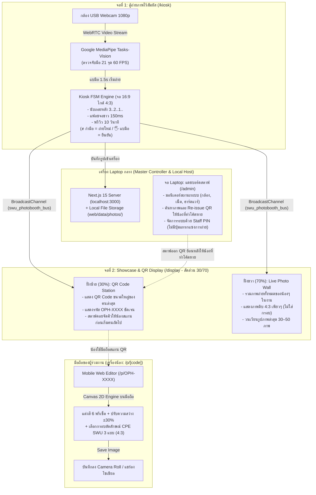
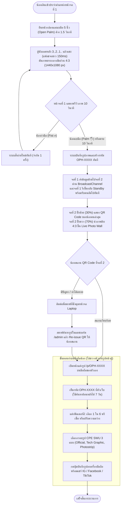

# ภาพรวมระบบและขั้นตอนการทำงาน (System Overview)

ภาพรวมสถาปัตยกรรมระบบ **SWU Open House AI Photo Booth** ฉบับอัปเดตตามการออกแบบหน้างานจริง (1 Laptop + 2 จอแสดงผลภายนอก) — รายละเอียดเชิงลึกดูที่ [สารบัญเอกสาร](README.md) และ [มติล่าสุด](decisions.md)

---

## 1. ผังฮาร์ดแวร์และสถาปัตยกรรมระบบ (Hardware & System Topology)

ระบบทำงานบน **Laptop 1 เครื่อง** ทำหน้าที่เป็นทั้งเซิร์ฟเวอร์หลักและส่งสัญญาณภาพออกไปยังหน้าจอภายนอก 2 จอ (Windows Extended Desktop):

---

## 2. ขั้นตอนการทำงานหน้างาน (End-to-End Workflow)

---

## 3. เอกสารอ้างอิงที่เกี่ยวข้อง
- [สารบัญเอกสารโครงการทั้งหมด](README.md)
- [มติล่าสุดของระบบ (Current Decisions)](decisions.md)
- [สถาปัตยกรรมระบบและการออกแบบเชิงเทคนิค (Task 02)](task02-architecture/system-architecture-and-technical-design.md)
- [แผนการแบ่งงาน 3 คนและ Git Workflow](task02-architecture/team-execution-and-github-plan.md)
- [คู่มือสถาปัตยกรรม 4-Layer Pragmatic Clean Architecture](task02-architecture/project-structure-and-clean-architecture-guide.md)
