# สถาปัตยกรรมระบบ แผนผังเส้นทางผู้ใช้ และลำดับการทำงาน (System Architecture, User Flow & Sequence Diagrams)
## ระบบ AI Photo Booth สำหรับงานเปิดบ้าน มศว (SWU Open House)
**โครงการ**: SWU Open House - Pure AI Photo Booth System  
**เวอร์ชัน**: 2.1 (Updated: OPH Code Prefix, Clean QR on Kiosk, Mobile Code Retention & Staff QR Re-Issue Portal)  
**วันที่**: 7 พฤศจิกายน 2026  
**มาตรฐานอ้างอิง**:
- **IEEE 1016-2009** (Standard for Information Technology - Systems Design - Software Design Descriptions)
- **C4 Model** (Context, Container, Component, Code)
- **UML 2.5** (Unified Modeling Language - Activity & Sequence Diagrams)

---

## 📌 บทนำและขอบเขตสถาปัตยกรรม (Architectural Scope)
สถาปัตยกรรมนี้มุ่งเน้น **ระบบ AI Photo Booth อย่างเป็นรูปธรรม 100%** โดยมีข้อกำหนดพิเศษตามที่กำหนด:
1. **รหัส Short Code ใช้ Prefix `OPH-XXXX`** (แทน `SWU-XXXX`)
2. **หน้าจอตู้ Kiosk แสดงเฉพาะ QR Code**: ไม่แสดงตัวเลข Short Code บนหน้าตู้ถ่าย เพื่อความสะอาด เรียบง่าย และกระตุ้นการสแกนทันที
3. **รหัส `OPH-XXXX` จะแสดงบนหน้าจอมือถือของน้อง**: หลังจากสแกน QR น้องจะเห็นรหัสของตัวเองที่หัวเว็บมือถือเพื่อจดหรือบันทึกเก็บไว้ดึงรูปย้อนหลัง
4. **ระบบหลังบ้านสตาฟสำหรับยิง QR ย้อนหลัง (Staff QR Re-Issue Portal)**: หากน้องสแกนไม่ทันหรือลืมสแกน น้องสามารถเดินมาหาสตาฟ โดยสตาฟเปิดดูแกลเลอรีภาพถ่ายล่าสุดตามเวลาบนระบบหลังบ้าน `/admin` แล้วแตะที่รูปเพื่อเปิด QR Code ให้น้องสแกนได้ทันที

---

## ส่วนที่ 1: แผนผังโครงสร้างระบบภาพรวม (High-Level Architecture - C4 Context & Container)

### 1.1 C4 Context Diagram (บริบทของระบบ Photo Booth และโมเดล AI)

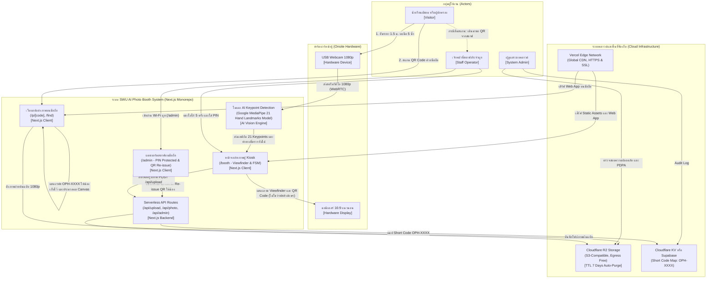

### 1.2 C4 Container Diagram (Frontend, AI Model Pipeline, Backend, Storage & CDN)

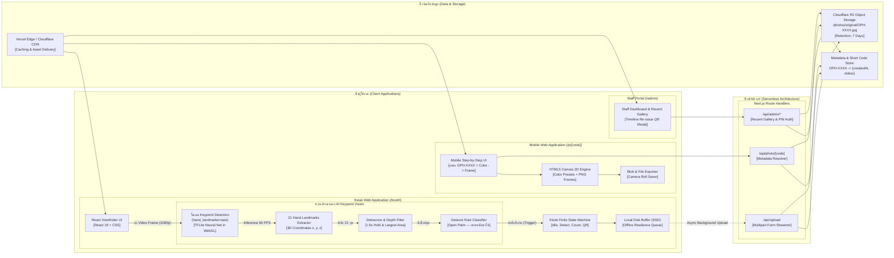

### 1.3 C4 Component Diagram: สถาปัตยกรรมภายในของ AI Keypoint Detection Pipeline

```mermaid
flowchart TD
    subgraph KioskAIModule["Kiosk AI Keypoint Vision Subsystem"]
        WebcamStream["WebRTC Stream Receiver<br>[navigator.mediaDevices.getUserMedia]"]
        FrameBuffer["Video Frame Preprocessor<br>[WebGL GPU Texture Binder]"]
        
        subgraph KeypointModel["AI Keypoint Detection Neural Network Model"]
            DetectionModel["Palm Detector Model<br>[BlazePalm SSD Anchor Detector]"]
            LandmarkModel["Hand Landmark Model<br>[21 3D Points Keypoint Regression]"]
        end
        
        LandmarkData["Raw 21 Keypoints Data<br>[x: 0..1, y: 0..1, z: Depth]"]
        DepthAreaFilter["Largest Area & Depth Filter<br>[Filter Out Background People]"]
        GestureEvaluator["Gesture Geometry Evaluator<br>[Open Palm — ขยายเพิ่มท่าได้]"]
        HoldController["Hold Duration Controller<br>[1.5s Continuous Hold Counter]"]
        TriggerDispatch["Capture Trigger Event Dispatcher<br>[Trigger Countdown 5..4..3..2..1..]"]
    end

    WebcamStream --> FrameBuffer
    FrameBuffer --> DetectionModel
    DetectionModel --> LandmarkModel
    LandmarkModel --> LandmarkData
    LandmarkData --> DepthAreaFilter
    DepthAreaFilter --> GestureEvaluator
    GestureEvaluator --> HoldController
    HoldController --> TriggerDispatch
```

---

## ส่วนที่ 2: สถาปัตยกรรมเชิงลึก (Low-Level Architecture: State Machine & Component Tree)

### 2.1 State Machine ของตู้ถ่ายภาพ (Kiosk Finite State Machine - FSM)
ตู้ทำงานแบบ Stateless & Resilient แยกจากมือถือโดยสิ้นเชิง:

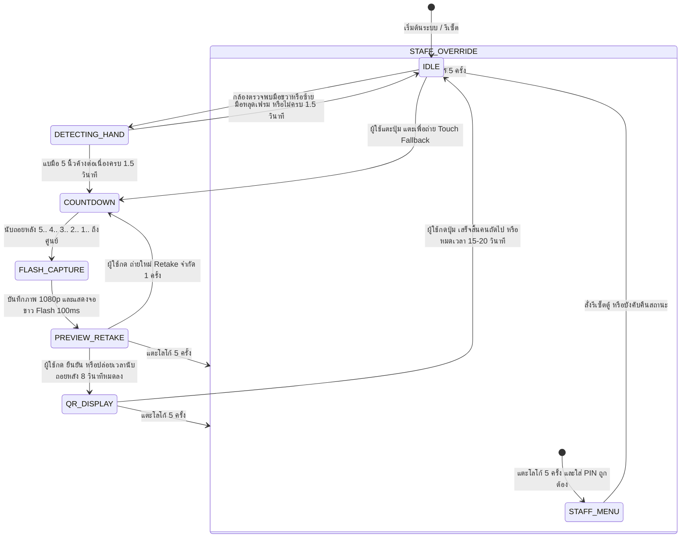

---

## ส่วนที่ 3: แผนผังเส้นทางการใช้งานของผู้ใช้แต่ละกลุ่ม (User Flow Diagrams)

### 3.1 Visitor Flow: เส้นทางการถ่ายรูปและดาวน์โหลดของนักเรียน/ผู้ปกครอง

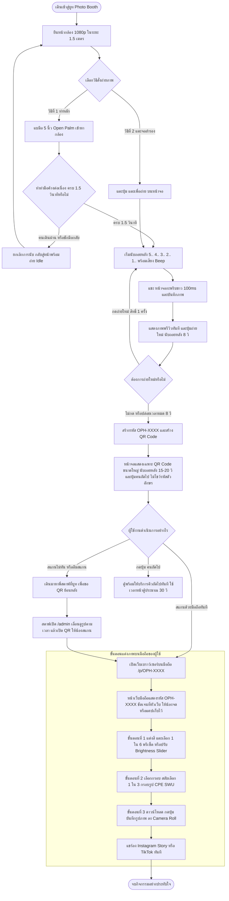

### 3.2 Staff Flow: เส้นทางการปฏิบัติงานและการช่วยเหลือออก QR ย้อนหลัง

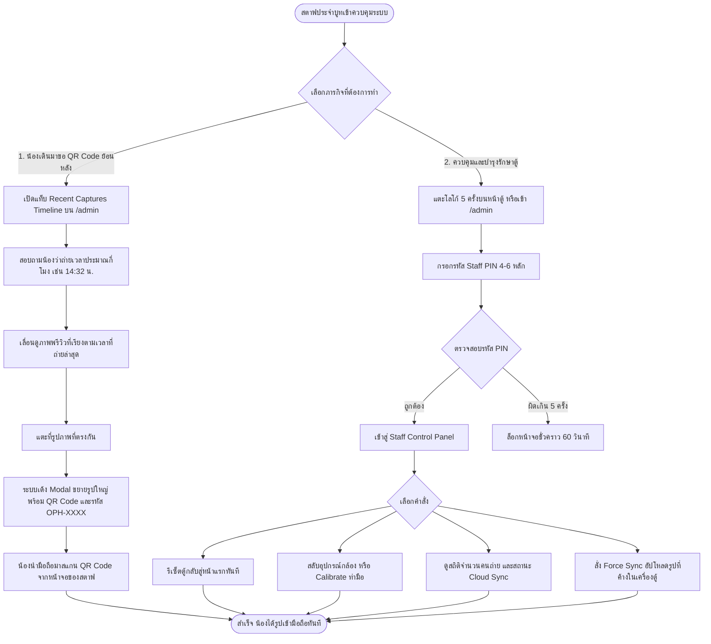

### 3.3 Admin Flow: การทำลายข้อมูลอัตโนมัติ 7 วันตามมาตรฐาน PDPA

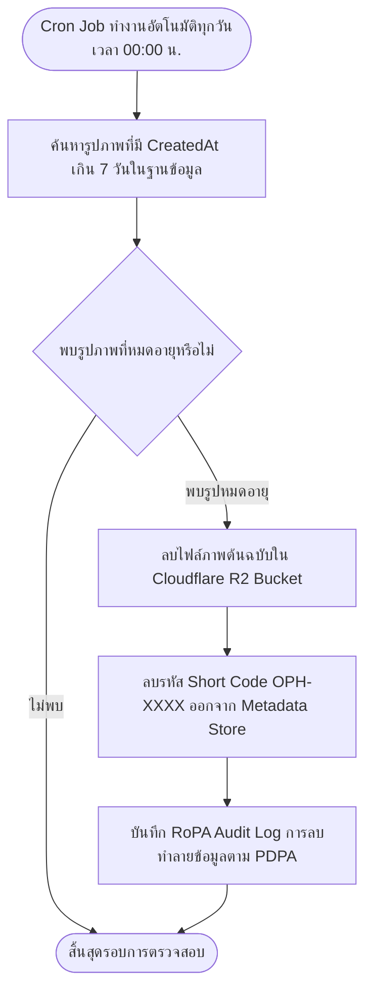

---

## ส่วนที่ 4: ลำดับการทำงานของกระบวนการสำคัญ (Sequence Diagrams)

### 4.1 Sequence 01: Touchless Hand Gesture Capture & Countdown Loop

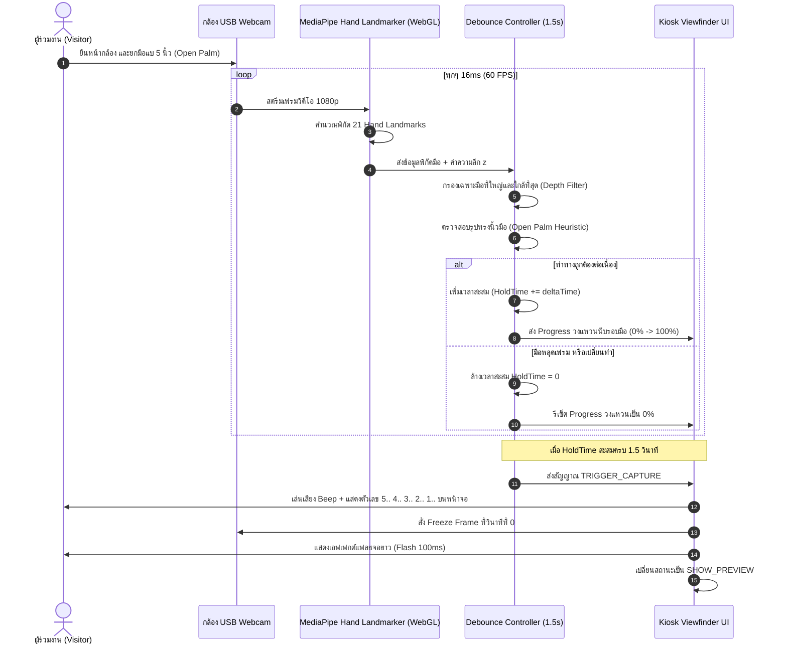

### 4.2 Sequence 02: Image Capture, Preview & 5-8s Retake Logic

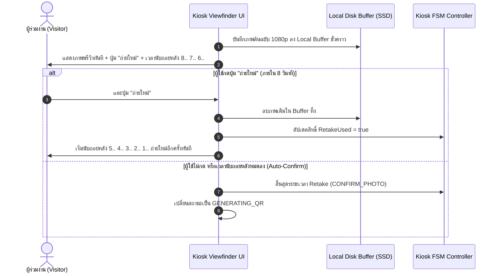

### 4.3 Sequence 03: Storage Upload, Short Code & Clean QR Generation
การออกรหัสและแสดงผลเฉพาะ QR Code บนหน้าตู้:

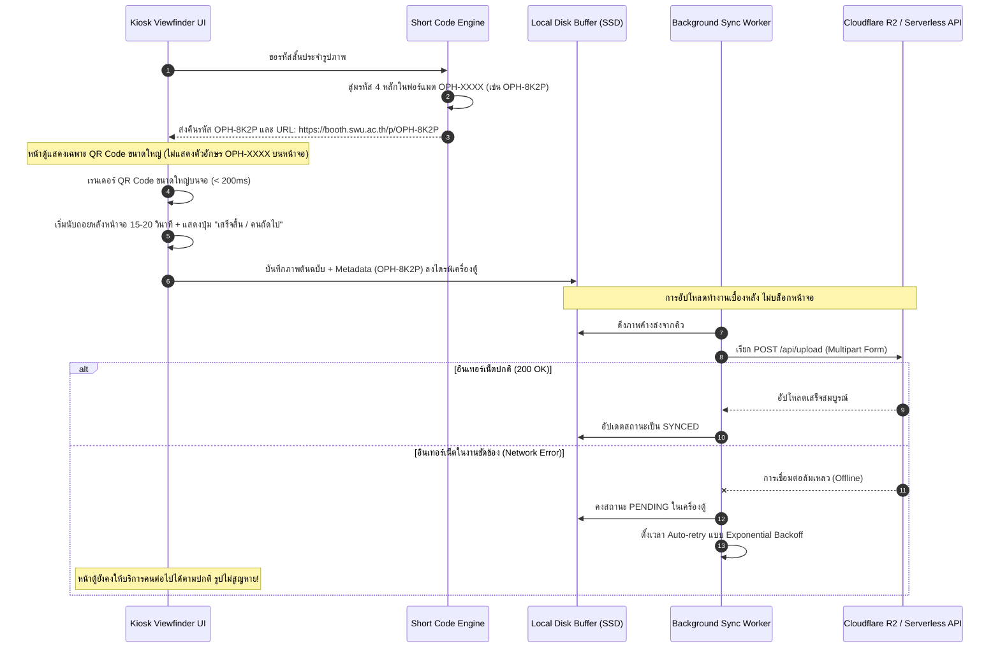

### 4.4 Sequence 04: Mobile Customization & Code Display
แสดงรหัส `OPH-XXXX` บนมือถือให้น้องเก็บไว้:

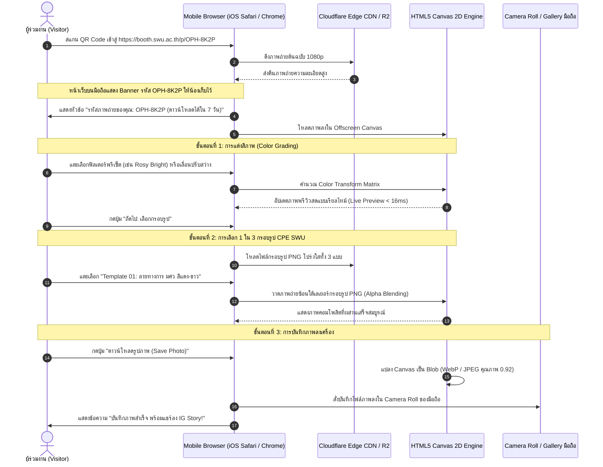

### 4.5 Sequence 05: Staff Back-Office QR Re-Issue Flow (ระบบหลังบ้านสำหรับน้องมาขอ QR ทีหลัง)
กรณีผู้ใช้สแกนไม่ทันหรือลืมสแกน แล้วเดินมาหาสตาฟ:

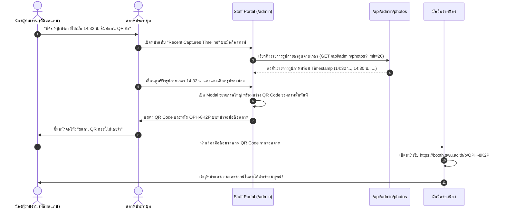

### 4.6 Sequence 06: Retroactive Photo Retrieval (`/find`)
การค้นหาภาพถ่ายย้อนหลังด้วยรหัส `OPH-XXXX` ผ่านหน้าค้นหา:

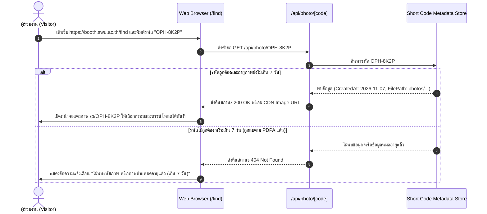

---

## ส่วนที่ 5: การจัดการข้อผิดพลาดและข้อยกเว้น (Fault Matrix & Error Handling)

| สถานการณ์ขัดข้อง (Fault Scenario) | ผลกระทบที่เกิดขึ้น | วิธีการตรวจจับและการจัดการ (Detection & Recovery) | การแสดงผลที่ผู้ใช้เห็น |
| :--- | :--- | :--- | :--- |
| **1. กล้อง USB หลุด หรือสายหลวม** | หน้าจอ Viewfinder มืดดำ | ดักจับ WebRTC `track.onended` event | แสดงหน้าจอแจ้งเตือนสีส้ม: *"กล้องขัดข้อง กำลังเชื่อมต่อใหม่..."* พร้อมแจ้งเตือนสตาฟ |
| **2. ผู้ใช้เดินหนีหลังถ่ายเสร็จ** | ตู้ค้างที่หน้าพรีวิว | ตัวนับถอยหลัง Timeout 8 วินาทีในหน้าพรีวิว | หมดเวลา 8 วิ จะข้ามไปแสดง QR Code 15 วินาที แล้วรีเซ็ตกลับหน้าแรกเองโดยอัตโนมัติ |
| **3. สัญญาณ Wi-Fi ในฮอลล์ดับ** | อัปโหลดขึ้น Cloudflare R2 ไม่ได้ | API Fetch โยนข้อผิดพลาด `NetworkError` | สวิตช์เข้าสู่ **Offline Mode**: บันทึกลงไดรฟ์ตู้ โชว์ QR Code ทันที และมี Sync Queue คอยอัปโหลดเมื่อเน็ตมา |
| **4. แสงไฟในบูทมืดเกินไป** | MediaPipe จับข้อมือไม่ติด | Landmark Detection Confidence < 0.6 ติดต่อกัน 3 วินาที | แสดงปุ่มขนาดใหญ่บนหน้าจอ: *"แตะตรงนี้เพื่อถ่ายรูป (Tap to capture)"* เป็นทางเลือกสำรอง |
| **5. สแกน QR ไม่ทันใน 15 วินาที** | หน้าจอตู้รีเซ็ตกลับหน้าแรกแล้ว | สื่อสารให้น้องเดินไปขอ QR จากสตาฟได้ | สตาฟเปิดหน้า `/admin` ดึงรูปตามเวลาขึ้นมาให้น้องสแกน QR ใหม่ได้ทันที |
