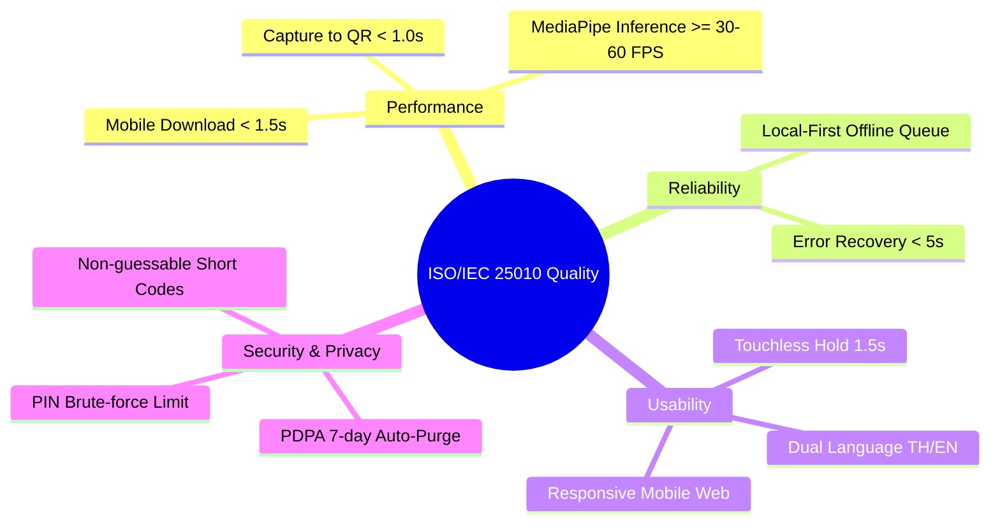

# เอกสารข้อกำหนดความต้องการทางธุรกิจและวิศวกรรมซอฟต์แวร์ (Requirements Specification)
## Phase 1 - Task 01: BRD, PRD, SRS/IEEE 830, NFR, RTM
**โครงการ**: SWU Open House - AI Photo Booth  
**เวอร์ชัน**: 1.0 (Approved & Locked via `/grill-me`)  
**วันที่**: 7 พฤศจิกายน 2026  
**มาตรฐานอ้างอิง**:
- **IIBA BABOK Guide v3.0** (Business Analysis Body of Knowledge)
- **IEEE 830 / ISO/IEC/IEEE 29148:2018** (Software Requirements Specifications)
- **ISO/IEC 25010:2011** (Systems and Software Quality Requirements and Evaluation)

---

## 📑 สารบัญ (Table of Contents)
1. [ส่วนที่ 1: เอกสารวิเคราะห์ความต้องการทางธุรกิจ (BRD - Business Requirements Document)](#ส่วนที่-1-เอกสารวิเคราะห์ความต้องการทางธุรกิจ-brd)
2. [ส่วนที่ 2: ข้อกำหนดผลิตภัณฑ์มุมมองผู้ใช้ (PRD - Product Requirements Document)](#ส่วนที่-2-ข้อกำหนดผลิตภัณฑ์มุมมองผู้ใช้-prd)
3. [ส่วนที่ 3: ข้อกำหนดฟังก์ชันเชิงวิศวกรรม (SRS / FRS ตามมาตรฐาน IEEE 830)](#ส่วนที่-3-ข้อกำหนดฟังก์ชันเชิงวิศวกรรม-srs--frs-ตามมาตรฐาน-ieee-830)
4. [ส่วนที่ 4: ข้อกำหนดคุณภาพเชิงเทคนิค (NFR Document ตามมาตรฐาน ISO/IEC 25010)](#ส่วนที่-4-ข้อกำหนดคุณภาพเชิงเทคนิค-nfr-document)
5. [ส่วนที่ 5: ตารางความสัมพันธ์ความต้องการ (RTM - Requirements Traceability Matrix)](#ส่วนที่-5-ตารางความสัมพันธ์ความต้องการ-rtm)

---

## ส่วนที่ 1: เอกสารวิเคราะห์ความต้องการทางธุรกิจ (BRD)

### 1.1 วัตถุประสงค์โครงการ (Project Objectives)
1. **Brand Engagement & Experience**: สร้างความประทับใจแก่นักเรียนมัธยมและผู้ปกครองที่มาร่วมงานเปิดบ้าน มศว (SWU Open House) ด้วยเทคโนโลยี AI ไร้สัมผัส (Touchless Interaction) ที่ทันสมัย
2. **Social Amplification**: ส่งมอบภาพถ่ายดิจิทัลคุณภาพสูงที่มีกรอบอัตลักษณ์ CPE SWU เพื่อให้นักเรียนนำไปโพสต์ลงโซเชียลมีเดีย (Instagram, TikTok, Facebook) สร้างการรับรู้แบบ Viral
3. **Queue Throughput Optimization**: แก้ปัญหาตู้ถ่ายรูปคิวยาวติดขัด ด้วยการแยกกระบวนการถ่ายภาพ (หน้าตู้) ออกจากการแต่งภาพ/เลือกกรอบ (บนมือถือน้อง)
4. **Zero Cloud Infrastructure Cost**: ออกแบบให้ทำงานได้เต็มประสิทธิภาพภายใต้ Free Tier (ต้นทุนค่าเช่าเซิร์ฟเวอร์และ Storage เป็น 0 บาท)

### 1.2 ตัวชี้วัดความสำเร็จทางธุรกิจ (Business Success Metrics / KPIs)
* **Kiosk Service Time**: เวลาเฉลี่ยที่ผู้ใช้ยืนหน้าตู้ **<= 30 วินาทีต่อคน**
* **Throughput Capacity**: รองรับผู้ถ่ายภาพได้ **>= 60–80 คนต่อชั่วโมง** ต่อ 1 ตู้เดี่ยว
* **Engagement Rate**: อัตราการสแกน QR Code เพื่อเปิดแต่งภาพบนมือถือ **>= 85%** ของผู้ถ่ายทั้งหมด
* **System Availability**: ตู้ถ่ายรูปต้องมีความพร้อมใช้งาน (Uptime) **>= 99.5%** ตลอด 2 วันจัดงาน
* **Cloud Infrastructure Spend**: ค่าใช้จ่ายระบบคลาวด์คงที่ที่ **0 บาท (Free Tier 100%)**

### 1.3 ขอบเขตงาน (Business Scope)
* **สิ่งที่อยู่ในขอบเขต (In-Scope)**:
  * การถ่ายภาพที่ตู้ด้วยการแบมือ (Open Palm) ผ่านเว็บแคม 1080p
  * หน้าจอพรีวิวและปุ่มถ่ายใหม่ (Retake) แบบจำกัดเวลา 8 วินาที
  * การสร้าง QR Code และ Short Code `OPH-XXXX` สำหรับดาวน์โหลดภาพ
  * เว็บแอปบนมือถือสำหรับแต่งสีภาพ (6 พรีเซ็ต + แถบปรับสว่าง) และเลือก 1 ใน 3 กรอบ CPE SWU
  * หน้าเว็บค้นหารูปภาพย้อนหลัง (`/find`) ภายใน 7 วัน
  * หน้าแดชบอร์ดสตาฟ (`/admin`) สำหรับดูสถิติและรีเซ็ตตู้
  * การรองรับ 2 ภาษา (ไทย และ อังกฤษ)
* **สิ่งที่อยู่นอกขอบเขต (Out-of-Scope)**:
  * การพิมพ์รูปภาพลงกระดาษจริงหน้างาน (เป็น Digital-Only 100%)
  * การเชื่อมต่อบัญชีสมาชิก หรือการบังคับกรอกข้อมูลส่วนบุคคลก่อนดาวน์โหลด

---

## ส่วนที่ 2: ข้อกำหนดผลิตภัณฑ์มุมมองผู้ใช้ (PRD)

### 2.1 กลุ่มผู้ใช้งานและ User Personas
1. **Persona 1: น้องมัธยมปลาย (Primary Visitor - "น้องพลอย")**
   * *พฤติกรรม*: ชอบถ่ายรูปเล่นกับเพื่อน, ต้องการความรวดเร็ว, ชอบแชร์รูปลง IG Story ทันที, ไม่ชอบยืนรอคิวนาน
   * *ความต้องการ*: ท่าถ่ายรูปง่ายๆ, มีฟิลเตอร์หน้าใสอมชมพู, กรอบรูปน่ารักที่มีโลโก้ มศว
2. **Persona 2: ผู้ปกครอง / ชาวต่างชาติ (Secondary Visitor - "คุณพ่อ / International Guest")**
   * *พฤติกรรม*: อาจไม่คุ้นชินกับระบบ Gesture มือ, ต้องการเมนูภาษาอังกฤษที่เข้าใจง่าย
   * *ความต้องการ*: มีปุ่มแตะถ่ายภาพบนจอสำรองเผื่อทำท่าไม่ติด, มีสวิตช์เปลี่ยนภาษาอังกฤษ (EN)
3. **Persona 3: พี่สตาฟประจำบูท (Booth Operator - "พี่เจมส์")**
   * *พฤติกรรม*: ต้องคอยดูแลความเรียบร้อย, จัดแถว, และช่วยเหลือผู้ใช้งาน
   * *ความต้องการ*: รหัส PIN ปลดล็อกง่ายๆ, หน้าจอรีเซ็ตด่วนเมื่อมีคนเดินหนีกลางคัน, และดูยอดคนถ่ายได้จากมือถือ

### 2.2 ตารางสิทธิ์การเข้าถึงข้อมูล (RBAC Matrix)

| หน้าที่ / ความสามารถ (Capabilities) | ผู้ร่วมงาน (Visitor) | หน้าจอ Kiosk | สตาฟประจำบูท (Staff) | ผู้ดูแลระบบ (Admin) |
| :--- | :---: | :---: | :---: | :---: |
| สั่งถ่ายภาพด้วยท่าทางมือ (Gesture) | ✅ | ✅ | ✅ | ✅ |
| แตะหน้าจอเพื่อถ่ายภาพ (Touch Fallback) | ✅ | ✅ | ✅ | ✅ |
| กดถ่ายใหม่ภายในเวลาที่กำหนด (Retake) | ✅ | ✅ | ✅ | ✅ |
| สแกน QR Code เข้าแต่งภาพบนมือถือ | ✅ | ❌ | ✅ | ✅ |
| สลับฟิลเตอร์สี และเลือก 1 ใน 3 กรอบรูป | ✅ (บนมือถือ) | ❌ | ✅ | ✅ |
| ดาวน์โหลดภาพคอมโพสิตลงเครื่อง | ✅ | ❌ | ✅ | ✅ |
| ค้นหารูปย้อนหลังด้วยรหัส `OPH-XXXX` (`/find`) | ✅ | ❌ | ✅ | ✅ |
| ปลดล็อก Staff Modal ลับหน้าตู้ | ❌ | ❌ | ✅ (PIN) | ✅ (PIN) |
| เข้าสู่แดชบอร์ดดูยอดคนถ่าย (`/admin`) | ❌ | ❌ | ✅ (PIN) | ✅ (PIN) |
| สั่งรีเซ็ตสถานะหน้าตู้จากระยะไกล | ❌ | ❌ | ✅ | ✅ |
| ลบรูปภาพก่อนกำหนด หรือตั้งค่าระบบ | ❌ | ❌ | ❌ | ✅ |

### 2.3 User Stories & Acceptance Scenarios
* **US-01 (Touchless Capture)**: ในฐานะผู้ร่วมงาน ฉันต้องการยกฝ่ามือเพื่อสั่งถ่ายภาพ เพื่อให้ได้ประสบการณ์ถ่ายรูปที่ล้ำสมัยและไม่ต้องสัมผัสหน้าจอ
* **US-02 (Retake)**: ในฐานะผู้ร่วมงาน หากฉันกระพริบตา ฉันต้องการกดปุ่มถ่ายใหม่ได้ 1 ครั้งภายในเวลา 8 วินาที เพื่อให้ได้ภาพที่พอใจ
* **US-03 (Mobile Customization)**: ในฐานะผู้ร่วมงาน ฉันต้องการสแกน QR บนหน้าตู้เพื่อไปเลือกฟิลเตอร์แต่งสีและเลือกกรอบรูป 3 แบบบนมือถือของฉันเอง เพื่อจะได้ไม่ต้องรีบและไม่ยืนขวางคิวคนอื่น
* **US-04 (Mobile Code Retention)**: ในฐานะผู้ร่วมงาน เมื่อสแกนเข้าเว็บมือถือแล้ว ฉันต้องการเห็นรหัสสั้น `OPH-XXXX` บนหัวเว็บอย่างชัดเจน เพื่อบันทึกหรือจำรหัสไว้ค้นหาภาพย้อนหลังผ่านหน้า `/find` ได้ตลอด 7 วัน
* **US-05 (Staff Management)**: ในฐานะสตาฟ ฉันต้องการกรอก PIN เพื่อเข้าระบบจัดการหน้าตู้ได้ทันทีเมื่อเกิดเหตุขัดข้อง
* **US-06 (Staff QR Re-Issue)**: ในฐานะผู้ร่วมงาน หากฉันสแกน QR ที่หน้าตู้ไม่ทัน ฉันต้องการเดินไปหาพี่สตาฟที่บูท เพื่อให้สตาฟเปิดดูรูปตามเวลาที่ถ่ายแล้วออก QR Code ให้ฉันสแกนใหม่ได้ทันที

---

## ส่วนที่ 3: ข้อกำหนดฟังก์ชันเชิงวิศวกรรม (SRS / FRS ตามมาตรฐาน IEEE 830)

### FR-01: การสตรีมภาพจากกล้องและการตรวจจับมือ (Camera Stream & MediaPipe WebGL)
* **Input**: WebRTC Video Stream จากกล้อง USB Webcam ความละเอียด 1920x1080 ที่ 30–60 FPS
* **Process**: ส่ง Frame เข้าสู่ `@mediapipe/tasks-vision` Hand Landmarker แบบต่อเนื่อง
* **Output**: พิกัด 3D Keypoints ทั้ง 21 จุดของมือในหน้าจอ
* **Error State**: หากไม่พบกล้อง (NotFoundError) หรือผู้ใช้ปฏิเสธการเข้าถึงกล้อง (NotAllowedError) ระบบต้องแสดงหน้าจอแจ้งเตือนสตาฟทันที

### FR-02: การคัดกรองท่าทางมือและกรอง Noise (Gesture Classification & Area Filter)
* **Input**: ชุดพิกัด 21 จุดจากมือทุกข้างที่ตรวจพบในเฟรม
* **Process**:
  1. คำนวณ Bounding Box Area และค่าความลึก `z` ของข้อมือ
  2. กรองจับเฉพาะมือที่มีขนาดใหญ่ที่สุดและอยู่ใกล้กล้องที่สุด (ตัดมือคนที่เดินผ่านฉากหลังออก)
  3. ตรวจสอบเงื่อนไข **แบมือ 5 นิ้ว (Open Palm)**: นิ้วชี้, กลาง, นาง, ก้อย ปลายนิ้วสูงกว่าข้อนิ้ว PIP
* **Business Rule**: ท่ามือต้องแสดงต่อเนื่องครบ **1.5 วินาที** (Hold Duration) ถึงจะเริ่มนับถอยหลัง
* **Extensibility**: ออกแบบ Gesture Registry ให้เพิ่มท่าอื่นได้ภายหลัง (รอบแรกใช้แบมือท่าเดียว)

### FR-03: การนับถอยหลังและการบันทึกภาพ (Countdown & Capture Flash)
* **Input**: สัญญาณ Trigger จาก FR-02 หรือการแตะปุ่ม Touch Fallback บนหน้าจอ
* **Process**:
  1. แสดงตัวเลขนับถอยหลัง **5 วินาที** (5.. 4.. 3.. 2.. 1..) พร้อมเสียง Beep — ระหว่างนับผู้ใช้เปลี่ยนท่าโพสได้อิสระ ระบบไม่ยกเลิกการนับเมื่อชักมือกลับ
  2. เมื่อนับถึง 0 ทำการ Freeze เฟรม 1080p แล้วตัด Center Crop **4:3** (1440x1080)
  3. แสดง Effect จอขาว (White Flash) 100ms เพื่อจำลองแสงแฟลช
* **Output**: Raw Captured Frame (Blob/ImageData) บันทึกลงหน่วยความจำชั่วคราว

### FR-04: การแสดงพรีวิวและกลไกถ่ายใหม่ (Preview & Retake Policy)
* **Input**: ภาพที่บันทึกได้จาก FR-03
* **Process**:
  1. แสดงภาพพรีวิวบนหน้าจอตู้ทันที
  2. แสดงปุ่ม "ถ่ายใหม่ (Retake)" พร้อมเวลานับถอยหลัง 8 วินาที
  3. หากผู้ใช้กดถ่ายใหม่: ยกเลิกภาพเดิมแล้วเริ่มขั้นตอนนับถอยหลังถ่ายใหม่ (ทำได้รอบเดียว)
  4. หากหมดเวลาโดยไม่กดถ่ายใหม่: ระบบเปลี่ยนเข้าสู่หน้าจอแสดง QR Code อัตโนมัติ

### FR-05: การสร้างรหัส OPH-XXXX และ QR Code (Short Code & Clean QR Engine)
* **Input**: สัญญาณยืนยันภาพถ่าย (เมื่อหมดเวลา Retake หรือกดตกลง)
* **Process**:
  1. สุ่มรหัสสั้น 4 ตัวอักษรที่ไม่ซ้ำกันจากพยัญชนะ `A-Z` และตัวเลข `2-9` (ตัด `0, O, 1, I` ออกเพื่อป้องกันความสับสน)
  2. สร้างรหัสในรูปแบบ `OPH-XXXX` (เช่น `OPH-8K2P`)
  3. สร้าง QR Code ชี้ไปยัง URL: `https://<domain>/p/OPH-XXXX`
  4. บันทึกภาพต้นฉบับลง Local SSD พร้อมทั้ง Queue อัปโหลดไปยัง Cloudflare R2
* **Display Policy (ข้อกำหนดการแสดงผล)**:
  - **หน้าจอตู้ Kiosk**: แสดง **เฉพาะ QR Code ขนาดใหญ่** (SVG/Canvas ไม่ต่ำกว่า 320x320 px) พร้อมเวลานับถอยหลัง 15–20 วินาที และปุ่ม "คนถัดไป (Next)" **โดยไม่แสดงรหัสตัวอักษร Short Code บนหน้าจอตู้** เพื่อความสะอาด เรียบง่าย และกระตุ้นให้สแกนทันที
  - **หน้าจอมือถือของผู้ใช้ (`/p/OPH-XXXX`)**: แสดงรหัส `OPH-XXXX` อย่างเด่นชัดบน Header Banner ของหน้าแต่งภาพ เพื่อให้น้องบันทึก/จดจำไว้ใช้ดึงรูปย้อนหลัง

### FR-06: การสลับภาษาหน้าจอ (Localization Engine)
* **Input**: การแตะสวิตช์ `TH | EN` มุมขวาบนของหน้าจอ
* **Process**: สลับชุดข้อความ (Locale Dictionary) ทั้งหมดแบบ Real-time โดยไม่ต้องรีเฟรชหน้าเว็บ

### FR-07: การแต่งสีและฟิลเตอร์บนมือถือ (Mobile Color Grading Engine)
* **Input**: ภาพถ่ายที่โหลดขึ้นบนหน้าเว็บมือถือของผู้ใช้งาน
* **Process**:
  1. ผู้ใช้แตะเลือก 1 ใน 6 พรีเซ็ต: `Original`, `Warm`, `Cool Minimal`, `Film Vintage`, `Classic B&W`, `Rosy Bright`
  2. ผู้ใช้สามารถเลื่อนแถบสไลเดอร์ปรับความสว่าง (Brightness) ได้ระหว่าง -30% ถึง +30%
  3. ประมวลผลผ่าน HTML5 Canvas Pixel Manipulation แบบเรียลไทม์
* **Output**: ภาพที่ผ่านการปรับแต่งสีบน Canvas Viewport ของมือถือ

### FR-08: การเลือกกรอบเทมเพลต 3 แบบ (Template Selection Engine)
* **Input**: ผู้ใช้กดปุ่ม "ถัดไป (Next)" หลังจากแต่งสีใน FR-07
* **Process**:
  1. แสดง Carousel หรือ Grid รายการกรอบรูปจำนวน 3 แบบ:
     - **Template 01**: CPE SWU Official Classic — ธีมทางการ แดง-เทา พร้อมชื่อภาควิชาและมหาวิทยาลัย
     - **Template 02**: CPE Youthful Tech & Circuit — ธีมสดใส ลายวงจร โค้ดดิ้ง และ AI
     - **Template 03**: CPE Photostrip Minimalist — ธีมฟิล์มเกาหลีมินิมอล (กรอบสไตล์ Photostrip สำหรับภาพเดี่ยว)
  2. ซ้อนภาพถ่ายใต้เลเยอร์กรอบรูป PNG โปร่งใส (Alpha Layer Compositing)
* **Output**: ภาพรวมสมบูรณ์ (Composite Output) ความละเอียดสูง

### FR-09: การส่งออกและดาวน์โหลดภาพ (High-Resolution Image Export)
* **Input**: ผู้ใช้กดปุ่ม "ดาวน์โหลด (Download / Save Photo)"
* **Process**: แปลง Canvas ให้เป็นไฟล์ภาพ WebP / High-res JPEG (Quality 0.92)
* **Output**: สั่งบันทึกไฟล์ภาพลงใน Camera Roll (iOS Photos / Android Gallery)

### FR-10: การค้นหารูปภาพย้อนหลัง (Retroactive Photo Lookup Portal)
* **Input**: ผู้ใช้เปิดหน้าเว็บ `https://<domain>/find` และกรอกรหัส `OPH-XXXX` (ที่ดูได้จากหัวเว็บมือถือ)
* **Process**: ตรวจสอบความถูกต้องของรหัส และดึงข้อมูลรูปภาพจาก Storage หากยังไม่หมดอายุ 7 วัน
* **Output**: เปิดหน้าตกแต่งภาพ/ดาวน์โหลดของรหัสนั้นขึ้นมาทันที

### FR-11: ระบบควบคุมของสตาฟและการยืนยันตัวตน (Staff Controls & PIN Auth)
* **Input**: แตะโลโก้ มศว 5 ครั้งบนหน้าตู้ หรือเข้าหน้าเว็บ `/admin` จากมือถือ และกรอกรหัส PIN 4–6 หลัก
* **Process**: ตรวจสอบความถูกต้องของรหัส PIN เทียบกับ Environment Variable `STAFF_PIN`
* **Output**: ปลดล็อกหน้าควบคุม: ดูยอดคนถ่าย, สลับกล้อง, สั่งรีเซ็ตตู้กลับสู่หน้าแรก, และตรวจสอบสถานะ Sync

### FR-12: ระบบหลังบ้านสตาฟสำหรับการยิง QR ย้อนหลัง (Staff Recent Captures & QR Re-issue Portal)
* **Input**: สตาฟล็อกอินเข้าแดชบอร์ด `/admin` และเลือกแท็บ "Recent Captures" เมื่อมีน้องเดินมาขอ QR ย้อนหลัง
* **Process**:
  1. สตาฟสอบถามเวลาที่น้องถ่ายโดยประมาณ (เช่น 14:32 น.)
  2. แดชบอร์ดแสดงแกลเลอรีภาพถ่ายล่าสุดเรียงตาม Timestamp จากใหม่ไปเก่า
  3. สตาฟแตะที่รูปภาพที่ตรงกัน ระบบเปิดหน้าต่างพรีวิวขนาดใหญ่พร้อมปุ่ม "แสดง QR Code"
  4. ระบบ Render QR Code พร้อมรหัส `OPH-XXXX` ขนาดเต็มหน้าจอให้น้องนำมือถือมายิงสแกนได้ทันที
* **Output**: QR Code สดสำหรับภาพถ่ายนั้นๆ ให้น้องสแกนเข้า `/p/OPH-XXXX` บนมือถือได้สำเร็จ แม้หน้าจอตู้จะผ่านไปแล้ว

---

## ส่วนที่ 4: ข้อกำหนดคุณภาพเชิงเทคนิค (NFR Document ตาม ISO/IEC 25010)

### 4.1 ประสิทธิภาพการทำงาน (Performance Efficiency)
* **P-01 (Inference Rate)**: MediaPipe Hand Landmarker ต้องประมวลผลบนเบราว์เซอร์ได้ไม่ต่ำกว่า **30 FPS (เป้าหมาย 60 FPS)** บนฮาร์ดแวร์ทั่วไป
* **P-02 (Processing Latency)**: ระยะเวลานับจากสิ้นสุดการถ่ายภาพจนกระทั่งสร้าง QR Code สำเร็จต้อง **น้อยกว่า 1.0 วินาที**
* **P-03 (Mobile Load Time)**: หน้าเว็บดาวน์โหลดบนมือถือผ่านเครือข่าย 4G/5G ต้องโหลดเสร็จสมบูรณ์ภายใน **1.5 วินาที** (ภาพบีบอัดขนาด ~1.5–2.0 MB)

### 4.2 ความพร้อมใช้งานและความเชื่อถือได้ (Reliability & Resilience)
* **R-01 (Offline-First Kiosk)**: หากสัญญาณอินเทอร์เน็ตที่งานขัดข้อง ตู้ต้องถ่ายภาพ บันทึกไฟล์ลง Local Storage และออก QR Code ได้ตามปกติ 100%
* **R-02 (Background Upload Retry)**: เมื่อสัญญาณอินเทอร์เน็ตกลับมา ระบบต้องซิงค์ภาพจาก Local Queue ขึ้น Cloudflare R2 โดยอัตโนมัติโดยไม่มีภาพสูญหาย
* **R-03 (Fault Tolerance)**: หากสตาฟกดปุ่มรีเซ็ต ระบบต้องกู้คืนสู่สถานะพร้อมถ่าย (Idle) ได้ภายใน **2 วินาที**

### 4.3 การใช้งานและความสะดวก (Usability & Accessibility)
* **U-01 (Zero-Instruction Intuitive UI)**: หน้าจอ Viewfinder ต้องมีไอคอนจำลองแสดงท่ามือแบ 5 นิ้วที่มองเห็นชัดเจนในระยะ 2 เมตร เพื่อให้ผู้ใช้งานทำตามได้โดยไม่ต้องมีสตาฟสอน
* **U-02 (Touch Fallback)**: ผู้ใช้งานสามารถแตะที่บริเวณใดก็ได้บนจอเพื่อสั่งถ่ายรูปสำรอง ในกรณีที่ไม่สามารถทำท่าทางมือได้

### 4.4 ความปลอดภัยและความเป็นส่วนตัว (Security & Privacy)
* **S-01 (Data Minimization & PDPA)**: ไม่มีการเก็บข้อมูลส่วนบุคคลระบุตัวตน (ไม่มีการขอชื่อ เบอร์โทร หรืออีเมล)
* **S-02 (Auto-Purge 7 Days)**: รูปภาพทั้งหมดบนคลาวด์จะถูกตั้งค่า Lifecycle ให้ลบทิ้งอัตโนมัติหลังครบ 7 วัน
* **S-03 (Brute Force Protection)**: การกรอกรหัสสั้นในหน้า `/find` และรหัส PIN ในหน้า `/admin` จำกัดการกรอกผิดไม่เกิน 5 ครั้งต่อ 1 นาที

---

## ส่วนที่ 5: ตารางความสัมพันธ์ความต้องการ (Requirements Traceability Matrix - RTM)

| Requirement ID | รายละเอียดความต้องการ (Description) | Component / UI ID | วิธีการทดสอบ (Verification) | Test Case ID |
| :---: | :--- | :--- | :--- | :---: |
| **FR-01** | สตรีมกล้อง 1080p + MediaPipe 21 Keypoints | `KioskViewfinder.tsx` | WebRTC Stream Inspection | `TC-01` |
| **FR-02** | แบมือ 5 นิ้วค้าง 1.5 วิเพื่อสั่งถ่ายภาพ | `GestureRecognizer.ts` | Unit Test Keypoint Logic | `TC-02` |
| **FR-03** | แอนิเมชันนับถอยหลัง 5..4..3..2..1.. และ Flash | `CountdownOverlay.tsx` | Visual Animation Inspection | `TC-03` |
| **FR-04** | แสดงพรีวิว + ปุ่มถ่ายใหม่จำกัดเวลา 8 วิ | `RetakeTimerModal.tsx` | Timer Countdown Verification | `TC-04` |
| **FR-05** | ออกรหัส `OPH-XXXX` + หน้าตู้แสดงเฉพาะ QR Code สะอาดตา | `QRCodeGenerator.ts` | Regex & URL Routing Test | `TC-05` |
| **FR-06** | สลับภาษาหน้าจอ ไทย / อังกฤษ | `LanguageToggle.tsx` | UI Locale Switching Test | `TC-06` |
| **FR-07** | แต่งสีภาพ 6 พรีเซ็ต + แถบ Brightness บนมือถือ | `MobileColorFilter.tsx` | Canvas Pixel Manipulation Test | `TC-07` |
| **FR-08** | เลือกกรอบเทมเพลต CPE SWU 3 แบบบนมือถือ | `FrameTemplateSelector.tsx` | Alpha Layer Blending Test | `TC-08` |
| **FR-09** | ดาวน์โหลดรูปคอมโพสิตลง Camera Roll | `DownloadButton.tsx` | Device File Download Test | `TC-09` |
| **FR-10** | ค้นหารูปภาพย้อนหลัง 7 วันผ่านหน้า `/find` ด้วยรหัส `OPH-XXXX` | `PhotoFinderPage.tsx` | Search Query & Retrieval Test | `TC-10` |
| **FR-11** | Staff Modal บนตู้ + หน้า `/admin` ด้วย PIN | `StaffAdminModal.tsx` | PIN Authentication Guard Test | `TC-11` |
| **FR-12** | แดชบอร์ดสตาฟ Recent Captures Timeline + ออก QR ย้อนหลัง | `StaffRecentCaptures.tsx` | Timeline Query & Modal Re-issue Test | `TC-16` |
| **NFR-01** | Inference เฟรมเรต >= 30–60 FPS | `MediaPipeEngine` | Chrome Performance Monitor | `TC-12` |
| **NFR-02** | ความเร็วประมวลผลกล้องถึง QR < 1.0s | `CaptureWorkflow` | Timestamp Benchmark Profile | `TC-13` |
| **NFR-04** | ถ่ายและบันทึกออฟไลน์ได้เมื่อเน็ตหลุด | `LocalStorageQueue` | Network Disconnect Simulation | `TC-14` |
| **NFR-05** | ลบไฟล์ภาพอัตโนมัติเมื่อครบ 7 วัน | `StorageRetentionWorker` | 7-day TTL Lifecycle Verification | `TC-15` |
