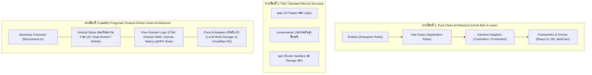
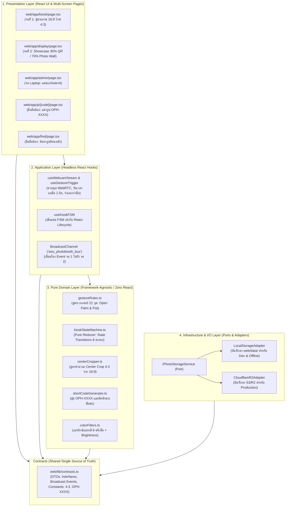

# คู่มือการออกแบบโครงสร้างโปรเจกต์และสถาปัตยกรรมซอฟต์แวร์ (Project Structure & Architecture Guide)
## ระบบ AI Photo Booth สำหรับงานเปิดบ้าน มศว (SWU Open House)

เอกสารฉบับนี้จัดทำขึ้นเพื่อตอบคำถามเชิงสถาปัตยกรรมวิศวกรรมซอฟต์แวร์ (Software Engineering Architecture): **"โครงสร้างโปรเจกต์ควรเป็น Clean Architecture หรือรูปแบบไหน จึงจะเหมาะสมและมีประสิทธิภาพสูงสุดสำหรับงานนี้"** พร้อมบันทึกข้อตกลงเชิงสถาปัตยกรรม (ADR-09) และโครงสร้างโฟลเดอร์ฉบับสมบูรณ์สำหรับทีมพัฒนา 3 คน บนสถาปัตยกรรมฮาร์ดแวร์ 3 หน้าจอ (1 Laptop + 2 จอแสดงผลภายนอก)

---

## 1. การประเมินเปรียบเทียบเชิงสถาปัตยกรรม (Architectural Patterns Comparison)

ในการพัฒนาซอฟต์แวร์ระดับงานอีเวนต์ที่มีทั้ง **Client-Side AI Computer Vision (MediaPipe)**, **Hardware Multi-Display (จอถ่ายภาพ + จอ Showcase + จอ Laptop แอดมิน)**, **Inter-Screen Event Bus (`BroadcastChannel`)**, **State Machine แบบเรียลไทม์**, และ **Serverless API สำหรับแจกจ่ายภาพถ่าย** เราได้ทำการประเมิน 3 ทางเลือกหลัก:



### ตารางเปรียบเทียบข้อดี-ข้อเสีย (Architecture Trade-off Matrix)

| มิติการประเมิน | ทางเลือกที่ 1: Pure Clean Architecture (Uncle Bob) | ทางเลือกที่ 2: Flat / Unstructured Next.js | ทางเลือกที่ 3: Pragmatic Feature-Driven Architecture (แนะนำ) |
| :--- | :--- | :--- | :--- |
| **ความเร็วในการส่งมอบ (Velocity & TTM)** | 🔴 **ต่ำมาก**: ต้องสร้างไฟล์ DTO, Presenter, UseCase, Repository Interface ซ้ำซ้อน 4-6 ไฟล์ต่อหนึ่งฟังก์ชัน | 🟡 **เร็วช่วงแรกแต่ช้าช่วงหลัง**: โค้ดปนกัน แก้ยากเมื่อระบบเริ่มซับซ้อน | 🟢 **สูงสุด**: แบ่งงานชัดเจน ไม่เสียเวลาเขียน boilerplate ที่ไม่จำเป็น |
| **ความเข้ากันได้กับ React & Next.js 15** | 🔴 **ขัดกับธรรมชาติของ React**: ฝืนแปลง State และ Browser Lifecycle (Webcam, Canvas, Audio) ให้กลายเป็น Use Case & Presenter | 🟢 **เข้ากันได้ตามมาตรฐาน Next.js**: ใช้งาน App Router ปกติ | 🟢 **ดีที่สุด**: ใช้ Custom Hooks เป็น Application Layer และใช้ Pure TS Functions เป็น Domain Layer |
| **การทดสอบ (Testability)** | 🟢 **สูง**: แยก Mock ชัดเจน | 🔴 **ต่ำมาก**: Logic ผูกติดกับ UI Component ทดสอบแยกไม่ได้ | 🟢 **สูงมาก**: Pure FSM และ Gesture Math ทดสอบได้ 100% โดยไม่ต้องมี DOM |
| **การทำงานร่วมกัน 3 คน (Git Conflict)** | 🟡 **ปานกลาง**: มีโอกาสชนกันที่ Container / DI Resolver กลาง | 🔴 **เสี่ยงสูงมาก**: ทุกคนแก้โฟลเดอร์ `components/` และ `lib/` รวมกัน | 🟢 **ปราศจากการชนกัน (Zero-Conflict)**: แยก Vertical Slice ตามโฟลเดอร์ของแต่ละคน |
| **ความคุ้มค่าต่องานอีเวนต์ 2 วัน (ROI)** | 🔴 **Over-engineering รุนแรง**: ความซับซ้อนเกินขนาดโจทย์ธุรกิจ | 🔴 **เสี่ยงระบบล่มหน้างาน**: แก้บั๊กยาก ไม่มี Boundary ป้องกัน | 🟢 **สมดุลสมบูรณ์แบบ**: แข็งแกร่ง บำรุงรักษาง่าย และเสร็จทันเวลา |

---

## 2. เหตุผลทางวิศวกรรม: ทำไม "Pure Clean Architecture" จึงเป็น Anti-Pattern สำหรับงานนี้

> [!WARNING] ข้อผิดพลาดที่พบบ่อยในการนำ Clean Architecture มาใช้กับ Frontend
> Uncle Bob (Robert C. Martin) คิดค้น Clean Architecture ขึ้นมาสำหรับระบบ Enterprise Backend (เช่น ธนาคาร, ประกันภัย) ที่มีกฎเกณฑ์ทางธุรกิจ (Business Rules) ซับซ้อนและเปลี่ยนแปลงบ่อย โดยมองว่า UI และฐานข้อมูลเป็นเพียง "Detail" ภายนอกเท่านั้น
> 
> แต่สำหรับระบบ **SWU AI Photo Booth**:
> 1. **งาน 85% คือ Client-Side Computing & Hardware Interaction**:
>    - การประมวลผลโมเดล MediaPipe 21 จุด บน WebGL/WASM 60 FPS
>    - การควบคุมกล้อง WebRTC 1080p และตัดรูป Center Crop 4:3
>    - การจัดการสถาปัตยกรรม 2 จอแสดงผล (จอ 1 ถ่ายภาพ + จอ 2 Showcase 30/70)
>    - การซิงค์ข้ามหน้าต่างเบราว์เซอร์ด้วย `BroadcastChannel` API
>    - การจัดการสถานะ Kiosk FSM (Countdown, Screen Flash, Sound Effect, Retake Preview 10s: กำมือถ่ายใหม่ / แบมือไปต่อ)
>    - การประมวลผล Canvas 2D (Color Filter Matrix, Brightness Slider, Frame Compositing)
>    สิ่งเหล่านี้ไม่ใช่ "Detail ปลีกย่อย" แต่เป็น **หัวใจหลักของระบบ (Core Capabilities)** การนำ UI และ Browser APIs ไปยัดไว้ที่ Outer Layer แล้วสร้าง Presenter/Controller มาห่อหุ้ม ทำให้เกิดความล่าช้า (Impedance Mismatch) และโค้ดบวมโดยไร้ประโยชน์
> 2. **Backend มีขอบเขตจำกัด (Lean Backend)**:
>    - Backend มีเพียง 4 Endpoints: บันทึกรูปภาพลง Storage, ส่งภาพกลับตามรหัส `OPH-XXXX`, แสดงรายการภาพให้สตาฟ และตรวจสอบ PIN
>    - การสร้าง Entity -> UseCase -> Interactor -> Gateway Interface -> Controller สำหรับแค่ฟังก์ชันอัปโหลดไฟล์ 1 ไฟล์ เป็นการสร้าง **Accidental Complexity** เกินความจำเป็น

---

## 3. มติสถาปัตยกรรม ADR-09: Pragmatic Feature-Driven Clean Architecture

### บันทึกการตัดสินใจทางสถาปัตยกรรม (ADR-09)
* **สถานะ**: ✅ อนุมัติ (Approved)
* **บริบท**: ระบบต้องการความเสถียรสูง ไม่ค้าง ไม่กระตุก รองรับผู้ใช้งาน 60–80 คน/ชม. พัฒนาโดยทีม 3 คนในระยะเวลาจำกัด บนระบบ 3 หน้าจอ (1 Laptop + 2 จอภายนอก)
* **การตัดสินใจ (Decision)**: เลือกใช้สถาปัตยกรรมแบบ **"Pragmatic Feature-Driven Clean Architecture"** (การผสมผสานระหว่าง Vertical Slice Architecture เข้ากับหลักการแยก Layer ของ Clean Architecture เฉพาะจุดที่คุ้มค่า)



---

## 4. กฎเหล็กของสถาปัตยกรรม (Architecture Boundary Rules)

เพื่อให้โค้ดสะอาด เป็นระเบียบ และบำรุงรักษาง่าย กำหนดกฎ 4 ข้อดังนี้:

1. **Rule 1: Pure Domain ห้าม Import Framework (Zero React / Next.js Dependencies)**
   - โค้ดใน `gestureRules.ts`, `kioskStateMachine.ts`, `centerCropper.ts`, `shortCodeGenerator.ts`, `colorFilters.ts` ต้องเป็น Pure TypeScript เท่านั้น
   - **ห้าม** `import React`, `import useState`, หรือ `import 'next/...'` ในไฟล์เหล่านี้
   - **ผลลัพธ์**: สามารถเขียน Unit Test รันผ่าน Vitest / Node.js ได้ในเวลาไม่กี่มิลลิวินาทีโดยไม่ต้องจำลอง Browser DOM
2. **Rule 2: Application Hooks เป็นสะพานเชื่อมระหว่าง Domain กับ UI**
   - หน้าจอ UI (React Components) จะไม่เรียก Logic ตรงๆ แต่จะเรียกผ่าน Custom Hook
   - ตัวอย่าง: `KioskPage` จะเรียกใช้ `const { state, send } = useKioskFSM()`
3. **Rule 3: I/O และ Storage ต้องผ่าน Port & Adapter เสมอ**
   - API Route ห้ามเรียก SDK ของ Cloudflare R2 หรือเขียนไฟล์ `fs` โดยตรง
   - ให้เรียกผ่าน `photoStorageService.savePhoto(...)` เพื่อให้สามารถสลับระหว่าง Local Storage (ตอนทดสอบออฟไลน์หน้างาน) กับ Cloudflare R2 (ตอนเปิดบริการจริง) ได้ทันทีผ่าน Environment Variable `STORAGE_DRIVER=local|r2`
4. **Rule 4: Shared Contracts คือสัญญาฉบับเดียว (`web/lib/contracts.ts`)**
   - ค่าคงที่ สเปกอัตราส่วน (`4:3`), ตัวแปรสถานะ FSM (`KioskState`), และโครงสร้างข้อมูล API Request/Response รวมถึง `ScreenSyncEvent` ต้องประกาศที่นี่ที่เดียว ห้ามประกาศซ้ำในโฟลเดอร์ของตัวเอง

---

## 5. โครงสร้างโฟลเดอร์ฉบับสมบูรณ์ (Complete Project Directory Layout)

```text
PhotoBooth-OpenHouseSWU/
├── docs/                                          # เอกสารวิศวกรรมระบบ (IEEE 830, SAD, ADRs)
│   ├── task00-discovery/                         # Task 00: Discovery, PoC, BOM/BOQ
│   ├── task01-requirements/                      # Task 01: SRS, BRD, PRD, RTM
│   └── task02-architecture/                      # Task 02: SAD, FSM, ADRs, Project Structure
│       ├── system-architecture-and-technical-design.md
│       ├── qa-decisions.md
│       ├── team-execution-and-github-plan.md
│       └── project-structure-and-clean-architecture-guide.md  # [เอกสารฉบับนี้]
│
├── poc/                                          # สคริปต์ทดสอบและ Proof of Concepts
│   ├── test_poc.mjs                              # PoC ชุดทดสอบ 4 ด้าน
│   └── validate_mermaid.mjs                      # สคริปต์ตรวจไวยากรณ์ Diagram
│
├── scripts/
│   └── model-training/                           # [Dev 1: AI Engineer]
│       ├── dataset_collector.py                  # สคริปต์บันทึกพิกัด 21 จุดมือลง CSV
│       ├── train_gesture_classifier.py           # สคริปต์เทรนโมเดล (MLP / Heuristic Weights)
│       └── export_model_weights.py               # แปลงโมเดลเป็น JSON / TFLite Web Format
│
└── web/                                          # Next.js 15 App (React 19, TypeScript)
    ├── package.json
    ├── tsconfig.json
    ├── next.config.ts
    ├── postcss.config.mjs                        # เปิดใช้ Tailwind CSS v4
    │
    ├── public/
    │   ├── frames/                               # กรอบรูป มศว สัดส่วน 4:3 (1440x1080 PNG โปร่งใส)
    │   │   ├── template-1-classic.png            # แบบที่ 1: Official Classic (ตรา มศว แดง-เทา)
    │   │   ├── template-2-cpe-tech.png           # แบบที่ 2: Youthful Tech Graphic (ธีม CPE คอมพิวเตอร์)
    │   │   └── template-3-photostrip.png         # แบบที่ 3: Photostrip Minimalist
    │   └── mediapipe/                            # โมเดลและ WASM Assets สำหรับ MediaPipe
    │
    ├── app/                                      # [Presentation Layer: Next.js App Router]
    │   ├── layout.tsx                            # Root Layout (ธีม SWU Red)
    │   ├── globals.css                           # Tailwind CSS / สไตล์กลาง
    │   ├── page.tsx                              # หน้า Landing Page ต้อนรับ
    │   │
    │   ├── kiosk/                                # [Dev 2: จอที่ 1 - ตู้ถ่ายภาพ]
    │   │   └── page.tsx                          # จอตู้ถ่ายภาพ 16:9 ไกด์ 4:3 (พรีวิว 10s กำมือถ่ายใหม่/แบมือไปต่อ)
    │   │
    │   ├── display/                              # [Dev 2: จอที่ 2 - Showcase]
    │   │   └── page.tsx                          # จอแสดงผลแบ่ง 30% QR ล่าสุด / 70% Live Photo Wall 4:3
    │   │
    │   ├── p/                                    # [Dev 3: มือถือน้อง]
    │   │   └── [code]/
    │   │       └── page.tsx                      # เว็บมือถือแต่งรูป (โชว์รหัส OPH-XXXX ชัดเจน)
    │   │
    │   ├── find/                                 # [Dev 3: มือถือน้อง]
    │   │   └── page.tsx                          # หน้าค้นหารูปย้อนหลังด้วยรหัส OPH-XXXX
    │   │
    │   ├── admin/                                # [Dev 3: จอ Laptop สตาฟ]
    │   │   └── page.tsx                          # แดชบอร์ดสตาฟ (มอนิเตอร์ + Re-issue QR)
    │   │
    │   └── api/                                  # [Serverless Route Handlers]
    │       ├── photos/
    │       │   ├── route.ts                      # POST บันทึกรูป / GET ดูรูปทั้งหมด (Staff)
    │       │   └── [code]/
    │       │       └── route.ts                  # GET ดึงข้อมูลและไฟล์รูปตามรหัส OPH-XXXX
    │       └── health/
    │           └── route.ts                      # GET Health-check ตรวจสอบความพร้อมระบบ
    │
    ├── lib/                                      # [Application & Domain Logic]
    │   ├── contracts.ts                          # [Shared Contract] Types, DTOs, Broadcast Event, 4:3 Constants
    │   │
    │   ├── ai-vision/                            # [Dev 1: Domain & Application - AI Vision]
    │   │   ├── gestureRules.ts                   # (Pure Domain) ตรรกะคณิตศาสตร์เวกเตอร์ 21 จุด (Open Palm & Fist)
    │   │   ├── depthAreaFilter.ts                # (Pure Domain) คัดเฉพาะมือที่อยู่ใกล้กล้องที่สุด
    │   │   ├── useWebcamStream.ts                # (App Hook) เปิดกล้อง WebRTC 1080p 60 FPS
    │   │   ├── useMediaPipeHand.ts               # (App Hook) โหลดและรัน MediaPipe Vision Task
    │   │   └── useGestureTrigger.ts              # (App Hook) จับเวลาแบมือ 1.5s / ตรวจจับกำมือ
    │   │
    │   ├── kiosk/                                # [Dev 2: Domain & Application - Kiosk Experience]
    │   │   ├── kioskStateMachine.ts              # (Pure Domain) FSM 8 สถานะของจอที่ 1
    │   │   ├── centerCropper.ts                  # (Pure Domain) สูตรคำนวณ Crop 1440x1080 จาก 1920x1080
    │   │   ├── broadcastBus.ts                   # (Infra) BroadcastChannel เชื่อมจอ 1 -> จอ 2 (swu_photobooth_bus)
    │   │   └── useKioskFSM.ts                    # (App Hook) เชื่อมต่อ State Machine กับ UI
    │   │
    │   ├── mobile/                               # [Dev 3: Domain & Application - Mobile & Canvas]
    │   │   ├── colorFilters.ts                   # (Pure Domain) เมทริกซ์แปลงสี 6 โทน + Brightness
    │   │   ├── canvasCompositor.ts               # (Pure Domain) รวมภาพถ่ายเข้ากับกรอบ มศว 4:3
    │   │   ├── shortCodeGenerator.ts             # (Pure Domain) สุ่มรหัส OPH-XXXX ปราศจากตัวสับสน
    │   │   └── useCanvasCompositor.ts            # (App Hook) จัดการ Touch, Preview และ Render
    │   │
    │   └── storage/                              # [Dev 3: Infrastructure - Ports & Adapters]
    │       ├── IPhotoStorage.ts                  # (Port Interface) สัญญาการบันทึก/ดึงไฟล์
    │       ├── LocalStorageAdapter.ts            # (Adapter) บันทึกไฟล์ลง Local Disk (web/data/)
    │       ├── CloudflareR2Adapter.ts            # (Adapter) บันทึกไฟล์ขึ้น Cloudflare R2
    │       └── storageService.ts                 # Factory สลับ Driver ตาม STORAGE_DRIVER
    │
    └── data/                                     # ที่เก็บไฟล์รูปภาพในเครื่องสำหรับ Local Dev & Offline
        └── photos/                               # สร้างอัตโนมัติ ไม่ถูก commit ขึ้น Git (.gitignore)
```
