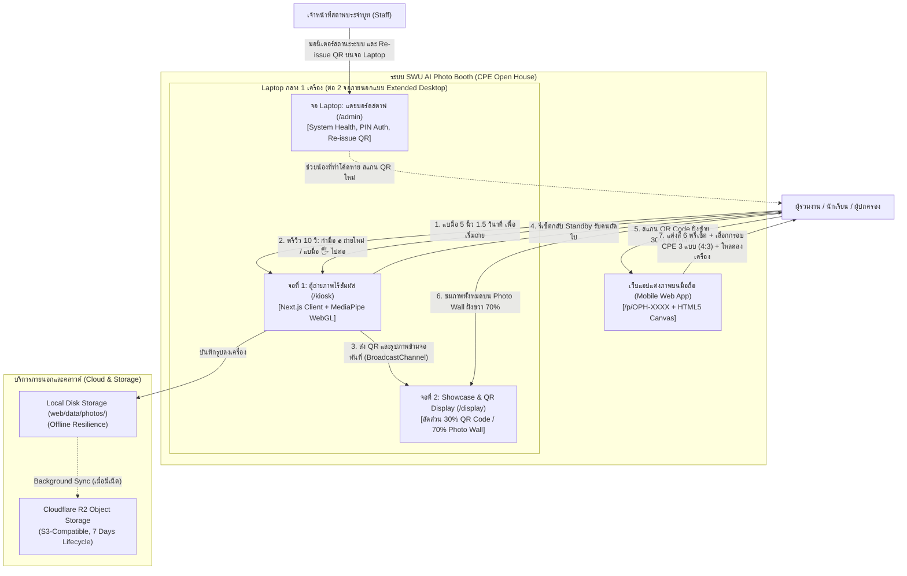
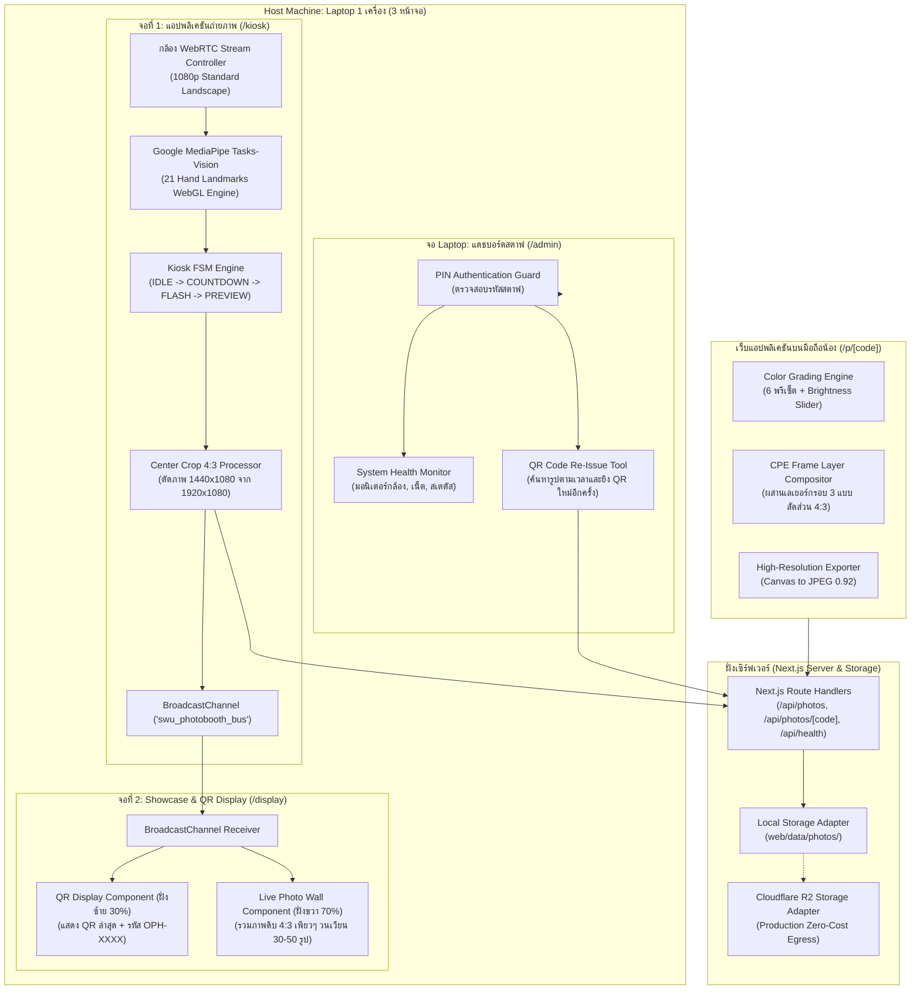
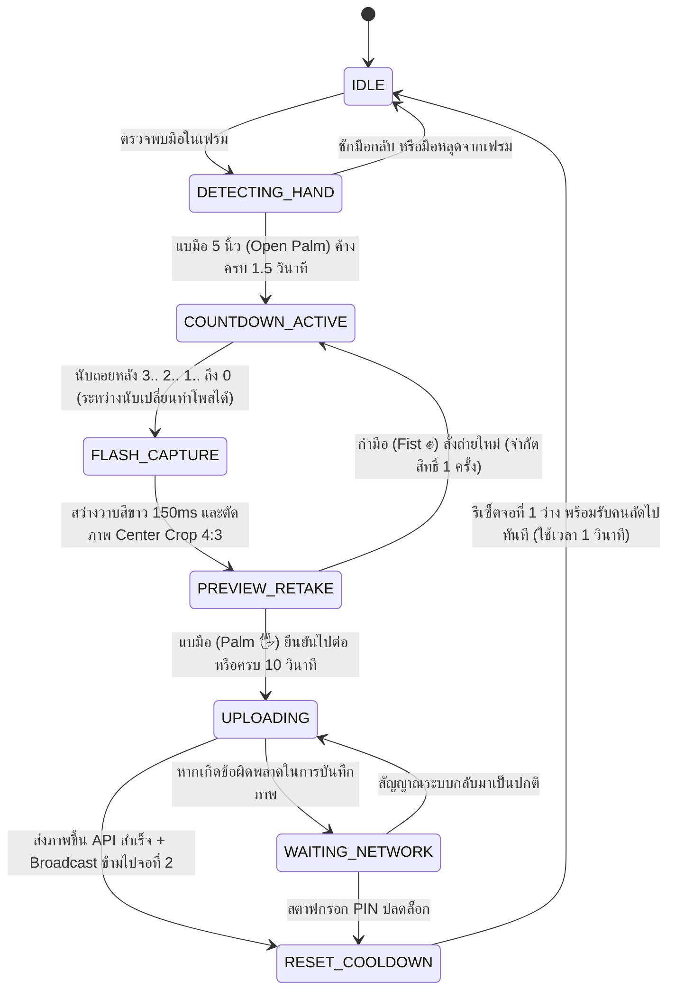
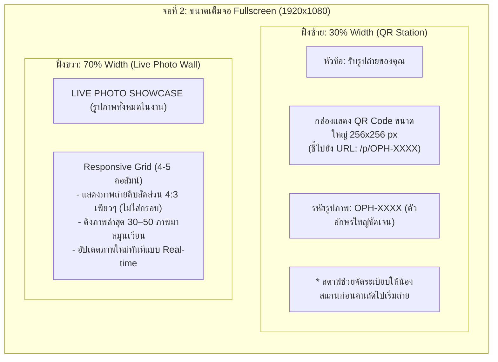

# สถาปัตยกรรมระบบและการออกแบบเชิงเทคนิค (System Architecture & Technical Design)
## โครงการ: SWU Open House - AI Photo Booth (CPE Major)
**เอกสาร**: SAD (System Architecture Document) & LLD (Low-Level Technical Design)  
**มาตรฐานอ้างอิง**:
- **IEEE 1016-2009** (Standard for Information Technology - Systems Design - Software Design Descriptions)
- **C4 Model for Software Architecture** (Context, Container, Component, Code)
- **ISO/IEC 25010** (Software Engineering - Software Product Quality Requirements and Evaluation)
**เวอร์ชัน**: 2.0 (Approved via /grill-me - Multi-Display Architecture)  
**วันที่**: 7 พฤศจิกายน 2026  

---

## 1. บทนำและเป้าหมายเชิงเทคนิค (Technical Scope & Objectives)

ระบบ AI Photo Booth ภาควิชาวิศวกรรมคอมพิวเตอร์ มหาวิทยาลัยศรีนครินทรวิโรฒ (CPE SWU Open House) ออกแบบขึ้นโดยมีเป้าหมายเชิงเทคนิค 5 ประการ:
1. **Low Latency & High Frame Rate**: การตรวจจับท่ามือแบบเรียลไทม์ 60 FPS ด้วยโมเดล Google MediaPipe บนเบราว์เซอร์ผ่าน WebGL (Client-side 100%)
2. **Multi-Screen Separation & Zero Queue Congestion**: แยกหน้าจอการทำงานออกเป็น **3 จอภาพ** บน Laptop 1 เครื่อง:
   - **จอที่ 1 (`/kiosk`)**: มุ่งเน้นการตรวจจับท่าทางและถ่ายภาพ (เมื่อถ่ายเสร็จ รีเซ็ตกลับ Standby รับคนถัดไปทันที)
   - **จอที่ 2 (`/display`)**: แบ่ง 30/70 (ฝั่งซ้าย 30% แสดง QR Code คนล่าสุด / ฝั่งขวา 70% แสดง Live Photo Wall รูปเพียว 4:3 ทั้งหมดในงาน)
   - **จอ Laptop (`/admin`)**: มอนิเตอร์สุขภาพระบบ และ Re-issue QR ให้น้องที่ทำโค้ดหาย
3. **100% Touchless Interaction**: ตั้งแต่เริ่มสั่งถ่าย (แบมือ 1.5s) จนถึงหน้าพรีวิว 10 วินาที (**กำมือ ✊ = ถ่ายใหม่** / **แบมือ 🖐️ = ยืนยันไปต่อ**) ไม่ต้องใช้จอสัมผัสราคาแพง
4. **Network Resilience & Local-First**: บันทึกภาพลง Disk ในเครื่องตู้และส่งสัญญาณข้ามจอด้วย `BroadcastChannel` ทันที 0ms ออฟไลน์ 100% พร้อม Background Sync ขึ้น Cloudflare R2
5. **Zero Cloud Infrastructure Cost**: ประมวลผลภาพบนเบราว์เซอร์ Client-side Canvas 2D ทั้งหมด และจัดเก็บไฟล์ภาพบน Cloudflare R2 (ฟรีค่า Egress) พร้อมระบบลบไฟล์อัตโนมัติ 7 วันตามมาตรฐาน PDPA

---

## 2. แผนผังสถาปัตยกรรมระดับสูง (C4 Architectural Diagrams)

### 2.1 C4 Level 1: System Context Diagram



---

### 2.2 C4 Level 2: Container Diagram



---

## 3. การออกแบบเชิงลึกและ Finite State Machine (Low-Level Design - LLD)

### 3.1 แผนผัง Finite State Machine ของจอที่ 1 (Screen 1 Kiosk FSM)

จอที่ 1 มีหน้าที่เฉพาะการตรวจจับท่าทางและถ่ายภาพ โดย State Transitions ถูกควบคุมดังนี้:



---

### 3.2 ตารางรายละเอียดสถานะและเงื่อนไขการเปลี่ยนสถานะ (FSM State Transition Matrix)

| State Name | คำอธิบายการทำงานในสถานะ | Trigger Event ขาเข้า | Next State | Action / ผลลัพธ์ที่เกิดขึ้น |
| :--- | :--- | :--- | :--- | :--- |
| **`IDLE`** | จอที่ 1 แสดง Live Viewfinder กรอบ 16:9 ไกด์ 4:3 | ระบบเริ่มทำงาน หรือรีเซ็ตเสร็จสิ้น | `DETECTING_HAND` | รัน MediaPipe WebGL สกัดพิกัด 21 จุด |
| **`DETECTING_HAND`** | ตรวจสอบท่าทางมือและกรองคนเดินผ่านหลัง | ตรวจพบมือขนาด >= 3.5% ของจอ | `COUNTDOWN_ACTIVE` | จับเวลา Hold Timer ครบ 1.5 วินาที |
| **`COUNTDOWN_ACTIVE`** | แสดงตัวเลขนับถอยหลังขนาดใหญ่ 3.. 2.. 1.. บนจอที่ 1 | Hold Timer ครบ 1.5 วิ | `FLASH_CAPTURE` | นับถอยหลัง 3 วินาที (เปลี่ยนท่าโพสได้อิสระ) |
| **`FLASH_CAPTURE`** | หน้าจอที่ 1 สว่างวาบสีขาวเต็มจอ (White Flash 150ms) | ตัวเลขนับถอยหลังถึง 0 | `PREVIEW_RETAKE` | Freeze เฟรม ตัด Center Crop 4:3 (1440x1080) |
| **`PREVIEW_RETAKE`** | แสดงภาพพรีวิวทันที พร้อมเวลานับถอยหลัง **10 วินาที** | บันทึกภาพสำเร็จ | `COUNTDOWN_ACTIVE`<br>หรือ `UPLOADING` | **กำมือ ✊ = ถ่ายใหม่ (1 ครั้ง)**<br>**แบมือ 🖐️ หรือหมด 10 วิ = ไปต่อ** |
| **`UPLOADING`** | บันทึกภาพลง Storage และส่งข้อมูลข้ามจอ | ยืนยันภาพ | `RESET_COOLDOWN` | ยิง Event `PHOTO_READY_FOR_DISPLAY` ไปจอ 2 |
| **`WAITING_NETWORK`** | หน้าจอรอระบบ (Blocking Mode กรณีผิดพลาดร้ายแรง) | เกิด Network/Storage Error | `UPLOADING` | มีปุ่มให้สตาฟกรอก PIN ปลดล็อก |
| **`RESET_COOLDOWN`** | ล้างแคชในจอที่ 1 คืนหน่วยความจำ | อัปโหลดสำเร็จ | `IDLE` | จอ 1 กลับสู่ Standby รอคนถัดไปทันที |

---

## 4. สถาปัตยกรรมจอที่ 2: Showcase & QR Display (Layout 30/70)

จอที่ 2 ถูกออกแบบเป็น Hub ศูนย์รวมการแสดงผลสำหรับผู้ร่วมงานที่ถ่ายภาพเสร็จแล้ว:



### การทำงานร่วมกันระหว่างจอ 1 และ จอ 2 ผ่าน `BroadcastChannel`
1. จอที่ 1 และ จอที่ 2 เปิดบนเบราว์เซอร์เดียวกันบน Laptop เครื่องเดียวกัน (Extended Desktop)
2. เมื่อจอที่ 1 อัปโหลดภาพเสร็จ จะส่งคำสั่ง:
   ```javascript
   const channel = new BroadcastChannel('swu_photobooth_bus');
   channel.postMessage({
     type: 'PHOTO_READY_FOR_DISPLAY',
     code: 'OPH-AB29',
     qrUrl: 'http://192.168.1.10:3000/p/OPH-AB29',
     photoUrl: '/api/photos/OPH-AB29/file',
     createdAt: new Date().toISOString()
   });
   ```
3. จอที่ 2 รับ Event ดังกล่าว แล้วนำ QR Code ไปแสดงที่ฝั่งซ้าย (30%) ทันที และนำภาพ 4:3 ไปเพิ่มที่ส่วนหัวของ Live Photo Wall ฝั่งขวา (70%) ทันที โดยมี Latency ต่ำกว่า 5 มิลลิวินาที

---

## 5. การออกแบบสถาปัตยกรรมหน้าจอแอดมินบน Laptop (`/admin`)

หน้าจอ Laptop ของสตาฟถูกจำกัดบทบาทให้เป็น **Monitoring & Disaster Recovery Console**:
* **System Health Monitor**: ตรวจสอบสถานะการเชื่อมต่อกล้องเว็บแคม, สัญญาณอินเทอร์เน็ต, และพื้นที่จัดเก็บ Disk
* **Re-Issue QR Code**: กรณีที่น้องทำ QR หาย หรือเดินออกจากบูทไปแล้ว สตาฟสามารถค้นหารูปตามเวลาที่ถ่าย และกดเปิด QR Code ขนาดใหญ่บนจอ Laptop ให้น้องสแกนได้ทันที
* **Staff PIN Guard**: ป้องกันบุคคลภายนอกเข้าถึงข้อมูลรูปภาพทั้งหมด
* **No Shooting Override Button**: ตามมติที่ตกลงไว้ สตาฟจะไม่มีปุ่มกดถ่ายรูปแทน เพื่อให้ระบบตู้ทำงานแบบ Touchless อัตโนมัติ 100%

---

## 6. บันทึกการตัดสินใจทางสถาปัตยกรรม (Architecture Decision Records - ADR)

### ADR-01: การเลือกใช้ Google MediaPipe บน WebGL (60 FPS On-Device)
* **การตัดสินใจ**: ใช้ `@mediapipe/tasks-vision` บนเบราว์เซอร์ผ่าน WebGL 60 FPS แทนการใช้ YOLO หรือ Python Backend

### ADR-02: สถาปัตยกรรม 3 หน้าจอแยกอิสระ (1 Laptop + 2 จอแสดงผล)
* **บริบท**: การรวมทั้งการถ่ายรูปและการสแกน QR ไว้บนจอเดียวกันทำให้คิวติดขัด เพราะคนต้องยืนสแกน QR ขวางหน้ากล้อง
* **การตัดสินใจ**: แยกเป็น **จอที่ 1 สำหรับถ่ายรูป**, **จอที่ 2 สำหรับโชว์ QR (30%) + Photo Wall (70%)**, และ **จอ Laptop สำหรับแอดมิน**
* **ผลลัพธ์**: Throughput เพิ่มขึ้นเป็น 60–80 คนต่อชั่วโมง คนถ่ายเสร็จเดินไปสแกนที่จอ 2 ทันที จอ 1 รับคนใหม่ได้ทันที

### ADR-03: การควบคุมหน้าพรีวิว 10 วินาทีแบบ Touchless (กำมือถ่ายใหม่ / แบมือไปต่อ)
* **บริบท**: จอที่ 1 ไม่มีหน้าจอสัมผัส (Non-touchscreen)
* **การตัดสินใจ**: ให้น้อง **กำมือ (`FIST` ✊)** เพื่อถ่ายใหม่ และ **แบมือ (`OPEN_PALM` 🖐️)** เพื่อยืนยันไปต่อทันที (พร้อมระบบไปต่ออัตโนมัติเมื่อครบ 10 วินาที)
* **ผลลัพธ์**: ใช้งานได้แบบไร้สัมผัส 100% ประหยัดงบฮาร์ดแวร์หน้าจอ

### ADR-04: การสื่อสารระหว่างหน้าจอด้วย Browser `BroadcastChannel` API
* **บริบท**: หน้าจอทั้ง 3 เปิดอยู่บนเครื่อง Laptop เดียวกัน
* **การตัดสินใจ**: ใช้ `BroadcastChannel` ในการส่งข้อมูลข้ามหน้าต่างเบราว์เซอร์
* **ผลลัพธ์**: ความเร็วในการซิงค์ 0ms, ออฟไลน์ 100%, ไม่ต้องติดตั้ง WebSocket Server หรือ Redis

### ADR-05: สัดส่วนภาพถ่าย 4:3 (1440x1080 px)
* **บริบท**: ภาพถ่าย Photo Booth งานวิศวะ มศว กำหนดให้ใช้สัดส่วน 4:3
* **การตัดสินใจ**: ครอปตรงกลางจากกล้อง 1080p (ตัดขอบข้างซ้าย-ขวา ข้างละ 240 px)
* **ผลลัพธ์**: ได้ภาพคมชัด สัดส่วน 4:3 สมบูรณ์แบบเข้ากับกรอบรูป CPE ทั้ง 3 แบบ

### ADR-06: Live Photo Wall แสดงภาพดิบ 4:3 เพียวๆ (ไม่ใส่กรอบ)
* **บริบท**: ต้องการโชว์รูปทั้งหมดของน้องๆ ในงานบนจอที่ 2 ฝั่งขวา 70%
* **การตัดสินใจ**: แสดงภาพถ่าย 4:3 เพียวๆ ทันทีหลังถ่ายเสร็จ วนเวียนภาพล่าสุด 30–50 ภาพ
* **ผลลัพธ์**: ภาพขึ้นแสดงได้ทันที Real-time ไม่ต้องรอน้องแต่งรูปเสร็จบนมือถือ

### ADR-07: การประมวลผลแต่งรูปบนมือถือด้วย Client-Side Canvas 2D
* **การตัดสินใจ**: ฟิลเตอร์ 6 พรีเซ็ต + สไลเดอร์ความสว่าง + กรอบ CPE 3 แบบ ทำงานบน Canvas 2D ในมือถือน้อง 100%

### ADR-08: นโยบายการเก็บรักษาข้อมูลและทำลายอัตโนมัติ 7 วัน (PDPA)
* **การตัดสินใจ**: ลบไฟล์ภาพออกจากระบบอัตโนมัติเมื่อครบ 7 วัน
