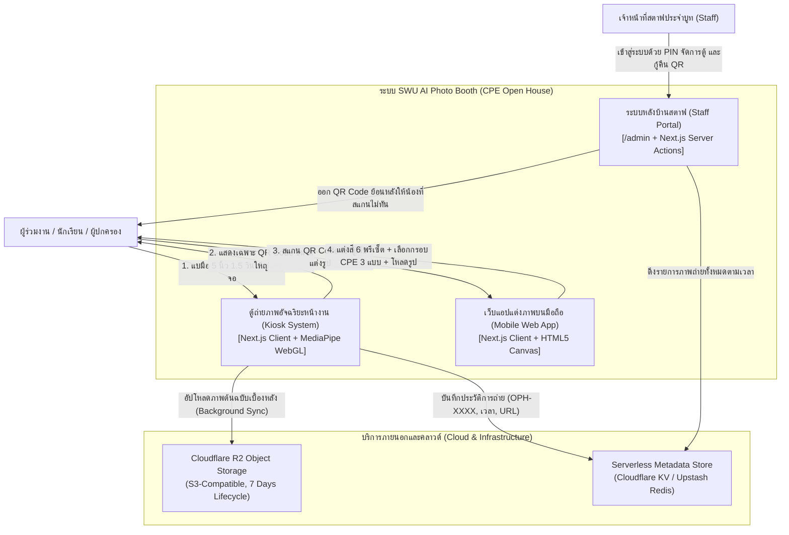
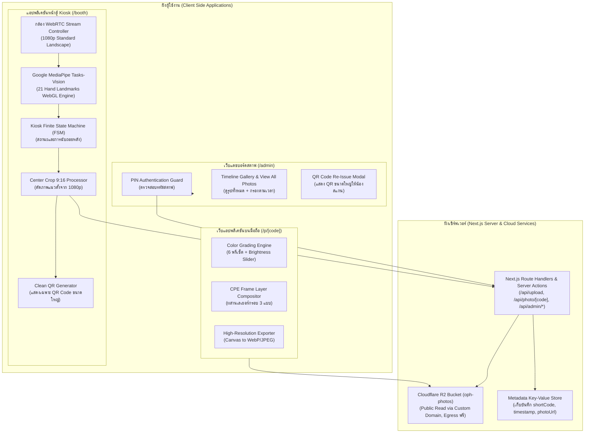
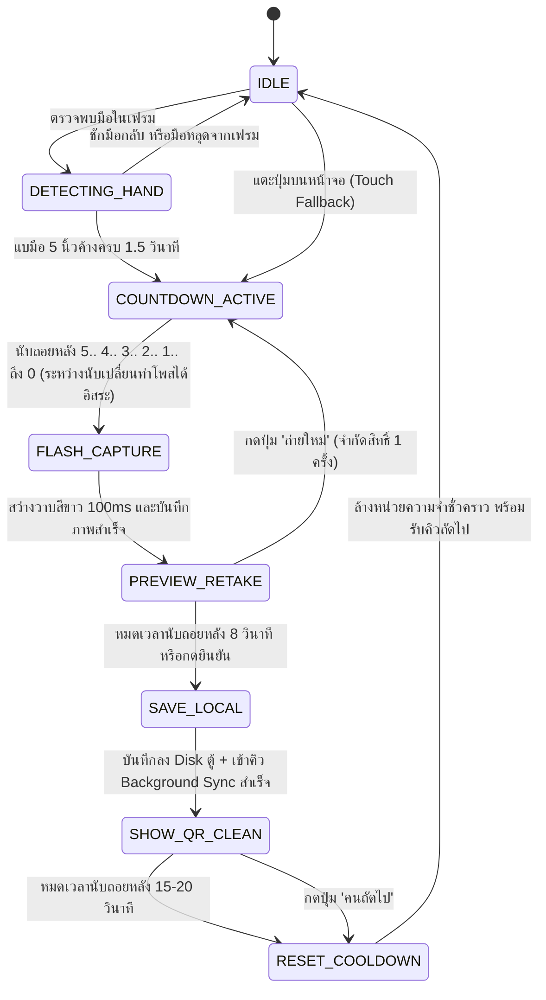
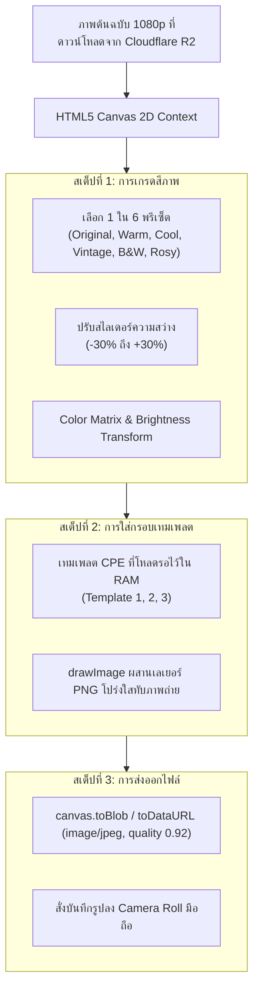
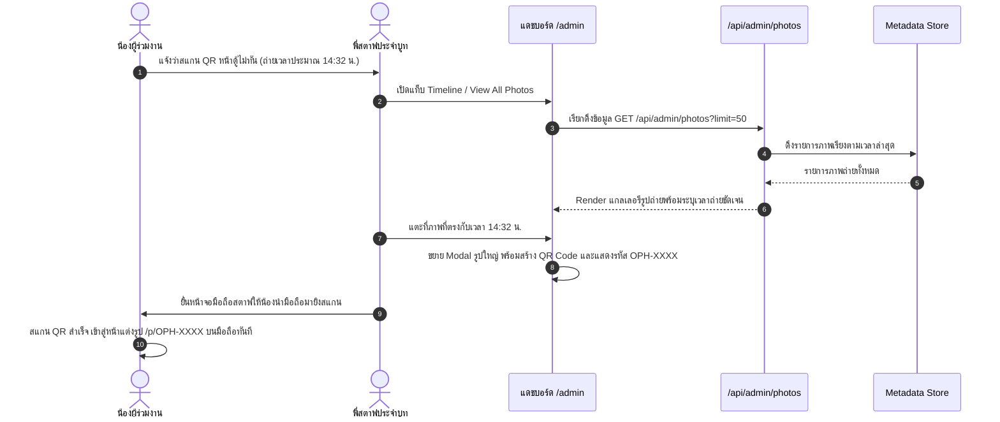

# สถาปัตยกรรมระบบและการออกแบบเชิงเทคนิค (System Architecture & Technical Design)
## โครงการ: SWU Open House - AI Photo Booth (CPE Major)
**เอกสาร**: SAD (System Architecture Document) & LLD (Low-Level Technical Design)  
**มาตรฐานอ้างอิง**:
- **IEEE 1016-2009** (Standard for Information Technology - Systems Design - Software Design Descriptions)
- **C4 Model for Software Architecture** (Context, Container, Component, Code)
- **ISO/IEC 25010** (Software Engineering - Software Product Quality Requirements and Evaluation)
**เวอร์ชัน**: 1.0 (Approved via /grill-me)  
**วันที่**: 7 พฤศจิกายน 2026  

---

## 1. บทนำและเป้าหมายเชิงเทคนิค (Technical Scope & Objectives)

ระบบ AI Photo Booth ภาควิชาวิศวกรรมคอมพิวเตอร์ มหาวิทยาลัยศรีนครินทรวิโรฒ (CPE SWU Open House) ออกแบบขึ้นโดยมีเป้าหมายเชิงเทคนิค 4 ประการ:
1. **Low Latency & High Frame Rate**: การตรวจจับท่ามือแบบเรียลไทม์ 60 FPS ด้วยโมเดล Google MediaPipe บนเบราว์เซอร์ผ่าน WebGL (Client-side 100%)
2. **Zero Queue Congestion**: แยกกระบวนการถ่ายภาพ (หน้าตู้) ออกจากการแต่งภาพและเลือกกรอบรูป (บนสมาร์ตโฟนของผู้ใช้) เพื่อให้ตู้ใช้เวลาบริการเฉลี่ยไม่เกิน 20–30 วินาทีต่อคน
3. **Network Resilience (Non-Blocking)**: เมื่อบันทึกภาพแล้ว ระบบเซฟลง Disk เครื่องตู้และแสดง QR Code ทันที ส่วนการอัปโหลดขึ้น Cloudflare R2 ทำเบื้องหลัง (Background Sync) หากเน็ตหลุดจะเก็บสถานะ `PENDING` แล้ว Retry อัตโนมัติเมื่อเน็ตกลับมา คิวหน้าตู้ไม่หยุด
4. **Zero Cloud Infrastructure Cost**: ประมวลผลภาพบนเบราว์เซอร์ Client-side Canvas 2D ทั้งหมด และจัดเก็บไฟล์ภาพบน Cloudflare R2 (ฟรีค่า Egress) พร้อมระบบลบไฟล์อัตโนมัติ 7 วันตามมาตรฐาน PDPA

---

## 2. แผนผังสถาปัตยกรรมระดับสูง (C4 Architectural Diagrams)

### 2.1 C4 Level 1: System Context Diagram

---

### 2.2 C4 Level 2: Container Diagram

---

## 3. การออกแบบเชิงลึกและ Finite State Machine (Low-Level Design - LLD)

### 3.1 แผนผัง Finite State Machine (Kiosk FSM)

สถานะการทำงานของตู้ถ่ายรูป Kiosk ถูกออกแบบให้ควบคุมการเปลี่ยนสถานะ (State Transitions) อย่างเคร่งครัดตามข้อกำหนดวิศวกรรม:

---

### 3.2 ตารางรายละเอียดสถานะและเงื่อนไขการเปลี่ยนสถานะ (FSM State Transition Matrix)

| State Name | คำอธิบายการทำงานในสถานะ | Trigger Event ขาเข้า | Next State | Action / ผลลัพธ์ที่เกิดขึ้น |
| :--- | :--- | :--- | :--- | :--- |
| **`IDLE`** | หน้าจอพร้อมใช้งาน แสดง Live Viewfinder จากกล้องเว็บแคม | ระบบเปิดใช้งาน หรือรีเซ็ตเสร็จสิ้น | `DETECTING_HAND` | รัน MediaPipe บน WebGL ดักจับพิกัด 21 จุด |
| **`DETECTING_HAND`** | ประเมินท่าทางมือ Open Palm | ตรวจพบมือในเฟรมกล้อง | `COUNTDOWN_ACTIVE` | จับเวลา Hold Timer ครบ 1.5 วินาที |
| **`COUNTDOWN_ACTIVE`** | แสดงตัวเลขนับถอยหลังขนาดใหญ่ 5.. 4.. 3.. 2.. 1.. บนหน้าจอ | Hold Timer ครบ 1.5 วิ หรือแตะปุ่มจอ | `FLASH_CAPTURE` | นับ 5 วินาที ไม่ยกเลิกเมื่อชักมือกลับ (ให้เปลี่ยนท่าโพสได้) |
| **`FLASH_CAPTURE`** | หน้าจอสว่างวาบสีขาวเต็มจอ (White Flash 100ms) | ตัวเลขนับถอยหลังถึง 0 | `PREVIEW_RETAKE` | Freeze เฟรม ตัด Center Crop 9:16 บันทึกลง Memory |
| **`PREVIEW_RETAKE`** | แสดงภาพพรีวิวทันที พร้อมเวลานับถอยหลัง **8 วินาที** | บันทึกภาพสำเร็จ | `SAVE_LOCAL` | มีปุ่ม "ถ่ายใหม่" (1 ครั้ง) หากหมดเวลา 8 วิจะไปต่อเอง |
| **`SAVE_LOCAL`** | บันทึกภาพ + Metadata ลง Disk เครื่องตู้ และเข้าคิวอัปโหลด | ยืนยันภาพ | `SHOW_QR_CLEAN` | Background Sync อัปโหลดขึ้น R2 เอง ถ้าเน็ตหลุดเก็บเป็น `PENDING` แล้ว Retry |
| **`SHOW_QR_CLEAN`** | แสดงเฉพาะ QR Code ขนาดใหญ่ นับถอยหลัง 15–20 วิ | บันทึกลงเครื่องสำเร็จ | `RESET_COOLDOWN` | **ไม่แสดงรหัสตัวอักษรบนหน้าตู้** มีปุ่ม "คนถัดไป" |
| **`RESET_COOLDOWN`** | ล้างหน่วยความจำชั่วคราว คืนทรัพยากรระบบ | หมดเวลา QR หรือกดคนถัดไป | `IDLE` | รีเซ็ต Viewfinder ให้ว่าง พร้อมเริ่มรอบใหม่ใน 1 วินาที |

---

## 4. สถาปัตยกรรมไปป์ไลน์กล้องและการประมวลผล AI (Camera & Vision Pipeline)

```mermaid
flowchart LR
    subgraph HW["ฮาร์ดแวร์"]
        Cam["กล้อง USB Webcam 1080p<br>(ติดตั้งแนวนอน 16:9)"]
    end

    subgraph BrowserStream["เบราว์เซอร์สตรีมมิ่ง"]
        Stream["WebRTC getUserMedia<br>(1920x1080 @ 30-60 FPS)"]
        VideoElement["HTML5 Video Texture Binder"]
    end

    subgraph AI_Engine["โมเดล AI MediaPipe"]
        BlazePalm["BlazePalm Detector<br>(ตรวจหาตำแหน่งฝ่ามือ)"]
        Landmarker["Hand Landmark Model<br>(คำนวณพิกัด 21 จุด 3D)"]
        GestureLogic["Open Palm Evaluator<br>(ปลายนิ้ว 4 นิ้วสูงกว่าข้อนิ้ว PIP)"]
    end

    subgraph CaptureEngine["การจับภาพและตัดสัดส่วน"]
        Crop916["Center Crop 9:16 Processor<br>(ตัดพิกัดตรงกลาง 608x1080 px)"]
        WhiteFlash["White Flash Animation Overlay<br>(ความสว่างเต็มจอ 100ms)"]
    end

    Cam --> Stream
    Stream --> VideoElement
    VideoElement --> BlazePalm
    BlazePalm --> Landmarker
    Landmarker --> GestureLogic
    GestureLogic -->|"แบมือครบ 1.5 วิ → นับถอยหลัง 5 วิ"| WhiteFlash
    WhiteFlash --> Crop916
```

---

## 5. การออกแบบเอนจินตกแต่งภาพและเทมเพลต CPE (Mobile Canvas Compositor)

บนสมาร์ตโฟนของผู้ใช้งาน (`/p/OPH-XXXX`) การประมวลผลภาพทั้งหมดทำงานบนเครื่องผู้ใช้ 100% (Client-Side Canvas 2D) โดยมีการโหลดเทมเพลตทั้ง 3 แบบล่วงหน้า (Preload) ทันทีที่เปิดหน้าเว็บ:

### 5.1 รายละเอียดเทมเพลตกรอบรูปภาควิชาคอมพิวเตอร์ (CPE Templates)
1. **Template 01: CPE SWU Official Classic**
   * โทนสี: แดงเลือดหมูวิศวะ (#8B0000) และเทาเงิน (#D3D3D3)
   * องค์ประกอบ: ตราสัญลักษณ์ภาควิชาวิศวกรรมคอมพิวเตอร์ และชื่อมหาวิทยาลัยศรีนครินทรวิโรฒ
2. **Template 02: CPE Youthful Tech & Circuit Graphic**
   * โทนสี: น้ำเงินนีออน เทคโนโลยี ลายเส้นวงจรไฟฟ้า ไอคอนคอมพิวเตอร์ โค้ดดิ้ง และ AI
   * องค์ประกอบ: กราฟิกการ์ตูนสดใส เหมาะสำหรับนักเรียนมัธยมถ่ายภาพเป็นที่ระลึก
3. **Template 03: CPE Photostrip Minimalist**
   * โทนสี: ขาว มินิมอล สไตล์ฟิล์มเกาหลี Life4Cuts
   * องค์ประกอบ: แถบข้อความระบุ `CPE Open House 2026 - Faculty of Engineering, SWU`

### 5.2 ไปป์ไลน์การเรนเดอร์ภาพ (Canvas 2D Rendering Pipeline)

---

## 6. สถาปัตยกรรมระบบหลังบ้านสตาฟและการสืบค้น (Staff Back-Office Architecture)

ระบบหลังบ้านสตาฟ (`/admin`) ได้รับการออกแบบให้สตาฟสามารถช่วยเหลือผู้ใช้งานได้ครอบคลุม:
* **Timeline เรียงตามเวลา**: แสดงภาพถ่ายล่าสุดเรียงตาม Timestamp เพื่อให้น้องที่สแกนไม่ทันเดินมาแจ้งเวลาถ่าย (เช่น ถ่ายเมื่อ 2 นาทีที่แล้ว) แล้วสตาฟแตะเปิด QR Code ย้อนหลังได้ทันที
* **โหมดดูรูปทั้งหมด (View All Photos)**: รองรับการโหลดภาพถ่ายทั้งหมดของทั้งงานแบบ Pagination / Infinite Scroll ไม่มีปัญหาเรื่องหน่วยความจำ
* **ระบบค้นหาด่วน**: ค้นหาด้วยรหัส `OPH-XXXX` หรือกรองดูตามช่วงเวลาที่ถ่าย

---

## 7. บันทึกการตัดสินใจทางสถาปัตยกรรม (Architecture Decision Records - ADR)

### ADR-01: การเลือกใช้ Google MediaPipe บน WebGL (60 FPS On-Device)
* **บริบท**: ระบบต้องตรวจจับท่าทางมือได้อย่างแม่นยำ ไม่กระตุก และไม่พึ่งพาเซิร์ฟเวอร์
* **การตัดสินใจ**: ใช้ `@mediapipe/tasks-vision` บนเบราว์เซอร์ผ่าน WebGL 60 FPS แทนการใช้ YOLO หรือ Python Backend
* **ผลลัพธ์**: ความหน่วงต่ำเพียง 10-16 ms, ไม่ต้องตั้งเซิร์ฟเวอร์ GPU, ทำงานออฟไลน์ได้ 100%

### ADR-02: สถาปัตยกรรม Hybrid UX (ตู้เร็ว + แต่งภาพบนมือถือ)
* **บริบท**: งานเปิดบ้านมีผู้เข้าร่วมจำนวนมาก การให้ผู้ใช้ยืนแต่งรูปหน้าตู้ทำให้คิวยาวติดขัด
* **การตัดสินใจ**: ตู้ทำหน้าที่แค่ถ่ายภาพแล้วออก QR ทันที น้องไปเลือกสีและกรอบบนมือถือตัวเอง
* **ผลลัพธ์**: เวลาเฉลี่ยหน้าตู้ลดลงเหลือ 20–30 วินาทีต่อคน รองรับผู้ถ่ายได้ 60–80 คนต่อชั่วโมง

### ADR-03: การแยกการแสดงผลรหัส OPH-XXXX และ QR Code บนหน้าตู้
* **บริบท**: ป้องกันไม่ให้หน้าตู้รกและกระตุ้นให้ผู้ใช้งานสแกนทันที
* **การตัดสินใจ**: หน้าตู้ Kiosk แสดงเฉพาะ QR Code ขนาดใหญ่ (ไม่แสดงตัวหนังสือรหัส) ส่วนรหัส `OPH-XXXX` จะแสดงที่หัวเว็บมือถือให้น้องจดเก็บไว้
* **ผลลัพธ์**: หน้าตู้สะอาด สื่อสารชัดเจน น้องไม่สับสน

### ADR-04: อัปโหลดเบื้องหลังแบบไม่บล็อกตู้ (Non-Blocking Background Sync)
* **บริบท**: เน็ตในงานอาจหลุด ถ้าตู้ต้องรออัปโหลดเสร็จก่อนจะทำให้คิวหยุดทั้งแถว
* **การตัดสินใจ**: บันทึกภาพลง Disk เครื่องตู้แล้วแสดง QR Code ทันที อัปโหลดขึ้น Cloudflare R2 เบื้องหลังพร้อม Retry อัตโนมัติ (แก้ไขมติเดิมที่เคยเป็น Blocking Mode — ดู [บันทึกการแก้ไขมติ](../decisions.md))
* **ผลลัพธ์**: คิวหน้าตู้ไม่หยุด ภาพไม่หาย
* **ข้อแลกเปลี่ยน**: ถ้าน้องสแกนตอนภาพยังอัปโหลดไม่เสร็จ หน้ามือถือต้องแสดง "กำลังเตรียมรูป..." และลองโหลดซ้ำอัตโนมัติ

### ADR-05: การประมวลผลภาพบนมือถือด้วย Client-Side Canvas 2D
* **บริบท**: ลดต้นทุนและภาระการประมวลผลบนคลาวด์
* **การตัดสินใจ**: ใช้ HTML5 Canvas บนเบราว์เซอร์มือถือน้องในการเกรดสีและซ้อนกรอบรูป
* **ผลลัพธ์**: พรีวิวการแต่งสีแบบเรียลไทม์ 0 วินาที และต้นทุนเซิร์ฟเวอร์เป็น 0 บาท

### ADR-06: การจัดเก็บและโหลดไฟล์กรอบเทมเพลต CPE แบบ Static Preload
* **บริบท**: ป้องกันปัญหากรอบรูปไม่ขึ้นขณะน้องแต่งภาพบนมือถือในจุดที่เน็ตช้า
* **การตัดสินใจ**: ฝังเทมเพลตกรอบรูป CPE ทั้ง 3 แบบไว้ในโฟลเดอร์ `/public/templates/` พร้อมฟังก์ชัน Preload ทันทีที่เปิดหน้าเว็บ
* **ผลลัพธ์**: สลับกรอบได้ทันที ไม่มีอาการหน่วงหรือรอโหลด

### ADR-07: การติดตั้งกล้องแนวนอนมาตรฐานและตัดภาพ Center Crop 9:16
* **บริบท**: จอมอนิเตอร์เป็นแนวนอน 16:9 แต่น้องต้องการภาพแนวตั้ง 9:16
* **การตัดสินใจ**: ติดตั้งกล้องแนวนอนมาตรฐาน 1080p แล้วใช้ซอฟต์แวร์ตัดขอบข้างแบบ Center Crop 9:16
* **ผลลัพธ์**: ไม่ต้องจัดหาขาจับหมุนกล้องแบบพิเศษ สตาฟติดตั้งหน้างานได้สะดวกรวดเร็ว

### ADR-08: นโยบายการเก็บรักษาข้อมูลและทำลายอัตโนมัติ 7 วัน (PDPA Compliance)
* **บริบท**: ปฏิบัติตาม พ.ร.บ. คุ้มครองข้อมูลส่วนบุคคล พ.ศ. 2562
* **การตัดสินใจ**: ตั้งค่า Cloudflare R2 Lifecycle Rule ให้ลบไฟล์ภาพทิ้งถาวรเมื่อครบ 7 วัน
* **ผลลัพธ์**: สอดคล้องตามกฎหมาย PDPA โดยไม่ต้องใช้แรงงานสตาฟมาคอยลบไฟล์ด้วยมือ

---

## 8. การจัดการข้อผิดพลาดและความต่อเนื่องของระบบ (Fault Matrix & Resilience)

| สถานการณ์ขัดข้อง (Fault Scenario) | ผลกระทบต่อระบบ | กลไกการตรวจจับ (Detection) | แผนการกู้คืนและการทำงานอัตโนมัติ (Recovery Strategy) |
| :--- | :--- | :--- | :--- |
| **กล้องเว็บแคมหลุด หรือถูกดึงสาย** | Viewfinder ดับ | Event `ended` หรือ MediaStream inactive | แสดงหน้าจอ Error ทันทีพร้อมแจ้งเตือนสตาฟให้เสียบสายใหม่ ระบบจะ Re-init กล้องอัตโนมัติ |
| **น้องชักมือกลับตอนนับถอยหลัง** | ไม่มีผลกระทบ | — | นับถอยหลังต่อจนถ่าย เพราะช่วง 5 วินาทีเปิดให้เปลี่ยนท่าโพสได้อิสระ |
| **สัญญาณ Wi-Fi หลุดขณะอัปโหลด** | ไม่สามารถส่งภาพขึ้นคลาวด์ได้ชั่วคราว | Fetch Request โยนข้อผิดพลาด `NetworkError` | ภาพอยู่บน Disk ตู้สถานะ `PENDING` Background Sync Retry อัตโนมัติ หน้าตู้ให้บริการคนถัดไปตามปกติ |
| **เน็ตดับยาวนาน** | น้องเปิดรูปบนมือถือไม่ได้จนกว่าจะซิงค์ | Staff Modal แสดงจำนวนภาพ `PENDING` | สตาฟสลับไปใช้ Hotspot มือถือ หรือสั่ง Force Sync ภาพจะเปิดได้เมื่ออัปโหลดเสร็จ |
| **น้องสแกน QR Code หน้าตู้ไม่ทัน** | หน้าจอตู้รีเซ็ตกลับหน้าแรกแล้ว | ผู้ใช้แจ้งสตาฟที่บูท | สตาฟเปิดหน้า `/admin` ดึงรายการรูปตามเวลา (Timeline) ขยาย QR Code ให้น้องสแกนใหม่ได้ทันที |
