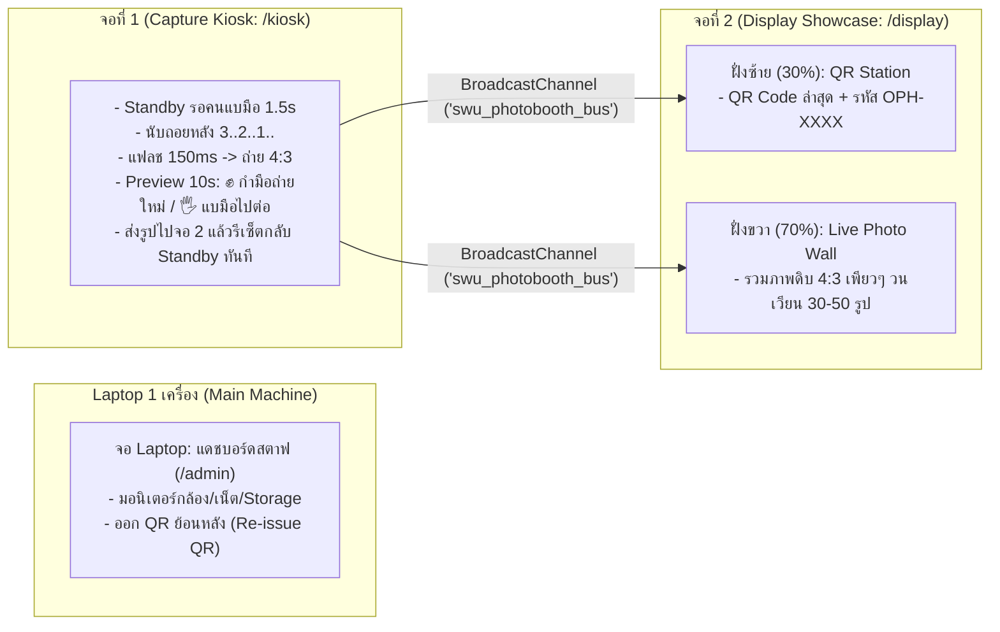
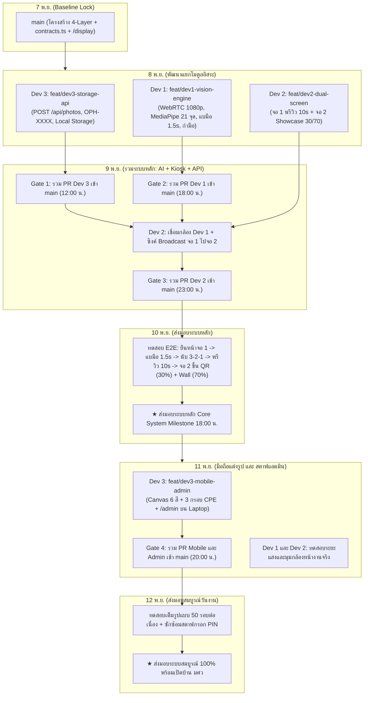

# แผนการทำงานร่วมกันของทีมพัฒนา 3 คน บน GitHub (Team Execution & GitHub Plan)
## โครงการ: SWU Open House - AI Photo Booth (CPE Major)
**เวอร์ชัน**: 2.0 (Approved via /grill-me - Multi-Display Architecture)  
**วันที่**: 7 พฤศจิกายน 2026  

---

## 1. บริบทและสถาปัตยกรรมฮาร์ดแวร์หน้างาน (Physical Hardware Context)

หน้างานจริงประกอบด้วย **Laptop 1 เครื่อง** และเชื่อมต่อออกจอภายนอก **2 จอ** ผ่านสายตรง (HDMI + Type-C DisplayPort) เป็น Windows Extended Desktop:



---

## 2. การแบ่งความรับผิดชอบของทีม 3 คน (Zero-Conflict Team Ownership)

เพื่อป้องกันไม่ให้โค้ดชนกัน (Zero Merge Conflict) ทั้ง 3 คนเป็นเจ้าของโฟลเดอร์ของตนเอง 100%:

| สมาชิกทีม | บทบาทหน้าที่หลัก | ขอบเขตงานที่รับผิดชอบ | โฟลเดอร์ใน `web/` ที่เป็นเจ้าของ |
| :--- | :--- | :--- | :--- |
| **คนที่ 1 (Dev 1)** | **AI & Computer Vision Engineer** | - เปิดกล้อง WebRTC 1080p<br>- รัน MediaPipe 21 จุด 60 FPS<br>- ตัวกรองขนาดมือหน้าตู้ (Depth & Area Filter)<br>- ตรวจจับท่าแบมือ (`OPEN_PALM`) ค้าง 1.5s เพื่อสั่งถ่าย<br>- ตรวจจับท่ากำมือ (`FIST`) สำหรับสั่งถ่ายใหม่ในหน้าพรีวิว 10s | `web/lib/ai-vision/`<br>`web/public/models/`<br>`scripts/model-training/` |
| **คนที่ 2 (Dev 2)** | **Kiosk & Showcase Display Engineer** | - พัฒนาจอที่ 1 (`/kiosk`): กรอบ 16:9 ไกด์ 4:3, นับถอยหลัง 3-2-1, แฟลช 150ms, พรีวิว 10 วิ (กำมือถ่ายใหม่ / แบมือไปต่อ)<br>- พัฒนาจอที่ 2 (`/display`): แบ่งพื้นที่ 30/70 (ซ้ายโชว์ QR ล่าสุด / ขวาโชว์ Live Photo Wall รูปเพียว 4:3)<br>- เชื่อมโยงจอ 1 และจอ 2 ด้วย `BroadcastChannel` API | `web/app/kiosk/`<br>`web/app/display/`<br>`web/lib/kiosk/` |
| **คนที่ 3 (Dev 3)** | **Full-Stack Mobile, Storage & Staff Admin Engineer** | - พัฒนา API อัปโหลดและดึงรูป (`/api/photos`), สุ่มรหัส `OPH-XXXX`<br>- ระบบ Storage (Local Disk `web/data/` และ Cloudflare R2)<br>- ลบไฟล์อัตโนมัติ 7 วัน (PDPA TTL)<br>- หน้าแต่งรูปมือถือ (`/p/[code]`): Canvas 6 สี + สไลเดอร์ความสว่าง + กรอบ CPE SWU 3 แบบ (4:3)<br>- หน้าแดชบอร์ดสตาฟบนจอ Laptop (`/admin`): มอนิเตอร์สุขภาพระบบ และ Re-issue QR | `web/app/p/`<br>`web/app/find/`<br>`web/app/admin/`<br>`web/app/api/`<br>`web/lib/mobile/`<br>`web/lib/storage/` |

---

## 3. โครงสร้างโฟลเดอร์ภายในโปรเจกต์ (Project Directory Layout)

```text
PhotoBooth-OpenHouseSWU/
├── docs/                                 # เอกสารวิศวกรรมระบบ (IEEE 830, SAD, ADRs, Backlog)
├── poc/                                  # สคริปต์ทดสอบและตรวจไวยากรณ์ Diagram
├── scripts/
│   └── model-training/                   # [คนที่ 1] สคริปต์ Python เก็บข้อมูลและเทรนโมเดลท่ามือ
└── web/                                  # Next.js 15 Application
    ├── app/
    │   ├── kiosk/page.tsx                # [คนที่ 2] จอที่ 1: ตู้ถ่ายรูป 16:9 ไกด์ 4:3 แนวนอน
    │   ├── display/page.tsx              # [คนที่ 2] จอที่ 2: Showcase แบ่ง 30% QR / 70% Photo Wall
    │   ├── p/[code]/page.tsx             # [คนที่ 3] มือถือน้อง: แต่งสี 6 พรีเซ็ต + 3 กรอบ CPE 4:3
    │   ├── find/page.tsx                 # [คนที่ 3] ค้นหารูปย้อนหลังด้วยรหัส OPH-XXXX
    │   ├── admin/page.tsx                # [คนที่ 3] จอ Laptop: แดชบอร์ดสตาฟ (มอนิเตอร์ + Re-issue QR)
    │   └── api/
    │       ├── photos/route.ts           # [คนที่ 3] POST บันทึกรูป / GET ดูรูปทั้งหมด
    │       ├── photos/[code]/route.ts    # [คนที่ 3] GET ดึงรูปและเช็กหมดอายุ 7 วัน
    │       └── health/route.ts           # [คนที่ 3] GET ตรวจสอบสถานะระบบ
    ├── lib/
    │   ├── contracts.ts                  # [สัญญากลาง] Types, DTOs, Broadcast Event, 4:3 Constants
    │   ├── ai-vision/                    # [คนที่ 1] AI Gesture (Open Palm, Fist, 1.5s Hold)
    │   ├── kiosk/                        # [คนที่ 2] Kiosk FSM, Center Cropper, Broadcast Bus
    │   ├── mobile/                       # [คนที่ 3] Canvas Color Filters, Short Code Generator
    │   └── storage/                      # [คนที่ 3] IPhotoStorage, LocalStorage, CloudflareR2
    └── public/
        ├── frames/                       # กรอบรูป CPE SWU 3 แบบ (สัดส่วน 4:3 PNG)
        └── mediapipe/                    # WASM และ Model Hand Landmarker
```

---

## 4. สัญญาการเชื่อมต่อข้อมูลระหว่างกัน (`web/lib/contracts.ts`)

```typescript
export type GestureType = "OPEN_PALM" | "FIST" | "PEACE_SIGN" | "MINI_HEART" | "NONE";

export type KioskFSMState =
  | "IDLE"
  | "DETECTING_HAND"
  | "COUNTDOWN_ACTIVE"
  | "FLASH_CAPTURE"
  | "PREVIEW_RETAKE"
  | "UPLOADING"
  | "WAITING_NETWORK"
  | "RESET_COOLDOWN";

// Event Bus เชื่อมจอที่ 1 ไปยัง จอที่ 2 ผ่าน BroadcastChannel
export type ScreenSyncEvent =
  | {
      type: "PHOTO_READY_FOR_DISPLAY";
      code: string;
      qrUrl: string;
      photoUrl: string;
      createdAt: string;
    }
  | {
      type: "SCREEN1_RESET";
    };

export const PHOTO_ASPECT_RATIO = "4:3" as const;
export const CROP_DIMENSIONS_4_3 = { width: 1440, height: 1080 } as const;
```

---

## 5. แผนการทำงานร่วมกันบน GitHub และลำดับการรวมโค้ด (Git Workflow & Merge Roadmap)

### 5.1 กรอบเวลากำหนดส่งมอบ (Key Delivery Milestones)
* **วันที่ 7 พ.ย. 2026 (วันนี้)**: ปิดรอบ Baseline Lock รวม contracts.ts, หน้า `/display` และสถาปัตยกรรม 3 หน้าจอ
* **วันที่ 10 พ.ย. 2026 (เวลา 18:00 น.)**: **★ ส่งมอบระบบหลัก (Core System Milestone)** — จอที่ 1 ถ่ายรูปไร้สัมผัส, นับ 3-2-1, แฟลช 150ms, พรีวิว 10 วิ (กำมือถ่ายใหม่ / แบมือไปต่อ) และส่งภาพข้ามไปขึ้นจอที่ 2 (30% QR / 70% Photo Wall)
* **วันที่ 12 พ.ย. 2026 (เวลา 12:00 น.)**: **★ ส่งมอบระบบสมบูรณ์วันเปิดบ้าน (Final Handover & Go-Live)** — มือถือแต่งรูป 6 สี 3 กรอบ CPE SWU, หน้าแดชบอร์ดสตาฟบน Laptop และติดตั้งหน้างานจริง

---

### 5.2 แผนภาพลำดับการแตก Branch และรวมโค้ด (Merge Order Roadmap)



---

### 5.3 ตารางกำหนดเวลาประตูตรวจรับ (Gate Deadlines)

| ประตูตรวจรับ | กำหนดเวลา Merge เข้า `main` | สิ่งที่ต้องส่งมอบใน Pull Request | ผู้ส่งมอบ |
| :---: | :--- | :--- | :---: |
| **Gate 1** | **9 พ.ย. เวลา 12:00 น.** | API อัปโหลดรูป, Local Storage Adapter, สุ่มรหัส `OPH-XXXX` | Dev 3 |
| **Gate 2** | **9 พ.ย. เวลา 18:00 น.** | กล้อง 1080p, MediaPipe 21 จุด, จับเวลาแบมือ 1.5s, จำแนกท่ากำมือ | Dev 1 |
| **Gate 3** | **9 พ.ย. เวลา 23:00 น.** | จอ 1 (พรีวิว 10s กำมือถ่ายใหม่/แบมือไปต่อ) + จอ 2 (30% QR / 70% Wall) | Dev 2 |
| **Milestone 1** | **10 พ.ย. เวลา 18:00 น.** | **★ ตรวจรับระบบหลัก 2 จอสมบูรณ์ (Core System Sign-off)** | ทั้งทีม |
| **Gate 4** | **11 พ.ย. เวลา 20:00 น.** | เว็บมือถือแต่งรูป 6 สี 3 กรอบ, แดชบอร์ดสตาฟบนจอ Laptop | Dev 3 |
| **Milestone 2** | **12 พ.ย. เวลา 12:00 น.** | **★ ส่งมอบระบบสมบูรณ์ 100% พร้อมเปิดบ้าน มศว (Go-Live)** | ทั้งทีม |

---

## 6. รายการ Task ทั้งหมดที่ต้องทำต่อจากนี้ (แบ่งรายบุคคลอย่างละเอียด)

### สายงานคนที่ 1: AI & Computer Vision Engineer (เน้น Train Model + ระบบตรวจจับมือ)
* **Task AI-01**: เก็บ Dataset พิกัดมือ 21 จุด (ท่าแบมือ `OPEN_PALM`, ท่ากำมือ `FIST`, และท่าทั่วไป `NONE`)
* **Task AI-02**: พัฒนาตัวกรองมือคนที่อยู่ใกล้กล้องที่สุด (`web/lib/ai-vision/depthAreaFilter.ts`) คัดเฉพาะมือขนาด >= 3.5%
* **Task AI-03**: พัฒนาตัวจำแนกท่ามือและ Hook จับเวลาแบมือค้าง 1.5 วินาที (`web/lib/ai-vision/useGestureTrigger.ts`)
* **Task AI-04**: พัฒนาตรรกะตรวจจับท่ากำมือ (`FIST` ✊) ในหน้าพรีวิวเพื่อส่งสัญญาณ Retake

### สายงานคนที่ 2: Kiosk & Showcase Display Engineer (เน้นจอ 1 `/kiosk` และ จอ 2 `/display`)
* **Task KIOSK-01**: พัฒนา State Machine จอที่ 1 (`web/lib/kiosk/useKioskFSM.ts`) รองรับ 8 สถานะ
* **Task KIOSK-02**: พัฒนากรอบกล้อง 16:9 ไกด์ 4:3 และสูตรตัดภาพ Center Crop 4:3 (`1440x1080` พิกเซล)
* **Task KIOSK-03**: พัฒนาหน้าพรีวิว 10 วินาทีบนจอที่ 1 (รองรับกำมือถ่ายใหม่ / แบมือไปต่อ)
* **Task KIOSK-04**: พัฒนาจอที่ 2 (`web/app/display/page.tsx`) แบ่ง 30% แสดง QR Code คนล่าสุด / 70% Live Photo Wall รูปเพียว 4:3
* **Task KIOSK-05**: พัฒนาระบบเชื่อมโยงข้ามจอด้วย `BroadcastChannel` API (`swu_photobooth_bus`)

### สายงานคนที่ 3: Full-Stack Mobile, Storage & Staff Admin Engineer (เน้น API, มือถือ และจอ Laptop)
* **Task CLOUD-01**: พัฒนา API จัดเก็บรูปภาพ, สุ่มรหัส `OPH-XXXX`, และระบบลบอัตโนมัติ 7 วัน (PDPA)
* **Task CLOUD-02**: พัฒนาหน้าเว็บมือถือ (`/p/[code]`) เอนจินแต่งสี 6 พรีเซ็ต + แถบปรับความสว่างบน Canvas 2D
* **Task CLOUD-03**: พัฒนากรอบรูป CPE SWU 3 แบบ (สัดส่วน 4:3) และปุ่มบันทึกภาพลงเครื่องมือถือ
* **Task CLOUD-04**: พัฒนาหน้าจอแอดมินสตาฟบนจอ Laptop (`/admin`) พร้อมระบบตรวจเช็กสุขภาพระบบ และ Re-issue QR ย้อนหลัง
