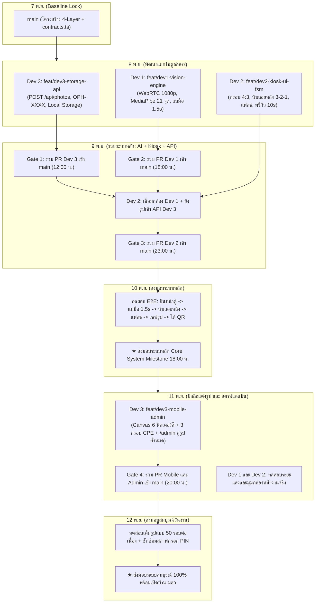

# แผนการดำเนินงานรายบุคคล โครงสร้างงาน และวิธีทำงานร่วมกันบน GitHub
## โครงการ: SWU Open House - AI Photo Booth (CPE Major)
**เอกสาร**: Team Execution Plan, Task Breakdown & GitHub Collaboration Workflow  
**สำหรับ**: ทีมพัฒนา 3 คน (AI/Vision 1 คน, Kiosk Frontend 1 คน, Mobile/Cloud/Back-Office 1 คน)  
**อ้างอิงสถานะ Git ล่าสุด**: Commit `b710d2f` (หลัง Merge PR #1 `feature/photo-booth-mvp` เข้าสู่ `main`)  
**วันที่จัดทำ**: 7 พฤศจิกายน 2026  

---

## 1. ตรวจสอบสถานะปัจจุบันใน Git (`origin/main` ล่าสุดมีอะไรอยู่บ้าง)

จากการตรวจสอบ Git Repository (`https://github.com/icelandz9/swu-openhouse.git`) ล่าสุด พบว่ามีการ Merge Pull Request #1 (`feature/photo-booth-mvp`) เข้ามาใน `main` แล้ว โดยมีสถานะของไฟล์ในโปรเจกต์ดังนี้:

### 1.1 สิ่งที่มีอยู่แล้วใน Git ตอนนี้ (เสร็จแล้ว)
1. **เอกสารวิศวกรรม (`ducument-sathit/`)**:
   * `task00/`: เอกสาร Discovery, Sizing, ต้นทุน 0 บาท และบันทึก Q&A
   * `task01/`: เอกสาร BRD, PRD, SRS (IEEE 830), NFR, RTM, C4 Architecture, Sequence Diagrams และบันทึก Q&A
   * `task02/`: เอกสาร SAD, LLD, Finite State Machine (FSM), ADRs 01-08 และบันทึก Q&A
   * `TASK_BACKLOG.md`: แผนงานภาพรวมของทั้งโปรเจกต์
2. **สคริปต์ตรวจสอบและ PoC (`poc/`)**:
   * `poc/test_poc.mjs`: ชุดทดสอบตรรกะท่ามือ, Debounce 1.5s, รหัส `OPH-XXXX` และอายุไฟล์ 7 วัน
   * `poc/validate_mermaid.mjs`: สคริปต์ตรวจสอบไวยากรณ์ Mermaid Diagram อัตโนมัติ
3. **โครงสร้างเว็บแอปเริ่มต้น (`web/` - เพิ่งสร้างเสร็จใน Step 1)**:
   * `web/package.json`: ตั้งค่า Next.js 15.5 + React 19 + TypeScript + ติดตั้ง `@mediapipe/tasks-vision` และ `qrcode` เรียบร้อยแล้ว
   * `web/scripts/setup-assets.mjs`: สคริปต์อัตโนมัติสำหรับก๊อปปี้ไฟล์ WASM และดาวน์โหลดโมเดล `hand_landmarker.task` มาไว้ที่ `web/public/mediapipe/` (รันอัตโนมัติตอนสั่ง `npm run dev`)
   * `web/app/page.tsx`, `layout.tsx`, `globals.css`: หน้าแรกของเว็บที่มีปุ่มกดไปหน้า `/kiosk`
   * `web/README.md`: คู่มือการรันโปรเจกต์เบื้องต้นในโฟลเดอร์ `web/`

### 1.2 สิ่งที่ยังไม่มีใน `web/` (ต้องเริ่มเขียนโค้ดต่อจากนี้)
* ยังไม่มีโฟลเดอร์ `web/lib/` (ตรรกะจับท่ามือ, โมเดลที่เทรนเพิ่ม, ฟิลเตอร์สี, กรอบรูป CPE, ระบบจัดเก็บไฟล์)
* ยังไม่มีหน้าตู้ `web/app/kiosk/page.tsx`
* ยังไม่มีหน้ามือถือ `web/app/p/[code]/page.tsx`
* ยังไม่มีหน้าค้นหารูปย้อนหลัง `web/app/find/page.tsx`
* ยังไม่มีหน้าสตาฟ `web/app/admin/page.tsx`
* ยังไม่มี API Routes ใน `web/app/api/` (`/api/photos`, `/api/config`, `/api/admin`)

### 1.3 จุดใน `web/README.md` ที่ต้องปรับให้ตรงกับสเปก Task 02 ล่าสุด
* เวลาพรีวิวหน้าตู้: ใน `web/README.md` เดิมเขียนไว้ 8 วินาที -> ต้องใช้ **10 วินาที** ตามที่เคาะใน Task 02
* กรอบรูป 3 แบบ: เปลี่ยนเป็นธีม **CPE (วิศวกรรมคอมพิวเตอร์ มศว)** ทั้ง 3 แบบ
* กรณีเน็ตหลุด: ใช้ **Blocking Mode** (ขึ้นหน้าจอรอสัญญาณเน็ต + ปุ่ม Staff PIN ปลดล็อก)

---

## 2. การแบ่งความรับผิดชอบของทีม 3 คน (ต่อยอดจากโฟลเดอร์ `web/` ที่มีอยู่)

เพื่อให้ทั้ง 3 คนเริ่มเขียนโค้ดต่อจากโฟลเดอร์ `web/` ได้ทันทีโดยไฟล์ไม่ชนกัน จึงแบ่งพื้นที่รับผิดชอบดังนี้:

| สมาชิกทีม | บทบาทหน้าที่หลัก | ขอบเขตงานที่รับผิดชอบ | โฟลเดอร์ใน `web/` ที่เป็นเจ้าของ (ห้ามคนอื่นแก้ทับ) |
| :--- | :--- | :--- | :--- |
| **คนที่ 1 (Dev 1)** | **AI & Computer Vision Engineer** | เก็บ Dataset, เทรนโมเดลจำแนกท่ามือ, เปิดกล้อง WebRTC 1080p, กรองคนเดินผ่านข้างหลัง (Depth & Area Filter), จับเวลาค้างท่ามือ 1.5 วินาที | `web/lib/ai-vision/`<br>`web/public/models/`<br>`scripts/model-training/` |
| **คนที่ 2 (Dev 2)** | **Kiosk Frontend & State Machine Engineer** | พัฒนาหน้าตู้ `/kiosk` แนวนอน 16:9, กรอบไกด์ Center Crop 4:3, ระบบควบคุมสถานะ FSM 8 สถานะ, นับถอยหลัง 3-2-1, แฟลชจอขาว 150ms, พรีวิว 10 วิ, หน้าจอรอเน็ต (Blocking Mode + Staff PIN), หน้าจอแสดงเฉพาะ QR Code | `web/app/kiosk/`<br>`web/lib/kiosk/` |
| **คนที่ 3 (Dev 3)** | **Full-Stack Mobile, Canvas & Cloud/Admin Engineer** | พัฒนา API อัปโหลด/ดึงรูป (รองรับทั้งเก็บลงเครื่อง `web/data/` ในช่วง MVP และเชื่อม Cloudflare R2), ลบไฟล์อัตโนมัติ 7 วัน, หน้ามือถือ `/p/[code]` โชว์รหัส `OPH-XXXX`, เอนจิน Canvas แต่งสี 6 โทน + กรอบ CPE 3 แบบ, หน้า `/find`, และหน้าสตาฟ `/admin` ดูรูปทั้งหมด + ยิง QR ย้อนหลัง | `web/app/p/`<br>`web/app/find/`<br>`web/app/admin/`<br>`web/app/api/`<br>`web/lib/mobile/`<br>`web/lib/storage/` |

---

## 3. โครงสร้างโฟลเดอร์ภายใน `web/` เพื่อป้องกันโค้ดชนกัน (Zero-Conflict Structure)

```text
PhotoBooth-OpenHouseSWU/
├── ducument-sathit/                      # เอกสารวิศวกรรม (Task 00, Task 01, Task 02)
├── scripts/
│   └── model-training/                   # [คนที่ 1] สคริปต์ Python/Notebook เก็บข้อมูลและเทรนโมเดล
└── web/                                  # โปรเจกต์ Next.js 15 (มีโครงเริ่มต้นแล้วใน main)
    ├── app/
    │   ├── page.tsx                      # (มีแล้ว) หน้าแรก
    │   ├── kiosk/
    │   │   └── page.tsx                  # [คนที่ 2] หน้าจอตู้ถ่ายรูป Kiosk
    │   ├── p/
    │   │   └── [code]/
    │   │       └── page.tsx              # [คนที่ 3] หน้าเว็บมือถือแต่งรูป (โชว์รหัส OPH-XXXX ที่หัวเว็บ)
    │   ├── find/
    │   │   └── page.tsx                  # [คนที่ 3] หน้าค้นหารูปย้อนหลังด้วยรหัส OPH-XXXX
    │   ├── admin/
    │   │   └── page.tsx                  # [คนที่ 3] หน้าแดชบอร์ดสตาฟ (ดูรูปทั้งหมด + ยิง QR ย้อนหลัง)
    │   └── api/
    │       ├── photos/
    │       │   ├── route.ts              # [คนที่ 3] POST อัปโหลดรูป / GET รายการรูปทั้งหมดสำหรับสตาฟ
    │       │   └── [code]/
    │       │       └── route.ts          # [คนที่ 3] GET ดึงรูปตามรหัส OPH-XXXX (เช็กหมดอายุ 7 วัน)
    │       ├── config/
    │       │   └── route.ts              # [คนที่ 3] GET ดึง Base URL / LAN IP สำหรับสร้าง QR
    │       └── admin/
    │           └── auth/
    │               └── route.ts          # [คนที่ 3] POST ตรวจสอบรหัส Staff PIN
    ├── lib/
    │   ├── contracts.ts                  # [ส่วนกลาง] Interface ตกลงร่วมกันระหว่าง 3 คน
    │   ├── ai-vision/                    # [คนที่ 1 เป็นเจ้าของ 100%]
    │   │   ├── useWebcamStream.ts        # เปิดกล้อง 1080p แนวนอน
    │   │   ├── handClassifier.ts         # รัน MediaPipe 21 จุด + โมเดลจำแนกท่ามือที่เทรนมา
    │   │   ├── depthAreaFilter.ts        # คัดเฉพาะมือที่ใหญ่และอยู่ใกล้กล้องที่สุด
    │   │   └── useGestureTrigger.ts      # Hook จับเวลาแบมือค้าง 1.5 วินาที
    │   ├── kiosk/                        # [คนที่ 2 เป็นเจ้าของ 100%]
    │   │   ├── useKioskFSM.ts            # State Machine 8 สถานะของตู้
    │   │   ├── ViewfinderFrame.tsx       # กรอบกล้อง 16:9 พร้อมเส้นไกด์ 4:3
    │   │   ├── CountdownOverlay.tsx      # ตัวเลขนับถอยหลัง 3.. 2.. 1..
    │   │   ├── WhiteFlashEffect.tsx      # แอนิเมชันจอสว่างวาบสีขาว 150ms
    │   │   ├── PreviewRetake.tsx         # พรีวิว 10 วินาที + ปุ่มถ่ายใหม่ 1 ครั้ง
    │   │   ├── NetworkWaitScreen.tsx     # หน้าจอรอเน็ต (Blocking Mode) + ปุ่ม Staff PIN
    │   │   ├── CleanQRDisplay.tsx        # แสดงเฉพาะ QR Code ใหญ่ + นับถอยหลัง 20 วิ + ปุ่มคนถัดไป
    │   │   └── centerCropper.ts          # ตัดภาพตรงกลางเป็นสัดส่วน 4:3 (1440x1080)
    │   ├── mobile/                       # [คนที่ 3 เป็นเจ้าของ 100%]
    │   │   ├── CanvasCompositor.tsx      # เอนจิน HTML5 Canvas แต่งสี + ซ้อนกรอบ
    │   │   ├── colorPresets.ts           # ค่าสี 6 พรีเซ็ต + แถบปรับความสว่าง ±30%
    │   │   ├── templatePreloader.ts      # โหลดกรอบ CPE 3 แบบล่วงหน้าเข้า RAM
    │   │   └── imageExporter.ts          # บันทึกไฟล์ JPEG 0.92 ลงอัลบั้มมือถือ
    │   └── storage/                      # [คนที่ 3 เป็นเจ้าของ 100%]
    │       ├── shortCodeGen.ts           # สุ่มรหัส OPH-XXXX ไม่ซ้ำ
    │       ├── storageAdapter.ts         # บันทึกไฟล์ลง web/data/ หรือ Cloudflare R2
    │       └── ttlCleanup.ts             # ลบไฟล์ที่เกิน 7 วันอัตโนมัติตาม PDPA
    ├── public/
    │   ├── mediapipe/                    # (สร้างอัตโนมัติโดย setup-assets.mjs)
    │   ├── models/                       # [คนที่ 1] วางไฟล์โมเดลจำแนกท่ามือที่เทรนเสร็จแล้ว
    │   └── templates/                    # [คนที่ 3] วางไฟล์กรอบรูป PNG 3 แบบของ CPE
    └── scripts/
        └── setup-assets.mjs              # (มีแล้ว) สคริปต์เตรียมไฟล์ MediaPipe
```

---

## 4. สัญญาการเชื่อมต่อข้อมูลระหว่างกัน (`web/lib/contracts.ts`)

ให้สร้างไฟล์ `web/lib/contracts.ts` เป็นอันดับแรก เพื่อให้ทั้ง 3 คนเรียกใช้ Type เดียวกัน:

```typescript
// web/lib/contracts.ts

export type GestureType = 'OPEN_PALM' | 'PEACE_SIGN' | 'MINI_HEART' | 'NONE';

// 1. ข้อมูลที่ คนที่ 1 (AI Vision) ส่งให้ คนที่ 2 (Kiosk UI)
export interface HandDetectionState {
  isCameraReady: boolean;
  cameraError: string | null;
  isHandPresent: boolean;
  detectedGesture: GestureType;
  confidence: number;
  holdDurationMs: number;          // 0 ถึง 1500 ms
  holdProgress: number;            // 0 ถึง 100% สำหรับวาดวงความคืบหน้า
  isTriggerReady: boolean;         // true เมื่อแบมือค้างครบ 1.5 วินาที
}

// 2. ข้อมูลที่ คนที่ 3 (API POST /api/photos) ส่งกลับให้ คนที่ 2 (Kiosk UI)
export interface UploadPhotoResponse {
  code: string;                    // รหัส เช่น "OPH-AB29"
  qrUrl: string;                   // URL สำหรับสร้าง QR เช่น "http://192.168.1.10:3000/p/OPH-AB29"
  photoUrl: string;                // URL สำหรับดึงไฟล์ภาพดิบ เช่น "/api/photos/OPH-AB29"
  createdAt: string;               // ISO Timestamp เวลาที่ถ่าย
  expiresAt: string;               // ISO Timestamp วันหมดอายุ (7 วัน)
}

// 3. ข้อมูลรายการรูปภาพสำหรับหน้าสตาฟ /admin
export interface PhotoRecord {
  code: string;
  photoUrl: string;
  qrUrl: string;
  createdAt: string;
  expiresAt: string;
}
```

---

## 5. แผนการทำงานร่วมกันบน GitHub และลำดับการรวมโค้ด (Git Workflow & Merge Roadmap)

### 5.1 กรอบเวลากำหนดส่งมอบ (Key Delivery Milestones)
* **วันที่ 7 พ.ย. 2026 (วันนี้)**: ปิดรอบ Baseline Lock รวม contracts.ts และ Skeleton โครงสร้างโปรเจกต์ 4-Layer
* **วันที่ 10 พ.ย. 2026 (เวลา 18:00 น.)**: **★ ส่งมอบระบบหลัก (Core System Milestone)** — ตู้ Kiosk ถ่ายรูปด้วยมือเปล่า (Touchless AI), นับถอยหลัง 3-2-1, ถ่าย Crop 4:3, อัปโหลดเข้าเครื่อง/คลาวด์, และแสดง QR Code ได้สมบูรณ์ End-to-End
* **วันที่ 12 พ.ย. 2026 (เวลา 12:00 น.)**: **★ ส่งมอบระบบสมบูรณ์วันเปิดบ้าน (Final Handover & Go-Live)** — มือถือแต่งรูป 6 สี + 3 กรอบรูป CPE SWU, หน้าแดชบอร์ดสตาฟดูรูปทั้งหมด และติดตั้งหน้างานจริง

---

### 5.2 แผนภาพลำดับการแตก Branch และรวมโค้ด (Merge Order Roadmap)



---

### 5.3 ข้อตกลงการตั้งชื่อ Branch และสิทธิ์แก้ไขไฟล์ (Branch Permissions & Ownership)

| ผู้รับผิดชอบ | ชื่อ Branch ที่ต้องสร้าง | ขอบเขตโฟลเดอร์ที่เป็นเจ้าของ 100% |
| :--- | :--- | :--- |
| **คนที่ 1 (AI & Vision)** | `feat/dev1-vision-engine`<br>`feat/dev1-gesture-model` | `web/lib/ai-vision/`<br>`scripts/model-training/`<br>`web/public/models/` |
| **คนที่ 2 (Kiosk & FSM)** | `feat/dev2-kiosk-ui-fsm`<br>`feat/dev2-network-blocking` | `web/lib/kiosk/`<br>`web/app/kiosk/` |
| **คนที่ 3 (Mobile & Cloud)** | `feat/dev3-storage-api`<br>`feat/dev3-mobile-admin` | `web/lib/storage/`<br>`web/lib/mobile/`<br>`web/app/p/`<br>`web/app/admin/`<br>`web/app/find/`<br>`web/app/api/` |

---

### 5.4 ขั้นตอนการทำงานประจำวันบน Git (Daily Git Workflow Commands)

#### ขั้นที่ 1: ดึงโค้ดล่าสุดจาก `main` และแตก Branch ของตัวเอง
```powershell
git checkout main
git pull origin main
git checkout -b feat/dev1-vision-engine
```

#### ขั้นที่ 2: พัฒนาและตรวจสอบความถูกต้องก่อน Commit
```powershell
cd web
npm run typecheck
git add .
git commit -m "feat(ai-vision): implement hand landmark heuristics and 1.5s hold timer"
```

#### ขั้นที่ 3: Rebase อัปเดตโค้ดของเพื่อนจาก `main` ก่อนส่ง
```powershell
git fetch origin
git rebase origin/main
```

#### ขั้นที่ 4: Push ขึ้น GitHub และเปิด Pull Request
```powershell
git push -u origin feat/dev1-vision-engine
```
*(จากนั้นเข้าไปที่ GitHub กด **Compare & pull request** ขอให้เพื่อนในทีมอย่างน้อย 1 คนรีวิวและกด **Squash and merge** เข้า `main`)*

---

### 5.5 ตารางกำหนดเวลาประตูตรวจรับ (Gate Deadlines)

| ประตูตรวจรับ | กำหนดเวลา Merge เข้า `main` | สิ่งที่ต้องส่งมอบใน Pull Request | ผู้ส่งมอบ |
| :---: | :--- | :--- | :---: |
| **Gate 1** | **9 พ.ย. เวลา 12:00 น.** | API อัปโหลดรูป, Local Storage Adapter, สุ่มรหัส `OPH-XXXX` | Dev 3 |
| **Gate 2** | **9 พ.ย. เวลา 18:00 น.** | กล้อง 1080p WebRTC, MediaPipe 21 จุด, นับเวลาแบมือ 1.5 วิ | Dev 1 |
| **Gate 3** | **9 พ.ย. เวลา 23:00 น.** | ตู้ Kiosk สมบูรณ์ (เชื่อม Vision + API), จอรอเน็ต, โชว์ QR | Dev 2 |
| **Milestone 1** | **10 พ.ย. เวลา 18:00 น.** | **★ ตรวจรับระบบหลัก (Core System Handover Sign-off)** | ทั้งทีม |
| **Gate 4** | **11 พ.ย. เวลา 20:00 น.** | เว็บมือถือแต่งรูป 6 สี 3 กรอบ, แดชบอร์ดสตาฟดูรูปทั้งหมด | Dev 3 |
| **Milestone 2** | **12 พ.ย. เวลา 12:00 น.** | **★ ส่งมอบระบบสมบูรณ์ 100% พร้อมเปิดบ้าน มศว (Go-Live)** | ทั้งทีม |

---
## 6. รายการ Task ทั้งหมดที่ต้องทำต่อจากนี้ (แบ่งรายบุคคลอย่างละเอียด)

### สายงานคนที่ 1: AI & Computer Vision Engineer (เน้น Train Model + ระบบตรวจจับมือ)

#### Task AI-01: เก็บข้อมูลและเทรนโมเดลจำแนกท่ามือ (Gesture Classifier Training)
* **สิ่งที่ต้องทำ**:
  1. สร้างโฟลเดอร์ `scripts/model-training/`
  2. เขียนสคริปต์ดึงค่าพิกัดมือ 21 จุด (63 ค่า `x, y, z` ที่ทำ Normalization เทียบกับข้อมือจุดที่ 0) สำหรับท่าแบมือ 5 นิ้ว (`OPEN_PALM`), ท่าเสริม 1–2 ท่า (เช่น ชู 2 นิ้ว `PEACE_SIGN`, มินิฮาร์ท `MINI_HEART`), และท่าอื่นๆ ที่ไม่ใช่ท่าสั่งถ่าย (`NONE`)
  3. เทรนโมเดล Classifier (เช่น MLP / Neural Network ขนาดเล็ก หรือ Random Forest / TFLite) แล้วส่งออกไฟล์โมเดล/Weights ไปไว้ที่ `web/public/models/gesture_weights.json`
* **เกณฑ์ตรวจสอบ**: โมเดลมีความแม่นยำในการแยกท่าแบมือ >= 95% และไม่ลั่นเมื่อทำท่ามือทั่วไป

#### Task AI-02: พัฒนาตัวกรองมือคนที่อยู่ใกล้กล้องที่สุด (`web/lib/ai-vision/depthAreaFilter.ts`)
* **สิ่งที่ต้องทำ**:
  1. รับผลลัพธ์พิกัดมือทั้งหมดที่ MediaPipe ตรวจพบในเฟรม
  2. คำนวณขนาดกรอบสี่เหลี่ยมรอบมือ (Bounding Box Area) และระยะความลึก `z`
  3. คัดเอาเฉพาะมือข้างที่ใหญ่ที่สุดและเกินขนาดขั้นต่ำ (ตัดมือของคนที่เดินผ่านฉากหลังในงานออก)
* **เกณฑ์ตรวจสอบ**: เมื่อมีคนยืนข้างหลังห่างออกไป 2 เมตรและยกมือ ระบบต้องไม่สลับไปจับมือคนข้างหลัง

#### Task AI-03: พัฒนาตัวจำแนกท่ามือและ Hook จับเวลาค้าง 1.5 วินาที (`web/lib/ai-vision/useGestureTrigger.ts`)
* **สิ่งที่ต้องทำ**:
  1. โหลดไฟล์ `hand_landmarker.task` จาก `/mediapipe/hand_landmarker.task` (ที่ `setup-assets.mjs` เตรียมไว้ให้แล้ว)
  2. ประมวลผลเฟรมวิดีโอแบบ `VIDEO` mode บน GPU (WebGL) ที่ 60 FPS
  3. นำพิกัด 21 จุดของมือที่ผ่านตัวกรองแล้ว เข้าโมเดลจำแนกท่ามือจาก Task AI-01
  4. หากเป็นท่า `OPEN_PALM` ต่อเนื่องกันครบ **1.5 วินาที (1,500 ms)** ให้ส่งค่า `isTriggerReady: true` และคำนวณ `holdProgress` (0–100%) ส่งออกให้คนที่ 2
* **เกณฑ์ตรวจสอบ**: แบมือค้างครบ 1.5 วิแล้ว `isTriggerReady` เปลี่ยนเป็น `true` หากลดมือลงก่อนครบ 1.5 วิ เวลาต้องรีเซ็ตเป็น 0 ทันที

---

### สายงานคนที่ 2: Kiosk Frontend & State Machine Engineer (เน้นหน้าตู้ `/kiosk`)

#### Task KIOSK-01: พัฒนา State Machine ควบคุมลำดับหน้าตู้ (`web/lib/kiosk/useKioskFSM.ts`)
* **สิ่งที่ต้องทำ**:
  1. สร้าง State Machine ควบคุมสถานะ: `IDLE` -> `COUNTDOWN_ACTIVE` (3..2..1..) -> `FLASH_CAPTURE` -> `PREVIEW_RETAKE` (**10 วินาที**) -> `UPLOADING` / `WAITING_NETWORK` -> `SHOW_QR_CLEAN` (**20 วินาที**) -> `IDLE`
  2. รองรับเงื่อนไข **Auto-Cancel**: หากระหว่างนับถอยหลัง 3..2..1.. ผู้ใช้ชักมือกลับ (`isHandPresent === false`) ให้ยกเลิกและกลับสู่ `IDLE` ทันที
* **เกณฑ์ตรวจสอบ**: สถานะเปลี่ยนครบทุกขั้น และยกเลิกอัตโนมัติเมื่อชักมือกลับระหว่างนับถอยหลัง

#### Task KIOSK-02: พัฒนาหน้าจอกล้อง 16:9, กรอบไกด์ 4:3 และระบบตัดภาพ (`web/lib/kiosk/centerCropper.ts`)
* **สิ่งที่ต้องทำ**:
  1. สร้างหน้า `web/app/kiosk/page.tsx` แสดงผลเต็มจอแนวนอน 16:9
  2. วาดกรอบไกด์สัดส่วน 4:3 ตรงกลางหน้าจอ พร้อมวงแหวนแสดงความคืบหน้า (`holdProgress`) ตอนแบมือค้าง 1.5 วิ และปุ่มแตะถ่ายสำรองบนจอ
  3. เขียนฟังก์ชัน `centerCropper.ts` สำหรับตัดเฟรมวิดีโอ 1920x1080 เฉพาะส่วนกลางสัดส่วน 4:3 (`1440x1080` พิกเซล) ออกมาเป็น Blob ภาพความละเอียดสูง
* **เกณฑ์ตรวจสอบ**: ภาพที่ตัดออกมามีสัดส่วน 4:3 ตรงกับกรอบไกด์บนหน้าจอพอดี

#### Task KIOSK-03: พัฒนาตัวเลขนับถอยหลัง 3-2-1, แฟลชขาว 150ms และหน้าพรีวิว 10 วินาที
* **สิ่งที่ต้องทำ**:
  1. แสดงตัวเลขนับถอยหลังขนาดใหญ่ **3 -> 2 -> 1** พร้อมเสียงบี๊บ (Web Audio API)
  2. เมื่อนับถึง 0 ให้แสดงเลเยอร์สีขาวสว่างวาบเต็มหน้าจอ (`WhiteFlashEffect.tsx`) นาน **150ms**
  3. แสดงภาพพรีวิวพร้อมนับถอยหลัง **10 วินาที** มีปุ่ม **"ถ่ายใหม่"** (กดได้ 1 ครั้งต่อรอบ) หากไม่กดภายใน 10 วินาที ให้ส่งอัปโหลดอัตโนมัติ
* **เกณฑ์ตรวจสอบ**: เอฟเฟกต์แฟลชขาวทำงานตรงจังหวะชัตเตอร์ และหน้าพรีวิวนับถอยหลัง 10 วินาทีถูกต้อง

#### Task KIOSK-04: พัฒนาหน้าจอรอเน็ต (Blocking Mode + Staff PIN) และหน้าจอแสดงเฉพาะ QR Code
* **สิ่งที่ต้องทำ**:
  1. ส่งไฟล์ภาพไปที่ `POST /api/photos`
  2. หากเน็ตหลุดหรือส่งไม่ผ่าน ให้แสดงหน้าจอ `NetworkWaitScreen.tsx` ขึ้นข้อความ **"กำลังรอสัญญาณอินเทอร์เน็ต..."** หมุนรอและลองส่งใหม่อัตโนมัติเมื่อสัญญาณกลับมา พร้อมปุ่มให้สตาฟกดกรอก **Staff PIN** เพื่อปลดล็อกหรือรีเซ็ตตู้
  3. เมื่ออัปโหลดสำเร็จ ให้แสดง `CleanQRDisplay.tsx` โชว์ **เฉพาะ QR Code ขนาดใหญ่** (ไม่แสดงรหัสตัวอักษร `OPH-XXXX` บนจอตู้) พร้อมนับถอยหลัง 20 วินาที และปุ่มกด **"คนถัดไป"**
* **เกณฑ์ตรวจสอบ**: หน้าตู้แสดงเฉพาะ QR Code สะอาดตา และเมื่อจำลองตัดเน็ตจะขึ้นหน้ารอสัญญาณเน็ตตามที่กำหนด

---

### สายงานคนที่ 3: Full-Stack Mobile, Canvas & Cloud/Admin Engineer (เน้น API, มือถือ และหลังบ้านสตาฟ)

#### Task CLOUD-01: พัฒนา API จัดเก็บรูปภาพ, รหัส `OPH-XXXX` และระบบลบอัตโนมัติ 7 วัน
* **สิ่งที่ต้องทำ**:
  1. เขียน `web/lib/storage/shortCodeGen.ts` สุ่มรหัส `OPH-XXXX` (ใช้ `A-Z`, `2-9` ตัด `0, O, 1, I`) โดยตรวจสอบไม่ให้ซ้ำกับที่มีอยู่
  2. เขียน `web/lib/storage/storageAdapter.ts` ให้รองรับการบันทึกไฟล์ลง `web/data/` (สำหรับการรันทดสอบในเครื่องทันที) และรองรับการเชื่อมต่อ Cloudflare R2 ผ่าน Environment Variables
  3. สร้าง `POST /api/photos` (รับรูปและบันทึก Metadata), `GET /api/photos/[code]` (ดึงรูปและเช็กว่าเกิน 7 วันหรือยัง ถ้าเกินตอบ `410 Gone`), และ `GET /api/config` (คืนค่า LAN IP / Base URL)
* **เกณฑ์ตรวจสอบ**: ส่งรูปเข้า `POST /api/photos` แล้วได้รหัส `OPH-XXXX` และดึงรูปผ่าน `GET /api/photos/OPH-XXXX` ได้จริง

#### Task CLOUD-02: พัฒนาหน้าเว็บมือถือ (`/p/[code]`) และเอนจินแต่งสี 6 พรีเซ็ต + ความสว่าง
* **สิ่งที่ต้องทำ**:
  1. สร้างหน้า `web/app/p/[code]/page.tsx` โดยแสดงรหัส **`OPH-XXXX`** เด่นชัดที่แถบหัวเว็บ เพื่อให้น้องจดหรือแคปเก็บไว้
  2. พัฒนา `CanvasCompositor.tsx` และ `colorPresets.ts` ให้เลือกฟิลเตอร์สีได้ 6 แบบ (`Original`, `Warm`, `Cool Minimal`, `Film Vintage`, `Classic B&W`, `Rosy Bright`) และแถบเลื่อนปรับความสว่าง (`-30%` ถึง `+30%`) บน HTML5 Canvas
* **เกณฑ์ตรวจสอบ**: เปิดหน้าเว็บบนมือถือ เห็นรหัส `OPH-XXXX` ชัดเจน และแตะเปลี่ยนสี/เลื่อนความสว่างเห็นผลทันที

#### Task CLOUD-03: พัฒนากรอบรูป CPE 3 แบบ (Preload) และระบบบันทึกรูปลงมือถือ
* **สิ่งที่ต้องทำ**:
  1. สร้างระบบกรอบรูปภาควิชาวิศวกรรมคอมพิวเตอร์ (CPE SWU) ทั้ง 3 แบบ (รองรับทั้งการวาดด้วย Canvas และการซ้อนไฟล์ PNG จาก `web/public/templates/` แบบ Preload ล่วงหน้า):
     * **แบบที่ 1**: CPE SWU Official Classic (ธีมทางการวิศวกรรมคอมพิวเตอร์ มศว)
     * **แบบที่ 2**: CPE Youthful Tech & Circuit (ธีมกราฟิกเทคโนโลยี วงจร และ AI)
     * **แบบที่ 3**: CPE Photostrip Minimalist (ธีมฟิล์มมินิมอล CPE Open House 2026)
  2. ทำปุ่มดาวน์โหลด/แชร์ภาพ (`image/jpeg` คุณภาพ `0.92`) รองรับ Web Share API บน iOS/Android ให้กดบันทึกลงอัลบั้มรูปได้ทันที
* **เกณฑ์ตรวจสอบ**: สลับกรอบ CPE ทั้ง 3 แบบได้โดยไม่หน่วง และกดบันทึกรูปลงมือถือได้ไฟล์ที่รวมสีและกรอบครบถ้วน

#### Task CLOUD-04: พัฒนาหน้าค้นหารูปย้อนหลัง (`/find`) และหน้าหลังบ้านสตาฟ (`/admin`)
* **สิ่งที่ต้องทำ**:
  1. สร้างหน้า `web/app/find/page.tsx` สำหรับกรอกรหัส `OPH-XXXX` เพื่อเปิดไปยังหน้า `/p/OPH-XXXX`
  2. สร้างหน้า `web/app/admin/page.tsx` และ `POST /api/admin/auth` (ตรวจรหัส `STAFF_PIN`)
  3. ในหน้า `/admin` แสดงแกลเลอรีรูปภาพทั้งหมดเรียงตามเวลาถ่ายล่าสุด (ดูรูปทั้งหมดได้พร้อมระบบแบ่งหน้า Pagination และช่องค้นหาตามเวลา/รหัส)
  4. เมื่อสตาฟแตะที่รูป จะเปิดหน้าต่าง Modal แสดงรูปใหญ่พร้อม **QR Code และรหัส `OPH-XXXX`** ให้น้องที่สแกนหน้าตู้ไม่ทันนำมือถือมาสแกนย้อนหลังได้ทันที
* **เกณฑ์ตรวจสอบ**: สตาฟล็อกอินด้วย PIN เห็นรายการรูปทั้งหมดตามเวลา และกดเปิด QR Code ให้น้องสแกนได้จริง
