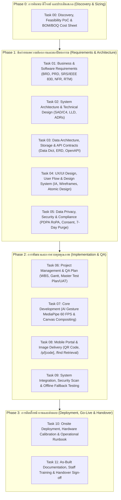

# SWU Open House - แผนงานและรายการ Task (Project Tasks & Deliverables)
## ระบบ AI Photo Booth สำหรับงานเปิดบ้าน มศว (SWU Open House)

เอกสารรวบรวมรายการงาน (Task Backlog) และมาตรฐานเอกสารทางวิศวกรรมซอฟต์แวร์ฉบับสมบูรณ์สำหรับระบบ **SWU Open House Photo Booth** โดยบูรณาการตามมาตรฐานสากล 5 กลุ่มเอกสาร:
1. **Business & Requirements Engineering** (IIBA BABOK, IEEE 830 / ISO/IEC/IEEE 29148)
2. **Technical & Architecture Design** (IEEE 1016, C4 Model, OpenAPI 3.0)
3. **UX/UI & Design System** (Nielsen Norman Group - NN/g, Atomic Design)
4. **Project Management & QA Planning** (PMI PMBOK, IEEE 829 Software Test Documentation)
5. **Legal, Security & Compliance** (พ.ร.บ. คุ้มครองข้อมูลส่วนบุคคล พ.ศ. 2562 - PDPA, OWASP ASVS)

---

## 📌 สรุปภาพรวมสถาปัตยกรรมและกระบวนการทำงาน (Project Overview)

---

## 📚 มาตรฐานเอกสาร 5 กลุ่มหลักที่กำกับในโครงการ (Engineering Document Standards)

### กลุ่มที่ 1: เอกสารวิเคราะห์ธุรกิจและความต้องการ (Business & Requirements Engineering)
*(อ้างอิงมาตรฐาน: **IIBA BABOK Guide** และ **IEEE 830 / ISO/IEC/IEEE 29148**)*
* **BRD (Business Requirements Document):** เป้าหมายทางธุรกิจของบูทเปิดบ้าน มศว, Pain Points คิวตู้ถ่ายรูป, และ KPIs (รองรับ 60–80 คน/ชม., ต้นทุนคลาวด์ 0 บาท)
* **PRD (Product Requirements Document):** ฟีเจอร์มองจากมุมนักเรียน/ผู้ปกครอง, User Personas, User Stories, และ Use Cases
* **SRS / FRS (Software Requirements Specification - IEEE 830):** กำหนดฟังก์ชันเชิงวิศวกรรมที่ไร้ความกำกวม Input (Webcam Video Stream), Process (MediaPipe 21 Landmark Detection, Canvas Filter Overlay), Output (High-res WebP/JPEG, QR Link)
* **NFR Document (Non-Functional Requirements - ISO/IEC 25010):** ความเร็ว (Inference >= 30–60 FPS, Latency < 1s), Throughput, ความเสถียร (Offline-first Resilience)
* **RTM (Requirements Traceability Matrix):** ตารางจับคู่ Requirement ID ↔ Component ↔ Test Case ID

### กลุ่มที่ 2: เอกสารสถาปัตยกรรมและการออกแบบเชิงเทคนิค (Technical & Architecture Design)
*(อ้างอิงมาตรฐาน: **IEEE 1016 Software Design Descriptions**, **C4 Model** และ **OpenAPI Specification**)*
* **SAD (System Architecture Document) / HLD:** แผนผังโครงสร้าง C4 Model (Context, Container, Component) เชื่อมโยง Kiosk Browser, MediaPipe, Canvas Engine, Cloudflare R2 และ Mobile Web
* **LLD (Low-Level Design) / TDD:** Sequence Diagrams ลำดับการนับถอยหลัง-บันทึกภาพ-สร้าง QR, State Machine การเปลี่ยนสถานะตู้ (`Idle` -> `Detecting` -> `Counting` -> `Captured` -> `Rendering` -> `QR_Ready`)
* **ADR (Architecture Decision Records):** บันทึกมติเลือก Next.js Monorepo แทน Go, การใช้ MediaPipe ใน WebGL, และการใช้ Short Code 6 หลัก
* **Data Dictionary & Storage Schema:** โครงสร้าง Object Storage Bucket, Naming Convention (`/photos/{short_code}.webp`), Metadata Schema
* **API Specification / Contract:** เอกสารมาตรฐาน OpenAPI 3.0 สำหรับ Endpoint อัปโหลดและค้นหารูปภาพ

### กลุ่มที่ 3: เอกสารการออกแบบประสบการณ์ผู้ใช้ (UX/UI & Design System)
*(อ้างอิงแนวปฏิบัติ: **Nielsen Norman Group - NN/g** และ **Atomic Design by Brad Frost**)*
* **Information Architecture (IA) & Sitemap:** โครงสร้างหน้าเว็บหน้าตู้ (`/booth`), หน้าโหลดรูปมือถือ (`/p/[code]`), และหน้าค้นหา (`/find`)
* **User Flow / Task Flow Diagram:** แผนผังเส้นทางการใช้งาน Happy Path (ท่ามือ 1.5 วิ -> ถ่าย 3..2..1.. -> สแกน QR -> แต่งต่อบนมือถือ) และ Unhappy Path (แสงสะท้อน, เน็ตหลุด, สแกนไม่ทัน)
* **Wireframes & Interactive Prototype:** โครงร่าง UI หน้าตู้แบบ Touchless Kiosk และ UI มือถือสำหรับเลือกสลับฟิลเตอร์/กรอบ
* **UI Style Guide / Design System (Atomic Design):** การกำหนด Design Tokens โทนสีอัตลักษณ์ มศว (SWU Red `#E31B23`, Dark Red `#B3141A`, Gray `#F4F4F6`), Typography, และ Frame Templates

### กลุ่มที่ 4: เอกสารการบริหารโปรเจกต์และแผนการทดสอบ (Project Management & QA Planning)
*(อ้างอิงมาตรฐาน: **PMI PMBOK Guide** และ **IEEE 829 Software Test Documentation**)*
* **WBS (Work Breakdown Structure):** การแบ่งงานเป็นชิ้นงานย่อยระดับโมดูลพร้อมประเมินเวลา
* **Project Schedule / Gantt Chart & Milestone Plan:** ตารางเวลาการพัฒนาและการทดสอบก่อนวันงานเปิดบ้านจริง
* **RAID Log:** ตารางบริหารจัดการ Risks, Assumptions, Issues, Dependencies (เช่น ความเสถียรของสัญญาณ Wi-Fi ในหอประชุม, แสงไฟในบูท)
* **Master Test Plan & UAT Test Cases:** แผนการทดสอบตามรูปแบบ Given-When-Then ครอบคลุม AC-01 ถึง AC-08

### กลุ่มที่ 5: เอกสารกฎหมาย ความปลอดภัย และข้อมูล (Legal, Security & Compliance)
*(อ้างอิงกฎหมาย: **พ.ร.บ. คุ้มครองข้อมูลส่วนบุคคล พ.ศ. 2562 - PDPA** และ **OWASP ASVS**)*
* **Project Charter & SOW (Statement of Work):** ขอบเขตการทำงาน เงื่อนไขการส่งมอบงาน และความรับผิดชอบ
* **PDPA Checklist & RoPA (Record of Processing Activities):** บันทึกกิจกรรมการประมวลผลข้อมูลภาพถ่ายใบหน้าเยาวชน, หน้าจอแสดง Consent Notice สั้นๆ บริเวณตู้
* **Data Retention & Auto-Purge Policy:** กำหนดวงจรอายุภาพถ่าย 7 วัน (TTL 7 Days) และลบทำลายทิ้งอัตโนมัติ
* **SLA & Onsite Incident Response Plan:** ข้อตกลงการเข้าแก้ไขปัญหาขัดข้องฉุกเฉินในวันงานเปิดบ้านจริง

---

## 📋 รายการงานจำแนกตามระยะ (Detailed Task Breakdown)

### 🔍 Phase 0: การค้นพบ ตีโจทย์ และประเมินสเกล (Discovery & Sizing)

---

#### 🔹 Task 00: ตีโจทย์ระบบ Photo Booth, PoC จุดเสี่ยง และประเมินราคา (Discovery & Sizing)
- **สถานะ**: ✅ เสร็จสมบูรณ์ (Approved & PoC Verified)
- **เป้าหมาย**: รวบรวม Requirement เชิงปริมาณและคุณภาพสำหรับตู้ถ่ายภาพแบบไร้สัมผัส (Touchless AI), ทดสอบ PoC จุดเสี่ยง และจัดทำงบประมาณ BOM/BOQ
- **รายละเอียดงาน**:
  1. วิเคราะห์ Pain Point ของตู้ถ่ายรูปในงานคนเยอะ และกำหนดสเกล (งาน 2 วัน, 1,000–2,000 รูป, Throughput 60–80 คน/ชม.)
  2. ดำเนินการทดสอบ Proof of Concept (PoC) จุดเสี่ยง 4 ประเด็น:
     - การจำแนกท่ามือ (Landmark Geometric Heuristics)
     - กลไก Debounce & 1.5s Hold Duration ป้องกันการลั่น
     - การสร้าง Short Code 6 หลัก (`SWU-XXXX`) และ QR URL
     - ระบบตรวจสอบอายุภาพถ่ายตามหลัก PDPA 7-day TTL
  3. เคาะสถาปัตยกรรมระบบ (เปรียบเทียบ Next.js vs Go) และประเมินงบประมาณ (BOM Hardware + BOQ Cloud 0 บาท)
- **สิ่งที่ต้องส่งมอบ (Deliverables)**:
  - Requirements Specification (FR-01 ถึง FR-07, NFR-01 ถึง NFR-04)
  - รายงานผลและชุดโค้ดทดสอบ PoC อัตโนมัติ (`poc/test_poc.mjs`)
  - ตารางประมาณการงบประมาณ (BOM / BOQ Cost Sheet)
  - บันทึกการสัมภาษณ์สถาปัตยกรรม (ADR via `/grill-me`)
- **เกณฑ์การตรวจรับ (Acceptance Criteria)**:
  - ผ่านการรันชุดทดสอบ PoC อัตโนมัติครบ 4/4 หัวข้อ
  - สรุปตัวเลข CCU, Latency, Storage และต้นทุนคลาวด์เป็น 0 บาทได้อย่างมีหลักการ

---

### 🚀 Phase 1: ข้อกำหนดความต้องการและสถาปัตยกรรมระบบ (Requirements & Architecture Engineering)

---

#### 🔹 Task 01: วิเคราะห์และจัดทำข้อกำหนดความต้องการ (BRD, PRD, SRS/IEEE 830, NFR, RTM)
- **สถานะ**: ✅ เสร็จสมบูรณ์ (Approved & Requirements Specified)
- **เป้าหมาย**: แปลงโจทย์ธุรกิจของงาน SWU Open House เป็นข้อกำหนดทางวิศวกรรมซอฟต์แวร์ที่แม่นยำ ไร้ความกำกวม
- **รายละเอียดงาน**:
  1. **BRD**: ระบุเป้าหมายการโปรโมตมหาวิทยาลัย, ความประทับใจของผู้ร่วมงาน, ตัวชี้วัดความสำเร็จ (เวลาต่อคน < 30 วิ, Throughput 60–80 คน/ชม., ต้นทุนคลาวด์ 0 บาท)
  2. **PRD**: กำหนด User Personas (น้องมัธยม, ผู้ปกครอง, สตาฟประจำบูท), User Stories, Use Cases และตารางสิทธิ์การเข้าถึง (RBAC Matrix)
  3. **SRS / FRS**: บันทึกความต้องการเชิงฟังก์ชันตามมาตรฐาน **IEEE 830**:
     - ท่าทางสั่งถ่ายหลัก: แบมือ 5 นิ้ว (Open Palm) ค้าง 1.5 วิ + สถาปัตยกรรมขยายเพิ่มอีก 1-2 ท่า
     - หน้าจอแสดงพรีวิวและปุ่มถ่ายใหม่ (Retake) แบบจำกัดเวลา 5–8 วินาที
     - การเลือกฟิลเตอร์/แต่งสี 6 พรีเซ็ต + สไลเดอร์ความสว่าง และการเลือก 1 ใน 3 กรอบรูป มศว ทำบนมือถือ 100% หลังสแกน QR Code
  4. **NFR Document**: กำหนดมาตรฐานคุณภาพตาม **ISO/IEC 25010** (Frame Rate >= 30–60 FPS, Latency < 1s, Uptime 99.5%, PDPA 7-day Auto-Purge)
  5. **RTM**: จัดทำ Requirements Traceability Matrix เชื่อมโยง Requirement ID (FR-01 ถึง FR-11, NFR) สู่ Component และ Test Case ID
- **สิ่งที่ต้องส่งมอบ (Deliverables)**:
  - เอกสารข้อกำหนดความต้องการฉบับสมบูรณ์ (`document/task-01-requirements-specification.md`)
  - บันทึกการสัมภาษณ์ความต้องการ (`document/task-01-qa-and-decisions.md`)
- **เกณฑ์การตรวจรับ (Acceptance Criteria)**:
  - ผ่านการสัมภาษณ์เจาะลึก `/grill-me` ครบทุกมิติ
  - ตาราง RTM ครอบคลุมฟังก์ชันตั้งแต่กล้องจนถึงการดาวน์โหลดภาพและการควบคุมของสตาฟ

---

#### 🔹 Task 02: สถาปัตยกรรมระบบและการออกแบบเชิงเทคนิค (SAD/C4, LLD, ADRs)
- **สถานะ**: 🔲 To Do
- **เป้าหมาย**: กำหนดโครงสร้างระบบซอฟต์แวร์ ลำดับการทำงานของคอมโพเนนต์ และบันทึกการตัดสินใจทางสถาปัตยกรรม
- **รายละเอียดงาน**:
  1. **SAD / HLD**: วาดแผนผังระบบตามมาตรฐาน **C4 Model**:
     - System Context Diagram: ผู้ใช้, เครื่องตู้ Kiosk, Cloud Storage, และสมาร์ตโฟน
     - Container Diagram: Next.js Kiosk App, WebGL MediaPipe Engine, HTML5 Canvas Compositor, Cloudflare R2
  2. **LLD / TDD**:
     - Sequence Diagrams: ลำดับขั้นตอน Gesture Trigger -> Visual Countdown -> Frame Capture -> Canvas Layering -> QR Generation
     - State Machine Diagram: สถานะของตู้ถ่ายรูป (`Idle` -> `Detecting_Hand` -> `Counting_Down` -> `Flash_Capture` -> `Compositing` -> `Show_QR`)
  3. **ADR (Architecture Decision Records)**:
     - ADR-01: การเลือก Google MediaPipe บน WebGL (60 FPS On-device)
     - ADR-02: การเลือกสถาปัตยกรรม Hybrid UX (ตู้เร็ว + แต่งต่อบนมือถือ)
     - ADR-03: การเลือก Next.js Monorepo แทน Go
     - ADR-04: นโยบาย Short Code 6 หลัก และ Retention 7 วัน
- **สิ่งที่ต้องส่งมอบ (Deliverables)**:
  - System Architecture Document (Mermaid C4 Diagrams)
  - Low-Level Sequence & State Machine Diagrams
  - Architecture Decision Records (ADR 01-04)
- **เกณฑ์การตรวจรับ (Acceptance Criteria)**:
  - Diagram แสดง Component ครบถ้วน รวมถึงการทำงานแบบ Offline-first
  - Sequence Flow มีการจัดการ Success และ Error Handling Case (เช่น มือหายระหว่างนับถอยหลัง, กล้องหลุด)

---

#### 🔹 Task 03: สถาปัตยกรรมข้อมูล แหล่งเก็บไฟล์ และข้อกำหนด API (Data Dict, ERD, OpenAPI)
- **สถานะ**: 🔲 To Do
- **เป้าหมาย**: โครงสร้างข้อมูลที่เรียบง่าย ปลอดภัย รองรับการสืบค้นรวดเร็ว และมีสัญญาเชื่อมต่อ API ที่ชัดเจน
- **รายละเอียดงาน**:
  1. ออกแบบ Data Dictionary & Metadata Schema:
     - Session ID, Short Code, File Path, Created At, Expire At (TTL), Filter Used, Frame Template ID
  2. กำหนดโครงสร้าง Object Storage (Cloudflare R2 / Supabase Storage):
     - โครงสร้างไดเรกทอรี `/photos/original/{id}.jpg` และ `/photos/composite/{short_code}.webp`
     - สิทธิ์การเข้าถึง (Public Read CDN vs Private Signed URL)
  3. เขียนข้อกำหนด API Specification ตามมาตรฐาน **OpenAPI 3.0 (Swagger)**:
     - `POST /api/upload`: อัปโหลดภาพคอมโพสิตจากตู้พร้อมรับ Short Code
     - `GET /api/photo/{short_code}`: ดึงข้อมูลภาพและลิงก์ดาวน์โหลด
     - `GET /api/health`: Health-check endpoint สำหรับตรวจสอบความพร้อมของระบบ
- **สิ่งที่ต้องส่งมอบ (Deliverables)**:
  - Data Dictionary & Storage Architecture Document
  - OpenAPI 3.0 Specification (YAML / JSON)
- **เกณฑ์การตรวจรับ (Acceptance Criteria)**:
  - สเปก API ครอบคลุม Request, Response JSON, Status Codes (200, 400, 404, 500) และ Error Format สม่ำเสมอ

---

#### 🔹 Task 04: การออกแบบประสบการณ์ผู้ใช้และระบบดีไซน์ (IA, Wireframes, Atomic Design)
- **สถานะ**: 🔲 To Do
- **เป้าหมาย**: อินเทอร์เฟซตู้ถ่ายรูปและหน้าเว็บบนมือถือที่ใช้งานง่าย ดึงดูดสายตา และสะท้อนอัตลักษณ์ของ มศว
- **รายละเอียดงาน**:
  1. **Information Architecture (IA) & Sitemap**:
     - แผนผังโครงสร้างหน้าจอ Kiosk (`/booth`)
     - แผนผังหน้าเว็บบนมือถือ (`/p/[code]` และ `/find`)
  2. **User Flow & Task Flow Diagram**:
     - Happy Path: ท่ามือชูสองนิ้ว 1.5 วิ -> นับถอยหลัง 3..2..1.. -> แชะ -> แสดงพรีวิว & แตะพรีเซ็ตด่วน -> โชว์ QR -> สแกนเข้ามือถือ
     - Unhappy / Edge Paths: คนเดินผ่านกล้อง (ไม่ครบ 1.5 วิ), แสงในห้องมืด, สแกน QR ไม่ทัน (จดรหัสไปเข้า `/find`)
  3. **Wireframes & Interactive Prototype**:
     - Wireframe หน้าจอ Kiosk (Camera Viewfinder, Hand Tracking Indicator, Countdown Overlay, QR Modal)
     - Mobile Wireframe (Photo Preview, Filter Carousel, Template Selector, Download Button)
  4. **UI Style Guide & Design System (Atomic Design)**:
     - Design Tokens: ชุดสี มศว (SWU Red `#E31B23`, Dark Red `#B3141A`, Gray `#F4F4F6`), Typography
     - กราฟิกเทมเพลตกรอบรูปอัตลักษณ์ มศว Open House (ขนาด 9:16 และ Photostrip)
- **สิ่งที่ต้องส่งมอบ (Deliverables)**:
  - Information Architecture & User Flow Diagrams
  - UI Wireframes & Layout Specification
  - Design Tokens & Assets Guideline (SWU Brand Identity)
- **เกณฑ์การตรวจรับ (Acceptance Criteria)**:
  - Flow หน้าตู้มีความกระชับ ใช้เวลาเรียนรู้และใช้งานไม่เกิน 60 วินาที
  - UI ออกแบบตามแนวคิด Touchless-First และรองรับ Mobile Responsive

---

#### 🔹 Task 05: การปฏิบัติตามกฎหมาย PDPA, ความปลอดภัย และ SLA (Legal, Privacy & Compliance)
- **สถานะ**: 🔲 To Do
- **เป้าหมาย**: ปฏิบัติตาม พ.ร.บ. คุ้มครองข้อมูลส่วนบุคคล พ.ศ. 2562 (PDPA) อย่างเคร่งครัด และกำหนด SLA วันงาน
- **รายละเอียดงาน**:
  1. จัดทำ **PDPA Checklist & RoPA (Record of Processing Activities)**:
     - ระบุประเภทข้อมูลส่วนบุคคล (ภาพถ่ายใบหน้าผู้ร่วมงานและเยาวชน)
     - ฐานทางกฎหมาย (Consent / Legitimate Interest สำหรับกิจกรรมเปิดบ้าน)
  2. ออกแบบระบบ **Consent Management & Data Minimization**:
     - ป้ายประกาศ Privacy Notice สั้นๆ บริเวณตู้ถ่ายภาพ
     - กลไกจำกัดการเข้าถึงภาพ (ค้นหาได้เฉพาะผู้ที่มี Short Code 6 หลัก)
  3. ออกแบบวงจรชีวิตข้อมูลและการลบทำลาย (**Data Retention & Auto-Purge Policy**):
     - กำหนดอายุไฟล์ภาพ 7 วันนับจากวันที่ถ่าย (TTL 7 Days)
     - ฟังก์ชัน Background Cleaner ลบไฟล์และ Metadata หลังหมดอายุ
  4. จัดทำ **SLA (Service Level Agreement)** และ Incident Response Plan สำหรับวันงาน:
     - เกณฑ์ Severity 1 (ระบบถ่ายรูปไม่ได้/กล้องดับ) ต้องกู้คืนภายใน 5 นาที
     - เกณฑ์ Severity 2 (เน็ตหลุด ไม่สามารถอัปโหลดได้) ทำงานต่อในโหมด Offline แคชรูปลงตู้
- **สิ่งที่ต้องส่งมอบ (Deliverables)**:
  - PDPA Compliance Document & RoPA Worksheet
  - Data Retention & Automated Purge Specification
  - Onsite SLA & Incident Response Plan
- **เกณฑ์การตรวจรับ (Acceptance Criteria)**:
  - มีกลไกการลบข้อมูลอัตโนมัติ 7 วัน และเอกสาร Consent ถูกต้องตามหลัก PDPA
  - มีแผนรองรับกรณีเน็ตหลุดโดยไม่ทำให้ข้อมูลภาพสูญหาย

---

### 💻 Phase 2: การพัฒนาและการควบคุมคุณภาพ (Implementation & QA)

---

#### 🔹 Task 06: การบริหารโปรเจกต์และแผนการทดสอบ (WBS, Gantt, Master Test Plan/UAT)
- **สถานะ**: 🔲 To Do
- **เป้าหมาย**: กำหนดแผนงานย่อย ลำดับเวลาการส่งมอบ และเอกสารแผนการทดสอบคุณภาพ
- **รายละเอียดงาน**:
  1. จัดทำ **WBS (Work Breakdown Structure)** ซอยงานระดับโมดูลพร้อมประเมินระยะเวลา
  2. จัดทำ **Project Schedule / Gantt Chart & Milestone Plan**
  3. จัดทำ **RAID Log** ติดตามความเสี่ยงและสมมติฐานทางเทคนิค
  4. จัดทำ **Master Test Plan & UAT Test Cases (IEEE 829)**:
     - กำหนด Test Cases ในรูปแบบ **Given-When-Then** ครอบคลุม AC-01 ถึง AC-08
- **สิ่งที่ต้องส่งมอบ (Deliverables)**:
  - Work Breakdown Structure (WBS) และตาราง Milestone Schedule
  - RAID Log
  - Master Test Plan & UAT Test Cases Specification
- **เกณฑ์การตรวจรับ (Acceptance Criteria)**:
  - แผนงานระบุวันแล้วเสร็จชัดเจนก่อนวันจัดงานจริง
  - Test Cases ครอบคลุมทั้ง Unit Test, Integration Test และ UAT

---

#### 🔹 Task 07: พัฒนาระบบตู้ถ่ายภาพและเอนจินประมวลผลหลัก (Core Kiosk Development)
- **สถานะ**: 🔲 To Do
- **เป้าหมาย**: พัฒนาระบบจับภาพกล้อง, AI Hand Gesture, การนับถอยหลัง และการเรนเดอร์ภาพ
- **รายละเอียดงาน**:
  1. พัฒนาระบบ Camera Stream (`getUserMedia`) รองรับความละเอียด 1080p
  2. เชื่อมต่อ Google MediaPipe Hand Landmarker ใน WebGL ตรวจจับท่าทางมือ (Peace Sign, Open Palm, Mini Heart) พร้อม Debounce 1.5 วินาที
  3. พัฒนาระบบ Visual Countdown Overlay 3.. 2.. 1.. และ White Flash Effect
  4. พัฒนา HTML5 Canvas Compositing Engine สำหรับผสานเลเยอร์ภาพถ่าย + ฟิลเตอร์สี + กรอบกราฟิก PNG
- **สิ่งที่ต้องส่งมอบ (Deliverables)**:
  - Kiosk Web Application Source Code (`/src/app/booth`)
  - Gesture Detection Module & Canvas Compositor
- **เกณฑ์การตรวจรับ (Acceptance Criteria)**:
  - ทำงานลื่นไหลที่ >= 30–60 FPS
  - ถ่ายรูปติดเมื่อทำท่ามือค้าง 1.5 วินาที และไม่ลั่นจากการขยับมือปกติ

---

#### 🔹 Task 08: พัฒนาระบบส่งมอบภาพและพอร์ทัลดาวน์โหลด (Mobile Portal & Image Delivery)
- **สถานะ**: 🔲 To Do
- **เป้าหมาย**: พัฒนาระบบสร้าง Short Code, QR Code และหน้าเว็บดาวน์โหลด/ปรับแต่งภาพบนมือถือ
- **รายละเอียดงาน**:
  1. พัฒนาโมดูลสร้าง Short Code 6 หลัก (`SWU-XXXX`) ที่ไม่ซ้ำกัน
  2. พัฒนาระบบเรนเดอร์ QR Code นำทางสู่ `https://<domain>/p/<short_code>`
  3. พัฒนาหน้าเว็บ Responsive บนมือถือ (`/p/[code]`):
     - แสดงภาพความละเอียดสูง
     - สลับเลือกฟิลเตอร์สี และเปลี่ยนกรอบลายคณะต่างๆ
     - ปุ่มดาวน์โหลดภาพความละเอียดสูงลง Camera Roll
  4. พัฒนาหน้าค้นหาภาพย้อนหลัง (`/find`) ด้วยรหัส 6 หลัก
  5. พัฒนาระบบ Background Sync อัปโหลดภาพขึ้น Cloudflare R2 / Supabase Storage
- **สิ่งที่ต้องส่งมอบ (Deliverables)**:
  - Mobile Portal Source Code (`/src/app/p/[code]` และ `/src/app/find`)
  - Storage Sync Worker & QR Generator Module
- **เกณฑ์การตรวจรับ (Acceptance Criteria)**:
  - ใช้งานได้ราบรื่นบนทั้ง iOS Safari และ Android Chrome
  - ผู้ใช้สามารถสแกน QR หรือกรอกรหัส 6 หลักเพื่อดึงรูปได้ถูกต้อง

---

#### 🔹 Task 09: การทดสอบระบบบูรณาการ, Security Review และ Offline Fallback
- **สถานะ**: 🔲 To Do
- **เป้าหมาย**: ทดสอบความสมบูรณ์ของระบบ end-to-end ตรวจสอบความปลอดภัย และทดสอบกรณีเน็ตหลุด
- **รายละเอียดงาน**:
  1. รันการทดสอบตาม Master Test Plan (Unit, Integration, E2E)
  2. ทดสอบจำลองสภาวะเน็ตในงานดับ (Offline Simulation):
     - ตู้ยังคงถ่ายภาพ บันทึกลงไดรฟ์เครื่องตู้ และออก QR Code / Short Code ได้ตามปกติ
     - เมื่อต่อเน็ตได้ ระบบต้อง Auto-retry อัปโหลดขึ้นคลาวด์ได้ครบ 100%
  3. ตรวจสอบความปลอดภัยตามแนวทาง **OWASP ASVS** (Input sanitization, File upload restrictions, Secure headers)
- **สิ่งที่ต้องส่งมอบ (Deliverables)**:
  - Test Execution Report & UAT Sign-off
  - Security Review & Vulnerability Assessment Report
  - Offline Fallback Verification Log
- **เกณฑ์การตรวจรับ (Acceptance Criteria)**:
  - ผ่าน Test Cases ทั้งหมด 100%
  - ไม่มีข้อมูลภาพสูญหายในกรณีเน็ตขัดข้อง

---

### 🚢 Phase 3: การติดตั้งหน้างานและส่งมอบ (Deployment, Go-Live & Handover)

---

#### 🔹 Task 10: การติดตั้งหน้างาน ปรับแต่งฮาร์ดแวร์ และ Operational Runbook
- **สถานะ**: 🔲 To Do
- **เป้าหมาย**: ติดตั้งอุปกรณ์หน้าบูทจริง จัดแสง ปรับมุมกล้อง และเตรียมความพร้อมการเปิดใช้งาน
- **รายละเอียดงาน**:
  1. ติดตั้งฮาร์ดแวร์ตู้: Host PC/Laptop, จอมอนิเตอร์พรีวิว, กล้อง Webcam 1080p, และไฟ Ring Light
  2. ปรับจูนสภาพแสงและระยะห่างระหว่างผู้ใช้กับกล้อง (Calibration ระยะ 1.2–2.0 เมตร)
  3. ตั้งค่าระบบเบราว์เซอร์ในโหมด Chrome Fullscreen Kiosk Mode
  4. จัดทำ **Operational Runbook** ลำดับขั้นตอนการเปิดตู้ตอนเช้า, การปิดตู้ตอนเย็น, และการแก้ไขปัญหาเฉพาะหน้า
- **สิ่งที่ต้องส่งมอบ (Deliverables)**:
  - Onsite Hardware Calibration Sheet
  - Operational Runbook & Troubleshooting Guide
- **เกณฑ์การตรวจรับ (Acceptance Criteria)**:
  - กล้องจับภาพได้สว่าง คมชัด ตรวจจับท่ามือได้แม่นยำในสภาพแสงจริงของบูท
  - สตาฟสามารถเปิด-ปิดระบบได้ตามขั้นตอนใน Runbook

---

#### 🔹 Task 11: เอกสารฉบับสมบูรณ์ (As-Built), การอบรมสตาฟ และการส่งมอบโครงการ
- **สถานะ**: 🔲 To Do
- **เป้าหมาย**: ส่งมอบระบบและเอกสารฉบับสมบูรณ์ พร้อมถ่ายทอดการดูแลให้แก่ทีมงาน
- **รายละเอียดงาน**:
  1. ปรับปรุง Architecture Diagram ให้ตรงกับระบบที่ติดตั้งจริงหน้างาน (**As-Built Documentation**)
  2. จัดอบรมสตาฟประจำบูท (Staff Training Session): วิธีแนะนำน้องๆ ผู้ร่วมงาน และการช่วยน้องค้นหารูปย้อนหลัง
  3. สรุปรายงานสถิติการใช้งานหลังจบงาน 2 วัน (จำนวนผู้ถ่ายภาพ, จำนวนการดาวน์โหลด)
  4. ตรวจสอบการลบทำลายไฟล์ภาพอัตโนมัติหลังครบ 7 วันตามมาตรฐาน PDPA
  5. จัดทำเอกสารส่งมอบโครงการและลงนามรับมอบ (Project Handover Sign-off)
- **สิ่งที่ต้องส่งมอบ (Deliverables)**:
  - As-Built System Architecture & Operations Manual
  - บันทึกการอบรมสตาฟประจำบูท
  - รายงานสรุปผลการดำเนินงาน (Post-Event Analytics Report)
  - เอกสารส่งมอบโครงการและปิดงาน (Handover Sign-off)
- **เกณฑ์การตรวจรับ (Acceptance Criteria)**:
  - สตาฟสามารถดูแลตู้และแก้ไขปัญหาเบื้องต้นได้โดยไม่ต้องพึ่งพานักพัฒนา
  - ระบบลบไฟล์อัตโนมัติเมื่อครบ 7 วันตามเกณฑ์ PDPA อย่างถูกต้องครบถ้วน
