# สถาปัตยกรรมระบบ แผนผังเส้นทางผู้ใช้ และลำดับการทำงาน (System Architecture, User Flow & Sequence Diagrams)
## ระบบ AI Photo Booth สำหรับงานเปิดบ้าน มศว (SWU Open House)
**โครงการ**: SWU Open House - Pure AI Photo Booth System  
**เวอร์ชัน**: 2.0 (Approved via `/grill-me` - 100% Photo Booth Core Architecture)  
**วันที่**: 7 พฤศจิกายน 2026  
**มาตรฐานอ้างอิง**:
- **IEEE 1016-2009** (Standard for Information Technology - Systems Design - Software Design Descriptions)
- **C4 Model** (Context, Container, Component, Code)
- **UML 2.5** (Unified Modeling Language - Activity & Sequence Diagrams)

---

## 📌 บทนำและขอบเขตสถาปัตยกรรม (Architectural Scope)
สถาปัตยกรรมนี้มุ่งเน้น **ระบบ AI Photo Booth อย่างเป็นรูปธรรม 100%** (ตัดส่วนงานลงทะเบียน/เกียรติบัตรที่ไม่เกี่ยวข้องออกทั้งหมดตามมติ `/grill-me`) โดยกำหนดโครงสร้างฮาร์ดแวร์ ซอฟต์แวร์ และกระบวนการทำงานของผู้ใช้ 3 กลุ่มหลัก:
1. **ผู้ร่วมงาน / นักเรียน / ผู้ปกครอง (Visitors)**: ถ่ายภาพด้วยท่ามือ ➜ สแกน QR ➜ แต่งสีภาพ ➜ เลือก 1 ใน 3 กรอบ ➜ เซฟรูป
2. **เจ้าหน้าที่สตาฟประจำบูท (Staff Operators)**: ควบคุมตู้, ปลดล็อก Staff Modal ด้วย PIN, แก้ปัญหาเฉพาะหน้า และดูแลการซิงค์
3. **ผู้ดูแลระบบ (System Admin)**: บริหารจัดการ Cloud Storage, กฎหมาย PDPA และวงจรอายุภาพถ่าย 7 วัน

---

## ส่วนที่ 1: แผนผังโครงสร้างระบบภาพรวม (High-Level Architecture - C4 Context & Container)

### 1.1 C4 Context Diagram (บริบทของระบบ Photo Booth)

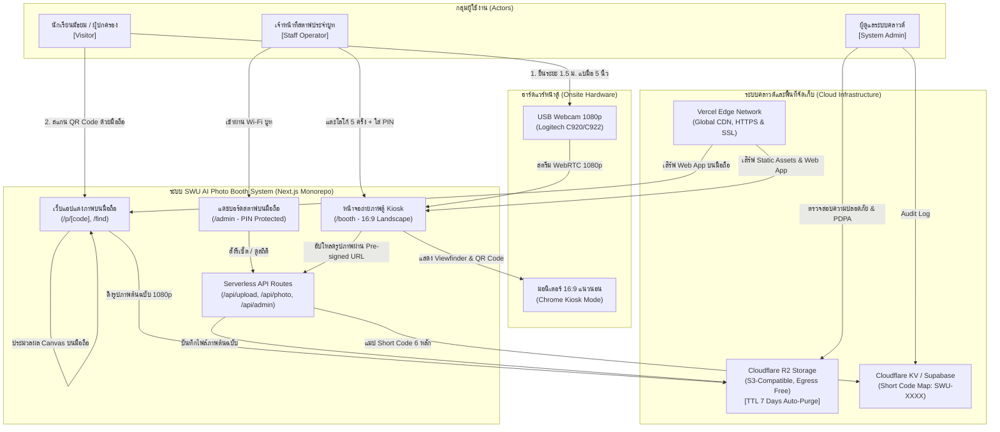

### 1.2 C4 Container Diagram (Frontend, Backend, Cache, Storage & CDN)

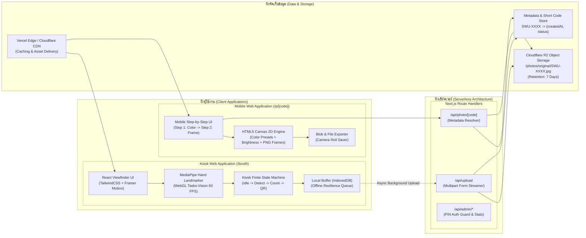

---

## ส่วนที่ 2: สถาปัตยกรรมเชิงลึก (Low-Level Architecture: State Machine & Component Tree)

### 2.1 State Machine ของตู้ถ่ายภาพ (Kiosk Finite State Machine - FSM)
ตู้ทำงานแบบ Stateless & Resilient แยกจากมือถือโดยสิ้นเชิง:

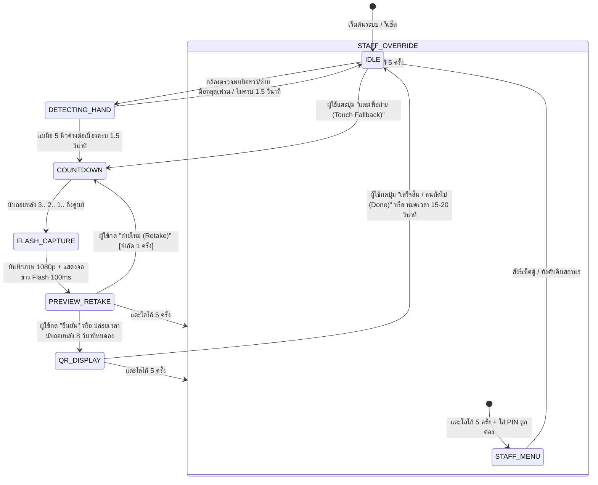

---

## ส่วนที่ 3: แผนผังเส้นทางการใช้งานของผู้ใช้แต่ละกลุ่ม (User Flow Diagrams)

### 3.1 Visitor Flow: เส้นทางการถ่ายรูปและดาวน์โหลดของนักเรียน/ผู้ปกครอง

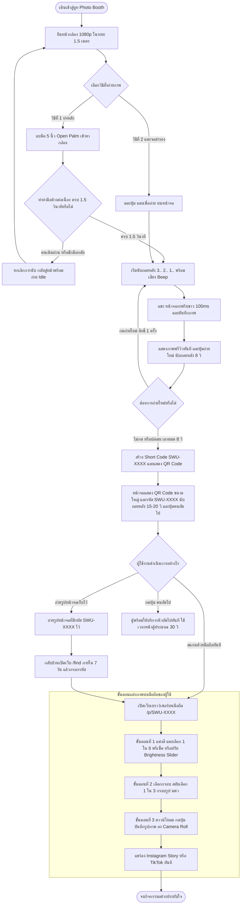

### 3.2 Staff Flow: เส้นทางการปฏิบัติงานและการควบคุมของสตาฟประจำบูท

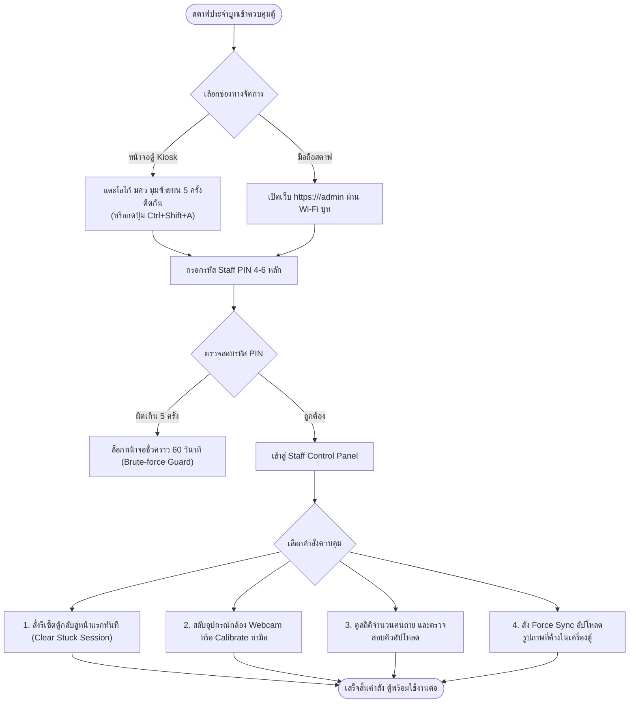

### 3.3 Admin Flow: การทำลายข้อมูลอัตโนมัติ 7 วันตามมาตรฐาน PDPA

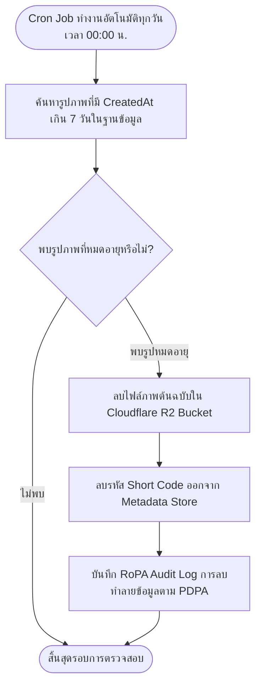

---

## ส่วนที่ 4: ลำดับการทำงานของกระบวนการสำคัญ (Sequence Diagrams)

### 4.1 Sequence 01: Touchless Hand Gesture Capture & Countdown Loop
กระบวนการตรวจจับท่าทางมือแบบ Real-time:

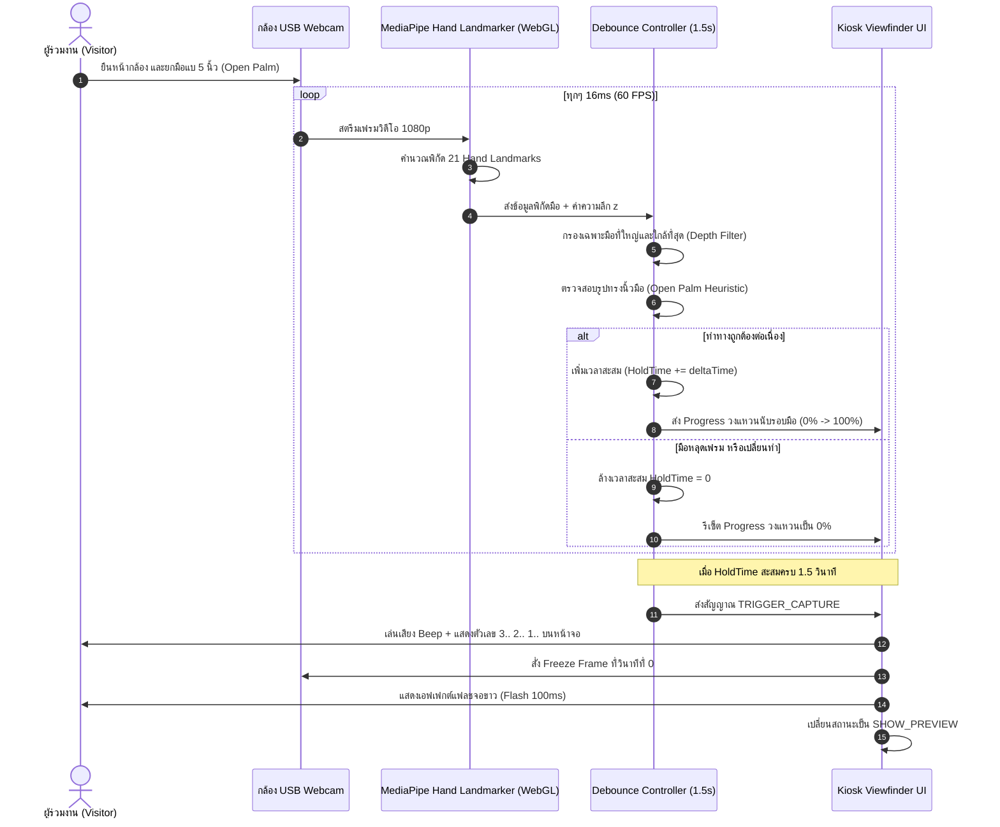

### 4.2 Sequence 02: Image Capture, Preview & 5-8s Retake Logic
กระบวนการพรีวิวและการให้โอกาสถ่ายแก้ตัว:

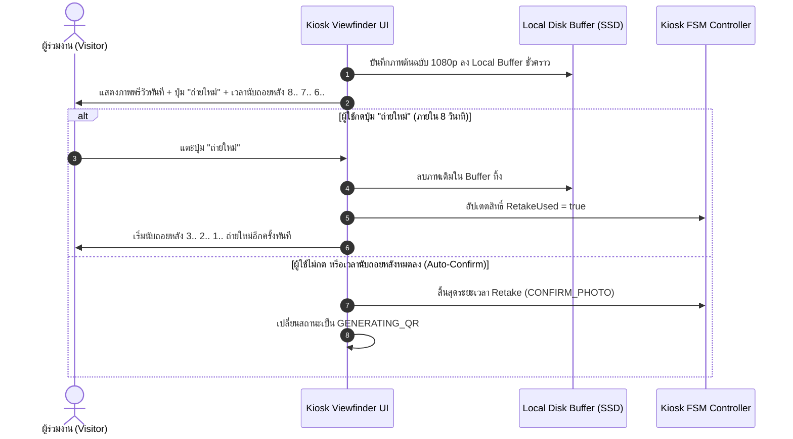

### 4.3 Sequence 03: Storage Upload, Short Code & QR Generation (พร้อม Offline Fallback)
การออกรหัสสั้นและการประกันความเสถียรกรณีเน็ตหลุด:

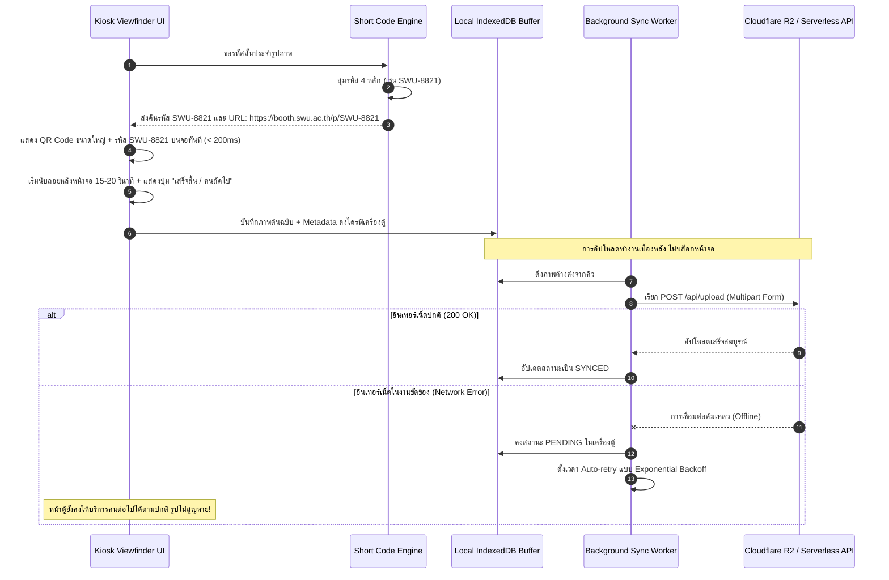

### 4.4 Sequence 04: Mobile Customization (6 Presets + Brightness + 3 Frames + Download)
ขั้นตอนการแต่งภาพบนสมาร์ตโฟนของผู้ใช้งาน:

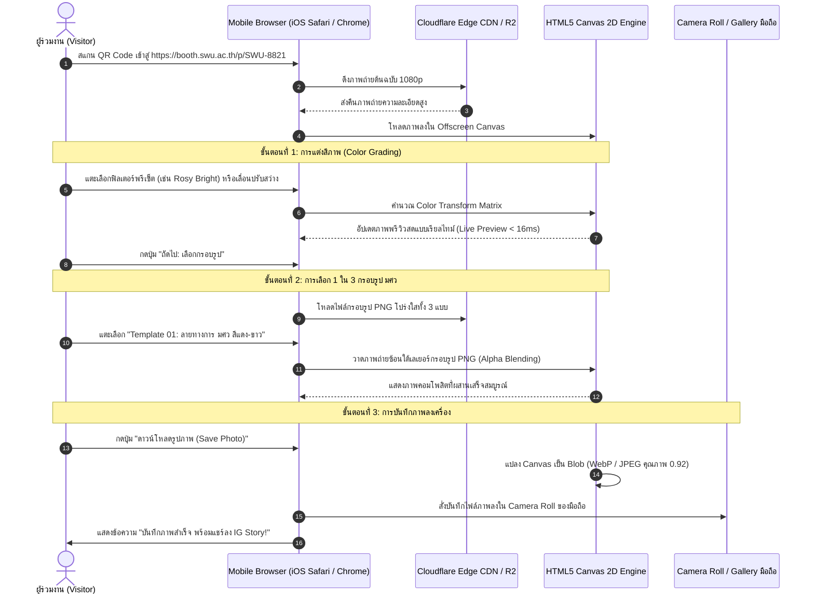

### 4.5 Sequence 05: Retroactive Photo Retrieval (`/find`) & 7-Day Expiry Check
การค้นหาภาพถ่ายย้อนหลังด้วยรหัส 6 หลัก:

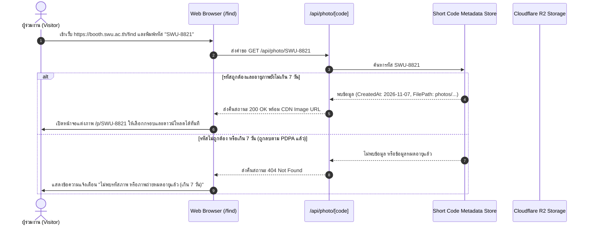

### 4.6 Sequence 06: Staff PIN Authentication & Remote Kiosk Control
การยืนยันตัวตนและการเข้าควบคุมตู้ของสตาฟ:

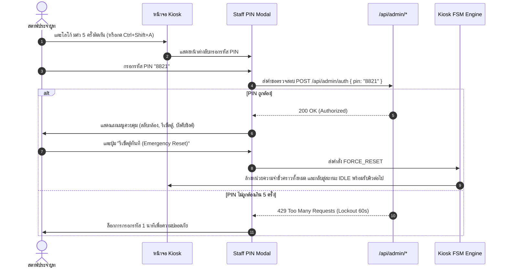

---

## ส่วนที่ 5: การจัดการข้อผิดพลาดและข้อยกเว้น (Fault Matrix & Error Handling)

| สถานการณ์ขัดข้อง (Fault Scenario) | ผลกระทบที่เกิดขึ้น | วิธีการตรวจจับและการจัดการ (Detection & Recovery) | การแสดงผลที่ผู้ใช้เห็น |
| :--- | :--- | :--- | :--- |
| **1. กล้อง USB หลุด หรือสายหลวม** | หน้าจอ Viewfinder มืดดำ | ดักจับ WebRTC `track.onended` event | แสดงหน้าจอแจ้งเตือนสีส้ม: *"กล้องขัดข้อง กำลังเชื่อมต่อใหม่..."* พร้อมแจ้งเตือนสตาฟ |
| **2. ผู้ใช้เดินหนีหลังถ่ายเสร็จ** | ตู้ค้างที่หน้าพรีวิว | ตัวนับถอยหลัง Timeout 8 วินาทีในหน้าพรีวิว | หมดเวลา 8 วิ จะข้ามไปแสดง QR Code 15 วินาที แล้วรีเซ็ตกลับหน้าแรกเองโดยอัตโนมัติ |
| **3. สัญญาณ Wi-Fi ในฮอลล์ดับ** | อัปโหลดขึ้น Cloudflare R2 ไม่ได้ | API Fetch โยนข้อผิดพลาด `NetworkError` | สวิตช์เข้าสู่ **Offline Mode**: บันทึกลงไดรฟ์ตู้ โชว์ QR Code ทันที และมี Sync Queue คอยอัปโหลดเมื่อเน็ตมา |
| **4. แสงไฟในบูทมืดเกินไป** | MediaPipe จับข้อมือไม่ติด | Landmark Detection Confidence < 0.6 ติดต่อกัน 3 วินาที | แสดงปุ่มขนาดใหญ่บนหน้าจอ: *"แตะตรงนี้เพื่อถ่ายรูป (Tap to capture)"* เป็นทางเลือกสำรอง |
| **5. สแกน QR ไม่ทันใน 15 วินาที** | หน้าจอตู้รีเซ็ตกลับหน้าแรกแล้ว | สื่อสารให้ผู้ใช้ถ่ายรูปหน้าจอไว้ล่วงหน้า | ผู้ใช้สามารถนำรหัส 6 หลักบนหน้าจอไปกรอกในหน้า `/find` เพื่อโหลดรูปได้ตลอด 7 วัน |
