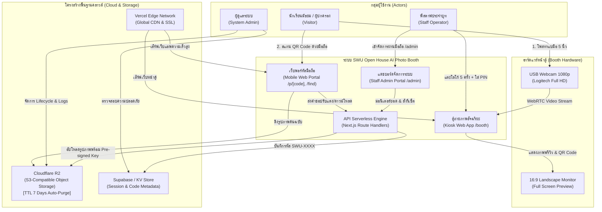
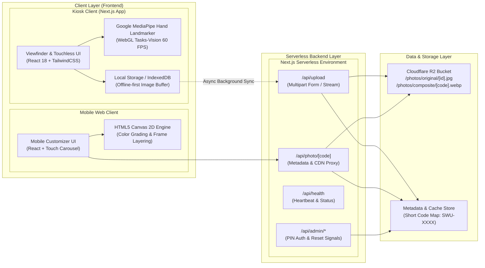
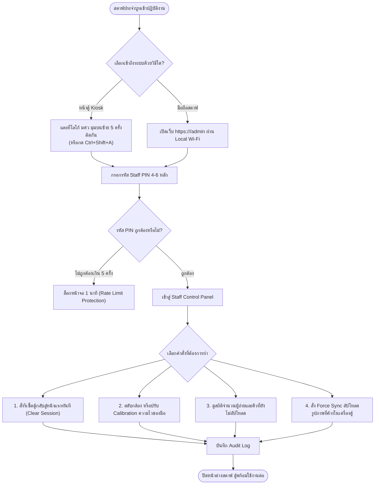
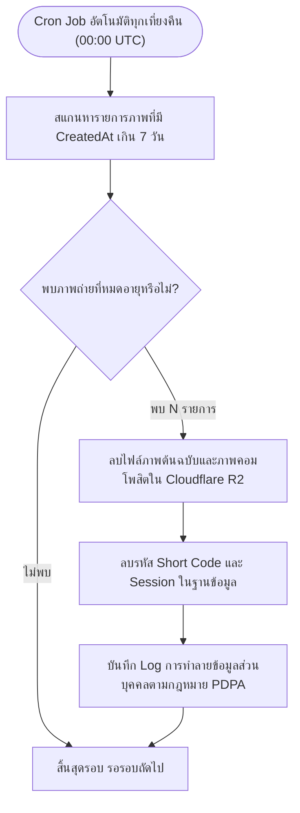
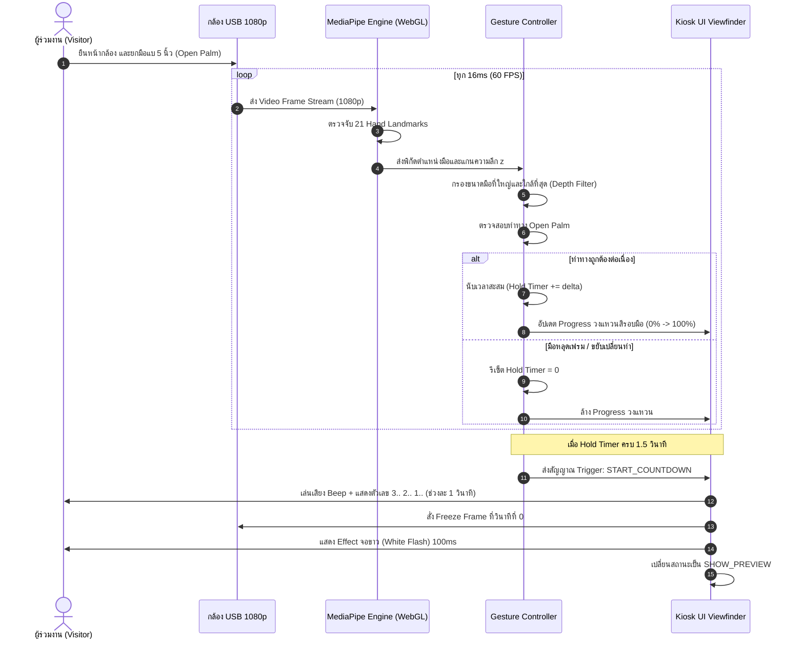
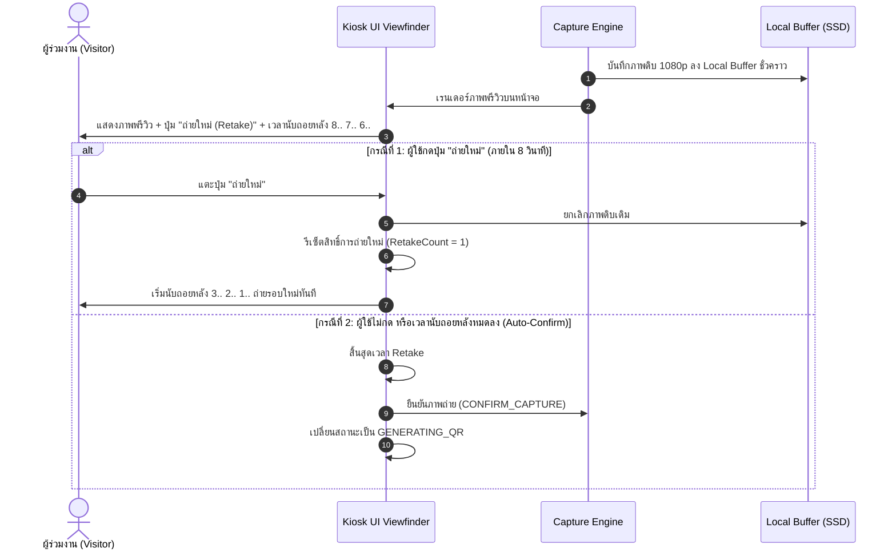
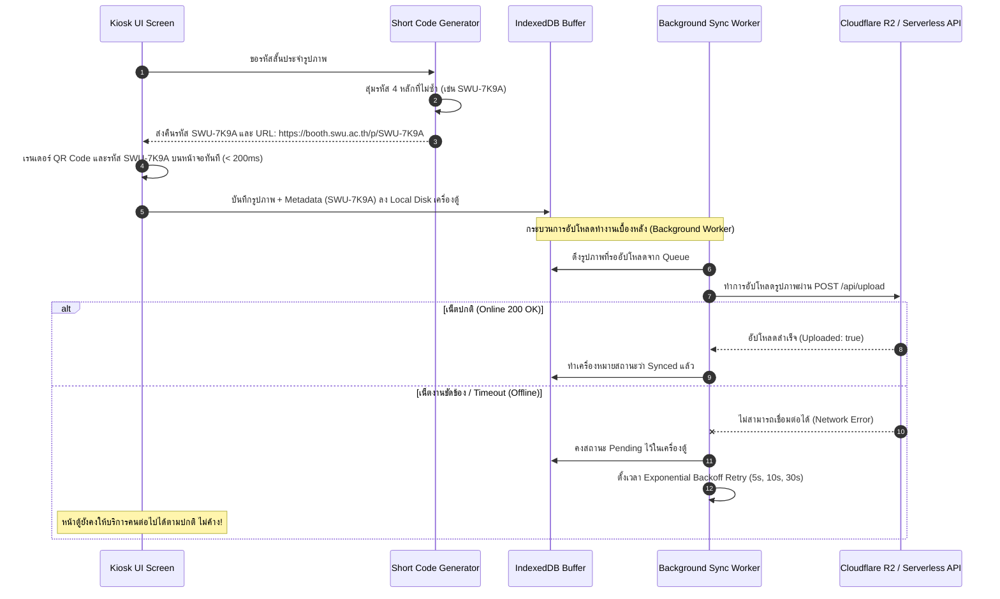
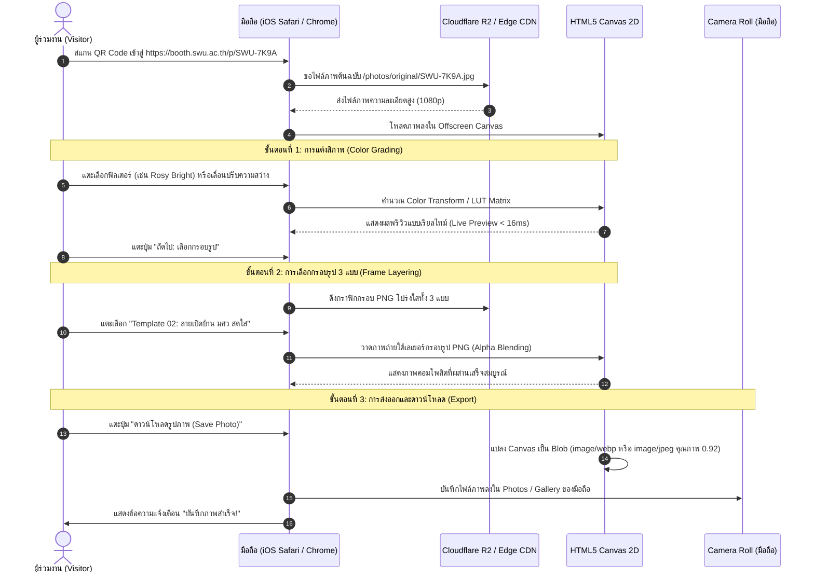
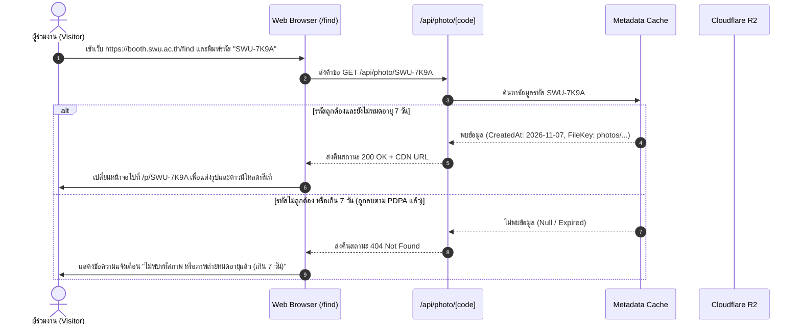
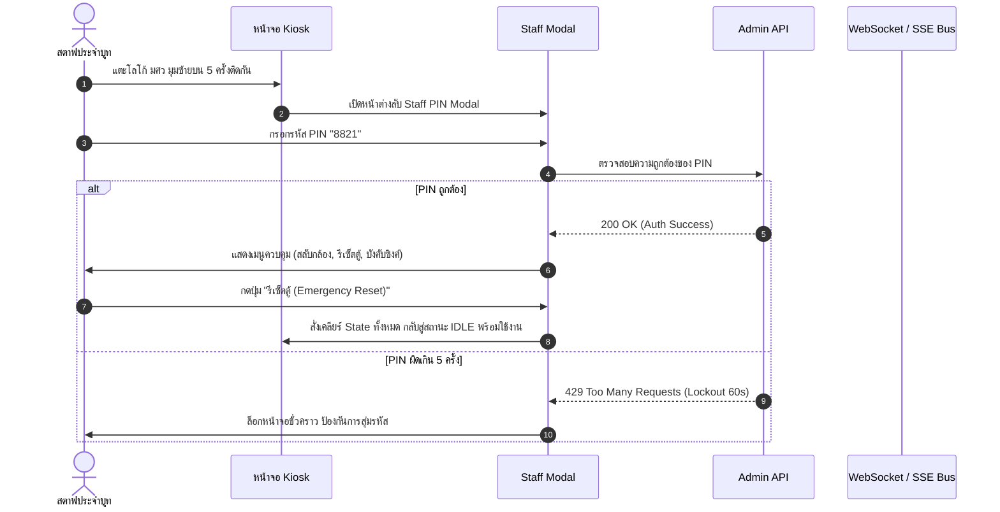

# สถาปัตยกรรมระบบ แผนผังเส้นทางผู้ใช้ และลำดับการทำงาน (System Architecture, User Flow & Sequence Diagrams)
**โครงการ**: SWU Open House - AI Photo Booth & Event Experience Platform  
**เวอร์ชัน**: 1.0 (Comprehensive Engineering Design)  
**วันที่**: 7 พฤศจิกายน 2026  
**มาตรฐานอ้างอิง**:
- **IEEE 1016-2009** (Standard for Information Technology - Systems Design - Software Design Descriptions)
- **C4 Model** for Visualizing Software Architecture
- **UML 2.5** (Unified Modeling Language - Sequence & Activity Diagrams)

---

## 📑 สารบัญ (Table of Contents)
1. [ส่วนที่ 1: ภาพรวมสถาปัตยกรรมระบบ (High-Level System Architecture - C4 Context & Container)](#ส่วนที่-1-ภาพรวมสถาปัตยกรรมระบบ-high-level-system-architecture)
2. [ส่วนที่ 2: สถาปัตยกรรมเชิงลึก (Low-Level Architecture - Components & Data Flow)](#ส่วนที่-2-สถาปัตยกรรมเชิงลึก-low-level-architecture)
3. [ส่วนที่ 3: แผนผังเส้นทางการใช้งานของผู้ใช้แต่ละกลุ่ม (User Flow Diagrams)](#ส่วนที่-3-แผนผังเส้นทางการใช้งานของผู้ใช้แต่ละกลุ่ม-user-flow-diagrams)
   - 3.1 Flow สำหรับผู้ร่วมงาน / นักเรียน / ผู้ปกครอง (Visitor Flow)
   - 3.2 Flow สำหรับสตาฟประจำบูท (Staff Flow)
   - 3.3 Flow สำหรับผู้ดูแลระบบ (Admin Flow)
4. [ส่วนที่ 4: ลำดับการทำงานของกระบวนการสำคัญ (Sequence Diagrams)](#ส่วนที่-4-ลำดับการทำงานของกระบวนการสำคัญ-sequence-diagrams)
   - 4.1 Sequence 01: Touchless Hand Gesture Capture & Countdown Loop
   - 4.2 Sequence 02: Image Capture, Preview & Retake Logic
   - 4.3 Sequence 03: Storage Upload, Short Code & QR Generation (พร้อม Offline Fallback)
   - 4.4 Sequence 04: Mobile Customization (Color Grading + 3 Frame Templates + Download)
   - 4.5 Sequence 05: Retroactive Photo Retrieval (`/find`) & Open House Verification
   - 4.6 Sequence 06: Staff PIN Authentication & Remote Kiosk Control
5. [ส่วนที่ 5: การจัดการข้อผิดพลาดและข้อยกเว้น (Error Handling & Edge Cases)](#ส่วนที่-5-การจัดการข้อผิดพลาดและข้อยกเว้น-error-handling--edge-cases)

---

## ส่วนที่ 1: ภาพรวมสถาปัตยกรรมระบบ (High-Level System Architecture)

### 1.1 C4 System Context Diagram
แผนผังแสดงบริบทของระบบ ผู้ใช้งานทุกกลุ่ม และการเชื่อมต่อกับระบบภายนอก:



### 1.2 C4 Container Diagram
แผนผังโครงสร้าง Container และเทคโนโลยีที่ใช้ในแต่ละส่วน:



---

## ส่วนที่ 2: สถาปัตยกรรมเชิงลึก (Low-Level Architecture & Components)

### 2.1 โครงสร้างคอมโพเนนต์และการจัดเก็บไฟล์ (Next.js Component Tree)

```text
src/
├── app/
│   ├── layout.tsx                 # Root Layout (Fonts, Locale Context)
│   ├── page.tsx                   # Landing Page / Redirection
│   ├── booth/
│   │   └── page.tsx               # Kiosk Viewfinder Screen (Full Screen 16:9)
│   ├── p/
│   │   └── [code]/
│   │       └── page.tsx           # Mobile Customization & Download Screen
│   ├── find/
│   │   └── page.tsx               # Retroactive Short Code Lookup Page
│   ├── admin/
│   │   └── page.tsx               # Staff Mobile Management Dashboard
│   └── api/
│       ├── upload/route.ts        # Image Upload Endpoint (with Pre-signed URLs)
│       ├── photo/[code]/route.ts  # Photo Lookup & CDN URL Resolver
│       └── admin/
│           ├── stats/route.ts     # Real-time Visitor Stats
│           └── reset/route.ts     # Kiosk Reset Signal Dispatcher
├── components/
│   ├── kiosk/
│   │   ├── CameraStream.tsx       # WebRTC getUserMedia Component
│   │   ├── HandLandmarkCanvas.tsx # Visual Hand Skeletal Overlay
│   │   ├── CountdownOverlay.tsx   # 3..2..1.. Timer & White Flash
│   │   ├── RetakeTimerModal.tsx   # 5-8s Preview & Retake Button
│   │   ├── QRCodeDisplay.tsx      # SVG QR Code & Short Code Banner
│   │   └── StaffSecretModal.tsx   # Hidden Trigger PIN Modal
│   ├── mobile/
│   │   ├── ColorFilterSlider.tsx  # 6 Presets + Brightness Adjuster
│   │   ├── FrameSelector.tsx      # 3 Pre-made SWU Frame Selector
│   │   ├── CanvasCompositor.tsx   # High-resolution Layering Canvas
│   │   └── DownloadButton.tsx     # Native Camera Roll Saver
│   └── common/
│       ├── LanguageToggle.tsx     # TH | EN Switcher
│       └── PrivacyNoticeModal.tsx # PDPA Consent Banner
└── lib/
    ├── mediapipe/
    │   └── handLandmarker.ts      # WebGL MediaPipe Hand Detection Engine
    ├── gesture/
    │   ├── classifier.ts          # Open Palm & Multi-pose Keypoint Heuristics
    │   └── debounceController.ts  # 1.5s Hold Duration Filter
    ├── storage/
    │   ├── offlineQueue.ts        # IndexedDB Offline Sync Buffer
    │   └── r2Client.ts            # Cloudflare R2 S3 Client SDK
    └── utils/
        ├── shortCode.ts           # Non-ambiguous 6-char Code Generator
        └── dateExpiry.ts          # PDPA 7-day TTL Date Calculator
```

---

## ส่วนที่ 3: แผนผังเส้นทางการใช้งานของผู้ใช้แต่ละกลุ่ม (User Flow Diagrams)

### 3.1 User Flow สำหรับผู้ร่วมงาน (Visitor Journey)
แสดงเส้นทาง Happy Path และ Unhappy Path เมื่อเกิดเหตุขัดข้อง:

```mermaid
flowchart TD
    Start(["ผู้ใช้เดินเข้ามาหน้าตู้ Photo Booth"]) --> StandFront["ยืนหน้ากล้องในระยะ 1.2 - 2.0 เมตร"]
    StandFront --> DetectMode{"เลือกสั่งถ่ายภาพด้วยวิธีใด?"}
    
    DetectMode -->|วิธีหลัก: AI Gesture| PoseHand["แบมือ 5 นิ้ว (Open Palm) เข้าหากล้อง"]
    DetectMode -->|วิธีสำรอง: Touch| TapScreen["แตะปุ่ม 'แตะเพื่อถ่าย' บนหน้าจอ"]

    PoseHand --> HoldCheck{"ทำท่ามือค้างต่อเนื่อง<br>ครบ 1.5 วินาทีหรือไม่?"}
    HoldCheck -->|ไม่ครบ / คนเดินผ่าน| ResetPose["ยกเลิกการนับ กลับสู่สถานะรอ (Idle)"]
    ResetPose --> StandFront
    HoldCheck -->|ครบ 1.5 วิ| StartCountdown["เริ่มนับถอยหลัง Visual Timer 3.. 2.. 1.."]
    TapScreen --> StartCountdown

    StartCountdown --> FlashCapture["แชะ! หน้าจอกะพริบ Flash 100ms และบันทึกภาพ"]
    FlashCapture --> ShowPreview["แสดงภาพพรีวิวทันที + ปุ่ม 'ถ่ายใหม่' (นับถอยหลัง 5-8 วิ)"]

    ShowPreview --> RetakeCheck{"ผู้ใช้ต้องการถ่ายใหม่หรือไม่?"}
    RetakeCheck -->|กดถ่ายใหม่ (สิทธิ์ 1 ครั้ง)| StartCountdown
    RetakeCheck -->|ไม่กด / ปล่อยเวลาหมด| GenQR["สร้าง Short Code (SWU-XXXX) และแสดง QR Code"]

    GenQR --> ScanOrNote{"ผู้ใช้เลือกรับภาพอย่างไร?"}
    ScanOrNote -->|สแกนทันที| MobileWeb["เปิดเว็บเบราว์เซอร์บนมือถือ (/p/[code])"]
    ScanOrNote -->|สแกนไม่ทัน / เน็ตหมุน| PhotoScreen["ใช้มือถือถ่ายรูปหน้าจอที่มีรหัส SWU-XXXX เก็บไว้"]

    PhotoScreen --> GoHome["เปิดเว็บ /find ภายใน 7 วัน แล้วกรอกรหัส"]
    GoHome --> MobileWeb

    subgraph MobileFlow["ขั้นตอนการแต่งภาพบนมือถือ (ไม่ขวางคิวตู้)"]
        MobileWeb --> Step1["ขั้นตอนที่ 1: เลือกฟิลเตอร์แต่งสี (6 พรีเซ็ต + ปรับสว่าง)"]
        Step1 --> Step2["ขั้นตอนที่ 2: เลือกกรอบรูป มศว (1 ใน 3 แบบ)"]
        Step2 --> Step3["ขั้นตอนที่ 3: กด 'ดาวน์โหลดรูปภาพ' ลง Camera Roll"]
        Step3 --> ShareSocial["แชร์ลง Instagram Story / TikTok พร้อมแฮชแท็ก #SWUOpenHouse"]
    end

    ShareSocial --> End(["เสร็จสิ้นประสบการณ์"])
```

### 3.2 User Flow สำหรับสตาฟประจำบูท (Staff Journey)



### 3.3 User Flow สำหรับผู้ดูแลระบบ (Admin Journey - PDPA Lifecycle)



---

## ส่วนที่ 4: ลำดับการทำงานของกระบวนการสำคัญ (Sequence Diagrams)

### 4.1 Sequence 01: Touchless Hand Gesture Capture & Countdown Loop
ลำดับการทำงานเมื่อผู้ใช้ยกมือสั่งถ่ายภาพ:



### 4.2 Sequence 02: Image Capture, Preview & Retake Logic
ลำดับการตัดสินใจว่าจะถ่ายใหม่หรือส่งออก QR Code:



### 4.3 Sequence 03: Storage Upload, Short Code & QR Generation (พร้อม Offline Fallback)
แสดงความทนทานต่อเน็ตเวิร์ก หากเน็ตในงานดับ ตู้ต้องไม่หยุดทำงาน:



### 4.4 Sequence 04: Mobile Customization (Color Grading + 3 Frame Templates + Download)
ขั้นตอนการแต่งภาพบนสมาร์ตโฟนของผู้ใช้งาน:



### 4.5 Sequence 05: Retroactive Photo Retrieval (`/find`) & Open House Verification
กรณีที่ผู้ใช้ไม่ได้สแกนทันที แต่นำรหัสมากรอกย้อนหลัง:



### 4.6 Sequence 06: Staff PIN Authentication & Remote Kiosk Control
การเข้าควบคุมระบบของสตาฟ:



---

## ส่วนที่ 5: การจัดการข้อผิดพลาดและข้อยกเว้น (Error Handling & Edge Cases)

ตารางสรุปพฤติกรรมของระบบเมื่อเกิดเหตุการณ์ผิดปกติ (Fault Matrix):

| เหตุการณ์ผิดปกติ (Failure Event) | ผลกระทบที่อาจเกิดขึ้น | กลไกการตรวจจับและการจัดการ (Handling Mechanism) | พฤติกรรมที่ผู้ใช้เห็นบนหน้าจอ |
| :--- | :--- | :--- | :--- |
| **1. กล้อง USB หลุด หรือสายหลวม** | หน้าจอ Viewfinder มืดดำ ตู้ถ่ายรูปไม่ได้ | เบราว์เซอร์ตรวจพบ `track.onended` หรือ `devicechange` event | หน้าจอแสดงป้ายสีส้ม: *"กล้องขัดข้อง กรุณาแจ้งเจ้าหน้าที่สตาฟ"* พร้อมส่งเสียงเตือนสตาฟ |
| **2. ผู้ใช้เดินหนีขณะนับถอยหลัง** | กล้องถ่ายรูปพื้นที่ว่างเปล่า ค้างที่หน้าพรีวิว | จับเวลา Timeout ในหน้าพรีวิว 8 วินาที | หากไม่มีใครกดถ่ายใหม่ ระบบจะข้ามไปหน้า QR Code 5 วินาทีแล้วรีเซ็ตกลับหน้าแรกเองอัตโนมัติ |
| **3. สัญญาณอินเทอร์เน็ตในงานดับ** | อัปโหลดรูปขึ้นคลาวด์ไม่ได้ | API Fetch โยนข้อผิดพลาด `TypeError: Failed to fetch` | ระบบจะสวิตช์เข้าสู่ **โหมด Offline อัตโนมัติ**: บันทึกลงไดรฟ์ตู้ โชว์ QR Code ทันที และมี Sync Queue คอย Retry |
| **4. แสงไฟในบูทมืดเกินไป** | MediaPipe ตรวจจับข้อต่อนิ้วมือไม่ติด | Confidence Score ของ Landmarks < 0.6 ติดต่อกันเกิน 3 วินาที | แสดงปุ่มขนาดใหญ่บนหน้าจอ: *"แตะตรงนี้เพื่อถ่ายรูป (Tap to capture)"* เป็นทางเลือกสำรอง |
| **5. เบราว์เซอร์มือถือน้องแบตหมดขณะแต่งภาพ** | ภาพที่กำลังแต่งสีอาจสูญหาย | การแต่งสีทั้งหมดทำแบบ Stateless บนมือถือ | น้องสามารถเปิดลิงก์เดิมบนมือถือเพื่อน หรือเข้า `/find` เพื่อแต่งภาพใหม่ได้ตลอด 7 วัน |
