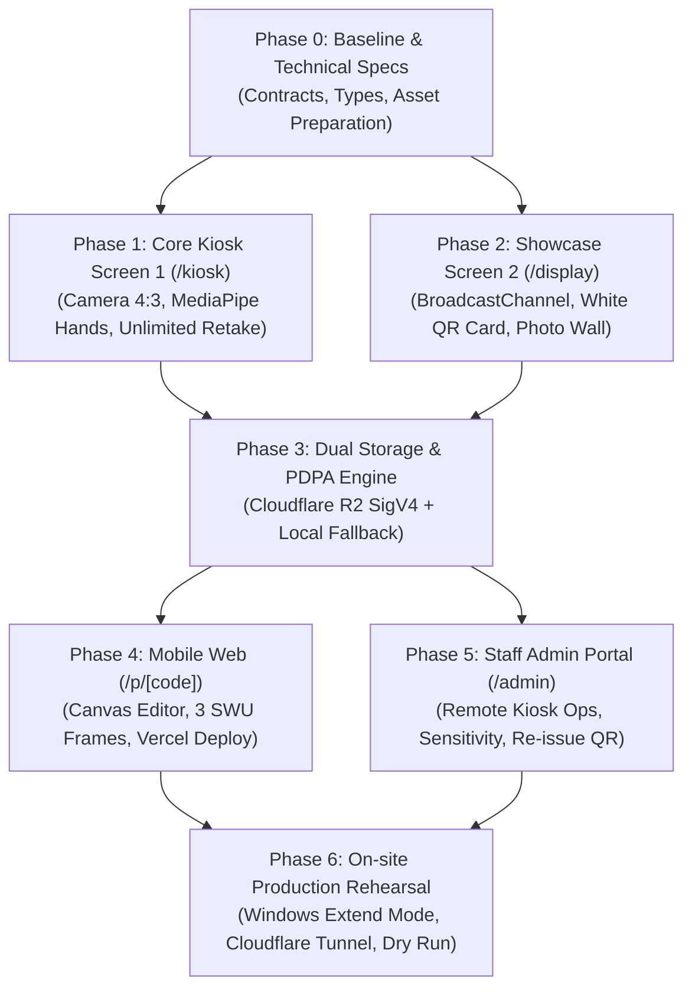

# 🎯 CPE PhotoBooth — Master Execution & Deployment Plan
**โครงการระบบตู้ถ่ายภาพอัจฉริยะไร้สัมผัส (Touchless AI Vision Photo Booth)**  
*ภาควิชาวิศวกรรมคอมพิวเตอร์ คณะวิศวกรรมศาสตร์ มหาวิทยาลัยศรีนครินทรวิโรฒ (SWU CPE Open House 2026)*  
*เอกสารกำกับแผนงานมาตรฐาน: `/make-plan` • `/goal` • `/boost`*

---

## 🧭 1. Goal & Definition of Done (DoD)

### 🎯 Goal Statement
> พัฒนาระบบตู้ถ่ายภาพอัจฉริยะไร้สัมผัส (Touchless Photo Booth) สถาปัตยกรรม 1 แล็ปท็อปขับเคลื่อน 2 จอแสดงผลภายนอก เชื่อมต่อแบบไร้ความหน่วง (<5ms) ผ่าน `BroadcastChannel` พร้อมระบบตรวจจับฝ่ามือด้วย MediaPipe AI โดยสามารถจัดเก็บภาพถ่ายบน Cloudflare R2 อย่างปลอดภัยตามมาตรฐาน PDPA (ลบอัตโนมัติใน 7 วัน) และเปิดให้ผู้เข้าร่วมงานใช้โทรศัพท์มือถือสแกน QR Code เข้าสู่เว็บแอปบน Vercel เพื่อเลือกกรอบรูปทางการ มศว แต่งฟิลเตอร์สี และดาวน์โหลดภาพลงโทรศัพท์ได้ทันทีอย่างไร้รอยต่อ

### ✅ Definition of Done (DoD)
ระบบจะถือว่า **"เสร็จสมบูรณ์พร้อมใช้งานจริง 100%"** เมื่อผ่านเกณฑ์การทดสอบเชิงประจักษ์ (Deterministic Criteria) ดังต่อไปนี้ครบถ้วน:

- [ ] **DoD-1 (Camera & Vision)**: กล้องเว็บแคมเปิดสตรีม 1080p 60fps Center Crop 4:3 (1440×1080) ทำงานเสถียร มีระบบตรวจจับ 3 ชั้น (Normal Vector, 5-Finger Extension, Depth Area > 3.5%) ไม่ถูกกระตุ้นโดยคนเดินผ่าน
- [ ] **DoD-2 (Interaction & Retake)**: แบมือค้าง 1.5 วินาทีเพื่อนับถอยหลัง 3..2..1 ถ่ายภาพ, กำมือเพื่อถ่ายใหม่ได้ไม่จำกัดรอบ (Unlimited Retakes), มี Grace Period 1.2 วินาที และต้องแบมือค้าง 800ms ถึงจะยืนยันส่งรูป
- [ ] **DoD-3 (Dual-Screen Sync)**: เมื่อผู้ใช้ยืนยันรูป หน้าจอที่ 2 (`/display`) จะแสดงภาพถ่ายในการ์ดโพลารอยด์ พร้อมขยาย White QR Card และอัปเดต Live Photo Wall ภายในเวลาไม่เกิน 50ms
- [ ] **DoD-4 (Cloud Storage & PDPA)**: รูปถ่ายถูกส่งขึ้น Cloudflare R2 (SigV4 Native) พร้อมบันทึกสำรองใน Local NVMe มีระบบตั้งเวลาทำลายไฟล์ทิ้งอัตโนมัติภายใน 7 วัน
- [ ] **DoD-5 (Mobile Web App)**: หน้าเว็บมือถือ (`/p/[code]`) เปิดผ่าน 4G/5G ได้รวดเร็ว (<1.5s), แต่งภาพด้วย 6 ฟิลเตอร์และ 3 กรอบทางการ มศว บน Canvas 2D ได้ลื่นไหล และดาวน์โหลดภาพลง Camera Roll สำเร็จ
- [ ] **DoD-6 (Staff Control & Recovery)**: หน้าจอแดชบอร์ดสตาฟ (`/admin`) สามารถสั่งงานตู้ (ข้าม Preview, รีเซ็ตตู้, พักบูธ) และออก QR Code ซ้ำให้น้องที่ทำรหัสหายได้ทันที
- [ ] **DoD-7 (UI & Brand Consistency)**: อินเทอร์เฟซทั้งหมดใช้ธีม "สีเทา-แดง มศว" (`#16181E` / `#1C1F26` / `#20242D` + `#CE1126`), ไร้อิโมจิ, คลีน มินิมอล ระดับ Production-Grade

---

## 🗺️ 2. ภาพรวมแผนผังงาน (Architecture & Dependency Roadmap)



---

## 🚀 3. รายละเอียดแผนงานรายเฟส (Phased Implementation Plan)

### 📌 Phase 0: Baseline & Documentation Discovery
*เป้าหมาย: กำหนด Contract มาตรฐาน, ตรวจสอบ Typescript, และจัดเตรียม Assets ให้พร้อมสำหรับการคอมไพล์*

* **สิ่งที่ต้องตรวจสอบและเตรียมความพร้อม**:
  - ตรวจสอบ [`web/lib/contracts.ts`](file:///c:/Users/satit/OneDrive/Desktop/PhotoBooth-OpenHouseSWU/web/lib/contracts.ts): ตรวจสอบสถานะ FSM `KioskState`, โครงสร้าง `PhotoRecord`, และประเภทเฟรม `CPEFrameTemplateId`
  - ตรวจสอบ Asset Templates ใน `web/public/templates/` และ `web/public/frames/` (กรอบ 3 แบบ)
  - ตรวจสอบไฟล์โมเดล MediaPipe WASM และ Weights ใน `web/public/models/`
* **Anti-Pattern Guards**:
  - ❌ ห้าม import `@aws-sdk/client-s3` (ใช้ Native Node.js SigV4 เพื่อประหยัดขนาด Bundle)
  - ❌ ห้ามใช้ Emoji ในข้อความแจ้งเตือนหรือปุ่ม UI
* **คำสั่งตรวจสอบ (Verification Command)**:
  ```powershell
  node web/scripts/setup-assets.mjs
  npx tsc -p web/tsconfig.json --noEmit
  ```

---

### 📌 Phase 1: Core Kiosk Screen 1 (`/kiosk`)
*เป้าหมาย: ตู้ถ่ายภาพจอหลัก 16:9 ไกด์ 4:3, อัลกอริทึมฝ่ามือ AI, ลูปถ่ายใหม่ไม่จำกัดรอบ, และ Grace Period*

* **เนื้องานหลัก**:
  1. **Camera Feed & 4:3 Mathematical Center-Crop**: ตรวจสอบการดึงวิดีโอ 1080p และฟังก์ชันตัดภาพตรงกลาง 1440×1080 ให้ได้สัดส่วนภาพถ่ายมาตรฐาน
  2. **AI Gesture Pipeline**: เชื่อมต่อ 3-Stage Filter (หงายมือเข้าหากล้อง, กางนิ้ว 5 นิ้ว > 75%, พื้นที่มือ > 3.5%) ป้องกันเสียงรบกวนจากคนเดินผ่าน
  3. **Unlimited Retake Loop**: เมื่อเข้าสู่หน้าพรีวิว กำมือ (`Fist`) เพื่อเริ่มนับถอยหลังถ่ายใหม่ได้ตลอดเวลา
  4. **Grace Period & Deliberate Confirmation**: ล็อก Gesture 1.2 วินาทีแรกเมื่อเข้าหน้าพรีวิว และต้องแบมือค้าง 800ms ถึงจะส่งรูป
  5. **ธีมสีเทา มศว**: พื้นหลัง `#16181E` / `#20242D`, เสาขวามินิมอล 3 ขั้นตอน ไร้อิโมจิ
* **ไฟล์ที่เกี่ยวข้อง**: [`web/app/kiosk/page.tsx`](file:///c:/Users/satit/OneDrive/Desktop/PhotoBooth-OpenHouseSWU/web/app/kiosk/page.tsx), [`web/components/HandMesh.tsx`](file:///c:/Users/satit/OneDrive/Desktop/PhotoBooth-OpenHouseSWU/web/components/HandMesh.tsx)
* **คำสั่งตรวจสอบ (Verification Command)**:
  ```powershell
  # รันชุดทดสอบ Kiosk FSM และ Gesture Classifier
  node web/scripts/verify-prototype.mjs
  ```

---

### 📌 Phase 2: Showcase Screen 2 (`/display`)
*เป้าหมาย: จอแสดงผลสาธารณะ แบ่งสัดส่วน 30/70 (โพลารอยด์ + White QR Card รับรูปทางซ้าย, Photo Wall ทางขวา)*

* **เนื้องานหลัก**:
  1. **BroadcastChannel Listener**: ดักจับ Event `PHOTO_CAPTURED` จากตู้เพื่ออัปเดตทันทีแบบ Zero-Latency (<5ms)
  2. **White QR Station (30% ซ้าย)**: เรนเดอร์การ์ด QR สีขาวตรงกลาง สแกนติดง่าย ชี้ไปยัง URL ของน้อง
  3. **Live Polaroid Showcase**: แสดงรูปถ่ายล่าสุดเอียง -2 องศา สไตล์โพลารอยด์สุดคลาสสิก
  4. **Live Photo Wall (70% ขวา)**: กริดแกลเลอรีรูปถ่ายทั้งหมดที่ถ่ายไปแล้ว พร้อมไฮไลต์ขอบรูปใหม่
  5. **Hydration Safe**: ป้องกันปัญหา SSR Clock / QR Mismatch ด้วย `isMounted` Guard
* **ไฟล์ที่เกี่ยวข้อง**: [`web/app/display/page.tsx`](file:///c:/Users/satit/OneDrive/Desktop/PhotoBooth-OpenHouseSWU/web/app/display/page.tsx)
* **คำสั่งตรวจสอบ (Verification Command)**:
  ```powershell
  # ทดสอบการเรนเดอร์และสร้างหน้า Static
  npm run build --prefix web
  ```

---

### 📌 Phase 3: Dual Storage Engine & PDPA Lifecycle
*เป้าหมาย: ระบบจัดเก็บรูปถ่าย 2 ชั้น (Cloudflare R2 + Local Cache) พร้อมระบบทำลายไฟล์อัตโนมัติใน 7 วัน*

* **เนื้องานหลัก**:
  1. **Cloudflare R2 Adapter**: ตรวจสอบการเซ็นต์ AWS SigV4 ใน [`web/lib/storage/CloudflareR2Adapter.ts`](file:///c:/Users/satit/OneDrive/Desktop/PhotoBooth-OpenHouseSWU/web/lib/storage/CloudflareR2Adapter.ts)
  2. **Local Storage Fallback**: หากไม่มีอินเทอร์เน็ตหรือไม่ได้ใส่คีย์ R2 ระบบจะบันทึกลงโฟลเดอร์ `data/photos/` อัตโนมัติ รูปไม่หาย 100%
  3. **Short Code Generator**: สุ่มรหัส `OPH-SWU###` ไม่ซ้ำกันและตรวจสอบความถูกต้อง
  4. **PDPA Auto-Purge**: กำหนดค่า Lifecycle Rules บน Cloudflare R2 ให้ลบ Object เมื่ออายุครบ 7 วัน
* **คำสั่งตรวจสอบ (Verification Command)**:
  ```powershell
  # รันสคริปต์ทดสอบการเชื่อมต่อ Cloudflare R2
  node web/scripts/test-r2-connection.mjs
  ```

---

### 📌 Phase 4: Mobile Web App (`/p/[code]` & `/find`)
*เป้าหมาย: เว็บแอปสำหรับผู้เข้าร่วมงาน เปิดดูรูป แต่งกรอบ มศว และดาวน์โหลดลงเครื่อง*

* **เนื้องานหลัก**:
  1. **Mobile Canvas Editor**: หน้าเว็บ [`web/app/p/[code]/page.tsx`](file:///c:/Users/satit/OneDrive/Desktop/PhotoBooth-OpenHouseSWU/web/app/p/[code]/page.tsx) รองรับการแสดงผลทุกหน้าจอมือถือ
  2. **3 Official SWU Frames**: กรอบตราสัญลักษณ์ มศว, กรอบ Cyber CPE, และกรอบฟิล์มโพลารอยด์
  3. **6 Filter Presets & Brightness**: ฟิลเตอร์สีโทนอุ่น, วินเทจ, โทนเย็น, โรสโกลด์, ขาวดำ
  4. **Save to Camera Roll**: รวมภาพ กรอบ และฟิลเตอร์ เรนเดอร์ผ่าน Canvas และบันทึกเป็น `.jpg` ลงเครื่อง
  5. **Find My Photo (`/find`)**: หน้าค้นหารูปย้อนหลังสำหรับผู้ที่ทำรหัสหายหรือสแกนไม่ทัน
* **แผนการ Deploy**: นำส่วนนี้ Deploy ขึ้น **Vercel** เพื่อรองรับการสแกนพร้อมกันนับพันคนได้อย่างลื่นไหล

---

### 📌 Phase 5: Staff Admin Portal (`/admin`)
*เป้าหมาย: หน้าจอควบคุมตู้ระยะไกลและสถานีบริการออก QR Code ซ้ำ สำหรับสตาฟบนจอ Laptop*

* **เนื้องานหลัก**:
  1. **PIN Security Gate**: ล็อกหน้าจอด้วยรหัสผ่าน PIN (ค่าเริ่มต้น: `1234`)
  2. **Remote Kiosk Control**: ปุ่มกดข้าม Preview, ปุ่มรีเซ็ตตู้เป็น Standby, ปุ่มสั่งจำลองถ่าย, และปุ่มพักบูธชั่วคราว
  3. **Re-issue QR Station**: กล่องค้นหารูปภาพและปุ่มกดแสดง QR Code ซ้ำบนจอ Laptop ให้น้องที่ทำรหัสหายสแกนได้ทันที
  4. **Sensitivity Slider**: แถบปรับเกณฑ์ขนาดฝ่ามือ (`Hand Area Threshold`) ปรับตามสภาพแสงและระยะยืนหน้างาน
  5. **Dynamic Public Domain**: ช่องกรอก Domain สำหรับ QR Code เปลี่ยน URL ได้ทันทีโดยไม่ต้องแก้โค้ด
* **ไฟล์ที่เกี่ยวข้อง**: [`web/app/admin/page.tsx`](file:///c:/Users/satit/OneDrive/Desktop/PhotoBooth-OpenHouseSWU/web/app/admin/page.tsx)

---

### 📌 Phase 6: On-site Production Rehearsal (วันจัดงานจริง)
*เป้าหมาย: ติดตั้งฮาร์ดแวร์ จัดสายสัญญาณ ตั้งค่า Multi-Display และซักซ้อมเสมือนจริง*

* **แผนผังขั้นตอนปฏิบัติการวันงาน (Morning SOP)**:
  1. **Hardware Setup**: ตั้งขาตั้งกล้องเว็บแคมให้อยู่ระดับสายตา (สูง ~1.4 - 1.5 เมตร), เชื่อมต่อสาย HDMI จอ 1 และ จอ 2 เข้ากับ Laptop, เปิดไฟ Softbox
  2. **Windows Extend Display**: กด `Win + P` -> เลือก `Extend` -> จัดลำดับจอซ้าย-กลาง-ขวาให้ถูกต้อง
  3. **Run Server**: เปิด Terminal รัน `npm start` (พอร์ต 3000)
  4. **Open Browsers**:
     - หน้าต่าง Chrome 1: `http://localhost:3000/kiosk` -> ลากไปจอ 1 -> กด `F11`
     - หน้าต่าง Chrome 2: `http://localhost:3000/display` -> ลากไปจอ 2 -> กด `F11`
     - หน้าต่าง Chrome 3: `http://localhost:3000/admin` -> เปิดไว้บนจอ Laptop สตาฟ
  5. **Network / Cloudflare Tunnel**:
     - หากใช้ Cloudflare Tunnel ให้รันคำสั่ง `cloudflared tunnel --url http://localhost:3000`
     - นำ URL ที่ได้ไปใส่ในช่อง Public Domain บนหน้า `/admin`
  6. **Dry-Run Rehearsal**: สตาฟทดสอบถ่ายจริง 3 รูป ทดสอบกำมือถ่ายใหม่ แบมือยืนยัน และนำมือถือ 4G/5G สแกนรับรูป

---

## 🛡️ 4. Anti-Pattern Guards & Risk Matrix (ข้อห้ามและแผนสำรอง)

| ความเสี่ยงหน้างาน | ระดับความเสี่ยง | มาตรการป้องกัน / แผนรับมือฉุกเฉิน |
| :--- | :---: | :--- |
| **สัญญาณ Wi-Fi มหาวิทยาลัยหลุด** | สูง | ระบบมี **Local Storage Fallback** บันทึกลงเครื่อง Laptop ทันที รูปไม่สูญหาย และสามารถกู้คืนส่งขึ้นคลาวด์ย้อนหลังได้ |
| **คนต่อแถวยาว คิวสะสม** | ปานกลาง | สตาฟสามารถกดปุ่ม **"ข้าม Preview"** บนหน้าแดชบอร์ด `/admin` หรือกดคีย์บอร์ด **`P`** เพื่อส่งรูปเข้าจอ 2 ทันทีโดยไม่ต้องรอ 10 วินาที |
| **แสงสว่างไม่พอ ตรวจจับมือยาก** | ปานกลาง | ใช้ไฟ Studio Ring Light หรือ Softbox ส่องสว่างตรงจุดยืน และปรับลด Slider ใน `/admin` เหลือ `2.0%` |
| **คนเดินผ่านข้างหลังทำให้ตู้ลั่นถ่าย** | ต่ำ | ระบบมี **Depth Area Filter** คัดกรองเฉพาะมือที่อยู่ใกล้ (> 3.5%) หากคนแน่น ให้สตาฟปรับ Slider ขึ้นเป็น `4.5% - 5.0%` |
| **น้องทำรหัสหาย หรือสแกนไม่ทัน** | สูง | สตาฟค้นหารูปบนหน้า `/admin` แล้วกด **"ออก QR Code ใหม่"** ให้น้องสแกนจากหน้าจอ Laptop ได้ทันที |
| **กล้องเว็บแคมหลุดการเชื่อมต่อ** | ต่ำ | หน้าตู้มีปุ่มแดง **"เชื่อมต่อกล้องทันที"** หรือสตาฟกดปุ่ม **"เชื่อมต่อกล้องใหม่"** จากหน้า Admin |

---

## 📋 5. Master Action Checklist (สรุปสิ่งที่ต้องทำตามลำดับ)

- [ ] **Step 1 (Cloudflare R2)**: สร้าง Bucket `swu-photobooth`, เปิด Public URL, ตั้งกฎลบ 7 วัน, และนำ API Token ใส่ `web/.env.local`
- [ ] **Step 2 (R2 Verification)**: รัน `node web/scripts/test-r2-connection.mjs` เพื่อยืนยันว่า R2 อัปโหลดได้ 100%
- [ ] **Step 3 (Vercel Deploy)**: นำโปรเจกต์ขึ้น Vercel สำหรับรองรับการเปิดเว็บมือถือของน้องๆ (`/p/[code]`)
- [ ] **Step 4 (Hardware Check)**: เตรียมสายแปลง HDMI/Type-C 2 เส้น, ปลั๊กพ่วง, กล้อง 1080p 60fps, และไฟส่องสว่าง
- [ ] **Step 5 (Dry Run Test)**: ซักซ้อมลูปถ่ายรูป ตรวจสอบเสียง Beep แฟลช และการสแกนรับรูปบนมือถือจริงก่อนเปิดรับน้องๆ ในวันงาน

---
*จัดทำตามมาตรฐานระเบียบวิธี: `/make-plan` • `/goal` • `/boost`*  
*บันทึกสถานะล่าสุด: Git Commit `f021dae` บน Branch `feature/standalone-prototype-suite`*
