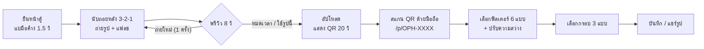

# SWU Open House Photo Booth — Web App (MVP)

เว็บแอปตู้ถ่ายรูปสำหรับงานเปิดบ้าน มศว: ผู้ร่วมงานแบมือหน้ากล้องเพื่อถ่ายรูป สแกน QR รับรูป แล้วแต่งฟิลเตอร์และกรอบรูปต่อบนมือถือของตัวเอง

> พัฒนาบน branch `feature/photo-booth-mvp` — ยังไม่ merge เข้า `main`

## Flow การใช้งาน



## เทคโนโลยีที่ใช้

| ส่วน | เทคโนโลยี | เหตุผล |
|---|---|---|
| หน้าเว็บ + API | Next.js 15 + TypeScript | ทำ frontend และ backend ในโปรเจกต์เดียว ตามเอกสาร Task 01 |
| จับท่ามือ | MediaPipe Hand Landmarker | มีโมเดลจุดบนมือ 21 จุดพร้อมใช้ รันบน GPU ในเบราว์เซอร์ แม่นกว่าและง่ายกว่า OpenCV |
| QR Code | `qrcode` | สร้าง QR ฝั่งเบราว์เซอร์ |
| ฟิลเตอร์ + กรอบ | HTML5 Canvas | ไม่ต้องโหลด library หนักบนมือถือ |
| เก็บรูป | ไฟล์ในเครื่องตู้ (`web/data/`) | MVP ใช้ในเครื่องก่อน ภายหลังย้ายไป Cloudflare R2 |

## หน้าเว็บ

### หน้าตู้ `/kiosk` — เปิดบนคอมที่ต่อกล้อง
1. เปิดกล้อง แสดงภาพแบบกระจก
2. ตรวจจับมือ เลือกเฉพาะมือที่ใหญ่/ใกล้กล้องที่สุด (ตัดคนเดินผ่านด้านหลัง)
3. แบมือค้าง **1.5 วินาที** → มีวงแสดงความคืบหน้า (มีปุ่มแตะถ่ายสำรอง)
4. นับถอยหลัง 3..2..1 พร้อมเสียงบี๊บ → ถ่าย + จอกะพริบขาว (แฟลช)
5. พรีวิว **8 วินาที** มีปุ่ม "ถ่ายใหม่" ได้ **1 ครั้ง**
6. อัปโหลดรูป → แสดง **QR ขนาดใหญ่ 20 วินาที** (ไม่แสดงรหัสตัวอักษรบนจอตู้) + ปุ่ม "คนถัดไป"
7. แจ้งเตือนสตาฟเมื่อไม่พบกล้องหรือไม่ได้รับสิทธิ์ใช้กล้อง

### หน้ามือถือ `/p/OPH-XXXX` — เปิดจากการสแกน QR
- แสดงรหัส **OPH-XXXX** ที่หัวเว็บ (จดไว้ดึงรูปย้อนหลังได้ 7 วัน)
- **ฟิลเตอร์ 6 แบบ**: Original, Warm, Cool Minimal, Film Vintage, Classic B&W, Rosy Bright (หน้าใสอมชมพู)
- **แถบปรับความสว่าง** -30% ถึง +30%
- **กรอบรูป 3 แบบ**: มศว แดง-ขาว (Classic), การ์ตูนเปิดบ้านสดใส (Youthful), ฟิล์มเกาหลี (Photostrip)
- ปุ่ม **บันทึกรูป** (JPEG คุณภาพ 0.92) และ **แชร์** (iOS เลือก "บันทึกรูปภาพ" ลงอัลบั้มได้)

## API

| Method | Path | หน้าที่ |
|---|---|---|
| `POST` | `/api/photos` | รับรูปจากตู้ สร้างรหัส `OPH-XXXX` ที่ไม่ซ้ำ บันทึกไฟล์ |
| `GET` | `/api/photos/OPH-XXXX` | ส่งรูปให้มือถือ ถ้าเกิน 7 วันตอบ `410 Gone` (PDPA) |
| `GET` | `/api/config` | บอก URL ของเครื่องตู้ในวง LAN สำหรับใส่ใน QR |

รหัสสั้นใช้ตัวอักษร `A-Z` และ `2-9` โดยตัด `0, O, 1, I` ออกเพื่อไม่ให้สับสน · รูปที่เกิน 7 วันจะถูกลบอัตโนมัติ

## วิธีรัน

ต้องมี [Node.js LTS](https://nodejs.org) ก่อน

```powershell
cd web
npm install
npm run dev
```

| เปิดที่ | ใช้ทำอะไร |
|---|---|
| http://localhost:3000 | หน้าแรก |
| http://localhost:3000/kiosk | หน้าตู้ (เปิดบนคอมที่ต่อกล้อง) |

- `npm run dev` จะรัน `scripts/setup-assets.mjs` ก่อนทุกครั้ง เพื่อคัดลอกไฟล์ MediaPipe และโหลดโมเดลจับมือ (~8 MB) มาไว้ใน `public/mediapipe/` — ต้องมีเน็ตแค่ครั้งแรก
- **มือถือต้องต่อ Wi-Fi วงเดียวกับคอมตู้** QR จะชี้ไปที่ IP ของคอม เช่น `http://192.168.1.10:3000/p/OPH-AB12`
- ครั้งแรก Windows อาจถามสิทธิ์ Firewall ให้กด **Allow**

## โครงสร้างโฟลเดอร์

```
web/
├── app/
│   ├── page.tsx              หน้าแรก
│   ├── kiosk/page.tsx        หน้าตู้ (กล้อง + จับท่ามือ + QR)
│   ├── p/[code]/page.tsx     หน้ามือถือ (ฟิลเตอร์ + กรอบ + บันทึก)
│   └── api/
│       ├── photos/           อัปโหลด / ดึงรูป
│       └── config/           URL ของเครื่องตู้
├── lib/                      logic กลาง (จับท่ามือ, รหัสสั้น, จัดเก็บไฟล์, ฟิลเตอร์, กรอบ)
├── scripts/setup-assets.mjs  เตรียมไฟล์ MediaPipe
├── public/mediapipe/         ไฟล์โมเดล (สร้างอัตโนมัติ ไม่ commit)
└── data/                     รูปที่ถ่าย (ไม่ commit — ข้อมูลส่วนบุคคล PDPA)
```

## ลำดับการพัฒนา

| ขั้น | งาน | สถานะ |
|---|---|---|
| 1 | ตั้งโปรเจกต์ Next.js + ติดตั้ง library | ✅ เสร็จ |
| 2 | หน้าตู้: เปิดกล้อง + จับท่ามือ + วงความคืบหน้า (ทดสอบกล้องจริง) | ⬜ |
| 3 | ครบเส้นทาง: นับถอยหลัง → ถ่าย → พรีวิว → อัปโหลด → QR → มือถือเห็นรูป | ⬜ |
| 4 | ฟิลเตอร์ 6 แบบ + แถบปรับความสว่าง | ⬜ |
| 5 | กรอบรูป 3 แบบ + บันทึก/แชร์ | ⬜ |
| 6 | ลบรูปอัตโนมัติ 7 วัน, หน้าแจ้ง error, ปรับหน้าตา | ⬜ |

ทุกขั้น commit บน branch นี้ และทดสอบรันก่อนไปขั้นถัดไป

## ยังไม่ทำในรอบ MVP

- **Cloudflare R2** — ตอนนี้เก็บรูปในเครื่องตู้ (ต้องมีบัญชี + key ก่อน)
- **หน้า `/admin` ของสตาฟ** — ดูรูปย้อนหลังแล้วเปิด QR ใหม่ให้น้องที่สแกนไม่ทัน
- **สลับภาษา TH / EN**
- **โลโก้และกรอบ มศว ของจริง** — ตอนนี้วาดกรอบด้วยโค้ด ถ้ามีไฟล์ PNG จะเปลี่ยนมาใช้แทน

## เอกสารที่เกี่ยวข้อง

- [Requirements Specification (Task 01)](../ducument-sathit/task01/task-01-requirements-specification.md)
- [Architecture & Sequence Flow (Task 01)](../ducument-sathit/task01/system-architecture-and-sequence-flow.md)
- [Task Backlog](../ducument-sathit/TASK_BACKLOG.md)
